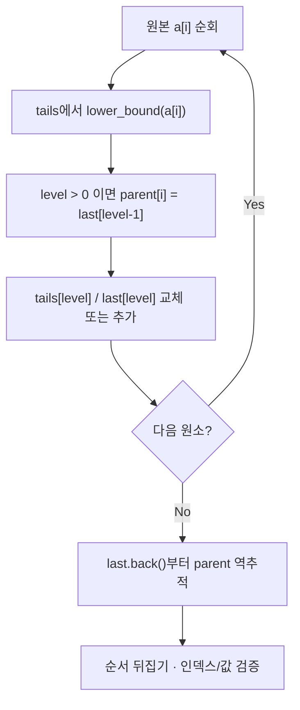

# Notion 학습 원본 보존

원본: https://app.notion.com/p/3fba99703f40810c9932c71907fd5cc4

> 이 파일은 프로토타입 시점의 Notion 원문입니다. 변환 시 누락 여부 확인과 링크 추적용입니다.

<callout icon="📈" color="blue_bg">
	**AL 03 · LIS (Longest Increasing Subsequence) — 엄격 증가 부분수열과 복원**
	<mention-date start="2026-10-17"/>. 원본 알고리즘 강의의 6주차 “이분탐색과 LIS” 미완료 주제를 독립 교재로 재작성했습니다. 기존 0\~5주차 원문·그림은 변경하지 않습니다. 선행: <mention-page url="https://app.notion.com/p/3fba99703f40813aae3bc15deefe10f4"/>.
</callout>
## 1. 문제 정의와 범위
길이 N인 정수열에서 **원래 인덱스 순서를 유지하면서 값이 엄격하게 증가**하는 가장 긴 부분수열을 구합니다. 연속할 필요가 없으므로 부분배열(subarray)과 다릅니다. 원소가 같은 경우 증가로 보지 않습니다. 빈 배열의 답은 길이 0입니다.
예시: \[10,9,2,5,3,7,101,18\]의 LIS 길이는 4이며 유효한 복원 결과 중 하나는 \[2,3,7,18\]입니다. 최적 답이 여러 개일 수 있어 특정 인덱스열 하나만을 정답으로 강제하면 안 됩니다.
## 2. 두 접근의 차이
<table fit-page-width="true" header-row="true">
<tr>
<td>방법</td>
<td>상태와 갱신</td>
<td>시간</td>
<td>공간</td>
</tr>
<tr>
<td>DP 기준 해법</td>
<td>dp\[i\]=i에서 끝나는 LIS 길이. 모든 j&lt;i와 비교해 a\[j\]&lt;a\[i\]이면 후보 갱신</td>
<td>O(N²)</td>
<td>O(N)</td>
</tr>
<tr>
<td>Binary Search + tails</td>
<td>tails\[k\]=길이 k+1의 증가 부분수열 중 최소 가능한 마지막 값</td>
<td>O(N log N)</td>
<td>O(N)</td>
</tr>
</table>
tails 자체가 원본의 LIS 인덱스열이라는 뜻은 아닙니다. 현재 값 x에 대해 `lower_bound(tails,x)`를 사용해 최소 끝값을 교체하거나 길이를 늘립니다. **엄격 증가** 조건에서는 lower_bound, 같은 값도 연장하는 비감소 부분수열은 upper_bound 쪽 경계가 대응됩니다. 둘을 바꾸면 중복 원소 테스트에서 틀립니다.
## 3. 실제 수열 복원의 불변식
값만 가진 tails로는 원본 인덱스를 복원하지 못합니다. 각 길이 단계의 마지막 원본 인덱스 `last[level]`과 현재 요소의 직전 인덱스 `parent[i]`를 추가로 보관합니다. 기존 길이를 확장하거나 교체하기 **전에** 해당 단계 앞의 부모를 기록합니다. 마지막 인덱스에서 parent를 역추적하고 순서를 뒤집으면 엄격 증가하며 원본 인덱스가 상승하는 증인이 됩니다.

## 4. 최소 알고리즘 핵심
```c++
std::vector<int> tails;
for (int x : input) {
    auto it = std::lower_bound(tails.begin(), tails.end(), x);
    if (it == tails.end()) tails.push_back(x);
    else *it = x;
}
// tails.size()는 LIS 길이. tails의 원소는 원본 LIS 복원값과 다를 수 있다.
```
이 부분은 길이 계산 코드이며, 실전 전체 예제는 별도 A 소스 페이지에서 인덱스 복원·부모 배열·예외 테스트와 main까지 제공합니다.
## 5. 실패 사례와 코드 계약
- \[4,4,4\]는 길이 1입니다. upper_bound를 사용하면 길이 3처럼 잘못 셀 수 있습니다.
- \[4,3,2,1\]은 길이 1입니다. tails는 반복적으로 낮은 값으로 교체됩니다.
- parent에는 `size_t`의 불가능 인덱스 N을 sentinel로 두고 실제 인덱스처럼 접근하지 않습니다.
- N=0이면 `last.back()`을 호출하지 않고 곧장 빈 결과를 반환합니다.
- 메모리 추가 할당은 O(N); 데이터가 매우 큰 경우 원본 배열과 보조 배열을 모두 고려합니다.
## 6. 게임 개발과의 관련
프레임별 점수·이벤트 레벨·작업 순서에서 원래 발생 순서를 보존한 채 **단조 증가하는 최장 선택**이 필요한 문제를 모델링할 수 있습니다. 단순 프레임 타임 최적화나 이벤트 필터링에 LIS를 무조건 적용하는 것은 아닙니다. 단조 제약과 순서 보존이 실제 요구사항인지 먼저 구별합니다.
## 7. 이해 확인
<details>
<summary>Q. tails 값이 정답 수열 자체가 아닌 이유는?</summary>
	나중에 도착한 작은 값이 같은 길이의 꼬리값을 교체할 수 있기 때문입니다. 정답 인덱스를 얻으려면 parent / last 연결을 사용해야 합니다.
</details>
<details>
<summary>Q. 두 값이 같을 때 새로운 길이로 확장되나요?</summary>
	엄격 증가 LIS에서는 확장되지 않습니다. lower_bound가 같은 위치를 돌려주면 해당 길이의 끝값을 교체합니다.
</details>
<details>
<summary>Q. 길이 O(N log N)와 테스트용 O(N²)의 관계는?</summary>
	최적화된 구현을 독립적인 느린 참조 구현과 비교하는 교차 검증입니다. 제품 경로에서는 O(N log N)을 사용하며 기준 풀이는 테스트에만 둡니다.
</details>
## 검증·출처·개정 이력
<mention-date start="2026-10-17"/> v1.0. GCC14.2 C++20/C++11, Clang17 C++20 ASan/UBSan: 동일한 39,662 `require` 호출 및 CTest 각 1/1. 1,612개 고정/난수 배열을 O(N²) 참조 해와 비교하고 재구성 인덱스·값 단조성도 검사했습니다. 환경별 반복은 독립 검사 개수에 합산하지 않습니다. Windows/MSVC 미실행.
공식/기술 근거: [CP-Algorithms · Longest Increasing Subsequence](https://cp-algorithms.com/dynamic_programming/longest_increasing_subsequence.html) · [cppreference · lower_bound](https://en.cppreference.com/w/cpp/algorithm/lower_bound). C++20 기본, 동일 소스 C++11 빌드 검증.
<page url="https://app.notion.com/p/3fba99703f4081bfb0c5d73831919070">AL03A · LIS 전체 main.cpp · 검증된 원문</page>
## 전체 실행 코드 보관
<mention-page url="https://app.notion.com/p/3fba99703f4081bfb0c5d73831919070">AL03A · LIS 전체 main.cpp · 검증된 원문</mention-page>에 검증된 전체 main.cpp가 저장되어 있습니다. 공용 CMake 및 원시 테스트 로그의 Notion 보관은 다음 단계에서 확인합니다.

---

## 부록 · 전체 소스 원본
<callout icon="📦" color="gray_bg">
	**AL03A · 컴파일·실행된 main.cpp 원본 전체**
	상위 <mention-page url="https://app.notion.com/p/3fba99703f40810c9932c71907fd5cc4">AL 03 · LIS 엄격 증가 부분수열·이분 탐색·인덱스 복원</mention-page>. 아래 C++ 코드는 Linux GCC14.2 C++20/C++11, Clang17 ASan/UBSan에서 실제 테스트한 바이트와 FNV64 체크섬이 동일합니다. 원시 로그와 CMake는 별도 AL03–05 공용 보관 페이지에서 연결합니다.
</callout>
# al03_lis/main.cpp
```c++
// AL03 Longest Increasing Subsequence: length and reconstructable witness.
// C++11-compliant; C++20 also tested. CPU-only reference model.
#include <algorithm>
#include <cstddef>
#include <iostream>
#include <random>
#include <stdexcept>
#include <vector>

namespace al03 {
// O(n log n) time, O(n) space. Strictly increasing (not nondecreasing).
std::vector<std::size_t> lis_indices(const std::vector<int>& a) {
    const std::size_t n = a.size();
    std::vector<int> tails;
    std::vector<std::size_t> last;
    std::vector<std::size_t> parent(n, n);  // n is our sentinel.
    tails.reserve(n);
    last.reserve(n);
    for (std::size_t i = 0; i < n; ++i) {
        const std::size_t level = static_cast<std::size_t>(
            std::lower_bound(tails.begin(), tails.end(), a[i]) - tails.begin());
        if (level > 0) parent[i] = last[level - 1];
        if (level == tails.size()) {
            tails.push_back(a[i]);
            last.push_back(i);
        } else {
            tails[level] = a[i];
            last[level] = i;
        }
    }
    std::vector<std::size_t> result;
    if (last.empty()) return result;
    for (std::size_t i = last.back(); i != n; i = parent[i]) result.push_back(i);
    std::reverse(result.begin(), result.end());
    return result;
}

// Independent O(n^2) oracle used only for test, not the optimized solution.
std::size_t quadratic_lis_length(const std::vector<int>& a) {
    if (a.empty()) return 0;
    std::vector<std::size_t> dp(a.size(), 1);
    std::size_t best = 1;
    for (std::size_t i = 0; i < a.size(); ++i) {
        for (std::size_t j = 0; j < i; ++j) {
            if (a[j] < a[i]) dp[i] = std::max(dp[i], dp[j] + 1);
        }
        best = std::max(best, dp[i]);
    }
    return best;
}
}

struct Tester {
    std::size_t checks = 0;
    void require(bool ok, const char* message) {
        ++checks;
        if (!ok) throw std::runtime_error(message);
    }
};

int main() {
    try {
        Tester t;
        const std::vector<std::vector<int> > fixed = {
            {}, {3}, {1,1,1,1}, {1,2,3,4}, {4,3,2,1},
            {10,9,2,5,3,7,101,18}, {-9,-9,-2,-7,3}, {2,2,3,1,4,4},
            {5,1,4,2,3}, {-3,-2,-1,-1,0}, {0,-1,0,-1,0}, {7,7,7}
        };
        std::mt19937 rng(20261017);
        std::uniform_int_distribution<int> len(0, 75);
        std::uniform_int_distribution<int> value(-40, 40);
        for (std::size_t round = 0; round < fixed.size() + 1600; ++round) {
            std::vector<int> a;
            if (round < fixed.size()) a = fixed[round];
            else {
                const int n = len(rng);
                for (int i = 0; i < n; ++i) a.push_back(value(rng));
            }
            const std::vector<std::size_t> indices = al03::lis_indices(a);
            t.require(indices.size() == al03::quadratic_lis_length(a), "LIS length mismatch");
            for (std::size_t j = 0; j < indices.size(); ++j) {
                t.require(indices[j] < a.size(), "LIS index range");
                if (j != 0) {
                    t.require(indices[j-1] < indices[j], "LIS original order");
                    t.require(a[indices[j-1]] < a[indices[j]], "LIS strict order");
                }
            }
        }
        const std::vector<int> nums = {10, 9, 2, 5, 3, 7, 101, 18};
        t.require(al03::lis_indices(nums).size() == 4, "classic LIS length");
        t.require(al03::lis_indices(std::vector<int>{5,5,5}).size() == 1,
                  "duplicates should NOT extend strict LIS");
        std::cout << "PASS AL03 LIS; checks=" << t.checks << "\n";
        return 0;
    } catch (const std::exception& e) {
        std::cerr << "FAIL AL03 " << e.what() << '\n';
        return 1;
    }
}
```
원본 바이트 수: `3706`. FNV64: `45474acb19a4dd5d`. SHA-256: `8c8e652bda6c814a4e657153c26cffeb4759e08278c4e17dfb74673b370e39be`.
테스트 범위: 고정 배열 12개와 난수 배열 1600개, 39,662 require 호출. 메인 진입점 포함. Windows/MSVC 미실행.
