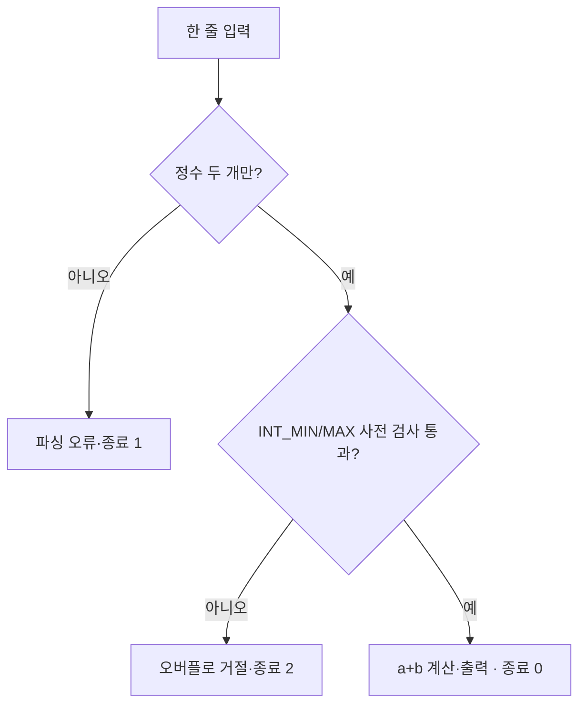

<b>2026-10-19 11시 보관 완료 검수(아래의 과거 미완료 문구보다 우선):</b> main.cpp 1605B, CMakeLists.txt 439B, GCC20·GCC11·ClangSan 각 Configure/Build/CTest stdout 9종 원시 코드의 길이와 FNV64가 모두 로컬 파일 원본과 일치했습니다. stderr 9종은 원본 0바이트·빈 SHA-256으로 기록했습니다. Notion 네이티브 코드 보존 완료이며 별도 파일 첨부 다운로드 검증 및 Windows·DX11/GPU·Unity Editor 실행은 미검증입니다.

## 정의와 전제

C++ 부호 있는 정수 덧셈이 표현 범위를 벗어나면 미정의 동작이므로 연산 전에 범위를 검증해야 합니다. 두 정수만 입력받고 나머지 토큰은 거절합니다.

## 검증 상태

Linux GCC C++20·11, Clang C++20 ASan/UBSan CTest가 각각 1/1 통과했습니다. 원시 로그의 Notion 영구 보관과 Windows 검증은 아직 미완료입니다.

## 전체 main.cpp · C++11/20

원본 UTF-8 1605바이트, SHA-256 <code>080a288ec894cda4e71018588879d1726e56aed11d0e17c8830e81e3e04828c9</code>.

```c++
// C01 portable CPU example: C++11 and C++20, no Windows/GPU API.
#include <climits>
#include <iostream>
#include <sstream>
#include <string>

bool checkedAdd(int a, int b, int& result) {
    if ((b > 0 && a > INT_MAX - b) || (b < 0 && a < INT_MIN - b))
        return false;
    result = a + b;
    return true;
}
bool parse(const std::string& text, int& a, int& b) {
    std::istringstream in(text);
    if (!(in >> a >> b)) return false;
    std::string extra;
    return !(in >> extra);
}
int selftest() {
    int v = 0, a = 0, b = 0;
    const bool t[] = {
        checkedAdd(1, 2, v) && v == 3,
        checkedAdd(-3, -4, v) && v == -7,
        !checkedAdd(INT_MAX, 1, v),
        !checkedAdd(INT_MIN, -1, v),
        checkedAdd(INT_MAX, 0, v) && v == INT_MAX,
        checkedAdd(INT_MIN, 0, v) && v == INT_MIN,
        parse("1 2", a, b) && a == 1 && b == 2,
        !parse("1 bad", a, b),
        !parse("1 2 extra", a, b),
        !parse("", a, b)
    };
    for (unsigned i = 0; i < sizeof(t) / sizeof(t[0]); ++i) {
        if (!t[i]) { std::cerr << "FAIL condition " << i << '\n'; return 1; }
    }
    std::cout << "PASS 10 independent conditions\n";
    return 0;
}
int main(int argc, char** argv) {
    if (argc == 2 && std::string(argv[1]) == "--test") return selftest();
    if (argc != 1) return 2;
    std::string line;
    if (!std::getline(std::cin, line)) return 1;
    int a = 0, b = 0, v = 0;
    if (!parse(line, a, b)) { std::cerr << "invalid input\n"; return 1; }
    if (!checkedAdd(a, b, v)) { std::cerr << "overflow\n"; return 2; }
    std::cout << v << '\n';
    return 0;
}
```

## CMakeLists.txt 전체 원문 · 439바이트

SHA-256 <code>0ba3ac77d8c56004556c45f11861803f3774a9734f9a86826658b14652ce4c48</code>. 파일은 <code>main.cpp</code> 옆에 저장합니다.

```javascript
cmake_minimum_required(VERSION 3.16)
project(C01_CheckedAdd LANGUAGES CXX)
set(CXX_LEVEL 20 CACHE STRING "11 or 20")
set(CMAKE_CXX_STANDARD ${CXX_LEVEL})
set(CMAKE_CXX_STANDARD_REQUIRED ON)
set(CMAKE_CXX_EXTENSIONS OFF)
add_executable(c01 main.cpp)
if(CMAKE_CXX_COMPILER_ID MATCHES "GNU|Clang")
  target_compile_options(c01 PRIVATE -Wall -Wextra -Wpedantic -Werror)
endif()
enable_testing()
add_test(NAME C01CheckedAdd COMMAND c01 --test)
```

## 빌드·CTest 실행 명령

```bash
cmake -S . -B build_gcc20 -DCMAKE_CXX_COMPILER=g++ -DCXX_LEVEL=20 -DCMAKE_BUILD_TYPE=Debug
cmake --build build_gcc20
ctest --test-dir build_gcc20 -V
cmake -S . -B build_gcc11 -DCMAKE_CXX_COMPILER=g++ -DCXX_LEVEL=11 -DCMAKE_BUILD_TYPE=Debug
cmake --build build_gcc11
ctest --test-dir build_gcc11 -V
cmake -S . -B build_clangsan -DCMAKE_CXX_COMPILER=clang++ -DCXX_LEVEL=20 -DCMAKE_BUILD_TYPE=Debug -DCMAKE_CXX_FLAGS="-fsanitize=address,undefined -fno-omit-frame-pointer" -DCMAKE_EXE_LINKER_FLAGS="-fsanitize=address,undefined"
cmake --build build_clangsan
ctest --test-dir build_clangsan -V
```

각 환경 빌드는 별도 디렉터리입니다. Windows/MSVC/DX9/DX11·GPU·Unity 실행은 하지 않았습니다.

## 원리·좌표형 학습 다이어그램



<code>b>0</code>에서는 <code>a>INT_MAX-b</code>, <code>b<0</code>에서는 <code>a<INT_MIN-b</code>를 검사합니다. 두 비교에 사용한 뺄셈은 분기 전제 때문에 표현 가능한 정수 범위 내에 있으며, 범위 검사가 실패하면 <code>result=a+b</code>에 도달하지 않습니다. 이 실습은 <b>C++11과 C++20 모두 호환</b>하며 C++20 전용 타입을 사용하지 않습니다.

## 비교표 · 실패 경계

<table fit-page-width="true" header-row="true">
<tr>
<td>
방법
</td>
<td>
입력·연산 정책
</td>
<td>
제약
</td>
</tr>
<tr>
<td>
<code>int sum=a+b</code> 이후 비교
</td>
<td>
오버플로 발생 이후 검사
</td>
<td>
C++ signed UB이므로 거부
</td>
</tr>
<tr>
<td>
사전 <code>checkedAdd</code>
</td>
<td>
int 범위 안에서만 합산
</td>
<td>
게임별 최대 자원·통화 정책은 별도
</td>
</tr>
<tr>
<td>
<code>std::istringstream</code>
</td>
<td>
두 정수 이외 추가 토큰 거부
</td>
<td>
여백 허용, 로케일·인코딩 별도
</td>
</tr>
<tr>
<td>
기존 C01 C11 <code>scanf</code>
</td>
<td>
할당 개수 확인·int64\_t 확장 후 합산
</td>
<td>
입력 토큰 자체의 범위 초과 방어 미포함
</td>
</tr>
</table>

## 반례·게임 개발 적용

- <code>INT_MAX+1</code>과 <code>INT_MIN-1</code>을 <b>실제로 계산하지 않고</b>, 함수가 false를 반환하는지 테스트합니다. signed UB가 발생하는 코드를 테스트 코드에서 평가하지 않습니다.
- <code>"1 bad"</code>, <code>"1 2 extra"</code>, 빈 줄은 실패, <code>"1 2   "</code>은 성공합니다. 실패한 <code>checkedAdd</code> 호출은 결과 참조값을 변경하지 않습니다.
- DX9 클라이언트 인벤토리 자원량, 패킷 누적 수치, 경험치 합산에서 반영 전에 범위 검사하면 상태 불변식을 보존하는 데 유용합니다. 동시성, 서버 신뢰, 데이터 단위·게임 경제 상한은 별도 검증이 필요합니다.

## 접힌 이해 확인

<toggle>
Q1. 덧셈 후에 오버플로를 알아내면 안 되나요?

안 됩니다. signed 오버플로 자체가 C++ UB이므로 연산 전 검사해야 합니다.
</toggle>

<toggle>
Q2. 실패 시 출력 인수는?

대입 전 false를 반환하므로 이전 값 그대로입니다.
</toggle>

<toggle>
Q3. 테스트 조건 10개를 세 환경에서 돌렸다면 고유 30개인가요?

아닙니다. 같은 10개 논리 조건을 세 빌드 구성에서 반복했습니다.
</toggle>

## 출처·검증 범위·변경 기록

- [C++ 표준 초안 UB](https://eel.is/c++draft/ub.expr) · [C++ 정수 연산 참고](https://en.cppreference.com/w/cpp/language/operator_arithmetic) · [CMake CTest 공식 문서](https://cmake.org/cmake/help/latest/manual/ctest.1.html).
- <date start="2026-10-19" /> Linux GCC 14.2.0 C++20 CTest <b>1/1 PASS</b>, GCC 14.2.0 C++11 CTest <b>1/1 PASS</b>, Clang 17.0.0 C++20 ASan/UBSan CTest <b>1/1 PASS</b>. 동일 논리 조건 10개 반복; CTest 구성별 반복은 고유 조건으로 중복 계산하지 않습니다.
- 새 소스·CMake는 본문에 저장했고 바이트 SHA-256은 명시했습니다. <b>configure/build/ctest 원시 9개 stdout 및 9개 stderr의 Notion 저장·재조회는 아직 미완료</b>입니다. 플랫폼 Windows/MSVC/D3D9/D3D11/GPU/Unity Editor는 미검증. 기존 삭제 상태 C 원본은 건드리지 않았습니다.

## gcc20 · 실제 원시 Configure/Build/CTest stdout 및 stderr 0B · 2026-10-19

Configure stdout 399B·SHA-256 <code>a8dff25910cef89d16b9b080327b84ab9bee1425c19531cd7b2d8a1c0ef47cf4</code>:

```txt
-- The CXX compiler identification is GNU 14.2.0
-- Detecting CXX compiler ABI info
-- Detecting CXX compiler ABI info - done
-- Check for working CXX compiler: /usr/bin/g++ - skipped
-- Detecting CXX compile features
-- Detecting CXX compile features - done
-- Configuring done (0.4s)
-- Generating done (0.0s)
-- Build files have been written to: /mnt/data/C01_Revision_20261019_11KST/build_gcc20
```

Build stdout 115B·SHA-256 <code>39f2056f4175d4e49d4a9e6e803025abaa9a5b199717637e40cda74b8b740443</code>:

```txt
[ 50%] Building CXX object CMakeFiles/c01.dir/main.cpp.o
[100%] Linking CXX executable c01
[100%] Built target c01
```

CTest stdout 980B·SHA-256 <code>aa3bfab291adbecab9569dab80be1b91d653fd27a78d366e349c892b0ebb3b61</code>:

```txt
Internal ctest changing into directory: /mnt/data/C01_Revision_20261019_11KST/build_gcc20
UpdateCTestConfiguration  from :/mnt/data/C01_Revision_20261019_11KST/build_gcc20/DartConfiguration.tcl
UpdateCTestConfiguration  from :/mnt/data/C01_Revision_20261019_11KST/build_gcc20/DartConfiguration.tcl
Test project /mnt/data/C01_Revision_20261019_11KST/build_gcc20
Constructing a list of tests
Done constructing a list of tests
Updating test list for fixtures
Added 0 tests to meet fixture requirements
Checking test dependency graph...
Checking test dependency graph end
test 1
    Start 1: C01CheckedAdd

1: Test command: /mnt/data/C01_Revision_20261019_11KST/build_gcc20/c01 "--test"
1: Working Directory: /mnt/data/C01_Revision_20261019_11KST/build_gcc20
1: Test timeout computed to be: 10000000
1: PASS 10 independent conditions
1/1 Test #1: C01CheckedAdd ....................   Passed    0.00 sec

100% tests passed, 0 tests failed out of 1

Total Test time (real) =   0.01 sec
```

Configure·Build·CTest stderr 세 파일은 각 0B(빈 SHA-256 <code>e3b0c44298fc1c149afbf4c8996fb92427ae41e4649b934ca495991b7852b855</code>). 이것은 빈 기록이지 로그 누락을 뜻하지 않습니다.

## gcc11 · 실제 원시 Configure/Build/CTest stdout 및 stderr 0B · 2026-10-19

Configure stdout 399B·SHA-256 <code>e72058da4265f427154a79d32f1b1750ca001b445f96a5ddd68eb2aaac32a09d</code>:

```txt
-- The CXX compiler identification is GNU 14.2.0
-- Detecting CXX compiler ABI info
-- Detecting CXX compiler ABI info - done
-- Check for working CXX compiler: /usr/bin/g++ - skipped
-- Detecting CXX compile features
-- Detecting CXX compile features - done
-- Configuring done (0.2s)
-- Generating done (0.0s)
-- Build files have been written to: /mnt/data/C01_Revision_20261019_11KST/build_gcc11
```

Build stdout 115B·SHA-256 <code>39f2056f4175d4e49d4a9e6e803025abaa9a5b199717637e40cda74b8b740443</code>:

```txt
[ 50%] Building CXX object CMakeFiles/c01.dir/main.cpp.o
[100%] Linking CXX executable c01
[100%] Built target c01
```

CTest stdout 980B·SHA-256 <code>667fce683be42ed5344f90bd7f32926c3bd9efe11ed4d7dc1b2afd1c90e86c0f</code>:

```txt
Internal ctest changing into directory: /mnt/data/C01_Revision_20261019_11KST/build_gcc11
UpdateCTestConfiguration  from :/mnt/data/C01_Revision_20261019_11KST/build_gcc11/DartConfiguration.tcl
UpdateCTestConfiguration  from :/mnt/data/C01_Revision_20261019_11KST/build_gcc11/DartConfiguration.tcl
Test project /mnt/data/C01_Revision_20261019_11KST/build_gcc11
Constructing a list of tests
Done constructing a list of tests
Updating test list for fixtures
Added 0 tests to meet fixture requirements
Checking test dependency graph...
Checking test dependency graph end
test 1
    Start 1: C01CheckedAdd

1: Test command: /mnt/data/C01_Revision_20261019_11KST/build_gcc11/c01 "--test"
1: Working Directory: /mnt/data/C01_Revision_20261019_11KST/build_gcc11
1: Test timeout computed to be: 10000000
1: PASS 10 independent conditions
1/1 Test #1: C01CheckedAdd ....................   Passed    0.00 sec

100% tests passed, 0 tests failed out of 1

Total Test time (real) =   0.00 sec
```

Configure·Build·CTest stderr 세 파일은 각 0B(빈 SHA-256 <code>e3b0c44298fc1c149afbf4c8996fb92427ae41e4649b934ca495991b7852b855</code>). 이것은 빈 기록이지 로그 누락을 뜻하지 않습니다.

## clangsan · 실제 원시 Configure/Build/CTest stdout 및 stderr 0B · 2026-10-19

Configure stdout 424B·SHA-256 <code>04f0a794837a8eb5134900d9fec8ad87e40374d049635d606f5f030d759e4bb3</code>:

```txt
-- The CXX compiler identification is Clang 17.0.0
-- Detecting CXX compiler ABI info
-- Detecting CXX compiler ABI info - done
-- Check for working CXX compiler: /usr/local/swift/usr/bin/clang++ - skipped
-- Detecting CXX compile features
-- Detecting CXX compile features - done
-- Configuring done (0.7s)
-- Generating done (0.0s)
-- Build files have been written to: /mnt/data/C01_Revision_20261019_11KST/build_clangsan
```

Build stdout 115B·SHA-256 <code>39f2056f4175d4e49d4a9e6e803025abaa9a5b199717637e40cda74b8b740443</code>:

```txt
[ 50%] Building CXX object CMakeFiles/c01.dir/main.cpp.o
[100%] Linking CXX executable c01
[100%] Built target c01
```

CTest stdout 998B·SHA-256 <code>e0042abdf8e922473f9d84e0939bedeb937ae5302aa63a04a9aa2e154b5dad2e</code>:

```txt
Internal ctest changing into directory: /mnt/data/C01_Revision_20261019_11KST/build_clangsan
UpdateCTestConfiguration  from :/mnt/data/C01_Revision_20261019_11KST/build_clangsan/DartConfiguration.tcl
UpdateCTestConfiguration  from :/mnt/data/C01_Revision_20261019_11KST/build_clangsan/DartConfiguration.tcl
Test project /mnt/data/C01_Revision_20261019_11KST/build_clangsan
Constructing a list of tests
Done constructing a list of tests
Updating test list for fixtures
Added 0 tests to meet fixture requirements
Checking test dependency graph...
Checking test dependency graph end
test 1
    Start 1: C01CheckedAdd

1: Test command: /mnt/data/C01_Revision_20261019_11KST/build_clangsan/c01 "--test"
1: Working Directory: /mnt/data/C01_Revision_20261019_11KST/build_clangsan
1: Test timeout computed to be: 10000000
1: PASS 10 independent conditions
1/1 Test #1: C01CheckedAdd ....................   Passed    0.01 sec

100% tests passed, 0 tests failed out of 1

Total Test time (real) =   0.01 sec
```

Configure·Build·CTest stderr 세 파일은 각 0B(빈 SHA-256 <code>e3b0c44298fc1c149afbf4c8996fb92427ae41e4649b934ca495991b7852b855</code>). 이것은 빈 기록이지 로그 누락을 뜻하지 않습니다.
