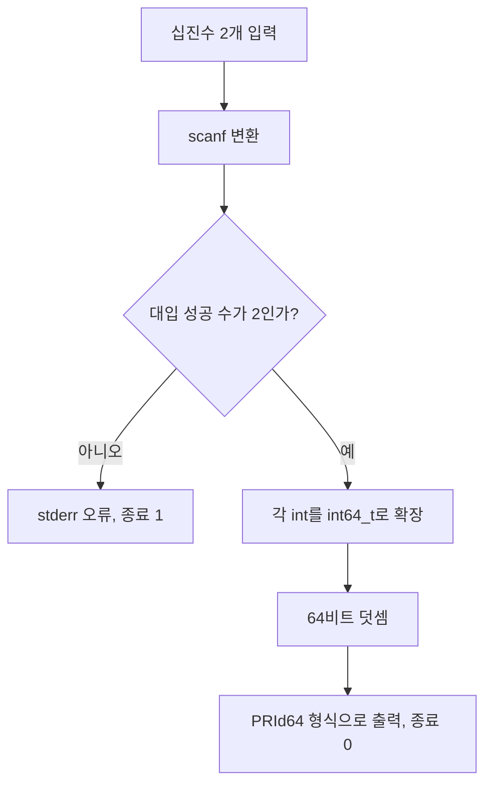

<b>2026-10-18 11시 KST 원시 로그 보관 정정:</b> C01 08시 최초 실행·09시 재실행 18개 중 기존 GCC11 CTest 파일 첨부 1개는 유지하고, 누락되었던 17개를 이 페이지의 네이티브 원시 코드 하위 페이지로 영구 저장했습니다. 17/17개는 원본 파일의 바이트 수·FNV64·코드 끝·부모 연결을 fetch로 재검증했습니다. 기존 파일 첨부 1개는 다운로드 URL까지 확인됐으나 바이트 재다운로드·해시 대조는 미실시입니다. 이번 실행에서 새로 빌드·CTest하지 않았습니다. Windows/MSVC·DirectX/GPU·Unity Editor 실측은 미검증입니다.

> <b>C01 개정 교재 (2026-10-18 KST)</b> — C11과 C++11/20 교차 컴파일 사례. 원래 <code>홍정모 C</code> 페이지는 Notion에서 deleted 상태로 조회되어 원본을 변경하거나 복원하지 않고 별도 페이지에 보존한다. 실제 Windows/MSVC·DirectX·GPU·Unity 실행은 미검증.

## 1. 정의와 전제

<code>scanf("%d %d", &a, &b)</code>의 반환값은 성공적으로 <b>대입한 입력 항목 수</b>이므로 반드시 <code>2</code>인지 확인한다. <code>scanf</code>가 입력 숫자의 모든 범위 초과를 안전하게 처리한다고 가정하면 안 된다. 이 예제는 입력 토큰이 실행 환경의 <code>int</code> 범위 안이고 <code>int64_t</code>가 제공되며 <code>int</code>가 32비트인 환경을 전제로 한다. 두 <code>int</code>를 <b>각각 덧셈 전에</b> <code>int64_t</code>로 확장하여 32비트 두 정수의 합을 표현한다.

## 2. 작동 원리



<table fit-page-width="true" header-row="true">
<tr>
<td>
방법
</td>
<td>
검증 계약
</td>
<td>
주요 실수
</td>
</tr>
<tr>
<td>
scanf(%d)
</td>
<td>
대입 수가 2인지 비교
</td>
<td>
토큰 범위 초과의 안전한 복구를 가정
</td>
</tr>
<tr>
<td>
strtoimax
</td>
<td>
errno·끝 포인터·값 범위
</td>
<td>
뒷문자 또는 부분 파싱 허용
</td>
</tr>
<tr>
<td>
(int64\_t)(a+b)
</td>
<td>
안전하지 않음
</td>
<td>
확장 전 int 오버플로 UB
</td>
</tr>
<tr>
<td>
(int64\_t)a+(int64\_t)b
</td>
<td>
32비트 int 전제에서 안전
</td>
<td>
int가 64비트인 경우 일반화 불가
</td>
</tr>
</table>

## 3. 전체 main.c — C11 및 C++11/20 컴파일 호환

```c
// Strictly demonstrate checking scanf and widening before signed addition.
// C11-compatible, also valid C++11 and C++20.
#include <stdio.h>
#include <stdint.h>
#include <inttypes.h>

int main(void) {
    int a = 0, b = 0;
    if (scanf("%d %d", &a, &b) != 2) {
        fputs("Expected two integers.\n", stderr);
        return 1;
    }
    printf("You entered: %d and %d\n", a, b);
    printf("Sum: %" PRId64 "\n", (int64_t)a + (int64_t)b);
    return 0;
}
```

원본 <code>main.c</code> = 459바이트, SHA-256 = <code>86d23d4ce07c340f971ad01844313928cf4ab8652ea96be111819d7d9c383d02</code>.

## 4. 전체 CMakeLists.txt (Linux Bash/grep 의존)

```txt
cmake_minimum_required(VERSION 3.16)
project(c_input_contract LANGUAGES C CXX)
set(CMAKE_C_STANDARD 11)
set(CMAKE_C_STANDARD_REQUIRED ON)
set(CMAKE_CXX_STANDARD 11 CACHE STRING "C++ version to test")
set(CMAKE_CXX_STANDARD_REQUIRED ON)
add_executable(c_input main.c)
configure_file(main.c ${CMAKE_CURRENT_BINARY_DIR}/main.cpp COPYONLY)
add_executable(cxx_input ${CMAKE_CURRENT_BINARY_DIR}/main.cpp)
enable_testing()
add_test(NAME c_valid COMMAND bash -c "printf '2147483647 1\\n' | '$<TARGET_FILE:c_input>' | grep -q 'Sum: 2147483648'")
add_test(NAME cxx_valid COMMAND bash -c "printf '2147483647 1\\n' | '$<TARGET_FILE:cxx_input>' | grep -q 'Sum: 2147483648'")
add_test(NAME c_invalid COMMAND bash -c "printf 'garbage\\n' | '$<TARGET_FILE:c_input>'")
set_tests_properties(c_invalid PROPERTIES WILL_FAIL TRUE)
```

원본 <code>CMakeLists.txt</code> = 810바이트, SHA-256 = <code>04a539112c93595ff7b65acb648bec2d66ab1bc26111e7f3fbc35c705699a488</code>. <code>WILL_FAIL</code>은 예상되는 오류 종료를 CTest PASS로 처리한다. POSIX 파이프라인의 중간 실행 결과까지 강하게 보장하는 테스트는 아니다.

## 5. 빌드·CTest 재현

```bash
cmake -S . -B build-gcc11 -DCMAKE_CXX_STANDARD=11
cmake --build build-gcc11 --parallel 2
ctest --test-dir build-gcc11 -V
cmake -S . -B build-gcc20 -DCMAKE_CXX_STANDARD=20
cmake --build build-gcc20 --parallel 2
ctest --test-dir build-gcc20 -V
CC=clang CXX=clang++ cmake -S . -B build-clangsan -DCMAKE_CXX_STANDARD=20 -DCMAKE_C_FLAGS='-fsanitize=address,undefined -fno-omit-frame-pointer' -DCMAKE_CXX_FLAGS='-fsanitize=address,undefined -fno-omit-frame-pointer'
cmake --build build-clangsan --parallel 2
ctest --test-dir build-clangsan -V
```

<b>2026-10-18 09시 KST 이전 실행 로그의 실측 기록</b>: GCC 14.2 C11/C++11 3/3, GCC 14.2 C11/C++20 3/3, Clang 17 ASan/UBSan C11/C++20 3/3 PASS. 동일 테스트 정의 3종을 환경별로 반복하므로 독립 설계 3종. <b>이번 페이지 게시 실행에서 재컴파일한 것은 아님</b>. 원시 로그의 상태는 상단 2026-10-18 11시 후속 보관 기록이 우선합니다. 기존 누락 17개는 네이티브 원시 코드 하위 페이지에 저장 후 길이·FNV64를 대조했고, 최초 GCC11 CTest 첨부 1개는 서명 URL까지 확인했지만 다운로드 바이트 해시 검증은 미수행입니다.

## 6. 반례·게임 개발 적용

- <code>(int64_t)(a+b)</code>: <code>a+b</code>의 부호 오버플로 UB가 확장 이전에 발생한다.
- <code>scanf</code> 반환값 무시: 하나만 변환된 입력을 완전한 데이터로 오인한다.
- 서버 패킷·JSON·세이브 파일: <code>strtoimax</code>의 <code>errno</code>, 끝 포인터, 범위·단위 검사 후 게임 상태에 커밋한다.
- DirectX9 코드에서 파일 로드 실패와 부분 파싱을 구분했던 것처럼 <b>검증이 완료되기 전 객체 상태를 바꾸지 않는다</b>.

<toggle>
이해 확인 1 · (int64\_t)(a+b)와 (int64\_t)a+(int64\_t)b의 차이

앞의 식은 int 덧셈을 먼저 수행해 UB 위험이 있다. 뒤의 식은 두 피연산자를 먼저 확장한다.
</toggle>

<toggle>
이해 확인 2 · "123 abc" 입력 시 scanf 반환값

첫 값만 성공하면 1이다. 완성된 두 숫자 입력이 아니므로 오류로 처리한다.
</toggle>

<toggle>
이해 확인 3 · WILL\_FAIL 설정의 의미

CTest가 테스트 프로그램의 비영 종료를 예상한 통과 조건으로 바꾸는 것이다.
</toggle>

## 7. 출처·검증·변경 이력

- [GNU C 공식 Signed Overflow](https://www.gnu.org/software/c-intro-and-ref/manual/html_node/Signed-Overflow.html)
- [CMake add\_test 공식 문서](https://cmake.org/cmake/help/v3.31/command/add_test.html)
- [CMake WILL\_FAIL 공식 문서](https://cmake.org/cmake/help/v3.31/prop_test/WILL_FAIL.html)
- [MSVC scanf 공식 문서](https://learn.microsoft.com/en-us/cpp/c-runtime-library/reference/scanf-scanf-l-wscanf-wscanf-l)
- <b>2026-10-18 개정</b>: C11 입출력 계약, 부호 오버플로 의미, 64비트 변환 전제, 세 빌드 설정, CPU 로그·미검증 플랫폼 상태를 독립적으로 정리. 원본 <code>홍정모 C</code> 페이지는 삭제 상태라 무수정. 초기 작성 시에는 원시 로그가 미보관이었으나, 2026-10-18 11시 기록에서 17개 네이티브 로그의 저장·재조립 검증을 완료했습니다. 별도 파일 첨부 1개의 다운로드 바이트 해시는 여전히 미검증입니다.

<page url="https://app.notion.com/p/3fda99703f4081e7b6e3fb925a97dd63">
C01 원시 로그 · GCC11 CTest · 1637바이트
</page>

<page url="https://app.notion.com/p/3fda99703f40814eaf27da819310b8fe">
C01 initial gcc11 configure · 원시 635B FNV64 b89e599d87ec6aa8
</page>

<page url="https://app.notion.com/p/3fda99703f40813d8112d6034e089b8e">
C01 initial gcc11 build · 원시 254B FNV64 bba07d5ec23adc81
</page>

<page url="https://app.notion.com/p/3fda99703f4081b595d2faddf42da293">
C01 initial gcc20 configure · 원시 635B FNV64 87e877544222104e
</page>

<page url="https://app.notion.com/p/3fda99703f40814fbfaad04873ee79f6">
C01 initial gcc20 build · 원시 254B FNV64 eedfe31b5d4facba
</page>

<page url="https://app.notion.com/p/3fda99703f4081ada67dcf44773b750a">
C01 initial gcc20 ctest · 원시 1637B FNV64 37b2c4b9e0375f80
</page>

<page url="https://app.notion.com/p/3fda99703f4081bf87a9db0900dd0b75">
C01 initial clangsan configure · 원시 681B FNV64 62bdb9dd31f69825
</page>

<page url="https://app.notion.com/p/3fda99703f408171bbf1da0d501dc46f">
C01 initial clangsan build · 원시 254B FNV64 297eef400ea8e8b1
</page>

<page url="https://app.notion.com/p/3fda99703f408186ba71d8858e508669">
C01 initial clangsan ctest · 원시 1667B FNV64 56d472e1de2e5fda
</page>

<page url="https://app.notion.com/p/3fda99703f4081618232f067579e1d61">
C01 retest gcc11 configure · 원시 638B FNV64 d60c885f9e6d0b52
</page>

<page url="https://app.notion.com/p/3fda99703f4081708afdd12042c27e3c">
C01 retest gcc11 build · 원시 254B FNV64 5638d4b8592f66a
</page>

<page url="https://app.notion.com/p/3fda99703f40816aa5d5faa3b7a4686c">
C01 retest gcc11 ctest · 원시 1657B FNV64 f2b2e592e0f3e13d
</page>

<page url="https://app.notion.com/p/3fda99703f40819aa84ffa2b7d41ec6e">
C01 retest gcc20 configure · 원시 638B FNV64 29b186672fee7801
</page>

<page url="https://app.notion.com/p/3fda99703f40817e842edbd445264376">
C01 retest gcc20 build · 원시 254B FNV64 2efbd4f53687a83a
</page>

<page url="https://app.notion.com/p/3fda99703f408137a111e6c296138bb2">
C01 retest gcc20 ctest · 원시 1657B FNV64 ff4e519389b69f85
</page>

<page url="https://app.notion.com/p/3fda99703f40816f9e3bd1ac6de80db1">
C01 retest clangsan configure · 원시 683B FNV64 eaeb4ce177a975fd
</page>

<page url="https://app.notion.com/p/3fda99703f40816eb017fb124f09cf64">
C01 retest clangsan build · 원시 254B FNV64 2efbd4f53687a83a
</page>

<page url="https://app.notion.com/p/3fda99703f4081329231f32399b67cd7">
C01 retest clangsan ctest · 원시 1687B FNV64 8fb8d46b6ba63ca5
</page>

<page url="https://app.notion.com/p/3fea99703f40818c90b2d60e3b94c3ce">
C01B · checkedAdd · C++11/20 CPU 실습
</page>

## 8. 추가 교정 · WORD와 정수 오버플로 구분 (2026-10-20)

이 절은 삭제 상태인 기존 <code>홍정모 C</code> 원본을 수정하지 않고, 기존 설명의 오해 가능성을 개정 교재에 보충한다.

- <b>WORD는 C 표준에서 단일한 16비트 또는 레지스터 비트 수로 정의된 정수 자료형이 아니다.</b> 문맥별 차이가 있다. x86 문서의 word는 통상 16비트, dword는 32비트, qword는 64비트를 뜻하지만 CPU의 일반 목적 레지스터 크기와 동일하다는 의미는 아니다. Windows API의 <code>WORD</code>는 16비트 부호 없는 정수형 별칭이다.
- C의 <code>int</code>, <code>long</code> 크기는 플랫폼 ABI 및 구현에 좌우된다. <b>32비트 프로그램이라고 </b><b><code>int</code></b><b> 외 모든 정수형이 32비트이거나 64비트 CPU라고 </b><b><code>long</code></b><b>이 64비트인 것은 아니다.</b> 직렬화·네트워크 패킷에는 <code><stdint.h></code>의 <code>uint16_t</code>, <code>uint32_t</code> 등 고정 너비 정수형이 제공되는 환경에서 명시적으로 사용한다.
- <b>unsigned 정수의 덧셈</b>은 해당 정수형의 표현 범위를 기준으로 모듈러 연산이므로 최대값 다음에 0으로 순환한다. 반면 <b>signed 정수 덧셈의 범위 초과는 C에서 정의되지 않은 동작(UB)</b> 이며 최솟값으로 순환한다고 단정하면 안 된다. <code>INT_MAX + 1</code>을 실행해 결과를 관찰하는 코드는 올바른 재현 시험이 아니다.
- 게임 엔진의 메모리 크기·버퍼 인덱스·파일 크기 및 네트워크 패킷 길이 산술에서는 <b>덧셈·곱셈 전에 범위를 검사</b>한 후 상태를 반영한다. 입력 변환의 성공 여부와 산술 안전성은 독립된 계약이다.
- 참고: [Microsoft Windows Data Types](https://learn.microsoft.com/en-us/windows/win32/winprog/windows-data-types), [C unsigned overflow](https://wiki.sei.cmu.edu/confluence/display/c/INT30-C.+Ensure+that+unsigned+integer+operations+do+not+wrap), [C signed overflow](https://wiki.sei.cmu.edu/confluence/display/c/INT32-C.+Ensure+that+operations+on+signed+integers+do+not+result+in+overflow).

<b>검증 범위:</b> 문서 설명을 보완한 것이며 이번 절에 대해 별도의 새 컴파일·테스트·Windows/MSVC 실행은 수행하지 않았다. 기존 C01의 테스트 결과를 새 검증으로 계산하지 않는다.
