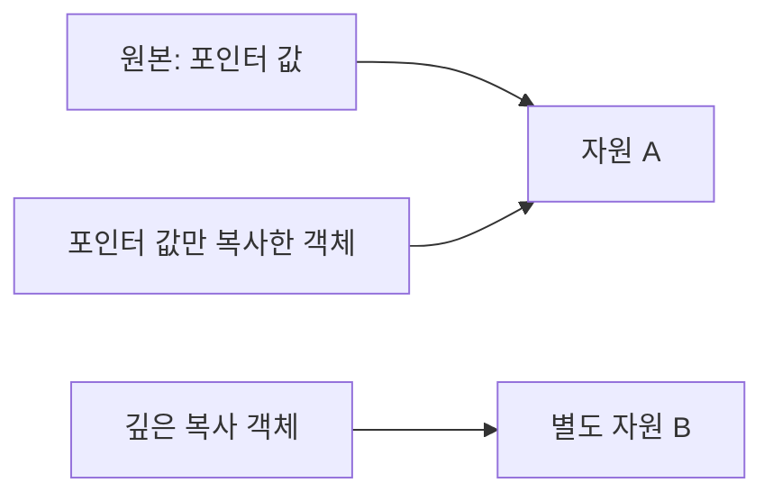
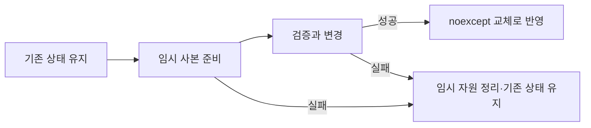

<callout icon="📦" color="blue_bg">
<b>복사는 무엇을 독립시킬지, 이동은 어떤 책임을 넘길지 정하는 일입니다.</b>

기준 C++20 · 개정일 <date start="2026-10-13" /> · 실습 <code>src/ownership.cpp</code>, <code>src/transaction.cpp</code>.
</callout>

<mention url="https://app.notion.com/p/aaa55bced8ff459ba67fb036fb34bb3b">C++ 심화문법 — 개정판 v1.0</mention>

<table-of-contents color="gray" />

## 1. 객체를 만들 때와 이미 있는 객체를 바꿀 때

<code>T b = a;</code>는 b를 새로 초기화하므로 복사 생성의 문맥입니다. <code>b = a;</code>는 이미 존재하는 b에 대입합니다. <code>T b = std::move(a);</code>와 <code>b = std::move(a);</code>도 각각 생성과 대입입니다. 문장 안에 등호가 보이는지만으로 복사 대입이라고 판단하지 않습니다.

```c++
T original;
T copied(original);          // 복사 생성
T assigned;
assigned = original;         // 복사 대입
T moved(std::move(original)); // 이동 생성 후보를 선택하는 문맥
```

이는 T가 필요한 연산을 지원한다고 가정한 문법 비교입니다. 실제로 어떤 함수가 선택되는지는 선언된 특수 멤버와 접근성, 삭제 여부, cv 한정에 따라 달라집니다.

복사 생성자의 매개변수는 보통 <code>const T&</code>입니다. <code>T(T)</code>처럼 자기 타입을 값으로 받는 선언은 정상적인 복사 생성자가 반복 호출되어 실행 중 스택이 넘치는 예제가 아닙니다. <b>C++에서 그 형태의 생성자 선언이 잘못되어 컴파일이 거부됩니다.</b> 이번 <code>negative/copy_by_value.cpp</code>로 확인합니다.

## 2. 멤버별 복사와 자원 복사는 다르다

기본 복사는 기본 클래스와 멤버를 각 타입의 복사 방식으로 처리합니다. 모든 객체를 memcpy한다는 뜻은 아닙니다. std::vector를 복사하면 원소를 독립적으로 소유하는 vector가 생기지만, raw pointer를 복사하면 포인터 값만 복사됩니다. 포인터가 가리키는 자원을 소유한다고 설계한 클래스라면 이 둘이 같은 해제 책임을 주장하게 될 수 있습니다.



그림의 공유 접근 자체가 항상 오류인 것은 아닙니다. 둘 다 관찰자라면 공유할 수 있습니다. 문제는 <b>소유·복사·해제 계약을 적지 않은 채 둘 다 삭제하는 것</b>입니다. 공동 소유가 필요하면 shared\_ptr 같은 수단을, 독립적인 값이 필요하면 깊은 복사를, 복사가 의미 없으면 삭제된 복사 연산을 선택합니다.

## 3. Rule of Zero를 먼저, 필요한 경우 Rule of Five

표준 소유 타입으로 멤버를 구성하면 직접 소멸자와 복사·이동 함수를 작성하지 않아도 되는 경우가 많습니다. 이것이 Rule of Zero입니다. 예를 들어 <code>struct Inventory { std::vector<Item> items; };</code>는 Item의 의미가 올바르다면 vector가 자원을 관리합니다.

직접 해제해야 하는 핸들, 복제 API를 호출해야 하는 자원, 이동 후 별도 메타데이터 불변식이 있는 타입에서는 소멸·복사 생성·복사 대입·이동 생성·이동 대입의 관계를 함께 검토합니다. 다섯 함수를 무조건 손으로 구현하라는 뜻이 아닙니다. <code>=default</code>, <code>=delete</code>, 제공 여부를 의식적으로 정합니다.

<table fit-page-width="true" header-row="true">
<tr>
<td>
정책
</td>
<td>
대표 수단
</td>
<td>
판단
</td>
</tr>
<tr>
<td>
독립 값
</td>
<td>
vector·string·깊은 복사
</td>
<td>
복사 후 한쪽 변경이 다른 쪽을 바꾸지 않아야 함
</td>
</tr>
<tr>
<td>
이동 전용 소유
</td>
<td>
unique\_ptr·삭제된 복사
</td>
<td>
한 자원의 소유자를 명확하게 유지
</td>
</tr>
<tr>
<td>
공동 소유
</td>
<td>
shared\_ptr
</td>
<td>
정말 여러 소유자가 수명을 연장해야 하는가
</td>
</tr>
<tr>
<td>
비소유 관찰
</td>
<td>
참조·raw pointer·span·weak\_ptr
</td>
<td>
대상의 수명과 무효화 조건을 별도로 설명
</td>
</tr>
</table>

사용자 선언 소멸자나 복사 함수가 암묵적 이동의 생성을 억제하는 경우가 있습니다. 참조·const 멤버, 이동 전용 멤버 때문에 기본 대입·복사가 삭제될 수도 있습니다. ‘컴파일러가 네 개 혹은 여섯 개를 항상 만들어 준다’ 대신 실제 타입에서 trait와 컴파일 진단을 확인합니다.

## 4. std::move는 이동 실행 명령이 아니다

std::move는 표현식을 이동 가능한 후보 선택에 사용할 값 범주로 바꿉니다. 실제 자원을 넘기는 것은 선택된 이동 생성자·대입 연산자입니다. 이동 함수가 없고 const 참조 복사가 가능하면 rvalue에서도 복사가 일어날 수 있습니다. const 객체는 일반적인 <code>T&&</code> 이동 함수에 맞지 않아 복사되는 경우가 많습니다.

실습의 <code>CopyOnly</code>는 복사 생성자만 사용자 선언되어 있습니다. <code>CopyOnly copied(std::move(old));</code>에서도 복사 카운터가 1 증가합니다. 따라서 std::move를 많이 붙이는 것만으로 성능이 좋아진다고 판단하면 안 됩니다.

이동된 객체는 여전히 존재합니다. 표준 라이브러리 타입은 별도 규정이 없다면 유효하지만 값이 명시되지 않은 상태가 될 수 있습니다. unique\_ptr처럼 이동 후 비어 있음이 정해진 타입도 있습니다. 사용자 타입은 자신이 제공하는 후조건을 문서화해야 합니다. ‘모든 이동된 컨테이너는 항상 empty’라는 가정은 하지 않습니다.

## 5. IntBuffer로 복사·이동 계약 확인하기

학습용 IntBuffer는 정수 배열을 unique\_ptr로 소유하며 <code>size_ == 0</code>과 포인터가 비어 있다는 조건을 일치시킵니다. int 전용이며 범용 vector 대체품이 아닙니다.

```c++
IntBuffer& operator=(const IntBuffer& other) {
    if (this != &other) {
        IntBuffer temporary(other); // 실패할 수 있는 준비
        Swap(temporary);            // 예외를 던지지 않는 교체
    }
    return *this;
}

IntBuffer(IntBuffer&& other) noexcept
    : size_(std::exchange(other.size_, 0)),
      data_(std::move(other.data_)) {}
```

발췌 코드의 전체 클래스는 <code>ownership.cpp</code>에 있습니다. raw 자원을 delete한 다음 새로 할당하면 새 할당이 실패했을 때 기존 값도 잃습니다. 위는 사본 준비가 성공한 다음 교체합니다. 실패 주입 테스트는 실제 메모리를 고갈시키지 않고 복사 준비 단계에서 bad\_alloc을 던집니다. 기존 target의 값과 크기가 그대로 남는지 검사합니다.

이동에서 unique\_ptr만 옮기고 size\_를 그대로 두면 ‘크기는 3인데 포인터가 없음’이라는 잘못된 상태가 남을 수 있습니다. 그래서 메타데이터까지 함께 갱신합니다. 소유 타입을 썼다는 이유만으로 사용자 클래스의 모든 불변식이 자동으로 해결되지는 않습니다.

자기 복사 대입과 자기 이동 대입도 이번 구현의 계약에 포함해 검사합니다. 모든 타입이 자기 이동 후 원래 값을 유지해야 한다는 보편 규칙을 실험으로 주장하는 것은 아닙니다.

## 6. 예외 안전성의 세 단계

기본 보장은 실패 후에도 자원이 새지 않고 객체의 불변식이 유지되는 것입니다. 강한 보장은 해당 연산의 관찰 가능한 상태가 실패 전과 같도록 하는 것입니다. 예외를 던지지 않는 보장은 그 연산에서 예외가 전파되지 않는 것입니다. <b>동시성의 원자성, 트랜잭션의 내구성과는 다른 이야기</b>입니다.



<code>transaction.cpp</code>는 임시 인벤토리·장면 상태를 준비한 뒤 교체합니다. 파일 쓰기나 서버 요청이 먼저 이루어졌다면 그 외부 효과까지 사본 교체로 취소되지는 않습니다. 함수의 보장 범위를 분명히 써야 합니다. 실패할 수 있는 helper도 원본과 격리된 사본에서 호출하면 바깥 연산은 더 강한 보장을 제공할 수 있습니다. 따라서 함수 보장은 항상 내부 helper 중 가장 약한 보장과 같다는 식의 기계적 규칙도 피합니다.

## 7. noexcept와 복사 생략

noexcept는 최적화 장식이 아니라 예외가 밖으로 전파되지 않는 계약입니다. 이를 어겨 예외가 빠져나가면 std::terminate가 호출됩니다. 단순히 noexcept를 붙인다고 실패 가능 연산이 안전해지지 않습니다. vector 재배치가 이동 대신 복사를 택하는 데 이동의 예외 성질이 영향을 줄 수 있지만 구체적인 타입 조건과 예외 보장 예외도 함께 확인합니다.

C++17 이후 특정 prvalue 초기화는 복사·이동 생성자가 호출되지 않고 결과 객체를 직접 구성합니다. 실습 <code>Immovable Make() { return Immovable{}; }</code>는 복사·이동을 삭제해도 동작합니다. 반면 이름 있는 지역 객체를 반환하는 NRVO는 같은 범주의 무조건 보장이 아닙니다. <code>return std::move(local);</code>를 습관적으로 붙이면 오히려 NRVO 기회를 막을 수 있습니다.

## 이해 확인

<p>
\<details>\<summary>unique\_ptr 멤버가 있으니 IntBuffer의 모든 이동을 default로 해도 될까?\</summary>

자원 해제 자체는 관리되지만 size\_와 포인터 사이의 사용자 불변식은 따로 봐야 합니다. 이번 타입은 이동된 원본의 size\_를 0으로 바꿔야 자신의 계약을 유지합니다. 다른 타입이 같은 후조건을 요구하지 않는다면 정책은 달라질 수 있습니다.
</p>

\</details>

<p>
\<details>\<summary>복사 도중 할당 실패를 실제 메모리 고갈로 재현해야 할까?\</summary>

아닙니다. 실패 지점을 주입하거나 제한된 할당자를 써서 예측 가능하게 검사합니다. 시스템 메모리를 고갈시키는 테스트는 다른 프로그램에 영향을 줄 수 있고 재현성도 나쁩니다.
</p>

\</details>

## 출처·검증

[N4861 — 복사·이동 생성](https://timsong-cpp.github.io/cppwp/n4861/class.copy.ctor), [복사 생략](https://timsong-cpp.github.io/cppwp/n4861/class.copy.elision), [예외 명세](https://timsong-cpp.github.io/cppwp/n4861/except.spec), [Core Guidelines C.20·C.21·C.66](https://isocpp.github.io/CppCoreGuidelines/CppCoreGuidelines#Rc-zero).

ownership 13개, transaction 8개 검사는 세 빌드에서 통과했습니다. 사용된 소유 정책·작은 데이터·동기 실행 범위에 대한 검증입니다. 비동기 게임 시스템이나 임의 사용자 타입의 예외 보장을 대신 증명하지 않습니다.
