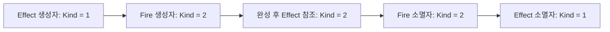

<callout icon="🧩" color="blue_bg">
<b>같은 인터페이스를 쓴다는 것과 같은 구현을 복사한다는 것은 다릅니다.</b>

기준 C++20 · 개정일 <date start="2026-10-13" /> · 실습 <code>polymorphism.cpp</code>, <code>interfaces.cpp</code>.
</callout>

<mention url="https://app.notion.com/p/aaa55bced8ff459ba67fb036fb34bb3b">C++ 심화문법 — 개정판 v1.0</mention>

<table-of-contents color="gray" />

## 1. public 상속은 호출자의 약속을 유지한다

파생 객체를 기본 타입으로 사용하는 코드가 여전히 올바르게 작동해야 한다는 것이 public 상속을 판단하는 핵심입니다. 단순히 ‘코드를 재활용하고 싶다’는 이유만으로 부모를 고르면 부모 함수의 전제와 파생 타입의 규칙이 충돌할 수 있습니다.

예를 들어 모든 Effect는 Tick과 Draw를 지원한다는 계약을 둘 수 있습니다. 하지만 모든 데이터가 Draw를 가져야 하는 것은 아닙니다. Transform이나 ItemData를 무조건 GameObject에서 상속시키면 사용하지 않는 기능까지 의존하게 됩니다. 재사용하려는 것이 단순한 기능이나 데이터라면 멤버로 포함하는 합성부터 검토합니다.

private 상속은 일반적으로 외부에 대체 가능한 기본 타입을 제공하지 않습니다. 구현을 이용하거나 protected 멤버·가상 확장 지점을 이용하는 의미로 접근합니다. 항상 합성보다 우수하거나 항상 금지해야 하는 방식은 아닙니다.

## 2. 정적 타입과 동적 타입

```c++
struct Effect {
    virtual ~Effect() = default;
    virtual int Kind() const { return 1; }
};
struct Fire : Effect {
    int Kind() const override { return 2; }
};
Fire fire;
Effect& effect = fire;
// effect의 정적 타입은 Effect&, 대상의 동적 타입은 Fire.
// effect.Kind()는 Fire::Kind()를 호출합니다.
```

동적 할당 여부와 동적 바인딩은 별개입니다. 위 fire는 new로 만들지 않아도 가상 호출이 됩니다. virtual은 런타임에 모든 함수를 검색하거나 잠깐 숨겨진 함수를 다시 보여주는 문법이 아닙니다. 언어의 가상 호출 규칙에 맞춰 최종 재정의 함수를 선택하는 것입니다.

많은 구현에서 가상 함수 테이블과 객체 내부 포인터를 사용하지만 테이블 모양, 포인터 개수, 배치, 호출 비용은 언어가 모든 구현에 동일하게 강제하지 않습니다. 최적화로 직접 호출이 될 수도 있습니다. 크기·성능이 중요하면 대상 컴파일러, 상속 구조, 실제 빌드 옵션으로 측정합니다.

## 3. override·오버로딩·이름 가림

오버로딩은 같은 이름의 서로 다른 매개변수 함수 후보를 만드는 것입니다. 오버라이딩은 기본 클래스의 가상 함수를 재정의하는 것입니다. 이름 가림은 파생 범위의 선언이 기본 범위의 같은 이름들을 가리는 현상입니다. 셋을 섞으면 ‘함수가 있는데 호출이 안 된다’는 오류를 설명하기 어렵습니다.

```c++
struct Base {
    void Set(int);
    virtual int Read() const;
};
struct Derived : Base {
    using Base::Set;
    void Set(const std::string&);
    int Read() const override;
};
```

필요 헤더와 함수 정의를 생략한 선언 예입니다. using으로 기본 Set 오버로드를 함께 노출합니다. Read의 const를 빼고 override를 붙이면 잘못된 재정의가 진단됩니다. override는 기본 함수와 일치하는지 컴파일러에게 확인시키는 도구입니다. <code>negative/wrong_override.cpp</code>가 이 실험입니다.

비가상 함수를 같은 이름으로 다시 선언해도 동적 재정의가 되지는 않습니다. 호출 표현식의 정적 타입 등에 따라 선택되므로 public 인터페이스의 일관성이 깨질 수 있습니다. 상속 구조에서 다른 동작을 원한다면 실제 계약을 검토한 뒤 virtual 또는 합성을 선택합니다.

## 4. 생성·소멸 중에는 최종 파생 함수로 보내지 않는다

실습 Effect 생성자에서 Kind를 호출하면 Effect의 구현을 사용합니다. Fire 생성자 본문에서 호출하면 Fire의 구현을 사용합니다. 소멸에서는 반대 순서로 읽습니다. 아직 만들어지지 않았거나 이미 파괴된 파생 부분에 의존하는 동작을 기본 생성·소멸자에 두면 안 됩니다.



이 규칙을 ‘생성자에서 virtual을 부르면 무조건 문법 오류’라고 외우지 않습니다. 허용되는 호출도 있지만 예상한 확장 지점이 아닐 수 있다는 것이 문제입니다. 특히 해당 생성·소멸 단계에서 순수 가상 최종 재정의를 가상 호출하는 것은 피해야 합니다. 완료 후 별도 시작 단계가 필요하면 객체가 유효한 상태인지 확인한 다음 명시적으로 호출합니다.

근거: [N4861 — 생성·소멸 중 객체 사용](https://timsong-cpp.github.io/cppwp/n4861/class.cdtor).

## 5. 기본 포인터로 삭제할 수 있는가

일반적인 <code>delete base_pointer</code>로 파생 객체를 삭제할 수 있도록 공개한 계층이라면 기본 소멸자를 public virtual로 둡니다. 가상 소멸자 없이 ordinary delete로 파생 객체를 기본 포인터를 통해 삭제하는 것은 단순히 파생 자원 몇 개만 새는 것으로 끝난다고 보장할 수 없습니다. 관련 조건에서 미정의 동작입니다. 배열 delete로 바꿔 해결하는 문제도 아닙니다.

기본 인터페이스를 통한 삭제를 허용하지 않는 설계라면 protected nonvirtual 소멸자도 선택지입니다. 모든 작은 값 타입에 virtual 소멸자를 추가할 이유는 없습니다. C++20의 특수한 destroying delete 등 별도 설계는 이 입문 계층 예제의 범위에 포함하지 않습니다.

std::unique\_ptr\<Base>에 Derived를 소유시키는 경우에도 실제 deleter의 삭제 계약을 봐야 합니다. 스마트 포인터를 사용했다는 이유만으로 잘못된 기반 삭제가 모두 안전해지는 것은 아닙니다. 이번 테스트는 virtual 소멸자를 갖춘 Effect를 사용합니다.

순수 가상 소멸자도 소멸 과정에서 기본 소멸자가 필요하므로 정의를 제공해야 합니다. 추상 타입을 직접 인스턴스화할 수 없는 이유는 가상 함수 계약 때문이지 크기를 계산할 수 없어서가 아닙니다.

## 6. 슬라이싱과 Clone

파생 객체를 기본 타입의 값으로 복사하면 파생 부분을 포함한 객체가 보존되지 않습니다. 기본 부분만을 가진 새 값이 됩니다. 다형성을 유지하려면 기본 포인터·참조를 사용하되 수명·소유권을 함께 관리합니다.

다형적인 복사가 필요하면 <code>virtual std::unique_ptr<Base> Clone() const</code>처럼 명시적인 복제 연산을 제공할 수 있습니다. 실습 Number::Clone은 새 객체를 만들어 반환하고 값은 같지만 주소는 다르다는 것을 검사합니다. 자식 타입마다 실제 자원의 복제 가능성을 확인해야 하므로 아무 클래스에나 기본 복사를 붙이는 것과 다릅니다.

## 7. 캐스팅은 허가증이 아니다

<table fit-page-width="true" header-row="true">
<tr>
<td>
도구
</td>
<td>
주요 목적
</td>
<td>
놓치면 안 되는 점
</td>
</tr>
<tr>
<td>
static\_cast
</td>
<td>
정해진 변환, 명시적인 수치 변환 등
</td>
<td>
다운캐스트 대상의 실제 타입을 일반적으로 검사해 주지 않음
</td>
</tr>
<tr>
<td>
dynamic\_cast
</td>
<td>
다형 계층의 런타임 검사
</td>
<td>
포인터 실패는 nullptr, 참조 실패는 bad\_cast. 원본의 수명·유효성은 별도
</td>
</tr>
<tr>
<td>
const\_cast
</td>
<td>
cv 한정 변경
</td>
<td>
원래 const인 객체를 수정하면 안 됨
</td>
</tr>
<tr>
<td>
reinterpret\_cast
</td>
<td>
저수준 표현·포인터 변환
</td>
<td>
정렬·수명·접근 가능한 타입 규칙을 무시하고 역참조할 권한을 주지 않음
</td>
</tr>
</table>

캐스팅의 비용을 모른 채 dynamic\_cast는 항상 느리니 절대 쓰지 말라는 결론을 내리지 않습니다. 자주 다운캐스트하는 구조가 추상화 문제인지 먼저 검토하고, 정말 필요한 핫패스라면 측정합니다. 반대로 static\_cast로 바꾸면 검사 비용이 줄어도 틀린 타입에서 미정의 동작을 만들 수 있습니다.

다중 상속에서는 기본 부분의 주소가 완전한 객체의 주소와 다를 수 있습니다. reinterpret\_cast로 올바른 기반 포인터 조정을 대신하려 하지 않습니다.

## 8. 기본 인수와 NVI

virtual 함수의 <b>실제 함수 선택은 동적 타입</b>, 생략한 <b>기본 인수는 호출 위치에서 보이는 선언</b>을 따릅니다. 실습은 기본 타입 default=2, Fire default=3을 두어 같은 Fire 객체가 기본 참조를 통하면 20, 구체 타입으로 호출하면 30이 됨을 확인합니다. 이런 차이는 오류를 부르므로 파생 쪽에서 기본값을 제각각 바꾸지 않는 편이 낫습니다.

Non-Virtual Interface, 즉 비가상 공개 함수가 검증·전후 작업을 담당하고 내부의 가상 함수가 달라지는 부분만 맡게 하는 방식도 있습니다. 실습 Damage::Apply는 음수·상한 검사를 공통 처리하고 private virtual ApplyImpl로 계산을 위임합니다. 단일 책임을 나누는 예이지 모든 함수를 NVI로 만들라는 규칙은 아닙니다.

## 이해 확인

<toggle>
기반 클래스의 가상 함수가 있으니 생성자에서 부르면 파생 초기화도 끝낼 수 있을까?

기반 생성 중 호출은 그 단계의 기반 구현으로 해석됩니다. 파생 멤버가 준비되기 전에 파생 로직을 가정하면 안 됩니다. 초기화 불변식과 완료 후 시작 작업을 분리해야 합니다.
</toggle>

<toggle>
추상 클래스 포인터를 unique\_ptr로 받으면 삭제는 무조건 안전할까?

아닙니다. 기본 deleter가 기반 포인터로 ordinary delete하는 경우의 소멸자 계약을 확인해야 합니다. 이번 예제에서는 public virtual 소멸자를 제공해 그 경로를 허용했습니다.
</toggle>

## 출처·검증

[N4861 — 가상 함수](https://timsong-cpp.github.io/cppwp/n4861/class.virtual), [delete 표현식](https://timsong-cpp.github.io/cppwp/n4861/expr.delete), [dynamic\_cast](https://timsong-cpp.github.io/cppwp/n4861/expr.dynamic.cast), [Core Guidelines C.35·C.67](https://isocpp.github.io/CppCoreGuidelines/CppCoreGuidelines#Rc-dtor-virtual).

실습 polymorphism의 12조건은 GCC·Clang·Clang ASan/UBSan에서 통과했습니다. 캐스팅 성능 벤치마크, ABI 크기 비교, 다중 상속의 모든 조합을 시험한 것은 아닙니다.
