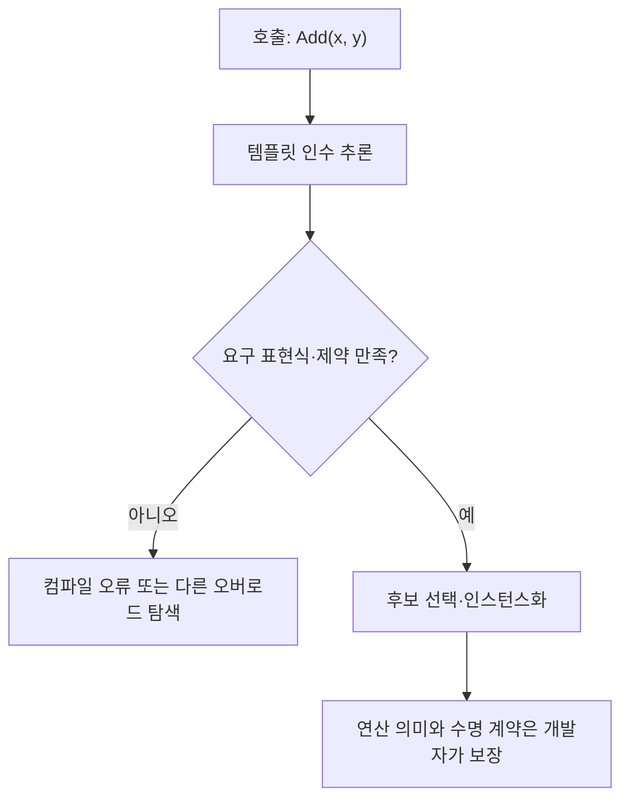

<callout icon="🧬" color="blue_bg">
<b>일반화는 아무 타입이나 받는 것이 아니라, 필요한 조건을 정확히 설명하는 것입니다.</b>

C++20 기준 · 개정일 <date start="2026-10-13" /> · 실습 <code>templates.cpp</code>, <code>interfaces.cpp</code>.
</callout>

<mention url="https://app.notion.com/p/aaa55bced8ff459ba67fb036fb34bb3b">C++ 심화문법 — 개정판 v1.0</mention>

<table-of-contents color="gray" />

## 정의에서 호출까지 · 컴파일 시점 계약



Concept와 requires는 <b>표현식의 형식적 유효성</b>을 제한하는 도구입니다. 비교자의 엄격 약순서나 계산 결과의 수치 안정성을 컴파일러가 자동 증명하는 것은 아닙니다. C++11 실습은 Concepts 문법 대신 SFINAE 또는 명시적 검사로 별도 작성해야 하고, 기존 C++20 예제를 그대로 C++11로 컴파일할 수는 없습니다.

## 1. 연산자는 수학 기호가 아니라 타입의 인터페이스

연산자 오버로드는 표기의 의미를 사용자 타입에 부여합니다. 곱셈 연산자에 파일 삭제처럼 전혀 예상하지 못한 동작을 넣으면 읽기 어렵습니다. 우선순위나 결합법칙, 피연산자 개수를 마음대로 바꿀 수도 없습니다.

대입은 보통 <code>T&</code>를 반환해 대입 대상의 참조를 돌려주고, 덧셈은 새 값을 반환합니다. 덧셈 결과로 함수 안 지역 객체의 참조를 반환하면 수명이 끝난 대상을 돌려주는 문제가 생깁니다. 전위·후위 증감은 후위의 구분용 int 매개변수와 이전 값 반환 등 인터페이스 의미가 다릅니다. 사용자 오버로드 논리 연산자가 내장 &&·\|\|의 단락 평가와 같은 방식이라고 가정해서도 안 됩니다.

실습 Counter는 <code>operator+=</code>를 이용해 <code>operator+</code>를 구성합니다. 계산하는 정수는 작은 값으로 제한한 교육용 예이며 임의 데이터의 오버플로 검증을 포함한 수치 타입은 아닙니다.

## 2. explicit와 대칭적인 변환

<code>Seconds(double)</code>처럼 단위를 나타내는 타입은 <code>explicit</code>을 붙여 단순 double에서 무심코 변환되지 않게 만들 수 있습니다. explicit이 있으면 생성자를 이용할 수 없는 것이 아니라 직접 초기화 등 허용된 방식으로 의도를 표현해야 합니다.

한편 의도적으로 양쪽 피연산자 변환을 허용하는 값 타입에서는 비멤버 연산자가 유용합니다. 멤버 연산자는 좌항이 그 클래스 객체여야 멤버 호출 후보가 되지만, 비멤버 연산자는 두 매개변수의 변환을 다룰 수 있습니다.

```c++
class Counter {
    int value_{};
public:
    Counter(int value = 0) : value_(value) {}
    Counter& operator+=(const Counter& rhs) {
        value_ += rhs.value_;
        return *this;
    }
    friend Counter operator+(Counter lhs, const Counter& rhs) {
        lhs += rhs;
        return lhs;
    }
};
```

이 예제의 암묵적 생성자는 변환을 관찰하기 위해 의도적으로 선택한 것입니다. 실제 게임의 초·미터·아이템 ID는 실수로 혼합되지 않도록 explicit이나 별도 연산 정책을 권장할 수 있습니다. 한 가지 조언을 모든 타입에 기계적으로 적용하지 않습니다.

## 3. 함수 템플릿은 필요한 표현식에 대한 계약

```c++
template<class T>
T Add(T left, T right) {
    return left + right;
}
```

위 템플릿은 T가 덧셈과 반환을 지원해야 합니다. Add라는 이름만으로 모든 숫자·문자열·사용자 객체의 의미가 같아지지는 않습니다. 예를 들어 두 인수의 타입이 다를 때 추론이 실패할 수 있고, 덧셈 결과가 T와 다른 타입일 수도 있습니다. 템플릿이 함수 본문의 모든 오류를 처음 선언하는 순간에만 검사한다는 생각도 잘못입니다. 의존적인 부분은 인스턴스화 단계에서 문제를 드러낼 수 있습니다.

원문에서 사용한 <code>template<class T></code>와 <code>template<typename T></code>의 이 문맥은 같은 타입 매개변수를 뜻합니다. 템플릿 인수는 타입 외에도 정수 같은 값이 될 수 있습니다. 크기를 타입 수준에서 고정할 필요와 런타임 값으로 받는 편의·코드 크기를 비교합니다.

## 4. Concepts로 요구사항 드러내기

```c++
#include <concepts>
#include <cstddef>

template<class T>
concept Sized = requires(const T& value) {
    { value.size() } -> std::convertible_to<std::size_t>;
};

template<Sized T>
std::size_t SizeOf(const T& value) {
    return static_cast<std::size_t>(value.size());
}
```

C++20의 concept는 유효한 표현식과 타입 조건을 제약으로 표현합니다. 위는 size 호출 가능 여부와 반환값 변환을 검사합니다. 반환값이 실제 원소 수인지, 음수 값이 들어오지 않는지 같은 모든 의미적 요구사항까지 자동으로 증명하지는 않습니다.

C++11·14 환경에서는 type\_traits, enable\_if, static\_assert, 명확한 문서 계약 등을 조합할 수 있습니다. 호환 코드를 제공할 때는 단순히 requires를 지우는 것만으로 동일한 진단과 오버로드 선택이 유지된다고 가정하지 않습니다.

이번 <code>negative/constraint.cpp</code>는 integral 제약에 double을 전달해 컴파일이 거부됨을 확인합니다. 실패를 보여주는 코드는 정상 빌드 대상에서 제외합니다.

## 5. typename과 의존 기반 클래스

<code>Container::value_type</code>이 템플릿 인수에 의존하는 타입 이름임을 나타내야 하는 문맥에서는 typename이 필요합니다. C++20에서 생략 가능한 타입 문맥이 확대된 부분도 있으므로 ‘중첩 이름 앞에는 항상 typename’이라고 외우지 않습니다.

```c++
template<class Container>
typename Container::value_type FirstCopy(const Container& values) {
    if (values.empty()) throw std::out_of_range("empty");
    return *values.begin();
}

template<class T> struct Base {
    int Read() const { return 42; }
};
template<class T> struct Derived : Base<T> {
    int ReadWithLog() const { return this->Read(); }
};
```

두 예제는 <code><stdexcept></code> 등을 포함한 전체 실습 파일에서 실행합니다. 의존 기반 클래스의 이름은 일반 비의존 이름 탐색과 같은 순간에 모두 해결되지 않습니다. this->, 적절한 using, 명시적인 기반 한정 등이 해결 방법입니다. 다만 <code>Base<T>::Read()</code>처럼 명시적으로 한정하면 가상 호출을 억제할 수 있으므로 셋이 항상 동작까지 동일한 것은 아닙니다.

## 6. 템플릿 정의와 cpp 분리

암묵적 인스턴스화를 사용하는 일반적인 헤더 기반 라이브러리에서는 필요한 정의가 사용 지점에 보이게 합니다. 그래서 헤더에 구현을 두는 경우가 많습니다. 이것을 ‘모든 템플릿은 어떤 경우에도 cpp로 분리할 수 없다’고 일반화하지 않습니다.

지원할 타입 집합이 정해져 있으면 cpp에서 명시적으로 인스턴스화하고 extern template 등으로 의도한 번역 단위에 구현을 모을 수 있습니다. 새 타입을 쓰려면 추가 인스턴스가 필요하다는 제약을 받아들이는 방식입니다. 모듈을 이용한 배포는 별도의 빌드 설계이며 기존 컴파일러 환경 지원도 확인해야 합니다.

클래스 템플릿의 부분 특수화와 함수 템플릿 오버로드·완전 특수화를 구분합니다. 함수 템플릿 자체의 부분 특수화는 제공되지 않으므로 오버로드나 제약 조건, 클래스 도우미 등을 사용합니다.

## 7. 람다는 상태를 가진 호출 가능 객체가 될 수 있다

캡처 없는 람다는 적합한 함수 포인터 타입으로 변환될 수 있습니다. 캡처가 있으면 상태를 저장해야 하므로 같은 방식으로 일반 함수 포인터가 되지 않습니다. 템플릿으로 호출 가능 객체를 직접 받거나 std::function 같은 타입 소거 도구에 담을 수 있습니다.

```c++
std::function<int(int)> AddLater(int offset) {
    return [offset](int value) { return value + offset; };
}
```

offset을 값으로 캡처했으므로 AddLater가 끝나도 저장된 값은 호출 객체에 남습니다. <code>[&offset]</code>이었다면 지역 매개변수의 수명 뒤에 참조를 사용하는 문제가 됩니다. this 캡처도 객체 수명을 자동으로 연장하지 않습니다. 비동기 작업·이벤트 구독에서는 소유권, 취소, 해제 시점까지 설계해야 합니다.

std::function은 모든 호출 대상을 무료로 담는 기능이 아닙니다. 타입 소거와 경우에 따른 할당 비용, C++20에서 대상의 복사 가능성 조건을 봅니다. 호출 즉시 사용하는 제네릭 알고리즘에서는 템플릿이 더 단순할 수 있고, 런타임에 교체하는 저장 슬롯에는 타입 소거가 편리할 수 있습니다.

## 8. 전달 참조와 std::forward

추론되는 템플릿 매개변수 T에 대한 T&& 등 특정 조건에서는 전달 참조가 됩니다. 모든 &&가 전달 참조는 아닙니다. 일반 <code>Widget&&</code>는 rvalue 참조이고, 클래스의 이미 정해진 T에 대한 T&&도 문맥을 확인해야 합니다.

이름이 붙은 매개변수 표현식은 lvalue입니다. std::forward\<T>는 추론한 범주를 고려해 다음 호출에 전달하고, std::move는 원래 범주와 상관없이 이동 후보를 선택하려는 의도를 나타냅니다. 실습 ForwardCategory는 mutable lvalue, const lvalue, rvalue가 서로 다른 오버로드로 전달되는지 검사합니다.

완벽한 전달은 복잡한 오버로드 함정을 동반하므로 단순한 값 인수 함수에 불필요하게 적용하지 않습니다. 무엇을 저장하고 무엇을 즉시 소비하는지가 먼저입니다.

## 9. constexpr·traits·컴파일 시점 작업

constexpr 함수는 조건이 맞으면 상수 평가에 쓰일 수 있고, 런타임 인수로 일반 실행될 수도 있습니다. 모든 호출이 컴파일 시점에 수행되도록 강제하는 표시는 아닙니다. 이번 PowerOfTwo는 static\_assert에서 결과를 검사하고, 실행 시 범위 밖 인수는 예외로 처리합니다.

타입 trait는 복사 가능성, nothrow 이동 등 타입 성질을 표현합니다. trait 하나가 사용자 정의 함수 본문의 모든 의미적 버그를 검증하는 것은 아닙니다. <code>is_move_constructible</code>이 참이라고 전용 이동 생성자가 반드시 존재한다는 뜻도 아닙니다. const 참조 복사가 rvalue를 받을 수 있기 때문입니다.

## 이해 확인

<toggle>
비동기 이벤트를 저장하는 람다에 지역 변수를 참조 캡처해도 될까?

이벤트 실행까지 지역 변수가 살아 있음을 보장하지 못하면 안 됩니다. 값 캡처, 명시적 공유 소유, 약한 참조와 lock 검사, 구독 취소 같은 정책을 선택합니다. 단순히 std::function에 넣는 것은 수명 해결책이 아닙니다.
</toggle>

<toggle>
concept가 통과했으니 정렬 비교자도 항상 올바를까?

호출 형식이 맞는 것과 엄격 약순서라는 의미 조건은 다릅니다. 같은 원소를 비교했을 때 false인지, 순환하는 비교가 없는지 등 수학적 계약을 별도로 지켜야 합니다.
</toggle>

## 출처·검증

[N4861 — 템플릿](https://timsong-cpp.github.io/cppwp/n4861/temp), [제약과 concept](https://timsong-cpp.github.io/cppwp/n4861/temp.constr), [명시적 인스턴스화](https://timsong-cpp.github.io/cppwp/n4861/temp.explicit), [람다](https://timsong-cpp.github.io/cppwp/n4861/expr.prim.lambda), [Core Guidelines — 제네릭 프로그래밍](https://isocpp.github.io/CppCoreGuidelines/CppCoreGuidelines#S-templates).

templates의 10조건과 interfaces의 7조건은 GCC·Clang·Clang ASan/UBSan에서 통과했습니다. 설명용 작은 정수 연산은 임의 크기 입력에 대한 안전한 수치 라이브러리가 아닙니다.
