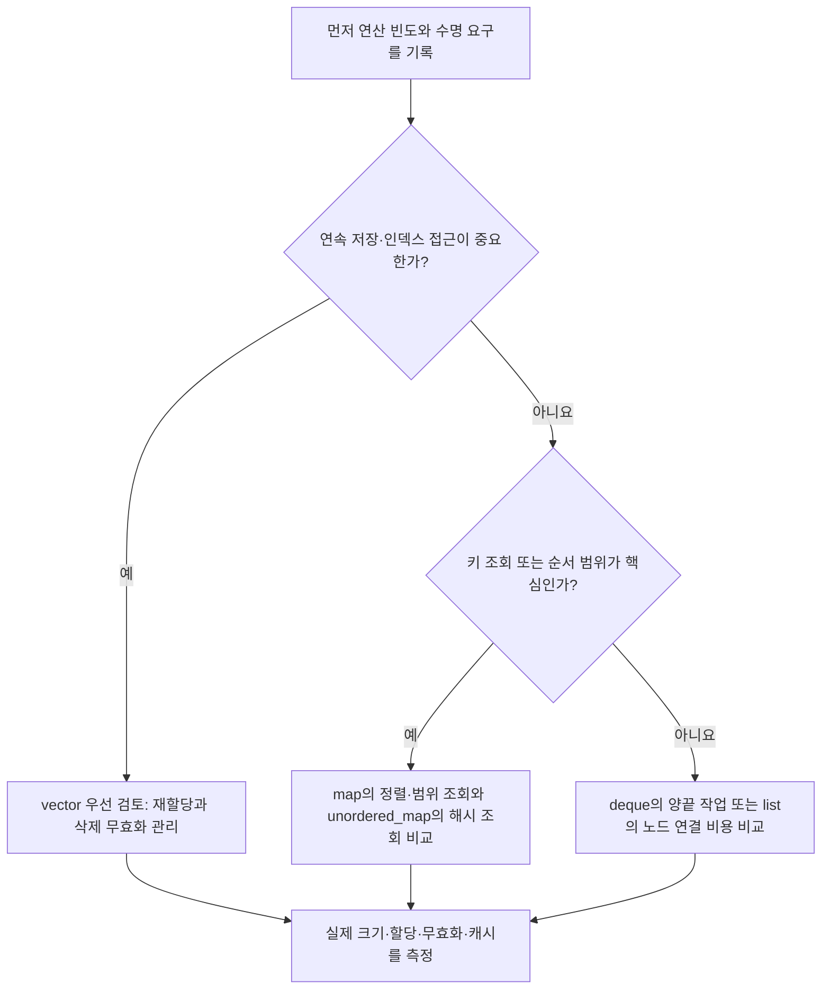

<callout icon="🗂️" color="blue_bg">
<b>컨테이너 선택은 함수 이름보다 접근 패턴·수명·무효화 조건으로 판단합니다.</b>

기준 C++20 · 개정일 <date start="2026-10-13" /> · 실행 파일 <code>containers</code>.
</callout>

<mention url="https://app.notion.com/p/aaa55bced8ff459ba67fb036fb34bb3b">C++ 심화문법 — 개정판 v1.0</mention>

<table-of-contents color="gray" />

## 1. 표준 라이브러리와 STL

표준 라이브러리에는 컨테이너·반복자·알고리즘뿐 아니라 문자열, 입출력, 시간, 스레드, 수치 도구 등이 있습니다. STL이라는 이름은 특히 제네릭 컨테이너·반복자·알고리즘 체계를 가리킬 때 사용합니다. 모든 표준 기능이 하나의 헤더에 들어 있지는 않습니다. vector는 <code><vector></code>, sort는 <code><algorithm></code>처럼 사용하는 기능의 헤더를 직접 포함합니다.

<code>using namespace std;</code>를 해야 표준 라이브러리를 쓸 수 있는 것은 아닙니다. <code>std::vector<int></code>처럼 한정하면 됩니다. 특히 공개 헤더에서 전체 네임스페이스를 가져오면 사용자의 이름 탐색에 영향을 주므로 피하는 것이 좋습니다.

## 2. 저장 구조와 작업을 함께 선택하기

<table fit-page-width="true" header-row="true">
<tr>
<td>
도구
</td>
<td>
장점
</td>
<td>
검토할 비용과 조건
</td>
</tr>
<tr>
<td>
array
</td>
<td>
고정 개수의 연속 원소
</td>
<td>
크기가 타입에 포함. 수명은 포함된 객체에 따름
</td>
</tr>
<tr>
<td>
vector
</td>
<td>
연속 원소·인덱스 접근·끝 추가
</td>
<td>
재할당, 중간 이동, 외부 참조 무효화
</td>
</tr>
<tr>
<td>
deque
</td>
<td>
양끝 추가·삭제와 임의 접근
</td>
<td>
전체 원소가 하나의 연속 버퍼라는 보장은 없음. 작업별 반복자 규칙 확인
</td>
</tr>
<tr>
<td>
list
</td>
<td>
노드 위치를 이미 알 때 연결 변경, 특정 참조 안정성
</td>
<td>
순차 탐색, 노드 할당·포인터·캐시 비용
</td>
</tr>
<tr>
<td>
map·set
</td>
<td>
키 순서·범위 질의·로그 시간 연산
</td>
<td>
비교자와 동등성 규칙, 노드 비용
</td>
</tr>
<tr>
<td>
unordered\_map·set
</td>
<td>
해시 기반 조회
</td>
<td>
평균과 최악 복잡도, 충돌, rehash, 메모리·순서 비보장
</td>
</tr>
</table>

list의 삽입이 상수 시간이라는 말은 삽입 위치를 찾는 시간이 공짜라는 뜻이 아닙니다. ‘삽입이 많으니 무조건 list’, ‘deque는 무조건 느리다’처럼 결론을 먼저 외우지 않습니다. 게임에서는 작은 데이터를 여러 개 순회하는 패턴, 필요한 주소 안정성, 프레임별 할당량을 함께 봅니다.

stack·queue·priority\_queue는 사용할 수 있는 연산을 제한한 컨테이너 어댑터입니다. 이름만 바꾼 list가 아니며 내부 컨테이너와 알고리즘 요구사항을 봅니다. 자료구조를 직접 구현하는 학습과 실제 시스템의 자료구조 선택을 구분합니다.

### 컨테이너 선택 판단 흐름 · 게임 객체 예시



이 도식은 선택을 시작하는 체크리스트이지 성능 순위가 아닙니다. UI가 보유한 원소 포인터의 안정성, 엔티티 ID 재사용, 잠금 범위는 컨테이너만 바꿔 해결되지 않습니다.

## 3. vector의 크기·용량·객체 소멸

size는 실제 원소 수, capacity는 재할당 없이 담을 수 있는 용량입니다. reserve는 원소를 만들지 않고, resize는 원소 수를 바꿉니다. vector는 중간 insert도 지원하지만 뒤 원소를 옮기는 비용이 발생합니다. 용량 증가가 항상 1.5배나 2배로 정해져 있지는 않습니다.

clear는 <b>원소를 파괴</b>하고 size를 0으로 만듭니다. 그렇다고 capacity가 반드시 없어지는 것은 아닙니다. <code>vector<unique_ptr<T>></code>라면 원소인 unique\_ptr의 소멸에 따라 소유하던 T도 정리됩니다. <code>vector<T*></code>라면 포인터 원소가 사라져도 대상 T를 자동으로 delete하지 않습니다. 원소 저장 공간, 포인터 객체, 동적 대상의 수명을 분리하세요.

성능 때문에 reserve를 사용한다면 적절한 예상 크기에 한 번 적용하는 방식부터 검토합니다. 매 push\_back마다 reserve(size+1)을 호출하면 성장 전략을 방해할 수 있습니다. <code>shrink_to_fit</code>도 강제적인 메모리 반환 보장으로 읽지 않습니다.

근거: [N4861 — vector 용량](https://timsong-cpp.github.io/cppwp/n4861/vector.capacity), [변경 연산](https://timsong-cpp.github.io/cppwp/n4861/vector.modifiers).

## 4. 반복자는 모두 포인터와 같지 않다

반복자는 원소에 접근하고 이동하는 인터페이스입니다. 벡터 반복자에서는 덧셈 이동이 가능하지만 list 반복자에 <code>it + 3</code>을 사용할 수 없습니다. std::advance나 ranges 도구가 여러 범주를 지원하더라도 실제 이동 비용은 반복자의 능력에 따라 다릅니다.

보통 범위는 <code>[begin, end)</code>로 표현합니다. end는 마지막 원소 다음 위치이므로 역참조할 수 없습니다. 빈 컨테이너에서는 begin과 end가 같습니다. 서로 무관한 컨테이너의 반복자를 섞어 하나의 유효 범위를 만들지 않습니다.

const 반복자 객체와 const\_iterator도 구별합니다. <code>const auto it = values.begin();</code>는 it를 다른 위치로 옮기지 못하지만 mutable 원소에 대한 <code>*it</code>는 바꿀 수 있습니다. <code>values.cbegin()</code>에서 얻은 반복자는 원소를 읽기 전용으로 보되 반복자 위치 자체를 옮길 수 있습니다. 이번 interfaces 실습에서 확인합니다.

## 5. 무효화 규칙은 연산별로 다르다

vector 재할당은 기존 원소의 포인터·참조·반복자를 무효화합니다. 재할당이 없더라도 중간 삽입·삭제에서는 위치별 영향이 다릅니다. list 삽입은 보통 기존 원소의 반복자를 무효화하지 않지만 삭제한 원소를 가리키는 반복자는 더 이상 유효하지 않습니다. unordered 컨테이너의 rehash는 반복자를 무효화하지만 원소에 대한 참조·포인터와는 규칙이 다릅니다.

```c++
for (auto it = values.begin(); it != values.end();) {
    if (*it >= 2) it = values.erase(it);
    else ++it;
}
```

발췌 예는 vector\<int>의 삭제 후 반환된 반복자를 사용합니다. 지운 it를 다시 ++하거나, 모든 컨테이너에서 같은 erase 반환 형식을 전제하지 않습니다. 간단한 조건 삭제는 C++20의 std::erase\_if도 사용할 수 있습니다.

객체 주소를 UI·이벤트에 장기 저장하는 게임에서는 컨테이너 변경 이후 안전성을 설계해야 합니다. 인덱스도 삭제·정렬 후 다른 객체를 뜻할 수 있습니다. ID나 세대 번호를 가진 핸들 체계는 별도 시스템 설계로 이어지며, 단순히 포인터를 정수로 바꾸는 것으로 해결되지 않습니다.

근거: [N4861 — 비정렬 연관 컨테이너 요구사항](https://timsong-cpp.github.io/cppwp/n4861/unord.req).

## 6. 키 조회와 삽입을 구분하기

<code>map[key]</code>는 없는 키라면 값을 생성해 삽입할 수 있습니다. 읽기만 하려면 find·contains 등을, 반드시 있어야 하는 계약에는 적절한 오류 처리와 함께 at 등을 선택합니다. <code>map[i]</code>의 i는 원소의 순번이 아니라 키입니다.

```c++
std::map<std::string, int, std::less<>> counts{{"potion", 3}};
auto found = counts.find("missing"); // 원소 수는 그대로
int value = counts["missing"];      // 값 0인 원소가 생김
```

문자열 내용으로 찾으려면 <code>std::string</code> 키처럼 그 내용을 소유하고 비교하는 타입을 선택합니다. raw <code>const char*</code>를 키로 쓰는 컨테이너의 기본 비교를 문자열 내용 비교와 같다고 가정하면 안 됩니다. 비교자를 작성해도 문자열 버퍼의 수명과 변경 문제는 남습니다.

map·set은 비교자 기준으로 동등성을 결정합니다. 두 방향 비교가 모두 false인 두 키가 같은 키로 취급되는 기준이므로 operator==와 항상 같은 기준일 필요는 없습니다. key를 정렬 규칙과 어긋나게 외부에서 바꾸지 않습니다.

표준은 map을 반드시 특정 모양의 레드블랙트리로 구현하라고 명시하는 것이 아니라 인터페이스와 복잡도 등의 요구사항을 정합니다. 구현 방식을 학습할 때에는 해당 라이브러리의 실제 코드를 따로 살펴봅니다.

## 7. 알고리즘의 전제도 타입만큼 중요하다

sort는 임의 접근 반복자를 요구하는 버전이므로 list에는 list::sort를 사용합니다. <code>negative/list_sort.cpp</code>는 std::sort에 list 반복자를 전달해 거부되는 예제입니다. lower\_bound·binary\_search는 해당 비교 기준으로 정렬되었거나 요구되는 분할 조건이 성립해야 합니다. 정렬을 하지 않고 써서 우연히 값이 나왔다고 알고리즘이 검증된 것은 아닙니다.

```c++
struct Item { int priority; int id; };
struct Less {
    bool operator()(const Item& a, const Item& b) const noexcept {
        return std::tie(a.priority, a.id) < std::tie(b.priority, b.id);
    }
};
```

Less는 우선순위가 같으면 ID를 비교합니다. 정렬 비교자에 <code><=</code>를 쓰면 자기 자신도 앞이라고 판단할 수 있어 엄격 약순서 계약을 깨뜨립니다. 비교 중 외부 상태가 바뀌어 순서가 달라지는 경우도 피합니다. 실습의 <code>!Less(x,x)</code> 검사는 일부 조건을 보여주는 샘플이지 임의 비교자의 전이성까지 증명한 것은 아닙니다.

## 8. emplace와 성능을 과장하지 않기

emplace는 전달한 인수로 원소를 구성합니다. 이미 만들어진 값을 넣는 push와 비교할 때 복사·이동과 생성자 선택, 예외 가능성이 다를 수 있습니다. 이름에 emplace가 있으면 항상 빠르거나 더 안전한 것은 아닙니다. 특히 raw 자원 포인터를 생성해 전달하는 동안 예외가 나면 언제 소유권이 성립하는지 점검합니다.

성능 측정은 메모리 누수 검사와 다릅니다. 누수 검사, 시간 프로파일링, 할당 횟수, 캐시·분기 비용을 따로 관찰합니다. Debug 결과 한 번으로 Release 성능을 단정하지 않으며 비교 데이터·작업량·컴파일 옵션을 고정합니다.

## 이해 확인

<toggle>
vector를 clear했는데 capacity가 남으면 동적 객체가 모두 누수된 것일까?

아닙니다. 원소 파괴와 컨테이너 저장 공간 유지가 다릅니다. unique\_ptr 원소는 소유 대상을 정리하지만 raw 포인터 원소는 대상 소유권을 표현하지 않습니다. 실제 소유 타입과 해제 책임을 봐야 합니다.
</toggle>

<toggle>
unordered\_map이 rehash된 뒤 원소 포인터가 유효하면 반복자도 유효할까?

같지 않습니다. 반복자와 원소 참조·포인터는 별도 무효화 규칙을 갖습니다. 실습은 원소 포인터의 보존을 검사했으며 이전 반복자를 재사용하지 않습니다.
</toggle>

## 출처·검증

[N4861 — 연관 컨테이너](https://timsong-cpp.github.io/cppwp/n4861/associative.reqmts), [반복자 요구사항](https://timsong-cpp.github.io/cppwp/n4861/iterator.requirements), [정렬 계약](https://timsong-cpp.github.io/cppwp/n4861/alg.sorting), [deque](https://timsong-cpp.github.io/cppwp/n4861/deque).

containers의 16조건과 관련 컴파일 실패 예제를 두 컴파일러에서 검사했습니다. 특정 컨테이너가 실제 게임에서 가장 빠르다는 벤치마크 결론은 내리지 않았습니다.
