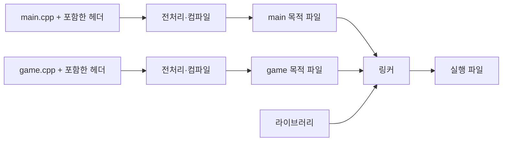

<callout icon="🔢" color="blue_bg">
<b>코드가 컴파일된다는 것과, 의도한 의미로 실행된다는 것은 다릅니다.</b>

C++20을 학습 기준으로 사용합니다. 타입의 범위, 초기화, 연산 결과를 설명할 수 있으면 포인터와 게임 데이터 처리의 기초가 잡힙니다. C++20을 최신 표준이라고 부르거나 기존 회사 프로젝트의 표준 변경을 전제하지 않습니다.
</callout>

<mention url="https://app.notion.com/p/2275f5f2c81a404e9c908dc0296ed65e">C++ 기초문법 — 개정판 v1.0</mention> · 실습 파일: <code>src/types.cpp</code> · 개정일 <date start="2026-10-12" />

<table-of-contents color="gray" />

## 1. 코드에서 실행까지

일반적인 네이티브 C++ 빌드에서는 각 <code>.cpp</code>가 포함한 헤더와 함께 하나의 <b>번역 단위</b>로 처리됩니다. 전처리로 포함·조건부 컴파일·매크로를 처리하고, 컴파일러가 코드를 분석하여 목적 파일을 만듭니다. 링커는 목적 파일과 라이브러리의 정의를 연결합니다. 어셈블리 파일을 별도로 저장하는지는 도구 설정에 따라 다릅니다. 빌드 과정 전체를 단순히 두 번의 컴파일이라고 외우기보다 각 단계가 검사하는 대상을 구분하세요.



<b>선언</b>은 이름과 타입 등을 알립니다. <b>정의</b>는 함수의 본문을 제공하거나 객체를 정의합니다. 예를 들어 <code>int Add(int, int);</code>는 함수 선언이고 본문이 붙은 함수가 정의입니다. <code>extern int score;</code>는 보통 객체를 정의하지 않는 선언이며, 네임스페이스 범위의 <code>int score{};</code>는 정의입니다. 선언만 있어도 호출하는 소스는 컴파일될 수 있지만, 필요한 정의가 연결되지 않으면 링크가 실패합니다.

문법·타입 오류, 정의를 찾지 못하는 링크 오류, 실행 중 잘못된 접근은 해결할 위치가 다릅니다. 오류 메시지의 첫 원인을 확인하고, 무작정 헤더를 추가하지 마세요. 자세한 다중 파일 예제는 이 묶음의 05 문서에 있습니다.

근거: [Microsoft — 번역 단위·프로그램과 연결](https://learn.microsoft.com/en-us/cpp/cpp/program-and-linkage-cpp?view=msvc-170).

## 2. 변수는 이름·타입·값·수명을 함께 갖습니다

<code>int hp{100};</code>에서 <code>hp</code>는 이름, <code>int</code>는 타입, <code>100</code>은 초기값입니다. 저장 공간이 존재하고 초기화가 끝나야 정상적인 객체 사용을 이야기할 수 있습니다. 타입은 저장 크기만이 아니라 허용되는 연산과 값의 범위를 정합니다.

다음 코드는 문법 조각입니다. 완전한 실행 코드는 실습 팩에 있습니다.

```c++
int hp{100};        // 객체를 만들며 초기화
hp = 80;            // 이미 있는 객체에 대입
int score{};        // int를 0으로 초기화
bool alive{true};   // True가 아니라 true
float speed{3.5f};
```

<b>초기화와 대입은 다릅니다.</b> 나중에 클래스에서 생성자와 대입 연산자를 배울 때 이 구분이 그대로 이어집니다. C++는 대소문자를 구분하므로 기본 타입은 <code>int</code>, <code>float</code>, 참·거짓 리터럴은 <code>true</code>, <code>false</code>입니다. <code>Int</code>나 <code>True</code>라는 별도 이름을 직접 정의하지 않았다면 같은 뜻이 아닙니다.

### 초기화의 빈틈

블록 안에서 <code>int hp;</code>만 쓰면 이 C++20 문서의 일반적인 지역 정수는 초기값이 주어지지 않습니다. 값을 대입하기 전에 읽어도 임의 숫자 하나가 안전하게 나오는 것이 아닙니다. 반면 정적 저장 기간의 정수에는 0 초기화 규칙이 적용됩니다. 같은 <code>int</code>여도 선언 위치와 초기화 방식에 따라 규칙이 다릅니다.

<code>int count{3.5};</code>는 목록 초기화의 축소 변환 검사에 걸립니다. <code>int count = 3.5;</code>는 변환이 허용되어 소수 부분이 버려질 수 있으므로 경고를 확인해야 합니다. 중괄호를 쓰는 습관은 도움이 되지만 모든 타입에서 모든 초기화가 같은 의미라는 뜻은 아닙니다. 예를 들어 <code>std::vector<int>(3, 1)</code>과 <code>std::vector<int>{3, 1}</code>은 서로 다른 데이터를 만듭니다.

근거: [Microsoft — 초기화 방식](https://learn.microsoft.com/en-us/cpp/cpp/initializers?view=msvc-170).

## 3. C++ 표준과 내 컴퓨터의 크기를 구분합니다

<code>sizeof(T)</code>는 C++ 바이트 단위의 저장 크기입니다. <code>sizeof(char)</code>는 1이고, 한 바이트의 비트 수는 <code><climits></code>의 <code>CHAR_BIT</code>로 확인합니다. 학습한 Windows PC에서는 일반적으로 8이지만 C++ 전체를 대상으로는 8 이상이라는 조건을 구분해야 합니다.

<table fit-page-width="true" header-row="true">
<tr>
<td>
항목
</td>
<td>
확인할 내용
</td>
</tr>
<tr>
<td>
정수
</td>
<td>
<code>int</code>가 모든 환경에서 4바이트라는 보장은 없습니다. 최소 범위와 실제 구현 크기를 구별합니다.
</td>
</tr>
<tr>
<td>
<code>long</code>
</td>
<td>
이번 Linux x86-64 실험에서는 8바이트였습니다. MSVC의 Windows 모델에서는 4바이트입니다.
</td>
</tr>
<tr>
<td>
<code>wchar_t</code>
</td>
<td>
이번 환경에서는 4바이트, MSVC에서는 2바이트입니다. 이를 문자 한 개의 크기로 일반화하지 않습니다.
</td>
</tr>
<tr>
<td>
포인터
</td>
<td>
이번 <code>sizeof(void*)</code>는 8입니다. 포인터 크기가 가리키는 객체의 크기라는 뜻은 아닙니다.
</td>
</tr>
<tr>
<td>
고정 폭 정수
</td>
<td>
<code>std::uint32_t</code>처럼 제공되는 정확한 폭의 타입을 파일·비트 처리의 의도 표시에 사용할 수 있습니다. 직렬화 규칙까지 자동으로 해결하지는 않습니다.
</td>
</tr>
</table>

이번 측정값은 실습 출력에 기록되어 있습니다. 이것은 <b>실험 환경의 관찰</b>이지 모든 컴퓨터의 규칙이 아닙니다. <code>std::numeric_limits<T>::min()</code>, <code>max()</code>, <code>digits</code>도 함께 확인하세요. 부동소수점에서 <code>min()</code>은 가장 음수인 값이 아니라 최소 양의 정규화 값이며, 가장 작은 유한 값은 <code>lowest()</code>입니다.

근거: [C++20 공개 초안 N4861 — 기본 타입](https://timsong-cpp.github.io/cppwp/n4861/basic.fundamental), [Microsoft — 구현별 타입 범위](https://learn.microsoft.com/en-us/cpp/cpp/data-type-ranges?view=msvc-170).

### 비트·진수·용량

이진수 <code>00000010</code>은 2입니다. 각 자리는 오른쪽부터 1, 2, 4, 8…의 가중치를 갖습니다. <code>0100 XOR 0011</code>은 <code>0111</code>, 즉 7입니다. C++ 코드에서 이진수는 <code>0b</code>, 16진수는 <code>0x</code>, 전통적인 8진수 표기는 앞의 <code>0</code>으로 구분합니다. <code>0132</code>는 8진수이므로 십진수 90입니다. 단순히 <code>0010</code>을 써서 이진수라고 생각하면 안 됩니다.

용량 표기는 <code>1 kB = 1000 B</code>, <code>1 KiB = 1024 B</code>로 구분합니다. 비트 수 N의 부호 없는 값은 0부터 2의 N제곱에서 1을 뺀 값까지 표현합니다. 8비트 예에서는 0\~255입니다. 음수의 최상위 <b>비트</b>와 정수 표현 방식, 타입의 부호 여부를 함께 봐야 합니다. 특정 16진수의 첫 글자가 8이라고 무조건 음수나 API 오류가 되지는 않습니다.

## 4. 정수 오버플로는 모두 같은 동작이 아닙니다

부호 없는 정수 연산은 타입의 범위를 기준으로 모듈러 연산을 합니다. 예를 들어 <code>unsigned int</code>의 최댓값에 <code>1u</code>를 더하면 0입니다. <b>부호 있는 정수의 표현 범위를 넘는 산술은 C++20에서 미정의 동작</b>입니다. 두 경우를 같은 래핑이라고 가르치면 최적화 빌드에서 판단이 무너집니다.

작은 정수 타입은 계산 전에 <code>int</code> 등으로 승격될 수 있습니다. <code>unsigned char</code> 변수끼리 더했다고 그 덧셈 자체가 반드시 8비트 연산인 것은 아닙니다. 피연산자 타입과 연산 후 변환을 구별하세요. 더 큰 타입에 담더라도 <code>long long result = a * b;</code>에서 곱셈이 먼저 <code>int</code>로 수행되면 늦습니다. 필요한 경우 <b>연산 전에</b> 넓은 타입으로 변환하고 결과 범위도 확인합니다.

게임 데이터 예에서는 체력이 0 아래로 내려가는 것을 허용할지, 0으로 제한할지부터 정해야 합니다. 부호 없는 체력에서 큰 피해를 빼면 거대한 양수가 될 수 있으므로 피해량을 비교한 뒤 계산합니다.

## 5. 실수·리터럴·형 변환

<code>10.0</code>은 기본적으로 <code>double</code>, <code>10.0f</code>는 <code>float</code> 리터럴입니다. <code>f</code>는 리터럴의 타입을 지정하는 표기이지, 무조건 특정 CPU 임시 메모리에 넣으라는 지시가 아닙니다. 실제 저장·레지스터 사용·상수 접기는 컴파일러의 구현과 최적화에 달려 있습니다.

부동소수점은 유한한 정밀도를 갖습니다. 0.1처럼 이진 표현이 유한하게 끝나지 않는 값은 근삿값으로 저장됩니다. 가까움을 비교해야 하는 문제에서는 데이터 크기와 허용 오차에 맞는 절대·상대 오차 정책을 정하세요. 모든 비교에 동일한 <code>epsilon</code> 하나를 넣는 것도 해결책이 아닙니다. 정수로 정확히 셀 수 있는 수량과 금액을 불필요하게 실수로 바꾸지 않습니다.

<code>7 / 2</code>는 정수 나눗셈으로 3, <code>7.0 / 2</code>는 실수 연산으로 3.5입니다. <code>static_cast<double>(7 / 2)</code>는 이미 잘린 3을 변환합니다. 원하는 계산이 실수 나눗셈이라면 <code>static_cast<double>(7) / 2</code>처럼 연산 전에 타입을 맞춥니다.

근거: [Microsoft — C++ 숫자·문자열 리터럴](https://learn.microsoft.com/en-us/cpp/cpp/numeric-boolean-and-pointer-literals-cpp?view=msvc-170).

## 6. const·constexpr·auto

<code>const</code>는 그 경로를 통한 변경 제한을 표현합니다. 런타임 입력으로 초기화한 <code>const int</code>도 있으므로 const와 컴파일 시간 상수를 동일하게 취급하지 않습니다. <code>constexpr</code> 변수는 상수 표현식 초기화가 필요합니다. <code>constexpr</code> 함수도 인자와 사용 문맥에 따라 런타임에 호출될 수 있습니다.

<code>auto</code>는 정적 타입 추론입니다. 실행 도중 타입이 마음대로 바뀌는 동적 타입이 아닙니다. <code>auto copy = original;</code>과 <code>auto& alias = original;</code>도 구분해야 합니다. 포인터·참조의 const는 03 문서에서 따로 다룹니다.

## 7. 연산자 우선순위와 평가 순서

우선순위는 표현식을 <b>어떻게 묶어 해석하는지</b>, 평가 순서는 실제 하위 계산이 <b>어떤 순서로 수행되는지</b>의 문제입니다. 괄호를 쳐서 묶음을 지정했다고 모든 함수 호출의 실행 순서가 정해지는 것은 아닙니다.

```c++
int i{5};
int old = i++;  // 이 식의 결과값은 증가 전의 5, 이후 i는 6
int now = ++i;  // i를 7로 증가시키고 그 값을 사용
```

후위 증가를 모든 계산의 마지막에 실행한다고 외우지 마세요. 값 계산과 부수 효과의 순서 규칙으로 이해해야 합니다. 한 표현식 안에서 같은 변수를 여러 번 변경하거나 읽는 복잡한 코드는 표준 버전에 따라 규칙도 달라질 수 있으므로 분리해서 쓰는 것이 낫습니다.

기본 <code>&&</code>와 <code>||</code>는 단락 평가를 합니다. <code>p != nullptr && *p > 0</code>에서는 왼쪽이 거짓이면 오른쪽을 평가하지 않습니다. 하지만 널이 아닌 포인터도 수명이 끝난 객체를 가리킬 수 있으므로 이 검사만으로 모든 접근이 안전해지지는 않습니다.

근거: [N4861 — 후위 증가](https://timsong-cpp.github.io/cppwp/n4861/expr.post.incr), [N4861 — 실행과 순서 규칙](https://timsong-cpp.github.io/cppwp/n4861/intro.execution).

## 8. 비트 마스크는 부호와 폭을 명시합니다

```c++
std::uint32_t flags{0};
constexpr std::uint32_t burning = std::uint32_t{1} << 2;
flags |= burning;                    // 설정
bool is_burning = (flags & burning) != 0;
flags &= ~burning;                   // 해제
flags ^= burning;                   // 반전
```

이 조각에는 <code><cstdint></code>가 필요합니다. 마스크를 해제하는 것과 반전하는 것은 다릅니다. 시프트 횟수는 음수이거나 승격된 왼쪽 피연산자의 비트 폭 이상이면 안 됩니다. 사용자 입력으로 비트 인덱스를 받으면 먼저 범위를 검사합니다. <code>flags & mask == 0</code> 대신 <code>(flags & mask) == 0</code>처럼 의도를 드러내세요.

## 9. 실습과 이해 확인

실습 팩의 <code>types</code> 실행 파일은 진수 계산, 초기화, 나눗셈, 증가 연산, 부호 없는 래핑, 비트 설정·해제, 단락 평가를 <b>15개 런타임 검사</b>로 확인합니다. 타입 관련 <code>static_assert</code>는 이 숫자와 별도입니다. 부동소수점 허용 오차 예는 작은 값에 대한 실습 기준일 뿐 게임 전체의 오차 정책이 아닙니다.

<toggle>
질문: reserve(10) 후 v\[0\]에 바로 쓸 수 있을까요?

아닙니다. 메모리 용량 확보와 실제 원소 생성은 다릅니다. 04 문서의 size·capacity 설명으로 이어집니다.
</toggle>

<toggle>
질문: unsigned char 값 255와 1을 더하면 항상 그 식의 결과가 0일까요?

아닙니다. 이번 환경에서는 두 값이 int로 승격되어 식의 값은 256이 됩니다. 다시 unsigned char에 변환하는 단계와 덧셈 단계를 분리해야 합니다.
</toggle>

<toggle>
질문: int count\{3.5\};와 int count = 3.5;의 차이는 무엇일까요?

첫 문장은 목록 초기화의 축소 변환으로 컴파일이 거부됩니다. 두 번째는 실수에서 정수로 변환되어 3이 될 수 있습니다. 실습 팩 negative/narrowing.cpp는 첫 경우가 실제로 거부되는지 확인한 파일입니다.
</toggle>

## 10. 검증 범위

실습 팩은 Linux x86-64의 GCC 14.2.0, Clang 17.0.0에서 C++20으로 빌드·실행했습니다. Windows/MSVC 실행은 아직 확인하지 않았습니다. 이 문서의 짧은 코드 조각은 해당 개념을 설명하며, 독립 빌드 대상은 파일 이름이 표시된 실습 팩입니다. 전체 C++ 표준의 모든 예외를 이 입문 문서에서 다루지는 않습니다.
