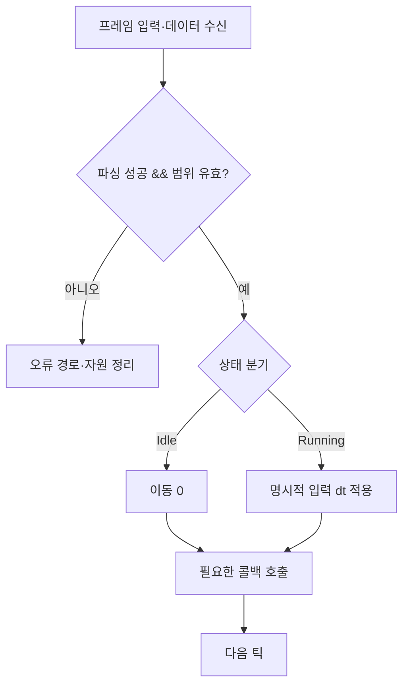

<callout icon="🔀" color="blue_bg">
<b>함수는 코드 덩어리가 아니라 입력·출력·실패 조건을 가진 약속입니다.</b>

반복과 분기를 정확하게 읽고, 원본 데이터를 바꾸는 함수인지 복사본을 처리하는 함수인지 구분합니다. 실습의 작은 값이라는 전제와 실제 게임 데이터의 범위 검사를 함께 생각하세요.
</callout>

<mention url="https://app.notion.com/p/2275f5f2c81a404e9c908dc0296ed65e">C++ 기초문법 — 개정판 v1.0</mention> · 실습 파일: <code>src/flow.cpp</code> · 기준 C++20

<table-of-contents color="gray" />

## 실행 흐름 도식 · 입력 검증 후 호출



이 그림은 기능별 <b>순서와 실패 경로</b>만 설명하며 실제 게임의 입력·상태 머신을 자동으로 구현하지 않습니다. <code>continue</code>와 <code>break</code>는 이 흐름도에서 다른 동작이므로 교재의 별도 절을 참조합니다.

## 1. if와 switch의 선택 기준

<code>if</code>는 임의의 참·거짓 조건으로 분기하고, <code>switch</code>는 정수나 열거형 등의 값에 대응하는 분기를 표현합니다. 서로 독립적으로 검사해야 하는 조건은 각각의 if로, 하나만 선택해야 하는 조건은 if–else if–else로 작성합니다. 중첩을 깊게 하기보다 잘못된 입력을 먼저 처리하는 조기 반환도 유용합니다.

```c++
enum class State { Idle, Running };
State state{State::Running};
int speed{};
switch (state) {
case State::Idle:
    speed = 0;
    break;
case State::Running:
    speed = 7;
    break;
}
```

<code>break</code>는 가장 안쪽의 switch 또는 반복문을 빠져나갑니다. <b>continue는 switch를 다음 case로 넘기는 문장이 아니라 가장 안쪽 반복문의 다음 반복으로 이동</b>합니다. switch에 break가 없으면 아래 case 본문으로 이어질 수 있습니다. C++17의 <code>[[fallthrough]];</code>는 의도적 통과를 표시하지만 통과 동작 자체를 만들어 주는 명령은 아닙니다.

enum class는 서로 다른 열거형을 섞기 어렵게 하고 이름 충돌을 줄입니다. 외부에서 읽은 정수를 캐스팅했다고 자동으로 유효한 열거 값이 검증되는 것은 아닙니다.

근거: [Microsoft — switch](https://learn.microsoft.com/en-us/cpp/cpp/switch-statement-cpp?view=msvc-170), [Microsoft — continue](https://learn.microsoft.com/en-us/cpp/cpp/continue-statement-cpp?view=msvc-170).

## 2. 반복문은 시작·계속 조건·진행을 따로 봅니다

for는 초기화, 계속 조건, 갱신을 함께 보여 줍니다. while은 계속 조건에, do–while은 최소 한 번 수행한다는 차이에 초점을 맞춥니다. 범위 기반 for는 컨테이너의 원소를 순회할 때 인덱스 경계 실수를 줄입니다.

```c++
for (int i = 0; i < 5; ++i) {
    if (i == 2) continue;
    // i == 0, 1, 3, 4일 때 실행
}
```

종료를 보장하려면 반복마다 종료 조건 쪽으로 진행하거나, 이벤트·입력에 의해 종료될 경로가 있어야 합니다. <code>while (ready);</code>처럼 뒤에 붙은 세미콜론은 빈 본문입니다. 코드가 반복문에 속한다고 착각하기 쉬우므로 중괄호를 일관되게 사용하세요.

게임 루프가 계속 도는 것과 입력 함수가 값을 기다리는 것은 다릅니다. 콘솔 입력 대기를 무한 반복으로 설명하면 CPU를 쓰는 바쁜 대기와 운영체제에 의해 대기하는 동작을 혼동하게 됩니다.

## 3. 입력도 실패할 수 있습니다

<code>std::cin >> count</code>는 변환 실패나 입력 종료를 만날 수 있습니다. 읽기에 성공한 뒤에 값의 범위까지 확인합니다. 음수 아이템 개수를 곧바로 size\_t로 바꾸면 아주 큰 수가 될 수 있으므로 <b>검증 후 변환</b>합니다.

```c++
int count{};
if (!(std::cin >> count) || count < 0 || count > 1000) {
    std::cerr << "Invalid count\n";
    return 1;
}
```

이 조각에는 <code><iostream></code>과 main 본문이 필요합니다. 입력이 실패했는데 같은 스트림을 무조건 반복해서 읽으면 fail 상태 때문에 진행하지 못할 수 있습니다. 재시도 정책이 있다면 실패 상태와 남은 입력을 명시적으로 정리해야 합니다. <code>operator>></code>와 <code>getline</code>을 섞을 때는 남은 개행도 고려합니다. scanf 계열을 사용하는 기존 코드는 반환된 변환 개수를 확인하고, 버퍼 크기와 서식 지정자·인자 타입을 맞춰야 합니다.

근거: [Microsoft — basic\_istream](https://learn.microsoft.com/en-us/cpp/standard-library/basic-istream-class?view=msvc-170).

## 4. 함수의 계약을 먼저 정합니다

<code>int Add(int a, int b)</code>라는 선언만으로는 두 정수의 합이 int의 범위를 넘을 때의 정책까지 알 수 없습니다. 호출자가 작은 값만 넘겨야 하는지, 넓은 결과 타입을 반환할지, 범위 오류를 보고할지를 정해야 합니다. 디버그용 assert는 외부 파일·사용자 입력을 검증하는 유일한 수단으로 삼지 않습니다.

짧은 단위 함수도 이름과 입력·출력의 의미가 명확하면 유용합니다. 두 번 사용해야만 함수로 분리할 수 있는 것은 아닙니다. 실패 처리·시험 가능한 단위·추상화 수준이 분리 이유가 될 수 있습니다.

### 전달 방식 비교

<table fit-page-width="true" header-row="true">
<tr>
<td>
매개변수
</td>
<td>
의미
</td>
<td>
주로 확인할 것
</td>
</tr>
<tr>
<td>
<code>int value</code>
</td>
<td>
정수 값 복사
</td>
<td>
이 매개변수의 대입은 호출자 정수를 바꾸지 않음
</td>
</tr>
<tr>
<td>
<code>Player& player</code>
</td>
<td>
기존 객체를 참조
</td>
<td>
원본 변경 의도, 유효한 수명
</td>
</tr>
<tr>
<td>
<code>const Player& player</code>
</td>
<td>
읽기용 참조
</td>
<td>
복사 없이 관찰, 저장해서 나중에 쓰면 수명 문제 발생 가능
</td>
</tr>
<tr>
<td>
<code>Player* player</code>
</td>
<td>
포인터 값 복사
</td>
<td>
널 허용 여부, 소유권, 포인터를 바꾸는 것과 대상 변경의 차이
</td>
</tr>
<tr>
<td>
<code>Player*& player</code> / <code>Player** player</code>
</td>
<td>
호출자의 포인터 변경 가능
</td>
<td>
새 포인터가 가리키는 객체의 소유자와 해제 책임
</td>
</tr>
</table>

작은 정수·불리언은 값 전달이 단순합니다. 참조라고 무조건 더 빠른 것은 아닙니다. 큰 데이터를 읽는 참조는 유용하지만 소유권·복사 비용·최적화 가능성을 함께 봐야 합니다. 자세한 실행 예제는 03 문서에 있습니다.

## 5. 오버로딩과 기본 인수

같은 함수 이름도 매개변수 타입·개수가 다르면 오버로드할 수 있습니다. 일반 함수는 <b>반환 타입만 다르게 해서 오버로드할 수 없습니다.</b> 호출 후보가 여러 개 비슷하게 맞으면 모호성이 생길 수 있습니다.

기본 인수는 호출 위치에서 보이는 선언에 있어야 합니다. 보통 헤더의 선언에 한 번 적습니다. 정의도 선언의 일종이므로 정의 위치에 기본값을 쓰는 것이 무조건 금지되지는 않습니다. 다만 동일한 기본 인수를 다시 지정하거나, 호출자에게 보이지 않는 곳에만 적으면 문제가 됩니다.

```c++
int Scale(int value, int factor = 2) {
    return value * factor;
}
// Scale(3) -> 6, Scale(3, 4) -> 12
```

위 실습은 작은 정수의 곱만 사용합니다. 임의의 큰 게임 데이터를 받는 API라면 곱셈 범위 정책을 별도로 추가해야 합니다.

근거: [N4861 — 기본 인수](https://timsong-cpp.github.io/cppwp/n4861/dcl.fct.default).

## 6. 재귀는 종료 조건뿐 아니라 입력 범위가 필요합니다

재귀 함수는 자기 자신을 호출합니다. 각 호출의 상태가 보존되어야 하므로 일반적인 구현에서는 호출 스택 비용을 생각해야 합니다. 재귀 깊이가 입력에 비례하면 수학적으로 종료하더라도 스택 공간을 소진할 수 있습니다. 꼬리 호출이 항상 최적화되는 것으로 전제하지 않습니다.

팩토리얼을 예로 들면 <code>0! = 1</code>이라는 기저 사례, 음수 거부, 결과 타입의 범위가 모두 필요합니다. 실습에서는 정확한 64비트 부호 없는 정수에 들어가는 0\~20만 받습니다. 매우 큰 입력을 받은 뒤 재귀 깊이부터 늘리는 대신 입구에서 거부합니다.

```c++
#include <cstdint>
#include <limits>
#include <optional>

std::optional<std::uint64_t> Factorial(int n) {
    if (n < 0 || n > 20) return std::nullopt;
    if (n == 0) return std::uint64_t{1};
    const auto previous = Factorial(n - 1);
    const auto factor = static_cast<std::uint64_t>(n);
    if (!previous ||
        *previous > std::numeric_limits<std::uint64_t>::max() / factor) {
        return std::nullopt;
    }
    return *previous * factor;
}
```

<code>std::optional</code>은 값이 있거나 없음을 표현하며 C++17부터 사용할 수 있습니다. 이것만으로 잘못된 입력과 오버플로의 세부 이유를 구분하지는 못합니다. 구체적인 오류 종류가 필요하면 오류 열거형 등을 포함한 별도 결과 타입을 설계합니다. C++11 코드와 연결할 때는 성공 bool과 출력 매개변수 같은 대안도 가능하지만 실패 시 출력값이 어떤 상태인지 정해야 합니다.

## 7. 함수 포인터와 콜백

함수 이름은 포인터 변수 그 자체가 아닙니다. 함수에 대한 표현식이 필요한 문맥에서 함수 포인터로 변환될 수 있습니다. 포인터를 저장하여 어떤 함수를 호출할지 전달하는 것이 콜백의 한 방법입니다.

```c++
int Add(int a, int b) { return a + b; }
using Operation = int (*)(int, int);
Operation operation = &Add;
int result = operation(3, 4);
operation = [](int a, int b) { return a - b; };
```

반환·매개변수 타입 등 함수 타입이 맞아야 합니다. 널 함수 포인터를 호출하면 안 됩니다. 캡처 없는 람다는 맞는 함수 포인터 타입으로 변환될 수 있지만, 캡처가 있는 람다는 그 캡처 상태를 담아야 하므로 같은 방식으로 바꿀 수 없습니다. 상태까지 저장하는 콜백이 필요하면 템플릿으로 호출 가능 객체를 받거나 std::function 같은 타입을 검토합니다. 모든 콜백을 무조건 std::function으로 감싸거나 함수 포인터로 바꾸면 성능이 개선된다고 단정하지 않습니다.

게임에서는 정렬 규칙, 이벤트 처리, 디버그 명령 등에 적용할 수 있습니다. 객체를 가리키는 포인터를 캡처해 나중에 호출한다면 <b>콜백 실행 때 대상 객체가 살아 있는지</b>가 핵심입니다.

근거: [Microsoft — 람다](https://learn.microsoft.com/en-us/cpp/cpp/lambda-expressions-in-cpp?view=msvc-170).

## 8. 매크로는 빠른 함수가 아닙니다

매크로는 전처리 단계의 토큰 치환입니다. 매개변수에 부수 효과가 있는 표현식을 넣으면 여러 번 평가되거나 예상과 다른 우선순위를 만들 수 있습니다. 괄호를 추가해도 다중 평가 문제까지 해결되지는 않습니다.

상수에는 const·constexpr, 짧은 계산에는 inline·constexpr 함수나 템플릿, 자원 해제에는 소유권을 표현하는 RAII를 우선 검토합니다. 헤더 가드·조건부 컴파일 등 전처리기가 필요한 자리와 일반 실행 로직을 구분하세요. inline 표기도 기계어 인라인 확장을 반드시 시키는 명령은 아닙니다.

```c++
constexpr int Square(int value) { return value * value; }
```

위 함수도 모든 int 입력에 안전한 제곱 함수는 아닙니다. 곱의 범위를 넘지 않는다는 계약이 필요합니다. 매크로를 함수로 바꿨다는 이유만으로 수치 오류가 사라지지 않는다는 예입니다.

근거: [C++ Core Guidelines — 매크로 대신 상수·함수](https://isocpp.github.io/CppCoreGuidelines/CppCoreGuidelines#Res-macros).

## 9. 실습·정답 확인

<code>flow</code>는 팩토리얼 0·5·20, 음수·21·매우 큰 입력 거부, 반복문의 continue, switch, do–while, 콜백, 기본 인수, 숫자 입력 성공·실패를 총 <b>15개 검사</b>로 확인합니다. 소스의 Add·Scale은 작은 입력에 대한 시연 함수이며 임의 정수에 대한 안전한 산술 라이브러리가 아닙니다.

<toggle>
질문: T\*를 받는 함수 안에서 p = 다른주소;를 하면 호출자의 포인터도 바뀔까요?

포인터 값을 복사한 매개변수만 바뀝니다. <i>p를 수정하면 대상 객체의 값은 바뀔 수 있습니다. 호출자의 포인터 자체를 바꾸려면 반환값을 사용하거나 T</i>& 또는 T 같은 인터페이스가 필요합니다.
</toggle>

<toggle>
질문: 재귀 팩토리얼이 양수마다 1씩 감소하므로 모든 int 입력에 안전할까요?

아닙니다. 결과 범위와 재귀 깊이 한계를 넘을 수 있습니다. 실습 함수는 재귀 시작 전에 범위를 제한하고 곱셈 전에 범위도 검사합니다.
</toggle>

<toggle>
질문: switch 안의 continue는 무엇을 하나요?

그 switch를 감싸는 가장 안쪽 반복문의 다음 반복으로 갑니다. 감싸는 반복문이 없다면 continue를 사용할 수 없습니다. 다음 case로 이동하는 의미가 아닙니다.
</toggle>
