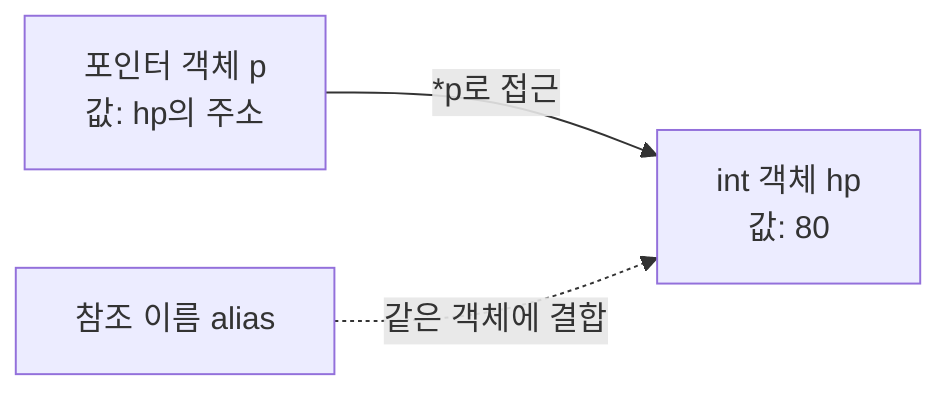
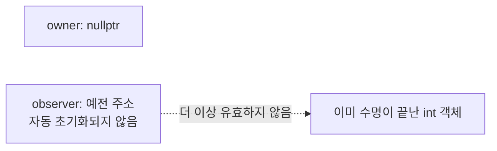

<callout icon="🧠" color="blue_bg">
<b>주소를 알고 있다는 사실은 그 객체를 사용해도 된다는 보장이 아닙니다.</b>

포인터 값을 읽는 것, 대상 값을 읽는 것, 대상의 수명, 해제 책임을 따로 설명할 수 있어야 합니다. 이 문서는 C++20의 객체·수명 모델을 기준으로 합니다.
</callout>

<mention url="https://app.notion.com/p/2275f5f2c81a404e9c908dc0296ed65e">C++ 기초문법 — 개정판 v1.0</mention> · 실습 파일: <code>src/memory.cpp</code>

<table-of-contents color="gray" />

## 1. 이름·주소·값을 분리해서 읽습니다

```c++
int hp{100};
int* p = &hp;
int& alias = hp;
*p = 80;
```

<code>hp</code>라는 객체의 값은 이제 80입니다. <code>&hp</code>는 그 객체의 주소이고, <code>p</code>는 그 주소를 값으로 저장하는 별도의 포인터 객체입니다. <code>*p</code>는 대상 객체를 지칭합니다. <code>alias</code>는 hp에 결합된 참조이므로 alias에 대입하면 같은 hp가 바뀝니다.



그림은 의미 관계를 설명한 것이며 실제 스택 주소·메모리 배치를 측정한 결과는 아닙니다. <b>p의 값과 \*p의 값은 다르고, &p는 p 자신의 주소</b>입니다. <code>int** pp = &p;</code>에서는 <code>*pp</code>가 포인터 p, <code>**pp</code>가 hp를 지칭합니다.

구조체 포인터의 <code>p->member</code>는 정상적인 대상에 대해 <code>(*p).member</code>와 대응합니다. 화살표 전체가 멤버 접근 연산자이며 <code>></code> 하나가 역참조 연산자는 아닙니다.

## 2. 포인터를 복사하면 무엇이 복사될까요?

```c++
void ReseatCopy(int* p, int* target) { p = target; }
void Reseat(int*& p, int* target) { p = target; }
void ReseatOut(int** p, int* target) {
    if (p != nullptr) *p = target;
}
```

첫 함수는 포인터의 복사본을 바꿉니다. 호출자의 포인터를 변경하려면 반환값을 받아 대입하거나, 두 번째·세 번째 함수처럼 포인터 객체에 접근해야 합니다. 세 번째 함수의 널 검사는 출력 위치 포인터가 없는 경우를 처리할 뿐, 임의의 잘못된 주소를 검증하는 기능은 아닙니다.

DirectX의 장치 생성처럼 출력 포인터를 받는 API를 읽을 때도 이 구분이 중요합니다. <code>T**</code>를 쓴다는 사실만으로 소유권이 정해지지는 않습니다. API가 반환하는 객체를 누가 해제하는지 별도 계약을 확인해야 합니다.

## 3. 참조는 재결합하지 않습니다

```c++
int a{10};
int b{20};
int& r = a;
r = b;  // r을 b에 재결합하는 것이 아니라 a에 b의 값을 대입
```

참조는 유효한 객체나 함수에 결합되어야 하며, 한 번 초기화한 참조를 다른 대상으로 재결합하는 문법은 없습니다. 포인터의 nullptr처럼 참조의 ‘없음’을 정상 상태로 사용하지 않습니다. 참조를 구현하기 위해 실제 저장 공간이 필요한지는 구현의 문제이므로 <b>참조는 언제나 메모리를 전혀 쓰지 않는다</b>고 설명하지 않습니다. <code>sizeof(r)</code>은 참조 자체의 별도 저장 비용이 아니라 지칭하는 타입의 크기를 구합니다.

<code>int& r = 10;</code>은 허용되지 않지만 <code>const int& r = 10;</code>은 임시 객체에 결합할 수 있습니다. 그렇다고 모든 const 참조가 임시 객체의 수명을 아무 때나 연장하지는 않습니다. 함수가 받은 참조를 그대로 반환하거나 저장하는 경우는 특히 주의합니다. 이번 기초 단계에서는 소유하지 않는 참조를 장기 보관하지 않는 인터페이스부터 익힙니다.

근거: [N4861 — 참조](https://timsong-cpp.github.io/cppwp/n4861/dcl.ref), [N4861 — 임시 객체](https://timsong-cpp.github.io/cppwp/n4861/class.temporary).

## 4. const를 읽는 표

<table fit-page-width="true" header-row="true">
<tr>
<td>
선언
</td>
<td>
포인터 자체 변경
</td>
<td>
이 경로로 대상 변경
</td>
</tr>
<tr>
<td>
<code>int* p</code>
</td>
<td>
가능
</td>
<td>
가능
</td>
</tr>
<tr>
<td>
<code>const int* p</code> / <code>int const* p</code>
</td>
<td>
가능
</td>
<td>
불가
</td>
</tr>
<tr>
<td>
<code>int* const p</code>
</td>
<td>
불가
</td>
<td>
가능
</td>
</tr>
<tr>
<td>
<code>const int* const p</code>
</td>
<td>
불가
</td>
<td>
불가
</td>
</tr>
</table>

포인터 선언의 const가 <b>포인터 객체</b>에 적용되는지, <b>대상 타입</b>에 적용되는지 나눠 읽습니다. const 경로로 관찰하는 객체가 다른 비const 경로에서도 절대 바뀌지 않는다는 뜻은 아닙니다.

원래 const인 객체를 const\_cast 등으로 수정하면 C++20에서 미정의 동작입니다. 캐스팅이 컴파일된다는 이유로 실제 수정을 허용받은 것이 아닙니다. 원래 비const 객체에 대한 const 경로를 제거하는 것과, 원래 const인 객체를 수정하는 것은 다른 상황입니다. 입문 예제에서 캐스팅으로 제한을 우회하는 습관을 들이지 않습니다.

<code>const int x{1};</code>에서 x를 나타내는 표현식은 lvalue이지만 수정할 수 없습니다. <b>lvalue = 수정 가능한 값, rvalue = 수정 불가능한 값</b>이라는 구분은 잘못입니다. 값 범주와 const는 서로 다른 축이며 이동 의미론은 심화 문서에서 이어서 다룹니다.

근거: [N4861 — cv 한정자](https://timsong-cpp.github.io/cppwp/n4861/dcl.type.cv).

## 5. 범위와 수명은 같은 단어가 아닙니다

범위는 이름을 사용할 수 있는 영역이고, 수명은 객체가 존재하는 기간입니다. 일반적인 함수 내부 객체는 자동 저장 기간을 갖지만, 지역 static은 이름의 지역 범위와 별개로 프로그램 실행 동안 저장 공간을 유지합니다. 동적 객체는 그것을 가리키는 지역 포인터가 사라졌다고 자동으로 해제되지 않습니다.

<table fit-page-width="true" header-row="true">
<tr>
<td>
저장 기간
</td>
<td>
예
</td>
<td>
주의
</td>
</tr>
<tr>
<td>
자동
</td>
<td>
블록 안의 일반 지역 객체
</td>
<td>
보통 블록을 벗어나며 소멸. 주소를 반환해 사용하지 않음
</td>
</tr>
<tr>
<td>
정적
</td>
<td>
전역 객체, 지역 static
</td>
<td>
이름 범위와 저장 기간이 같지 않음. 초기화·소멸 순서 고려
</td>
</tr>
<tr>
<td>
스레드
</td>
<td>
<code>thread_local</code> 객체
</td>
<td>
스레드별 객체이며 스레드 종료와 연관
</td>
</tr>
<tr>
<td>
동적
</td>
<td>
new 표현식이나 소유 객체가 관리하는 자원
</td>
<td>
해제 책임을 소유권으로 표현해야 함
</td>
</tr>
</table>

교재의 CODE/DATA/STACK/HEAP 그림은 일반적인 프로세스 메모리 배치의 설명 모델입니다. 물리 RAM이 C++에 의해 항상 네 구역으로 나뉜다는 규칙이 아닙니다. 최적화로 지역 값이 레지스터에 있거나 저장 자체가 제거될 수도 있습니다. 이 문서는 의미상 수명·접근 권한을 먼저 보고 구현 배치를 덧붙이는 순서를 사용합니다.

근거: [N4861 — 객체 수명](https://timsong-cpp.github.io/cppwp/n4861/basic.life), [N4861 — 저장 기간](https://timsong-cpp.github.io/cppwp/n4861/basic.stc).

## 6. 동적 객체와 포인터 객체는 따로 사라집니다

```c++
int* owner = new int{7};
int* observer = owner;
delete owner;
owner = nullptr;
// observer는 자동으로 nullptr가 되지 않습니다.
// *observer를 읽거나 delete observer를 하면 안 됩니다.
```

<code>new int{7}</code>은 동적으로 int 객체를 만들고 초기화합니다. <code>owner</code>라는 포인터 객체의 값은 유효한 주소입니다. <code>new int;</code>에서 문제가 되는 것은 포인터의 초기값이 아니라 <b>가리키는 int의 초기값을 주지 않았다는 점</b>입니다.



해제 후 메모리에 7이 남아 보이더라도 사용할 수 있다는 뜻이 아닙니다. 이러한 잘못된 접근은 디버그에서 우연히 정상처럼 보이다가 다른 할당·최적화에서 실패할 수 있습니다. 널 검사는 수명 검사나 소유권 검사를 대신하지 못합니다.

### 할당·해제 짝

<code>new T</code>와 <code>delete</code>, <code>new T[n]</code>과 <code>delete[]</code>, malloc 계열과 free를 섞지 않습니다. new는 객체 초기화·생성과 연결되고, malloc은 바이트 저장 공간 확보를 제공하는 C 계열 인터페이스입니다. 일반 C++ 클래스 객체를 malloc과 캐스트만으로 정상 생성했다고 취급하지 마세요. 일반 new는 실패하면 bad\_alloc 예외를 던지며, nothrow 형식이나 malloc의 실패 처리와 구분합니다.

## 7. RAII로 해제 책임을 코드에 씁니다

```c++
#include <memory>
#include <utility>

auto owner = std::make_unique<int>(42);
int* observer = owner.get();
auto next_owner = std::move(owner);
// next_owner가 소유, owner는 비어 있음. 동적 int의 주소는 그대로입니다.
next_owner.reset();
observer = nullptr; // 관찰 포인터는 사용을 끝냈음을 명시
```

unique\_ptr는 하나의 소유자를 표현합니다. 정상적인 소멸이나 reset 시 관리하는 객체를 해제합니다. <code>.get()</code>은 소유권을 넘기지 않습니다. 관찰 포인터를 직접 delete하면 이중 해제 원인이 됩니다. <code>std::move</code> 자체가 무조건 데이터를 이동하거나 메모리를 해제하는 함수는 아닙니다. 여기서는 unique\_ptr의 이동 생성자가 소유권을 이전합니다.

정수 배열·문자열·가변 목록은 직접 new/delete를 짜기 전에 std::array, std::string, std::vector를 검토합니다. shared\_ptr는 실제 공동 소유가 필요한 경우에 쓰며 모든 raw 포인터를 shared\_ptr로 바꾸는 것은 설계가 아닙니다. 순환 소유나 해제 시점 예측 문제는 심화에서 따로 다룹니다.

RAII는 메모리에만 해당하지 않습니다. 파일·잠금·그래픽 자원처럼 획득과 해제가 짝을 이루는 자원에도 적용하는 원리입니다.

근거: [Microsoft — 스마트 포인터와 소유권](https://learn.microsoft.com/en-us/cpp/cpp/smart-pointers-modern-cpp?view=msvc-170).

## 8. 배열과 포인터 연산의 경계

```c++
int values[]{10, 20, 30};
int* p = values;
int* end = values + 3;
int second = *(p + 1);  // values[1]과 대응
// *end는 금지: 끝 다음 위치를 만들 수 있어도 읽을 원소는 없습니다.
```

포인터 산술은 같은 배열 객체의 원소 또는 끝 다음 위치 안에서 수행해야 합니다. 단순한 주소 숫자 계산으로 메모리 어딘가를 탐색해도 되는 기능이 아닙니다. 포인터 증가 단위는 대상 타입의 크기지만, 크기만 맞다고 다른 배열·다른 타입 접근이 정당해지지는 않습니다.

배열은 포인터가 아닙니다. 많은 표현식에서 첫 원소 포인터로 변환되지만, 배열 자체의 sizeof와 함수 인자로 변환된 포인터의 sizeof는 다릅니다. <code>arr++</code>는 배열 객체를 포인터 변수처럼 변경하려는 표현이므로 허용되지 않습니다. 다차원 배열과 int의 차이는 04 문서에 있습니다.

근거: [N4861 — 포인터 덧셈](https://timsong-cpp.github.io/cppwp/n4861/expr.add), [Microsoft — 배열](https://learn.microsoft.com/en-us/cpp/cpp/arrays-cpp?view=msvc-170).

## 9. 캐스팅은 타입·정렬·수명 검사를 대신하지 않습니다

<code>void*</code>에는 객체 포인터를 타입을 지운 형태로 담을 수 있습니다. 그러나 표준 C++의 void\*에는 대상 원소 크기가 정해져 있지 않아 그대로 역참조하거나 산술할 수 없습니다. 원래 타입에 맞게 되돌리고 객체가 살아 있을 때 사용합니다. 함수 포인터까지 모든 환경에서 같은 규칙으로 왕복한다고 가정하지 않습니다.

기존 노트의 short·char 배열을 int\*로 바꿔 읽는 실험은 ‘비트가 어떻게 보일까’뿐 아니라 정렬·타입 접근·객체 수명 조건을 함께 다뤄야 합니다. 이를 단순한 정상 출력 문제로 사용하지 않습니다.

<b>파일의 바이트를 값으로 해석하려면 규약을 명시하는 방식이 더 분명합니다.</b> 예를 들어 두 옥텟을 리틀 엔디안 16비트 값으로 읽는다면 다음처럼 조립합니다.

```c++
std::array<std::uint8_t, 2> bytes{0x01, 0x02};
const auto value = static_cast<std::uint16_t>(
    static_cast<std::uint16_t>(bytes[0]) |
    (static_cast<std::uint16_t>(bytes[1]) << 8));  // 513
```

이 조각에는 <code><array></code>와 <code><cstdint></code>가 필요합니다. 호스트의 메모리 바이트 순서를 그대로 재해석하지 않고 정한 파일 규칙으로 값을 구성합니다. std::bit\_cast는 같은 크기·trivially copyable 등의 조건 아래 객체 표현을 다른 값으로 옮길 때 쓰지만 임의의 비트 패턴을 어떤 타입으로든 안전하게 만드는 도구는 아닙니다. memcpy 역시 크기·유효 대상·객체 표현 조건을 확인해야 합니다.

근거: [N4861 — bit\_cast](https://timsong-cpp.github.io/cppwp/n4861/bit.cast), [N4861 — 타입 접근](https://timsong-cpp.github.io/cppwp/n4861/basic.lval).

## 10. 게임 코드에서 적용하는 질문

오브젝트 포인터를 저장하기 전에 누가 소유하는지, 언제 삭제되는지, 컨테이너 재할당으로 주소가 바뀌는지, 이벤트가 삭제 뒤에도 호출될 수 있는지 확인합니다. 이 질문의 답이 불분명하면 raw 포인터를 스마트 포인터로 치환하기 전에 수명 설계를 먼저 정해야 합니다. 핸들·세대 번호 같은 대안은 이후 엔진 시스템 학습에서 연결할 수 있습니다.

## 11. 실습과 이해 확인

<code>memory</code>는 값·참조·포인터 전달, 포인터 재지정, const 경로, void<i> 왕복, 배열의 끝 다음 위치, unique\_ptr 이동과 해제, 바이트 해석을 19개 검사</i>\*로 확인합니다. 정상 실습에서는 이미 해제된 객체나 끝 다음 위치를 역참조하지 않습니다.

<toggle>
질문: owner를 nullptr로 만들었는데 observer를 써도 되나요?

안 됩니다. owner 포인터 변수만 바뀌었고 observer의 주소값은 자동으로 바뀌지 않습니다. 먼저 가리키던 객체의 수명이 끝났다면 observer를 통한 접근은 잘못입니다.
</toggle>

<toggle>
질문: sizeof(int&)가 int 크기와 같으니 참조 비용은 항상 0일까요?

그 결론을 내릴 수 없습니다. sizeof의 참조 처리 규칙과 함수 호출·참조 저장의 실제 구현 비용은 다른 문제입니다.
</toggle>

<toggle>
위험 동작을 직접 확인하는 별도 실험

<code>diagnostics/use_after_free.cpp</code>는 의도적인 미정의 동작 예제이며 정상 테스트 대상에서 제외했습니다. 이번 환경에서 AddressSanitizer가 heap-use-after-free를 보고하는 것을 확인했습니다. 일반 게임 코드나 정상 출력 예제로 복사하지 마세요. 도구가 아무것도 보고하지 않았다는 사실만으로 다른 모든 코드의 안전성이 증명되지는 않습니다.
</toggle>
