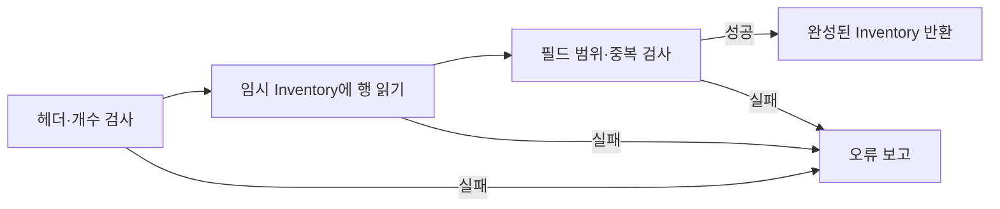

<callout icon="🧪" color="blue_bg">
<b>실행 가능한 문서는 성공한 예제뿐 아니라 실패를 처리하는 예제도 갖춥니다.</b>

파일 경로·직렬화·링크·검증을 작은 인벤토리 프로그램으로 연결합니다. 이번 실습은 개인 학습용 데이터에 대한 예제이며 상용 저장 시스템을 완성한 것은 아닙니다.
</callout>

<mention url="https://app.notion.com/p/2275f5f2c81a404e9c908dc0296ed65e">C++ 기초문법 — 개정판 v1.0</mention> · 파일: <code>src/inventory.hpp</code>, <code>src/inventory.cpp</code>, <code>src/inventory_main.cpp</code>

<table-of-contents color="gray" />

## 1. 파일 경로의 기준은 현재 작업 디렉터리입니다

상대 경로는 일반적으로 프로세스의 <b>현재 작업 디렉터리</b>를 기준으로 해석합니다. 소스 파일이 있는 위치나 실행 파일이 있는 위치가 언제나 기준인 것은 아닙니다. IDE·터미널·바로가기·테스트 실행기가 서로 다른 작업 디렉터리를 지정할 수 있습니다.

```c++
#include <filesystem>
#include <iostream>
int main() {
    std::cout << std::filesystem::current_path() << '\n';
}
```

파일을 못 찾는 경우 경로 문자열뿐 아니라 작업 디렉터리, 실제 파일 존재, 권한, 파일명 대소문자 정책을 확인합니다. 게임 자산 경로는 실행 시 한 번 정한 자산 루트를 기준으로 조합하는 식으로 관리하고, 매 함수마다 임의의 작업 디렉터리 변경에 의존하지 않는 편이 좋습니다. 사용자 입력 경로를 처리하는 도구는 루트 밖으로 나가는 경로와 덮어쓰기 정책도 별도로 검토해야 합니다.

근거: [Microsoft — filesystem 함수와 current\_path](https://learn.microsoft.com/en-us/cpp/standard-library/filesystem-functions?view=msvc-170).

## 2. 스트림·버퍼·EOF

스트림은 읽기·쓰기의 연속적인 인터페이스이고 버퍼는 데이터를 모아 처리하는 중간 저장 공간입니다. stdin과 stdout은 항상 키보드·모니터에 고정되는 것이 아니라 리다이렉션될 수 있습니다. 콘솔 입출력과 파일 입출력의 공통점은 <b>읽기·쓰기 요청이 실패할 수 있다는 점</b>입니다.

C의 fgetc 결과는 int로 받아 EOF와 비교합니다. EOF는 일반 문자 값과 구분해야 하는 음수 정수 매크로이며 모든 환경에서 숫자 -1로 하드코딩하는 대신 EOF 자체와 비교합니다. fread는 실제로 읽은 원소 개수를 반환하며, 요청보다 적게 읽었다면 EOF인지 오류인지 필요한 검사를 해야 합니다.

C++ 스트림에서는 보통 <code>while (std::getline(input, line))</code>처럼 읽기 연산의 성공을 조건으로 사용합니다. <code>while (!input.eof())</code>는 마지막 읽기가 실패한 뒤에도 이전 값을 처리하게 만드는 흔한 실수입니다. 정상 EOF와 badbit 등 실제 오류도 구분하세요.

근거: [Microsoft — fgetc](https://learn.microsoft.com/en-us/cpp/c-runtime-library/reference/fgetc-fgetwc?view=msvc-170), [Microsoft — fread](https://learn.microsoft.com/en-us/cpp/c-runtime-library/reference/fread?view=msvc-170), [Microsoft — basic\_istream](https://learn.microsoft.com/en-us/cpp/standard-library/basic-istream-class?view=msvc-170).

## 3. 파일도 소유자가 필요합니다

std::ifstream·ofstream은 객체 수명과 파일 자원 해제를 연결합니다. 개방 성공을 검사하고, 읽기·쓰기 실패도 처리해야 합니다. 중요한 저장에서는 출력 객체가 소멸하니 모든 쓰기가 성공했다고 가정하지 말고 flush·close의 실패를 확인합니다.

기존 FILE<i> 코드를 읽을 때에는 fopen과 fclose가 짝임을 확인합니다. fopen\_s의 FILE</i>\*는 호출자의 파일 포인터를 채우기 위한 출력 매개변수입니다. 운영체제가 달라서 이중 포인터를 쓴다고 설명할 이유는 없습니다. 표준 C/C++ 인터페이스와 특정 CRT의 보안 확장 함수는 구분합니다.

파일을 새로 여는 모드도 중요합니다. 쓰기 모드가 기존 내용을 지울 수 있으므로 경로를 검증하고 덮어쓰기 여부를 정해야 합니다. 이번 자동 테스트는 새 임시 디렉터리를 만든 뒤 그 안에만 파일을 작성하고, 테스트가 만든 디렉터리만 정리합니다.

## 4. 텍스트와 바이너리는 형식을 지키는 두 가지 표현입니다

텍스트는 사람이 보기 쉬운 숫자·구분자·문자열로, 바이너리는 정해진 바이트 표현으로 데이터를 저장할 수 있습니다. 파일 확장자가 메모리 구조나 디코딩 방법을 자동으로 결정하지는 않습니다. 바이너리도 올바른 형식에 맞게 수정하면 읽을 수 있습니다. ‘텍스트는 수정 가능, 바이너리는 수정 불가’라는 구분은 틀립니다.

구조체의 sizeof 바이트를 그대로 저장하는 것은 다음 이유로 일반적인 영속 포맷이 되지 못합니다. 포인터는 주소값일 뿐 대상 데이터가 아니고, 패딩·정렬·정수 폭·엔디안·문자 인코딩·라이브러리 구현이 달라질 수 있습니다. std::string 객체를 통째로 저장해도 문자열 내용이 이식 가능한 포맷으로 저장되지는 않습니다.

필드별 값, 버전, 개수, 길이, 바이트 순서, 문자열 인코딩을 명시하세요. 길이 필드를 읽을 때도 메모리를 할당하기 전에 상한과 계산 오버플로를 확인합니다. 원소 수를 받아 전체 구조를 한 번에 신뢰하지 않습니다.

03 문서의 두 바이트 조립은 리틀 엔디안 숫자를 명시적으로 해석한 작은 예입니다. 그것만으로 모든 타입을 저장하는 직렬화 라이브러리가 완성되지는 않습니다.

## 5. 예제 포맷: 인벤토리 INV1

이번 실습의 저장 형식은 아래와 같습니다. 첫 줄은 형식 식별자와 원소 수이고 이후 한 줄이 한 아이템입니다. 문자열의 공백·따옴표·역슬래시 처리는 std::quoted를 이용합니다. 저장기는 이름을 따옴표로 감싸며, 읽기 구현은 std::quoted가 허용하는 공백 없는 비인용 토큰도 받을 수 있습니다.

```txt
INV1 2
1 "Health Potion" 3
2 "Mana" 1
```

<table fit-page-width="true" header-row="true">
<tr>
<td>
필드
</td>
<td>
실습의 계약
</td>
</tr>
<tr>
<td>
버전
</td>
<td>
INV1만 허용
</td>
</tr>
<tr>
<td>
아이템 수
</td>
<td>
0\~1000
</td>
</tr>
<tr>
<td>
ID
</td>
<td>
양의 int, 중복 거부
</td>
</tr>
<tr>
<td>
이름
</td>
<td>
빈 값 거부, 최대 256 char 원소, CR·LF 포함 거부
</td>
</tr>
<tr>
<td>
수량
</td>
<td>
0\~1,000,000
</td>
</tr>
<tr>
<td>
파일 끝
</td>
<td>
부족한 행·행 뒤의 쓰레기 토큰·불필요한 추가 데이터 거부
</td>
</tr>
</table>

이 예제에서 이름 길이는 표시 글자 수가 아닙니다. 테스트는 ASCII 이름을 사용하며 UTF-8 유효성을 검사하는 파서는 구현하지 않았습니다. 외부에 공개하는 서비스에 적용하려면 총 파일 크기·행 길이의 읽기 전 제한, 인코딩 검사, 진단 위치, 파일 경로 정책 같은 보강도 필요합니다.

### 부분적으로 읽힌 데이터를 적용하지 않습니다

Load는 새 Inventory를 만들어 모든 행을 읽고 검증한 뒤 반환합니다. 호출자의 기존 인벤토리를 읽는 도중 하나씩 바꾸지 않습니다. 중간 행에서 실패하면 미완성 데이터를 게임 상태에 적용하지 않도록 하는 구조입니다.



Save는 데이터 유효성을 먼저 확인한 뒤 씁니다. 하지만 쓰기 도중 디스크 오류가 나면 파일 일부가 남을 수 있습니다. <b>이번 예제는 원자적 저장이나 전원 장애 복구를 구현하지 않았습니다.</b> 실제 저장 시스템에서는 임시 파일 기록과 안전한 교체 등 별도 정책이 필요합니다.

## 6. 소스 파일의 역할

<table fit-page-width="true" header-row="true">
<tr>
<td>
파일
</td>
<td>
역할
</td>
</tr>
<tr>
<td>
<code>inventory.hpp</code>
</td>
<td>
Item·Inventory 타입, Save·Load 인터페이스 선언, 헤더 가드
</td>
</tr>
<tr>
<td>
<code>inventory.cpp</code>
</td>
<td>
포맷 파싱·데이터 검증·저장 구현. 내부 보조 함수는 이름 없는 네임스페이스
</td>
</tr>
<tr>
<td>
<code>inventory_main.cpp</code>
</td>
<td>
왕복 저장·로드, 잘못된 입력 거부, 실제 파일·복사·누락 파일 테스트
</td>
</tr>
<tr>
<td>
<code>check.hpp</code>
</td>
<td>
성공 조건을 검사하는 학습용 공통 보조 함수. 실패 시 종료 코드 1
</td>
</tr>
<tr>
<td>
<code>CMakeLists.txt</code>
</td>
<td>
6개 실행 파일과 CTest 항목 구성. 위험 실험 파일은 기본 빌드에서 제외
</td>
</tr>
</table>

실습 팩에는 이 파일들의 전체 코드와 진입점이 있습니다. 본문은 API와 흐름을 읽기 위한 것이므로 수백 줄을 다시 복제하지 않습니다.

## 7. 선언·정의·링크를 정리합니다

헤더에는 호출자에게 필요한 선언을 두고, 일반 함수의 정의는 하나의 cpp에 둘 수 있습니다. 헤더 가드는 <b>같은 번역 단위에서의 중복 포함</b>을 막는 방법이지, 여러 cpp에 같은 외부 변수 정의를 만들어도 되는 해결책이 아닙니다. #pragma once는 널리 지원되지만 표준 문법은 아니므로 예제 팩은 매크로 헤더 가드를 사용합니다.

```c++
// state.hpp
#ifndef STUDY_STATE_HPP
#define STUDY_STATE_HPP
extern int score;
#endif

// state.cpp
#include "state.hpp"
int score{};
```

이 조각은 선언과 한 곳의 정의를 설명하는 예이며 실습 팩의 별도 빌드 대상은 아닙니다. static을 붙여 링크 오류만 숨기면 cpp마다 서로 다른 객체가 생겨 원래 공유하려던 상태가 나뉠 수 있습니다. 전역 공유가 정말 필요한지 먼저 확인하세요.

네임스페이스 범위 static은 내부 연결과, 지역 static은 정적 저장 기간과 연관됩니다. 같은 키워드가 서로 다른 문맥에서 무엇을 뜻하는지 읽어야 합니다. C++17 inline 변수와 헤더에 정의하는 템플릿·inline 함수는 각각의 규칙이 있으며 ‘모든 정의는 무조건 cpp’라고 가르치지 않습니다. 실습의 check.hpp는 C++17 이후 inline 변수를 사용하지만 전체 학습 빌드 기준은 C++20입니다.

근거: [Microsoft — 프로그램과 연결](https://learn.microsoft.com/en-us/cpp/cpp/program-and-linkage-cpp?view=msvc-170), [N4861 — 정의 규칙](https://timsong-cpp.github.io/cppwp/n4861/basic.def.odr).

## 8. 실행 방법

실습 팩 ZIP을 풀고 프로젝트 루트에서 다음을 실행합니다. CMake, C++20을 지원하는 컴파일러와 해당 표준 라이브러리가 설치되어 있어야 합니다.

```bash
cmake -S . -B build
cmake --build build --config Debug
ctest --test-dir build -C Debug --output-on-failure
```

MSVC에서 직접 한 소스를 빌드한다면 <code>/std:c++20 /EHsc /W4 /permissive- /utf-8</code> 같은 옵션을 사용할 수 있습니다. 다중 파일 inventory는 두 cpp를 함께 연결해야 합니다. 이번에 Windows 빌드를 실제로 실행한 것은 아니므로 설치된 MSVC·SDK에 맞춘 확인이 별도로 필요합니다.

근거: [Microsoft — 표준 버전 선택](https://learn.microsoft.com/en-us/cpp/build/reference/std-specify-language-standard-version?view=msvc-170), [CMake — 빌드 도구 사용법](https://cmake.org/cmake/help/latest/manual/cmake.1.html), [CTest — 테스트 실행](https://cmake.org/cmake/help/latest/manual/ctest.1.html).

## 9. 디버깅: 틀린 값을 만든 첫 지점을 찾습니다

중단점은 문제가 드러난 줄뿐 아니라 데이터가 처음 바뀌는 위치에도 둡니다. 호출 스택으로 누가 이 함수를 호출했는지 확인하고, Watch·Locals에서 값·포인터·size·capacity를 관찰합니다. 함수 안으로 들어가기와 한 줄씩 넘기기, 함수 밖으로 나오기를 구별합니다.

Visual Studio의 기본 키 설정에서는 F5 실행·계속, F9 중단점, F10 프로시저 단위 실행, F11 단계별 실행 등을 사용합니다. 키 바인딩은 환경 설정에 따라 달라질 수 있으므로 메뉴 명령도 함께 확인하세요. 컴파일 최적화가 켜져 있으면 소스 줄과 명령 실행이 일대일로 대응하지 않거나 변수가 보이지 않을 수 있습니다.

재현하려면 입력, 빌드 설정, 난수 시드, 발생 순서가 필요합니다. 이번 테스트도 파일 오류를 감각적으로 확인하는 대신 거부되어야 할 입력을 코드에 기록했습니다.

근거: [Microsoft — Visual Studio 디버거 탐색](https://learn.microsoft.com/en-us/visualstudio/debugger/navigating-through-code-with-the-debugger?view=vs-2022).

## 10. 실제 검증 결과 · 2026-10-12

<table fit-page-width="true" header-row="true">
<tr>
<td>
검증
</td>
<td>
실제 결과
</td>
<td>
한계
</td>
</tr>
<tr>
<td>
GCC 14.2.0 · Linux x86-64
</td>
<td>
6/6 실행 파일 통과, 런타임 조건 검사 총 221회
</td>
<td>
다른 플랫폼의 크기·ABI를 증명하지 않음
</td>
</tr>
<tr>
<td>
Clang 17.0.0 · 같은 Linux 환경
</td>
<td>
6/6 통과
</td>
<td>
독립된 두 운영체제나 두 표준 라이브러리 구현을 비교한 것은 아님
</td>
</tr>
<tr>
<td>
Clang + AddressSanitizer·UndefinedBehaviorSanitizer
</td>
<td>
정상 예제 6/6 통과, 실행 중 진단 없음
</td>
<td>
실행하지 않은 경로와 모든 종류의 오류를 보장하지 않음
</td>
</tr>
<tr>
<td>
컴파일 실패 예제 4개
</td>
<td>
GCC·Clang 양쪽에서 모두 거부
</td>
<td>
const 변경, 축소 초기화, 잘못된 다차원 배열 포인터, 임시값의 비const 참조
</td>
</tr>
<tr>
<td>
별도 위험 실험 2개
</td>
<td>
signed overflow와 heap-use-after-free를 각각 진단
</td>
<td>
의도적인 미정의 동작. 정상 결과를 기대하는 예제가 아님
</td>
</tr>
<tr>
<td>
Windows/MSVC·게임 프로젝트
</td>
<td>
실행 미검증
</td>
<td>
여기서 제공한 표준 예제와 실제 DX9·엔진 코드의 통합 검증은 별도
</td>
</tr>
</table>

정상 빌드 경고 옵션은 <code>-Wall -Wextra -Wpedantic -Wconversion -Wshadow</code>이며 이번 GCC·Clang 빌드에서 경고가 없었습니다. 정상 실행 프로그램별 검사는 types 15, flow 15, memory 19, containers 49, buffer 104, inventory 19입니다. 루프 원소 검사도 합산되어 있으므로 221개의 독립적인 기능 테스트라는 뜻은 아닙니다. 로그는 ZIP의 <code>verification/results.json</code>에 있습니다.

검증 명령과 오류 재현 방법은 ZIP의 README를 보세요. Windows 결과가 없는데 ‘모든 컴파일러에서 검증됨’이라고 표시하지 않습니다. 원문에 포함된 코드 이미지 전체를 전사하여 실행한 것이 아니라 <b>기존 주제를 바탕으로 새로 만든 실습 팩</b>을 테스트한 것입니다.

근거: [Clang — AddressSanitizer](https://clang.llvm.org/docs/AddressSanitizer.html), [Clang — UndefinedBehaviorSanitizer](https://clang.llvm.org/docs/UndefinedBehaviorSanitizer.html).

## 11. 통합 실습을 확장하기 전에

이번 Inventory에서 ID와 수량은 int 범위 안의 작은 값입니다. 다음 개선을 할 때에는 먼저 실패 조건을 테스트로 기록한 뒤 구현을 바꿉니다. 예를 들어 지원하는 파일 버전을 하나 늘리거나, 중복 ID 정책을 바꾸거나, 실제 게임에서 요구하는 문자열 정책을 추가할 수 있습니다. 현재 테스트 통과를 이유로 아무 입력이나 안전하게 읽는 범용 파서로 취급하지 않습니다.

<toggle>
질문: 편집기에서 실행할 때만 파일이 열리는 이유부터 무엇을 확인할까요?

현재 작업 디렉터리와 조합된 최종 경로부터 확인합니다. cpp 파일이나 exe 위치가 무조건 상대 경로 기준이라는 가정을 버립니다.
</toggle>

<toggle>
질문: 저장 함수가 반환했으니 갑작스러운 전원 종료에도 파일이 안전할까요?

아닙니다. 스트림 성공, 디스크 반영, 원자적 교체, 전원 장애 복구는 서로 다른 보장입니다. 이번 학습 예제는 원자적 저장이나 내구성을 구현하지 않습니다.
</toggle>

<toggle>
질문: 헤더 가드가 있는데 왜 다중 정의 링크 오류가 날 수 있을까요?

헤더 가드는 한 번역 단위 내의 중복 포함을 막습니다. 여러 번역 단위에 동일한 일반 외부 정의를 만드는 문제는 ODR과 연결 규칙에 따라 따로 해결해야 합니다.
</toggle>
