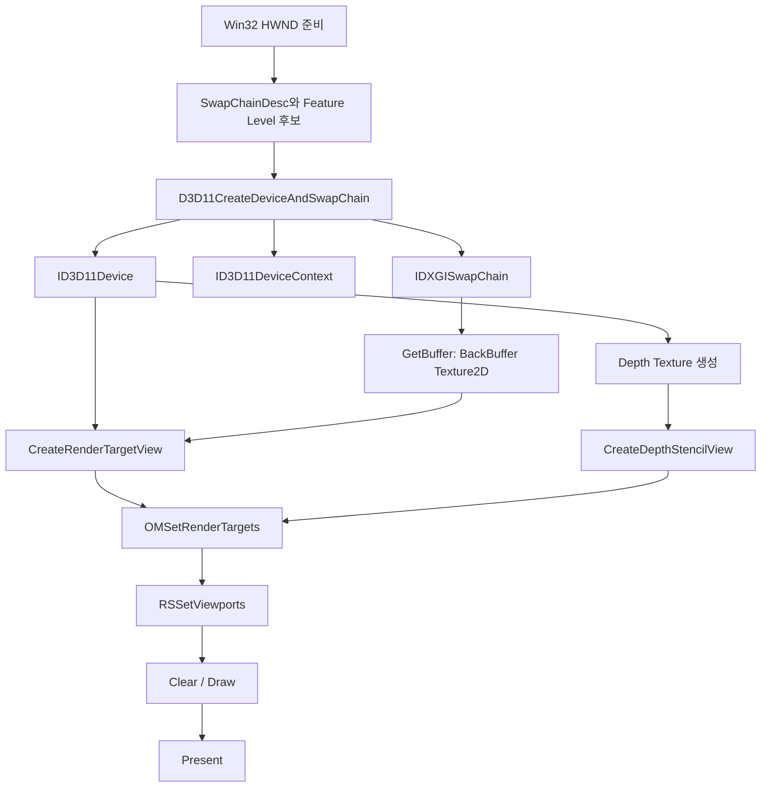
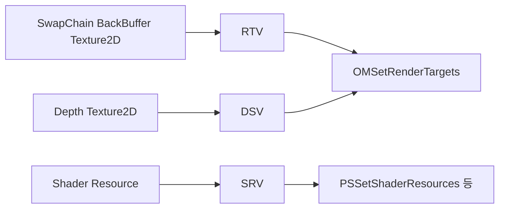
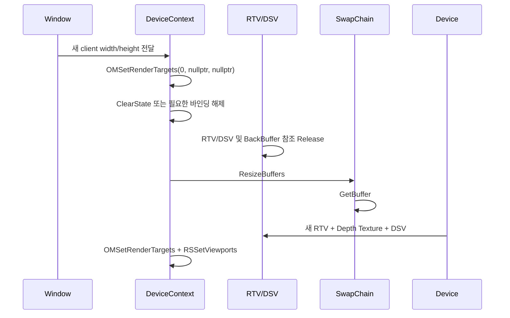

<callout icon="🧩" color="blue_bg">
	**DX11 개정 01 · 초기화와 장치 역할**
	<mention-date start="2026-10-16"/>. Direct3D 11의 Device·Immediate Context·SwapChain·View 역할을 분리하고, ResizeBuffers와 Debug Layer까지 하나의 초기화 계약으로 정리합니다. CPU 계약 모델은 실제 실행했지만 **Windows/MSVC·D3D11·GPU 경로는 미실행**입니다.
</callout>
<table_of_contents color="gray"/>
## 1. 먼저 교정할 표현
DirectX 11은 “퍼포먼스 중심의 언어”가 아니라 **Windows의 그래픽 API 계열**입니다. HLSL은 셰이더 언어이고 Direct3D 11은 CPU 측 그래픽 API입니다. 또한 DX11에서 “장치가 두 개”가 된 것이 아니라 역할이 분리된 것입니다.
<table fit-page-width="true" header-row="true">
<tr>
<td>객체</td>
<td>주요 역할</td>
<td>주의할 점</td>
</tr>
<tr>
<td>ID3D11Device</td>
<td>버퍼·텍스처·셰이더·View·상태 객체 같은 GPU 관련 객체를 생성합니다.</td>
<td>프레임마다 Draw를 제출하는 객체로 설명하지 않습니다.</td>
</tr>
<tr>
<td>ID3D11DeviceContext</td>
<td>리소스와 상태를 파이프라인에 바인딩하고 Draw·Dispatch·Map/Unmap 같은 명령을 수행합니다.</td>
<td>이 단원은 Immediate Context를 사용합니다. Deferred Context는 별도 개념입니다.</td>
</tr>
<tr>
<td>IDXGISwapChain</td>
<td>화면에 표시할 버퍼 집합과 Present, ResizeBuffers를 담당합니다.</td>
<td>백 버퍼에 대한 살아 있는 참조가 있으면 ResizeBuffers가 실패할 수 있습니다.</td>
</tr>
<tr>
<td>Resource</td>
<td>버퍼·Texture2D 같은 실제 저장 자원입니다.</td>
<td>Usage·BindFlags·CPUAccessFlags를 생성 시 계약으로 지정합니다.</td>
</tr>
<tr>
<td>View</td>
<td>Resource를 특정 용도로 해석하는 객체입니다. RTV·DSV·SRV 등이 대표적입니다.</td>
<td>View는 자원의 복사본이 아닙니다. 같은 자원에 대한 참조·해석입니다.</td>
</tr>
</table>
Microsoft 문서는 Device를 리소스 생성 인터페이스로, Device Context를 파이프라인 상태 설정과 렌더 명령 인터페이스로 구분합니다.
- [Microsoft · ID3D11Device 소개](https://learn.microsoft.com/en-us/windows/win32/direct3d11/overviews-direct3d-11-devices-intro)
- [Microsoft · D3D11CreateDeviceAndSwapChain](https://learn.microsoft.com/en-us/windows/win32/api/d3d11/nf-d3d11-d3d11createdeviceandswapchain)
## 2. 초기화의 전체 흐름

초기화 성공 여부는 “포인터가 null이 아닌지”만으로 판단하지 않습니다. 각 생성 API의 `HRESULT`를 확인하고, 성공한 단계까지만 소유권을 정리할 수 있어야 합니다.
### Feature Level은 API 버전과 다릅니다
Direct3D 11 API를 사용하면서도 실제 장치가 선택하는 Feature Level은 11_1, 11_0, 10_1, 10_0, 9_3 등이 될 수 있습니다. Feature Level은 하드웨어 기능 집합의 등급이지 “DirectX DLL의 버전 이름”과 같은 개념이 아닙니다.
명시적인 Feature Level 배열 첫 항목으로 `D3D_FEATURE_LEVEL_11_1`을 전달했는데 시스템의 Direct3D 11.1 런타임이 없다면 생성 함수가 `E_INVALIDARG`를 반환할 수 있습니다. 따라서 예제는 이 경우 11_1 항목을 제외해 한 번 재시도합니다.
- [Microsoft · Create a device and immediate context](https://learn.microsoft.com/en-us/windows/win32/direct3d11/overviews-direct3d-11-devices-initialize)
## 3. Debug Layer는 개발 중 검증 장치다
Debug 빌드에서는 `D3D11_CREATE_DEVICE_DEBUG`를 요청하여 잘못된 API 사용, 리소스 충돌, 상태 오류를 더 일찍 발견할 수 있습니다. Debug Layer가 설치되지 않은 환경에서 이 플래그로 생성하면 `DXGI_ERROR_SDK_COMPONENT_MISSING`이 발생할 수 있습니다.
학습 중에는 이 실패를 조용히 Release 빌드로 우회해 “검증 성공”으로 만드는 대신, 개발 환경에 Graphics Tools/Debug Layer가 없다는 사실을 드러내는 편이 좋습니다.
- [Microsoft · Direct3D 11 Debug Layer](https://learn.microsoft.com/en-us/windows/win32/direct3d11/using-the-debug-layer-to-test-apps)
<details>
<summary>Q. Debug Layer를 켜면 GPU 오류가 모두 자동으로 고쳐지나요?</summary>
	아닙니다. 잘못된 상태와 API 사용을 진단하는 도구입니다. 오류 메시지를 보고 코드와 자원 수명 계약을 수정해야 합니다.
</details>
## 4. BackBuffer와 View의 관계
SwapChain의 BackBuffer는 `ID3D11Texture2D` Resource입니다. 이를 출력 대상으로 쓰려면 Device가 `ID3D11RenderTargetView`를 생성합니다. Depth도 마찬가지로 Texture2D Resource를 만들고 DSV View를 생성합니다.

**Resource와 View를 구분하는 이유:** 하나의 메모리 자원을 “렌더 타깃으로 쓸지, 셰이더 입력으로 읽을지, 깊이/스텐실로 해석할지”는 View가 표현합니다. 모든 조합이 허용되는 것은 아니며 생성 당시 BindFlags·포맷·API 규칙과 맞아야 합니다.
## 5. ResizeBuffers의 실제 수명 계약
창 크기가 바뀌었다고 `ResizeBuffers`만 바로 호출하면 안 됩니다. 기존 BackBuffer에서 만든 RTV 등 **직접·간접 참조가 남아 있으면 ResizeBuffers가 실패**할 수 있습니다.
이 단원의 순서는 다음과 같습니다.

Microsoft의 ResizeBuffers 문서는 BackBuffer에 대한 모든 직접·간접 참조를 해제해야 한다고 명시합니다.
- [Microsoft · IDXGISwapChain::ResizeBuffers](https://learn.microsoft.com/en-us/windows/win32/api/dxgi/nf-dxgi-idxgiswapchain-resizebuffers)
- [Microsoft · DXGI overview](https://learn.microsoft.com/en-us/windows/win32/direct3ddxgi/d3d10-graphics-programming-guide-dxgi)
### 흔한 실패
- RTV만 `Reset()`했지만 Context의 OM 슬롯에 여전히 RTV가 바인딩되어 있음.
- SRV/UAV 등의 다른 View가 같은 Resource를 계속 참조함.
- Resize 이후 새 BackBuffer로 RTV를 다시 만들지 않음.
- 새 크기에 맞춰 Depth Texture와 Viewport를 다시 만들지 않음.
## 6. 읽기/쓰기 충돌은 명시적으로 관리한다
Direct3D 11 Runtime은 같은 Subresource가 충돌하는 읽기/쓰기 역할에 동시에 바인딩되는 상황을 감지합니다. 예를 들어 렌더 타깃으로 쓰는 자원을 동시에 픽셀 셰이더 SRV로 읽으려는 상태는 Hazard입니다. Runtime이 충돌 슬롯을 null 처리하거나 Debug Layer 경고를 낼 수 있으므로 “마지막 Set 호출이 알아서 전부 해결한다”고 설계하지 않습니다.
- [Microsoft · ID3D11DeviceContext::OMSetRenderTargets](https://learn.microsoft.com/en-us/windows/win32/api/d3d11/nf-d3d11-id3d11devicecontext-omsetrendertargets)
게임 렌더러에서는 Pass 경계에서 어떤 자원을 읽고 쓰는지 명시하고, 후속 Pass 전에 충돌하는 View를 해제하는 습관이 중요합니다.
## 7. 최소 Windows 예제의 범위
첨부의 `d3d11_init_window.cpp`는 다음 흐름을 포함합니다.
1. Win32 창 생성
2. `D3D11CreateDeviceAndSwapChain`
3. Device·ImmediateContext·SwapChain 확보
4. BackBuffer → RTV 생성
5. Depth Texture → DSV 생성
6. Viewport와 OM 출력 설정
7. RenderTarget/Depth Clear
8. `Present(1, 0)`
9. Resize 시 바인딩 해제 → View/Depth 해제 → `ResizeBuffers` → View 재생성
10. 종료 시 Context의 상태 정리
이 예제는 **이번 Linux 환경에서 Windows 분기를 컴파일하거나 실행하지 않았습니다.** 따라서 실제 창, 드라이버, Feature Level, Debug Layer 메시지, SwapChain Present 결과가 성공했다고 주장하지 않습니다.
또한 `DXGI_SWAP_EFFECT_DISCARD`를 사용하는 단순한 학습 초기화 예제입니다. 최신 Windows 애플리케이션의 최종 SwapChain 정책을 이것 하나로 고정하는 지침이 아닙니다.
## 8. CPU 계약 모델과 실제 검증
첨부의 `contract_model.cpp`는 GPU를 흉내 내는 구현이 아니라 아래 계약을 독립적으로 검사하는 CPU 모델입니다.
- 11.1 런타임이 없을 때 명시적 FL11_1 요청 실패와 재시도
- 지원 가능한 Feature Level 중 첫 항목 선택
- Debug Layer 누락 실패
- Device가 Resource/View를 생성하고 Context가 바인딩/Draw를 담당한다는 역할 구분
- BackBuffer View가 바인딩되거나 참조 중일 때 Resize 거부
- Unbind·Release 후 Resize 성공과 세대 변경
- Resize 후 새 BackBuffer View 생성 필요
처음 작성한 소스는 C++20에서 통과했지만 C++11에서 구조체 braced return 초기화가 실패했습니다. 이를 숨기지 않고 `CreateAttempt`와 `NegotiatedDevice`에 명시적 생성자를 추가해 호환성을 수정했습니다.
<table fit-page-width="true" header-row="true">
<tr>
<td>환경</td>
<td>실제 결과</td>
</tr>
<tr>
<td>GCC 14.2 · C++20</td>
<td>동일 24조건 PASS · CTest 1/1</td>
</tr>
<tr>
<td>GCC 14.2 · C++11</td>
<td>동일 24조건 PASS · CTest 1/1</td>
</tr>
<tr>
<td>Clang 17 · C++20 · ASan/UBSan</td>
<td>동일 24조건 PASS · CTest 1/1 · sanitizer 진단 없음</td>
</tr>
<tr>
<td>Windows/MSVC·D3D11·GPU</td>
<td>미실행·미검증</td>
</tr>
</table>
동일한 24조건을 세 환경에서 반복했으며 72개의 서로 다른 조건으로 합산하지 않습니다.
## 9. 전체 소스·빌드 안내
아래 첨부에는 `contract_model.cpp`, `d3d11_init_window.cpp`, `CMakeLists.txt`, README 전체가 들어 있습니다. 첨부 생성·연결은 성공했지만 재다운로드 도구가 빈 결과를 반환하여 바이트 일치 검증은 하지 못했습니다. 지속 보관·재시작 기준은 <mention-page url="https://app.notion.com/p/3fba99703f4081958997f12e2fc5a8ab">01A · DX11 초기화 전체 소스·CMake·검증 기준</mention-page>이며, 01A를 다시 읽어 CPU 소스·Windows 소스·CMake·README의 끝까지 저장된 것을 확인했습니다.
<file src="notion-file-block://cc44e13c-ba7a-4e6a-9e40-6a5ad5d8f1e7/3b43e5c2-81d1-43e9-8019-3f7fb3b1599a?space_id=815d1335-3b56-43a7-903b-d7addf097c9f&name=dx11_init01_full_sources.md">dx11_init01_full_[sources.md](http://sources.md)</file>
CPU 재현:
```bash
cmake -S . -B build -DCMAKE_BUILD_TYPE=Debug
cmake --build build
ctest --test-dir build --output-on-failure -V
```
Windows 수동 검증:
```powershell
cmake -S . -B build -A x64
cmake --build build --config Debug
ctest --test-dir build -C Debug --output-on-failure
.\build\Debug\dx11_init_window.exe
```
## 10. 게임 엔진에서의 적용
강의의 GraphicDevice Manager를 현대화한다고 해서 반드시 특정 클래스 구조를 강제할 필요는 없습니다. 핵심은 다음 책임을 구별하는 것입니다.
- Device: 장기 수명 그래픽 객체 생성
- Context: 프레임별 바인딩·명령
- SwapChain: Present와 화면 버퍼 수명
- Size-dependent Resources: RTV·Depth·Viewport 재생성
- Resource/View owner: 어떤 객체가 어떤 COM 참조를 소유하는지 명시
회사 프로젝트의 구조를 바꾸라는 지시가 아니라, 기존 코드를 읽을 때 책임 경계를 판별하기 위한 학습 기준입니다.
## 11. 자주 틀리는 점
1. **“DX11은 언어다”** → Direct3D 11은 API이며 HLSL이 셰이더 언어입니다.
2. **“Device가 두 개다”** → Device와 DeviceContext는 서로 다른 책임의 COM 인터페이스입니다.
3. **“View는 Texture 복사본이다”** → View는 Resource를 특정 용도로 해석하는 객체입니다.
4. **“Feature Level 11_0이면 API도 정확히 DirectX 11.0만 쓴다”** → 런타임/API와 하드웨어 기능 수준을 구분합니다.
5. **“RTV 포인터만 Release하면 Resize 가능”** → Context 바인딩과 다른 View/Reference도 고려합니다.
6. **“Debug Layer는 배포에 항상 켜야 한다”** → 개발 진단용이며 배포 정책과 별개입니다.
7. **“CPU 모델이 통과했으니 D3D11 초기화가 검증됐다”** → Windows API·GPU는 별도 검증입니다.
## 12. 이해 확인
<details>
<summary>Q1. Device와 DeviceContext를 한 문장으로 구분하면?</summary>
	Device는 그래픽 객체를 **생성**하고, Context는 그래픽 파이프라인에 상태·자원을 **바인딩하고 명령을 제출**합니다.
</details>
<details>
<summary>Q2. BackBuffer RTV를 Context에 바인딩한 상태에서 ResizeBuffers를 호출하면 왜 위험한가?</summary>
	Context가 RTV를 통해 BackBuffer를 간접 참조할 수 있기 때문입니다. OM에서 먼저 Unbind하고 애플리케이션이 가진 BackBuffer 관련 참조를 해제한 뒤 Resize합니다.
</details>
<details>
<summary>Q3. FL11_1 요청에서 E_INVALIDARG가 나오면 무조건 GPU가 DirectX 11을 지원하지 않는 뜻인가?</summary>
	아닙니다. 11.1 런타임이 없는 시스템에서 명시적 11_1 요청 때문에 발생할 수 있습니다. 예제는 11_1을 제외해 재시도하고 실제 선택 Feature Level을 기록합니다.
</details>
<details>
<summary>Q4. 같은 Texture2D를 RTV와 SRV에 동시에 바인딩해도 되나요?</summary>
	같은 Subresource에 대해 충돌하는 읽기/쓰기 역할이 되면 Hazard입니다. Pass 전환 시 읽기·쓰기 View를 명시적으로 정리합니다.
</details>
## 변경 기록
<mention-date start="2026-10-16"/> v1.0. 기존 메모의 “DX11은 언어”, “두 개의 장치” 표현을 교정하고 Device/Context/SwapChain/Resource/View의 책임, Feature Level·Debug Layer·ResizeBuffers 수명 계약을 추가했습니다. 전체 Windows 소스는 작성했지만 실제 Windows 실행은 미검증입니다. 다음 단원은 **Resource/View 생성과 Buffer Usage·CPUAccess·Map/Unmap·Constant Buffer 정렬**입니다.
<page url="https://app.notion.com/p/3fba99703f4081958997f12e2fc5a8ab">01A · DX11 초기화 전체 소스·CMake·검증 기준</page>
