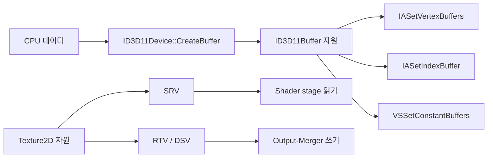
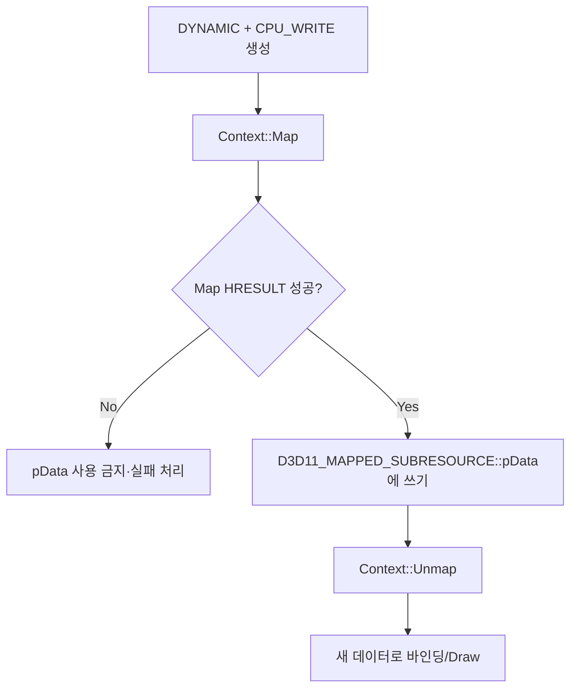

<callout icon="🧱" color="blue_bg">
	**DX11 개정 02 — Resource/View·Usage·CPU Access·Map 계약**
	<mention-date start="2026-10-16"/>. 기존 메모의 버텍스 버퍼·인덱스 버퍼·텍스처 컴포넌트에 앞서 이해해야 할 장치 API 계약을 독립 문서로 정리합니다. 01의 Device/Context/SwapChain 수명 설명을 전제로 합니다.
</callout>
## 1. 정의 — Resource와 View는 다르다
`ID3D11Buffer`와 `ID3D11Texture2D` 등 Resource가 데이터를 소유하고, SRV·RTV·DSV·UAV 등 View가 **어떤 파이프라인 용도로 해당 Subresource를 접근하는지** 지정합니다. 모든 Resource가 모든 View를 만들 수 있는 것은 아닙니다. 생성 때 `BindFlags`, DXGI Format, Mip/Array 범위와 View Descriptor를 맞춥니다.

**주의:** `CreateBuffer` 호출과 `IASetVertexBuffers`는 서로 다른 일입니다. Create는 메모리와 Descriptor를 확정하지만 Draw 시점의 바인딩·Shader·Topology까지 설정하지 않습니다. [공식 Resource 인터페이스](https://learn.microsoft.com/en-us/windows/win32/direct3d11/d3d11-graphics-reference-resource-interfaces).
## 2. Usage와 CPUAccessFlags의 계약
<table fit-page-width="true" header-row="true">
<tr>
<td>Usage</td>
<td>대표 데이터 흐름</td>
<td>갱신·읽기 조건</td>
</tr>
<tr>
<td>DEFAULT</td>
<td>GPU 중심</td>
<td>일반적으로 CPU 직접 Map 불가. Context의 UpdateSubresource·Copy 계열을 고려</td>
</tr>
<tr>
<td>IMMUTABLE</td>
<td>생성 후 변하지 않는 데이터</td>
<td>초기 데이터 필요, 이후 수정 불가</td>
</tr>
<tr>
<td>DYNAMIC</td>
<td>CPU에서 비교적 자주 작성</td>
<td>CPU_WRITE와 Map(WRITE_DISCARD 등), GPU 읽기</td>
</tr>
<tr>
<td>STAGING</td>
<td>GPU↔CPU 복사 경유</td>
<td>BindFlags=0, CPU_READ/WRITE에 맞춰 Map, CopyResource 등으로 이동</td>
</tr>
</table>
`D3D11_BUFFER_DESC`에는 `ByteWidth`, `Usage`, `BindFlags`, `CPUAccessFlags`, `MiscFlags`, `StructureByteStride`가 있습니다. 이 중 하나의 값을 전체 자원 규칙으로 환원하면 오류가 생깁니다. 예를 들어 “CPU가 데이터를 보낸다”는 이유만으로 모든 VB를 DYNAMIC으로 만들 필요는 없습니다. 변경이 드문 버퍼는 DEFAULT 또는 IMMUTABLE을 검토합니다.
- [Microsoft · D3D11_USAGE](https://learn.microsoft.com/en-us/windows/win32/api/d3d11/ne-d3d11-d3d11_usage)
- [Microsoft · D3D11_BUFFER_DESC](https://learn.microsoft.com/en-us/windows/win32/api/d3d11/ns-d3d11-d3d11_buffer_desc)
## 3. 동적 버퍼의 Map/Unmap

`D3D11_MAP_WRITE_DISCARD`는 이전 내용을 정의되지 않은 상태로 보고 새 데이터를 작성합니다. `WRITE_NO_OVERWRITE`는 기존 GPU 사용 범위를 드라이버가 대신 추적하여 보호해 준다는 뜻이 **아닙니다.** 호출자가 이미 제출한 Draw에서 사용 중인 범위를 덮어쓰지 않는다고 약속하는 방식입니다.
D3D11.0에서 `WRITE_NO_OVERWRITE`는 동적 VB/IB에 사용됩니다. D3D11.1에서는 동적 Constant Buffer 등으로 사용 범위가 확장되지만 **런타임 및 관련 옵션 지원 확인이 필요**합니다. 예제 CPU 모델의 `runtime11_1` 인수는 이를 단순화한 정책 스위치이며 실제 Driver/Feature Query를 대체하지 않습니다.
- [Microsoft · D3D11_MAP](https://learn.microsoft.com/en-us/windows/win32/api/d3d11/ne-d3d11-d3d11_map)
- [Microsoft · ID3D11DeviceContext::Map](https://learn.microsoft.com/en-us/windows/win32/api/d3d11/nf-d3d11-id3d11devicecontext-map)
## 4. Constant Buffer는 16바이트 단위
일반 D3D11 `D3D11_BIND_CONSTANT_BUFFER`는 독립 Bind Flag로 사용하고, `ByteWidth`를 16의 배수로 지정합니다. 구형 D3D11 런타임의 기본 한도는 4096개의 16바이트 상수(64KiB)이며 D3D11.1의 큰 Constant Buffer 사용은 별도 규칙이 있습니다. `sizeof(struct)`가 16의 배수가 되더라도 **HLSL cbuffer packing**, 행렬의 행/열 저장, 정렬과 필드 배열 규칙을 자동으로 증명하지 않습니다.
```c++
struct alignas(16) FrameConstants {
    float worldViewProjection[16]; // 64B
    float tint[4];                 // 16B
};
static_assert(sizeof(FrameConstants) == 80, "multiple of 16");
```
[Microsoft · ID3D11Device::CreateBuffer](https://learn.microsoft.com/en-us/windows/win32/api/d3d11/nf-d3d11-id3d11device-createbuffer)
## 5. 전체 독립 실습과 테스트 조건
동작 가능한 **CPU 계약 모델**은 02A 페이지에 `main.cpp`, `CMakeLists.txt`, `README.md` 전문 및 세 환경의 원시 CTest 로그를 저장합니다. 이 코드는 단순한 Buffer Descriptor 부분집합·Map 모드·슬롯 해석·바이트 범위·DYNAMIC 링 예약 모델만 검사합니다. Structured Buffer, MiscFlags, 텍스처 RowPitch, Deferred Context, Feature Query, 실제 COM·GPU 메모리를 구현하지 않습니다.
- GCC 14.2 C++20: 동일한 40조건, CTest 1/1
- GCC 14.2 C++11: 동일한 40조건, CTest 1/1
- Clang 17 C++20 + ASan/UBSan: 동일한 40조건, CTest 1/1; sanitizer 진단 없음
- Windows/MSVC·D3D11/GPU: 실행하지 않음
기본 학습 기준은 C++20이며 CPU 소스에서 사용하는 `enum class`, `lambda`, `std::vector` 등은 C++11로도 빌드됩니다. CPU 모델 통과는 D3D11 `CreateBuffer`와 `Map`의 실제 성공을 의미하지 않습니다.
## 6. 게임 개발에서의 적용
Renderer의 Static Mesh 정점 데이터와 매 프레임 바뀌는 Particle VB는 갱신 빈도가 다릅니다. 두 자원에 같은 Usage를 강제하지 말고 **접근 방향·업데이트 빈도·동기화·사이즈·Bind 목적**을 기준으로 고릅니다. Resource Manager는 원본 데이터의 소유와 GPU 리소스의 소유를 따로 기록하고, View는 자원 생명주기를 따르면서도 별도 COM 참조로 관리합니다.
## 7. 자주 틀리는 점과 이해 확인
<details>
<summary>IMMUTABLE에 초기 데이터를 넘기지 않으면?</summary>
	이 단원에서 다루는 일반 버퍼는 생성 시 초기 데이터가 필요합니다. 생성 후 값을 바꾸려면 다른 Usage를 선택해야 합니다.
</details>
<details>
<summary>STAGING 버퍼를 바로 IASetVertexBuffers에 바인딩하면?</summary>
	STAGING은 GPU 파이프라인 바인딩 목적이 아니라 CPU 접근을 위한 복사 경유 자원입니다. BindFlags=0 계약을 따릅니다.
</details>
<details>
<summary>DYNAMIC + WRITE_DISCARD 후 이전 바이트를 다시 읽어도 되나요?</summary>
	안 됩니다. 이전 콘텐츠는 정의되지 않습니다. 필요한 값은 새 매핑에 다시 기록해야 합니다.
</details>
<details>
<summary>Constant Buffer 20바이트를 만들 수 있나요?</summary>
	일반 CreateBuffer 계약상 ByteWidth는 16바이트의 배수여야 하므로 20은 적절하지 않습니다. 32바이트로 패딩하고 CPU/HLSL 레이아웃을 맞춥니다.
</details>
## 검증·변경 기록
<mention-date start="2026-10-16"/> v1.0. 구형 강의의 VB/IB·Texture 설명 전에 Resource/View 분리, Usage/CPUAccessFlags, Map/Unmap, DISCARD/NO_OVERWRITE, Constant Buffer 크기 규칙을 독립 교재로 정리했습니다. 이 문서의 C++ 테스트는 GPU가 없는 환경의 CPU 모델입니다. 다음은 IA/Shader/OM 바인딩과 DrawIndexed의 범위·상태 계약입니다.
<page url="https://app.notion.com/p/3fba99703f40814ebc7fe5250ad8d967">02A · Buffer/View 계약 전체 CPU 소스·CMake·실행 로그</page>
