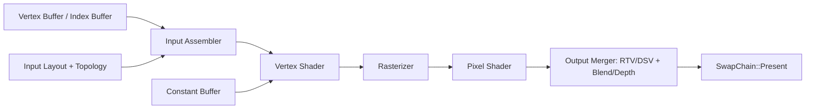
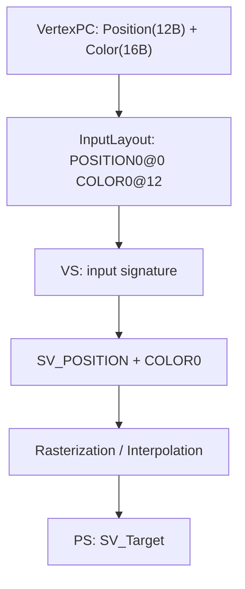
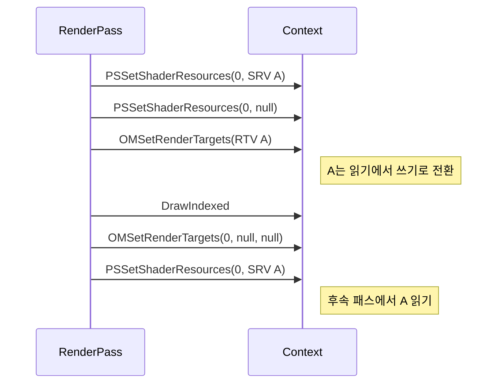

<callout icon="🎨" color="blue_bg">
	**DX11 개정 03 — IA / VS / PS / OM 바인딩과 DrawIndexed**
	<mention-date start="2026-10-16"/>. 앞 절의 Resource/Usage와 연결해 정점 데이터가 픽셀로 그려지기까지 필요한 상태 계약을 구성합니다. CPU 입력 검사와 실제 Windows D3D11 프로그램은 분리해 제공합니다.
</callout>
## 1. Draw 한 번에 필요한 입력은 무엇인가

상위 강의에서 사용한 `VIBuffer`는 사용자 엔진의 래퍼이지 Direct3D 11의 표준 COM 인터페이스 이름이 아닙니다. Direct3D11은 입력 데이터·셰이더·렌더 상태를 개별 파이프라인 슬롯에 설정한 다음 `DrawIndexed`를 호출합니다.
<table fit-page-width="true" header-row="true">
<tr>
<td>단계</td>
<td>대표 API</td>
<td>확인할 계약</td>
</tr>
<tr>
<td>IA 입력</td>
<td>IASetVertexBuffers / IASetIndexBuffer</td>
<td>실제 Byte Stride, Offset, DXGI Index Format</td>
</tr>
<tr>
<td>IA 해석</td>
<td>IASetInputLayout / IASetPrimitiveTopology</td>
<td>VS 입력 서명의 Semantic·Format과 정점 배치 일치</td>
</tr>
<tr>
<td>셰이더</td>
<td>VSSetShader / PSSetShader</td>
<td>컴파일된 Blob·Shader Model·입출력 Semantic</td>
</tr>
<tr>
<td>상수</td>
<td>VSSetConstantBuffers / PSSetConstantBuffers</td>
<td>슬롯 번호와 HLSL cbuffer b-register, 데이터 수명</td>
</tr>
<tr>
<td>출력</td>
<td>OMSetRenderTargets / RSSetViewports</td>
<td>RTV·DSV, 뷰포트 크기, 리소스 접근 충돌</td>
</tr>
<tr>
<td>그리기</td>
<td>DrawIndexed</td>
<td>IndexCount, StartIndexLocation, BaseVertexLocation</td>
</tr>
</table>
공식: [CreateInputLayout](https://learn.microsoft.com/en-us/windows/win32/api/d3d11/nf-d3d11-id3d11device-createinputlayout) · [IASetInputLayout](https://learn.microsoft.com/en-us/windows/win32/api/d3d11/nf-d3d11-id3d11devicecontext-iasetinputlayout).
## 2. Index Buffer 범위와 DrawIndexed
`DrawIndexed(IndexCount, StartIndexLocation, BaseVertexLocation)`는 IndexCount개의 인덱스 값을 StartIndexLocation부터 읽고, **인덱스값+BaseVertexLocation**을 실제 정점에 연결합니다.
```c++
// 4 vertex, 6 uint16 index entries
const unsigned short indices[6] = {0,1,2,2,1,3};
context->IASetIndexBuffer(indexBuffer, DXGI_FORMAT_R16_UINT, 0);
context->IASetPrimitiveTopology(D3D11_PRIMITIVE_TOPOLOGY_TRIANGLELIST);
context->DrawIndexed(6, 0, 0); // 2 triangles
```
인덱스 6개와 PrimitiveCount 6을 혼동하면 안 됩니다. Direct3D11의 `DrawIndexed`는 D3D9의 `DrawIndexedPrimitive`와 매개변수 계약도 다릅니다.
CPU 모델은 `IndexCount`가 3의 배수인지, 지정한 정점 범위에 모든 인덱스가 들어가는지, Stride가 예제 Vertex 구조체와 같은지 검사합니다. 단, **0개 인덱스 Draw나 Pixel Shader가 없는 Draw를 API가 무조건 금지한다고 주장하지 않습니다.** 그러한 입력 거부는 이번 학습 렌더러의 명시적인 정책입니다.
## 3. 정점 레이아웃과 VS 입력 서명
```c++
struct VertexPC {
    float position[3]; // POSITION0, R32G32B32_FLOAT
    float color[4];    // COLOR0, R32G32B32A32_FLOAT
};
static_assert(sizeof(VertexPC) == 28, "example stride");
```
`D3D11_INPUT_ELEMENT_DESC`의 SemanticName/Index와 DXGI_FORMAT, InputSlot, AlignedByteOffset은 **VS 바이트코드의 입력 서명**과 맞춰야 합니다. 문자열만 일치해도 Float 성분/Offset이 잘못되면 픽셀이 예상대로 나오지 않습니다. VS의 `SV_POSITION` 출력은 래스터 단계의 클립 위치이고 PS의 `SV_Target`은 렌더 타깃 출력입니다.

## 4. 행렬·상수 버퍼와 `mul`의 방향
CPU 측 행 벡터 예제는 `p_clip = p_local * World * View * Projection`을 택했습니다. HLSL에서 `mul(v, M)`을 쓴다면 행렬 저장의 기본 Column-Major 규약과 CPU 전송 레이아웃을 **별도로** 맞춰야 합니다. `row_major`, 전치 또는 동일한 연산 방향/상수 버퍼 packing을 조합해 일관된 규칙을 선택합니다.
이번 CPU 실습의 `MulRow`는 행 벡터 4×4만 계산하며 `FrameCB` 80바이트·정렬을 검사할 뿐 실제 Shader Reflection이나 HLSL Packing을 검증하지 않습니다.
## 5. RTV와 SRV 충돌
같은 Subresource를 렌더 타깃으로 쓰면서 동시에 Shader Resource로 읽으면 충돌합니다. Direct3D 11 Runtime은 일부 충돌 슬롯을 자동 NULL 처리하지만 그 부작용을 렌더러의 리소스 전환 프로토콜로 삼아서는 안 됩니다.

공식: [OMSetRenderTargets](https://learn.microsoft.com/en-us/windows/win32/api/d3d11/nf-d3d11-id3d11devicecontext-omsetrendertargets). 이 CPU 예제의 단순 정수 ID 충돌 검사는 Subresource/Mip/Array 범위가 겹치는지 검사하지 않습니다. 실제 코드는 서로 다른 View가 동일 자원 일부를 공유하는 상황까지 다뤄야 합니다.
## 6. 복사·실행할 수 있는 프로젝트
하위 03A에는 **두 종류의 전체 C++ 소스**와 CMake, 빌드 안내, 세 구성의 CTest 원시 로그가 있습니다.
- `main.cpp`: Index/Stride/State/RTV·SRV 충돌을 검사하는 이식 가능한 CPU 모델
- `d3d11_triangle_window.cpp`: Win32 창 → D3D11 장치/SwapChain → HLSL 문자열 컴파일 → VB/IB/InputLayout → VS/PS·RTV → DrawIndexed(3) → Present와 Resize까지 포함하는 Windows 전용 예제
Windows 프로그램은 Windows SDK·D3D11·DXGI·D3DCompiler와 Visual Studio/MSVC가 필요하며, **이번 Linux 환경에서는 컴파일·실행하지 않았습니다.** Windows 소스의 예상 결과(색상 삼각형)와 실제 관찰한 결과를 혼동하지 마세요. Swap Effect는 교육용 DISCARD 구성으로 최신 Flip Model 배포 정책 전체를 대변하지 않습니다.
CPU 검증: GCC14.2 C++20, GCC14.2 C++11, Clang17 C++20 ASan/UBSan에서 동일한 32조건·각 CTest 1/1 통과. 세 구성에서 같은 조건을 반복해 총 96개 독립 조건으로 세지 않습니다. 두 단원 통합 CTest는 구성별 2/2입니다.
## 7. 자주 틀리는 점
- InputLayout에서 Semantic은 맞지만 DXGI Format·Byte Offset이 다른데도 그리기 성공이라고 추정
- VS/PS를 생성한 것과 Context에 바인딩한 것을 혼동
- `DrawIndexed`의 인자 세 개를 D3D9 `DrawIndexedPrimitive` 인자와 동일하게 해석
- `IASetVertexBuffers`에 정점 수를 Byte Stride로 넘김
- `InputSlot`과 Constant Buffer `b0` 슬롯을 혼동
- Resize 또는 다음 Pass에서 RTV/SRV 바인딩 해제·복원을 잊음
- CPU 모델의 `DrawIndexed` 검사 통과를 GPU 픽셀 결과 검증이라고 표기
## 8. 게임 개발 적용과 이해 확인
실무 프레임워크의 Renderer는 Pass 시작 시 입력 레이아웃·Vertex/Index Buffer·Topology·Shader·Constant Buffer·SRV/Sampler·Output·Blend/Depth/Rasterizer 상태를 한 번에 선언하거나 변경된 항목을 안전하게 재설정하는 정책이 필요합니다. 외부 코드가 상태를 바꿀 수 있다면 “이전 상태를 유지한다”는 숨은 전제를 최소화합니다.
<details>
<summary>Vertex 4개와 Index 6개로 TriangleList 사각형을 그릴 때 DrawIndexed IndexCount는?</summary>
	6입니다. IndexCount는 인덱스 엔트리 개수이며 TriangleList는 세 인덱스로 한 삼각형을 만듭니다.
</details>
<details>
<summary>InputLayout을 만들어 놓기만 하면 IA가 자동으로 사용하나요?</summary>
	아닙니다. IASetInputLayout으로 현재 Context에 바인딩해야 합니다.
</details>
<details>
<summary>한 Texture2D를 RTV와 SRV로 쓰면 두 자원이 생성되나요?</summary>
	아닙니다. 서로 다른 View가 같은 Resource를 참조할 수 있습니다. 같은 Subresource의 충돌하는 Read/Write를 관리해야 합니다.
</details>
## 출처·변경 기록
<mention-date start="2026-10-16"/> v1.0. 강의의 버퍼 그리기·Shader RECT·바인딩 메모를 정점 입력 계약과 색상 삼각형 통합 예제로 재구성했습니다. 전체 소스는 03A에 저장하고 CPU/Windows 검증을 분리합니다. 다음은 **Shader Component·HLSL·Texture SRV/Sampler·Rect Draw**입니다.
<page url="https://app.notion.com/p/3fba99703f40819b8a86dd4ff0295fd1">03A · IA·DrawIndexed CPU/Windows 전체 소스와 검증 로그</page>
