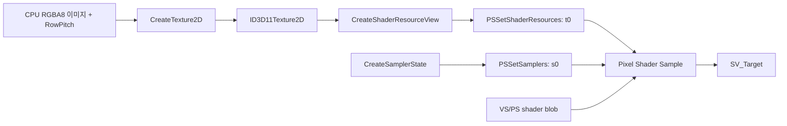
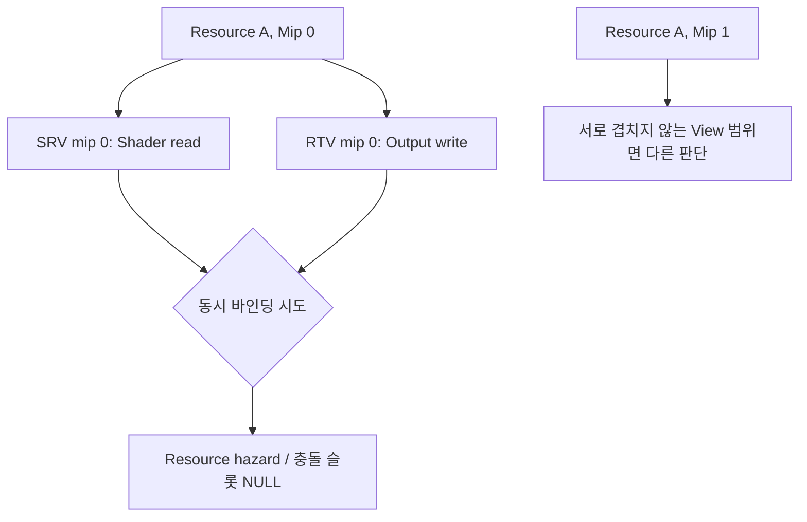

<callout icon="🧵" color="blue_bg">
	**DX11 개정 04 — HLSL Shader Component·Texture2D·SRV·Sampler**
	<mention-date start="2026-10-16"/>. 기존 셰이더 컴포넌트·DTK 텍스처 로드·Shader RECT 메모에서 개념이 뒤섞인 부분을 API 책임과 HLSL 입출력 기준으로 분리합니다. 하위 04A에 전체 C++·HLSL·CMake·실행 로그를 보존합니다.
</callout>
## 1. 텍스처는 데이터, SRV는 해석, Sampler는 접근 정책

Resource에 RGB 데이터가 있다고 Shader가 저절로 그 데이터를 읽지는 않습니다. 생성 시 `D3D11_BIND_SHADER_RESOURCE` 등 BindFlags를 지정하고, Device로 SRV를 생성해 Context의 올바른 단계에 바인딩해야 합니다. `Texture2D`는 리소스 클래스, `SRV`는 접근 View, `SamplerState`는 Filtering·Addressing·Mip 선택 정책입니다. 라이브러리(DTK/WIC/DirectXTex)는 파일을 디코딩·업로드하는 방법이고 API의 필수 Texture 인터페이스는 아닙니다.
- [Microsoft · CreateTexture2D](https://learn.microsoft.com/en-us/windows/win32/api/d3d11/nf-d3d11-id3d11device-createtexture2d)
- [Microsoft · 파일에서 텍스처 초기화](https://learn.microsoft.com/en-us/windows/win32/direct3d11/overviews-direct3d-11-resources-textures-how-to)
## 2. 생성 정보와 RowPitch
<table fit-page-width="true" header-row="true">
<tr>
<td>필드</td>
<td>예시</td>
<td>의미와 실패 전제</td>
</tr>
<tr>
<td>Width/Height</td>
<td>64×64</td>
<td>픽셀 크기. GPU 최대 차원은 Feature Level 등 장치 제약에 종속</td>
</tr>
<tr>
<td>DXGI_FORMAT</td>
<td>R8G8B8A8_UNORM</td>
<td>각 픽셀 네 채널, 각각 8비트 UNORM. 바이트 순서/포맷 대조</td>
</tr>
<tr>
<td>MipLevels/ArraySize</td>
<td>1 / 1</td>
<td>하위 리소스 범위. MipLevels × ArraySize개의 초기화 정보 고려</td>
</tr>
<tr>
<td>Usage/CPUAccess</td>
<td>IMMUTABLE / 0</td>
<td>생성할 때 모든 필요한 Subresource 데이터 제공</td>
</tr>
<tr>
<td>BindFlags</td>
<td>SHADER_RESOURCE</td>
<td>이용할 View 종류를 고려해 지정</td>
</tr>
<tr>
<td>SysMemPitch</td>
<td>Width × 4</td>
<td>예제의 촘촘한 RGBA8 행 사이 바이트 간격. 실제 파일/잠금 버퍼에는 패딩이 있을 수 있음</td>
</tr>
</table>
`D3D11_SUBRESOURCE_DATA::SysMemPitch`는 **원본 연속 행의 바이트 간격**입니다. 1×2 RGBA8에서 실제 유효 행 4바이트와 Pitch 8바이트를 혼동해 `data + row*4`로 다음 행을 계산하면 잘못된 픽셀을 읽게 됩니다. 비압축/단일 Mip RGBA8과 BC 압축 텍스처·Mip Array의 데이터 배치 규칙은 다릅니다.
```c++
// RGBA8 단일 mip/array 학습 예시 (HRESULT 검사는 생략하지 않아야 함)
D3D11_SUBRESOURCE_DATA init{};
init.pSysMem = rgba.data();
init.SysMemPitch = width * 4; // 촘촘한 RGBA8일 때만
ID3D11Texture2D* texture = nullptr;
HRESULT hr = device->CreateTexture2D(&desc, &init, &texture);
```
실제 코드는 `hr` 실패와 이미 확보한 COM 참조 정리, 정수 곱셈 오버플로 및 이미지 포맷을 검사합니다. 위 코드는 API를 이해하기 위한 **발췌**이며 전체 Windows 실행 예제를 대체하지 않습니다.
## 3. HLSL 입력·출력과 슬롯 계약
HLSL 전체 소스는 04A의 `texture.hlsl`입니다.
```plain text
cbuffer Frame : register(b0) {
    row_major float4x4 WorldViewProjection;
    float4 Tint;
};
Texture2D Albedo : register(t0);
SamplerState LinearSampler : register(s0);
struct VSIn { float3 position : POSITION; float2 uv : TEXCOORD0; };
struct VSOut { float4 position : SV_POSITION; float2 uv : TEXCOORD0; };
VSOut VSMain(VSIn input) {
    VSOut o;
    o.position = mul(float4(input.position,1), WorldViewProjection);
    o.uv = input.uv;
    return o;
}
float4 PSMain(VSOut input) : SV_Target {
    return Albedo.Sample(LinearSampler, input.uv) * Tint;
}
```
`register(t0)`은 SRV 슬롯, `register(s0)`은 Sampler 슬롯, `register(b0)`은 Constant Buffer 슬롯입니다. 서로 다른 번호 공간이므로 모두 0이라고 서로 충돌하지 않습니다. Texture 좌표는 Pixel Shader 입력으로 보간되며 `SV_POSITION`은 클립·래스터 흐름에 쓰입니다.
CPU 행 벡터 `p*World*View*Projection`을 택한다면 `mul(v,M)`과 `row_major` HLSL 저장, CPU 쪽 `FrameCB` 메모리 레이아웃을 하나의 규칙으로 맞춰야 합니다. 이를 단순히 “HLSL은 행렬을 항상 자동 전치한다”라고 외우지 않습니다.
## 4. Sampler와 알파·색 공간
POINT 필터는 보통 가까운 샘플을 선택하고 LINEAR 필터는 주변 데이터를 보간합니다. AddressU/V의 CLAMP와 WRAP은 좌표 범위 밖에서 결과가 달라집니다. PS에서 Texture Sample과 Vertex/Tint 값을 곱하는 것은 RGB/Alpha에 대한 연산이며, **알파 블렌딩이 자동으로 활성화되는 것을 뜻하지 않습니다.** 합성은 OM BlendState가 별도로 결정합니다.
SRGB 형식과 선형 형식, Gamma 인코딩을 구분해야 합니다. CPU 모델의 2×2 텍셀·Float4 곱셈은 실제 GPU의 Texture Filtering·Mip 선택·SRGB Decode·정밀도를 검증한 결과가 아닙니다.
## 5. 같은 자원의 SRV/RTV 충돌
다음 두 View가 같은 Texture Subresource 영역을 공유하면 읽기/쓰기 충돌이 발생할 수 있습니다.

단순히 두 View의 COM 포인터가 다른지 비교해서는 충돌을 판정할 수 없습니다. Resource ID뿐 아니라 Mip·Array Slice·Aspect 등 실제 View가 접근하는 Subresource를 고려해야 합니다. 04A의 CPU 예제는 **Resource ID+단일 Mip**에 한정된 모델이며 일반적인 D3D11 View Descriptor 전체를 검사하지 않습니다.
공식: [PSSetShaderResources](https://learn.microsoft.com/en-us/windows/win32/api/d3d11/nf-d3d11-id3d11devicecontext-pssetshaderresources).
## 6. 복사·실행 가능한 독립 테스트
04A에는 C++20 학습 기준·C++11 호환 CPU 모델 `main.cpp`, `texture.hlsl`, `CMakeLists.txt`, README, 구성별 CTest 로그를 모두 저장합니다. 모델은 RowPitch 부족/오버플로·동일 버퍼 거부·CLAMP/WRAP·색상 곱·같은 Mip read/write 충돌·상수 버퍼 데이터 크기 등을 검사합니다.
실제 결과:
- GCC 14.2 C++20: 36/36, CTest 1/1
- GCC 14.2 C++11: 36/36, CTest 1/1
- Clang 17 C++20 ASan/UBSan: 36/36, CTest 1/1, 검사기 진단 없음
- Windows/MSVC·D3D11·GPU Texture Sampling·HLSL FXC/DXC 컴파일: **미실행**
이 CPU 모델의 `Valid(TextureDesc)` 최대 크기와 `CopyPitched`의 용량 정책은 **실습 자체의 단순화**이며 실제 GPU의 모든 텍스처 생성 조건과 같지 않습니다. `texture.hlsl`은 복사 가능한 전체 셰이더이나 이번에 Shader Compiler로 컴파일해 통과했다는 뜻은 아닙니다.
## 7. 게임 개발에 적용하기
Texture Loader는 파일 포맷 처리·디코드·CPU 데이터·Mip 생성 정책을, Resource Manager는 GPU Texture/SRV 참조 수명을, Material은 Shader/Texture/Sampler Slot 설정을 담당하도록 분리할 수 있습니다. 기존 강의 프레임워크의 컴포넌트가 이 역할을 하나의 클래스에 묶었더라도 **프레임워크 설계와 D3D11 API의 고유 책임**을 혼동하지 않습니다.
## 8. 이해 확인
<details>
<summary>Texture2D 포인터를 PSSetShaderResources에 직접 전달할 수 있나요?</summary>
	아닙니다. 해당 API는 ID3D11ShaderResourceView 포인터를 요구합니다. Resource에서 SRV를 만들고 슬롯에 설정합니다.
</details>
<details>
<summary>RGBA8 폭 1, 높이 2, 원본 Pitch 8일 때 둘째 행은 몇 바이트 떨어져 시작하나요?</summary>
	원본 첫 행 시작에서 8바이트 뒤입니다. 유효 픽셀 4바이트와 행 간격을 구분합니다.
</details>
<details>
<summary>SamplerState s0와 Texture2D t0는 같은 슬롯인가요?</summary>
	아닙니다. Sampler Slot과 Shader Resource Slot은 서로 다른 레지스터 공간입니다.
</details>
<details>
<summary>픽셀 셰이더에서 Sample().a를 0으로 만들면 Z 기록이나 Blend가 자동으로 무효인가요?</summary>
	아닙니다. Depth/Blend 정책은 Output-Merger 상태와 discard 등 셰이더 동작을 함께 봐야 합니다.
</details>
## 출처·변경 이력
<mention-date start="2026-10-16"/> v1.0. 기존 텍스처·Shader Component 메모를 Texture/Resource/View/Sampler/HLSL 입출력·Pitch·Slot·위험한 동시 바인딩으로 재구성했습니다. 다음은 실제 **Texture Rect 렌더링·Material 및 Shader 바인딩 통합**입니다.
<page url="https://app.notion.com/p/3fba99703f4081c89295c3aed7177611">04A · Texture/SRV/Sampler 전체 C++·HLSL·CTest 로그</page>
