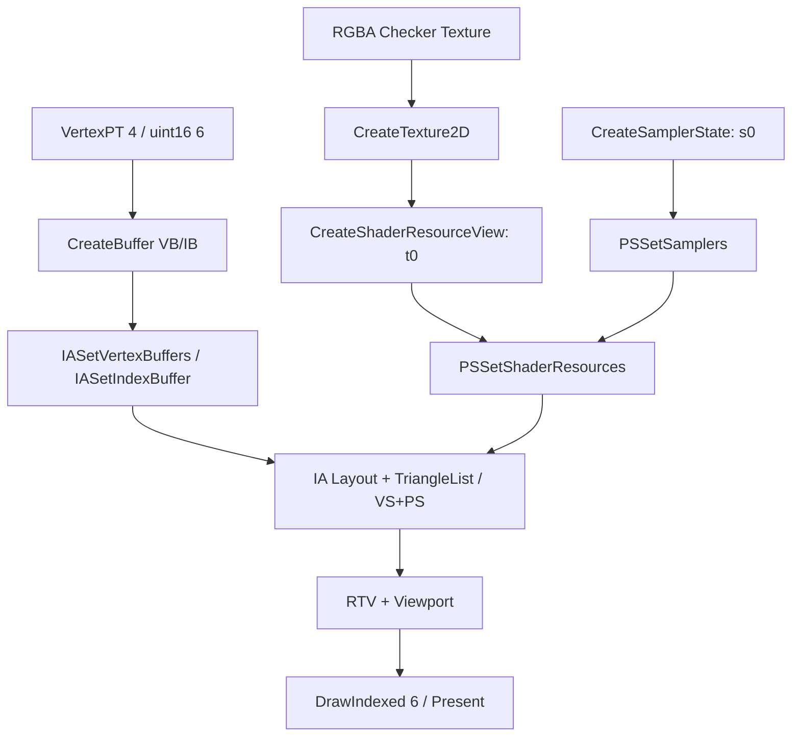

<callout icon="🎮" color="blue_bg">
	**DX11 05 · Texture Rect 통합 (개정본)**
	<mention-date start="2026-10-16"/>. 기존 02\~04의 VB/IB·Texture2D·SRV·Sampler·HLSL을 한 번의 DrawIndexed로 연결합니다. Windows/FXC/GPU 실제 실행은 미검증이며 CPU 계약 검사는 재현했습니다.
</callout>
## 1. 학습 목표와 정의
CPU의 네 VertexPT(좌표 float3, UV float2, stride 20바이트)와 여섯 uint16 인덱스(12바이트)를 ID3D11Buffer VB/IB로 만듭니다. 64×64 RGBA8 체크무늬 배열은 Texture2D 리소스이고, PS에서 읽기 위해 ShaderResourceView(t0)와 SamplerState(s0)를 별도로 생성·바인딩합니다. Material은 이러한 자원을 묶는 **게임 엔진의 설계 단위**이지 D3D11 표준 COM 인터페이스 이름이 아닙니다.
DX11 DrawIndexed의 첫 인자는 PrimitiveCount가 아니라 IndexCount입니다. 사각형은 인덱스 6개로 삼각형 두 개이므로 DrawIndexed(6,0,0)를 사용합니다. [Microsoft DrawIndexed](https://learn.microsoft.com/en-us/windows/win32/api/d3d11/nf-d3d11-id3d11devicecontext-drawindexed).
## 2. 생성부터 Draw까지

<table fit-page-width="true" header-row="true">
<tr>
<td>자원</td>
<td>계약</td>
<td>대표 오류</td>
</tr>
<tr>
<td>VB / InputLayout</td>
<td>float3 POSITION offset0, float2 TEXCOORD offset12, stride20</td>
<td>CPU 정점 구조와 VS Semantic 불일치</td>
</tr>
<tr>
<td>IB</td>
<td>uint16×6; Format R16_UINT</td>
<td>DX9 PrimitiveCount와 DX11 IndexCount 혼동</td>
</tr>
<tr>
<td>Texture2D</td>
<td>RGBA8, Mip1, SysMemPitch=64×4</td>
<td>원본 Pitch와 매핑 RowPitch 구분 누락</td>
</tr>
<tr>
<td>SRV / Sampler</td>
<td>PS 슬롯 t0 / s0</td>
<td>Texture 생성만 하고 View/Sampler 누락</td>
</tr>
<tr>
<td>출력</td>
<td>RTV·Viewport·PS·Topology</td>
<td>파이프라인 상태 일부를 과거 Draw에 의존</td>
</tr>
</table>
[Microsoft CreateTexture2D](https://learn.microsoft.com/en-us/windows/win32/api/d3d11/nf-d3d11-id3d11device-createtexture2d) · [CreateShaderResourceView](https://learn.microsoft.com/en-us/windows/win32/api/d3d11/nf-d3d11-id3d11device-createshaderresourceview) · [SysMemPitch](https://learn.microsoft.com/en-us/windows/win32/api/d3d11/ns-d3d11-d3d11_subresource_data).
## 3. Windows 통합 예제의 범위
05A는 Win32 창 생성, Device/Context/SwapChain, VB/IB, 내장 HLSL VS/PS 컴파일 요청, Texture2D/SRV/Sampler, OM RTV, Clear/Draw/Present, 창 Resize 시 Unbind·Release·ResizeBuffers·RTV 재생성의 전체 소스를 포함합니다. C++20 학습 기준, C++11과 호환되는 문법을 사용했습니다. 이 예제는 Depth와 Alpha, PBR을 구현하지 않으며 HLSL·Windows 분기는 Linux에서 컴파일하지 않았습니다.
## 4. CPU 검증·경계
CPU 모델의 ValidateDraw는 BaseVertex 적용 후 VB 접근 범위, 음수 인덱스·IndexCount 경계와 삼각형 단위를 검사합니다. RowImage는 Texture의 양수 Pitch, padding, 행 크기·전체 바이트 크기 오버플로를 검사합니다. MaterialSlots는 누락된 VS/PS/Layout/VB/IB/SRV/Sampler/RTV를 거부하는 **교육용 모델**입니다. 29개 서로 다른 조건을 GCC14.2 C++20·C++11과 Clang17 ASan/UBSan에서 동일하게 통과했고 구성별 CTest 1/1입니다. CPU 검사는 실제 GPU 바인딩 성공을 입증하지 않습니다.
## 5. 흔한 오해와 게임 엔진 적용
Immutable 텍스처를 매 프레임 Map으로 쓰는 정책과 생성 시 데이터를 확정하는 정책은 다릅니다. Resource Manager는 Texture2D와 SRV 수명을, Material/Renderer는 PS 슬롯 바인딩을 관리할 수 있으나 특정 Manager/Singleton 구조가 API 요구사항은 아닙니다. sRGB 텍스처와 선형 연산·UI Blend는 별도 절로 다뤄야 합니다.

Texture2D 자원만 있으면 PS가 자동으로 샘플링하나요?

	아니요. SRV t0과 Sampler s0 등 HLSL이 기대하는 자원과 상태를 바인딩해야 합니다.

두 삼각형인데 DrawIndexed(2,0,0)인가요?

	아닙니다. DX11의 IndexCount는 6입니다. DX9 DrawIndexedPrimitive의 PrimitiveCount와 구별하세요.

CPU Pitch/Index 검사가 통과하면 GPU 출력도 검증됐나요?

	아닙니다. Windows/Driver/HLSL/실제 RenderTarget와 COM 수명은 별도로 검증해야 합니다.

## 변경 기록
<mention-date start="2026-10-16"/> v1.0 · 전체 CPU·Windows·HLSL·CMake 및 실제 Linux 검증 자료는 연결된 05A에 보존합니다. 다음은 Transform·Camera 좌표 계약입니다.
<page url="https://app.notion.com/p/3fba99703f40812ab087df6acc9270f6">05A · Texture Rect CPU·Windows D3D11·HLSL 전체 소스·검증</page>
