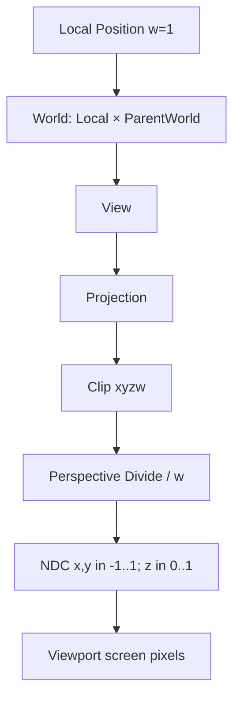
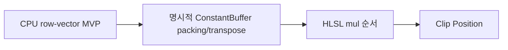

<callout icon="📷" color="blue_bg">
	**DX11 06 · Transform / Camera**
	<mention-date start="2026-10-16"/>. 원본의 SIMD Transform·카메라 계층 메모를 좌표·행렬 규약과 실패 조건 중심으로 독립 개정합니다. C++20 학습 기준, C++11 호환 CPU 모델을 제공합니다. DirectXMath/GPU 실행은 미검증입니다.
</callout>
## 1. 공간 변환의 정의
이 교재는 행 벡터, 왼손 좌표계(+Z 전방)와 동차좌표를 사용합니다. 점은 w=1, 방향은 w=0입니다. 클립 좌표는 p_clip = p_local × World × View × Projection, 부모 계층은 childWorld = childLocal × parentWorld입니다. 이는 C++의 보편 문법이 아니라 **프로젝트의 수학·HLSL 공통 계약**입니다.

<table fit-page-width="true" header-row="true">
<tr>
<td>대상</td>
<td>동차 w</td>
<td>중요 조건</td>
</tr>
<tr>
<td>점</td>
<td>1</td>
<td>이동 적용, 투영 후 w 나눗셈 필요</td>
</tr>
<tr>
<td>방향</td>
<td>0</td>
<td>이동 무시, 회전·스케일 적용</td>
</tr>
<tr>
<td>표면 법선</td>
<td>0</td>
<td>비균일 스케일/Shear 시 inverse-transpose와 정규화 검토</td>
</tr>
<tr>
<td>Camera View</td>
<td>행렬</td>
<td>카메라 World의 역행렬, LookAt 예외 처리</td>
</tr>
</table>
## 2. Camera의 View와 Projection
왼손 LookAt에서 F=normalize(At−Eye), R=normalize(cross(Up,F)), U=cross(F,R)입니다. Eye=At, Up과 Forward가 평행, 비유한 값이면 유효한 직교 기저가 성립하지 않습니다. 예로 Eye(0,0,-5), At(0,0,0)이면 원점은 View 공간 z=5입니다.
단순 LH 유한 Perspective 예제는 0보다 큰 near, far\>near, 0\<FOVy\<π, aspect\>0을 사용합니다. FOV 90°, near=1, far=101이면 View z=1은 z_ndc=0, z=101은 z_ndc=1입니다. 일반 Reverse-Z·무한 원평면 투영은 별도 정책입니다. [XMMatrixPerspectiveFovLH](https://learn.microsoft.com/en-us/windows/win32/api/directxmath/nf-directxmath-xmmatrixperspectivefovlh).
## 3. HLSL의 숨은 전제
mul(float4(pos,1), MVP)는 행 벡터 수식입니다. mul(MVP,float4(pos,1))과 일반적으로 같지 않습니다. 셰이더의 row_major/column_major 메모리 패킹과 CPU 수학 곱 순서를 구별합니다. CPU의 XMMATRIX 연산 타입과 XMFLOAT4X4 저장 타입, ConstantBuffer 슬롯 정렬을 따로 확인합니다. [D3DX→DirectXMath](https://learn.microsoft.com/en-us/windows/win32/dxmath/pg-xnamath-migration-d3dx) · [HLSL pack_matrix](https://learn.microsoft.com/en-us/windows/win32/direct3dhlsl/dx-graphics-hlsl-appendix-pre-pragma-pack-matrix).

## 4. Viewport와 픽셀
screen.x = viewport.X + (ndc.x+1)×Width/2, screen.y = viewport.Y + (1−ndc.y)×Height/2입니다. 에디터의 부분 뷰포트에서 전체 창 기준을 쓰면 픽킹/렌더 좌표가 어긋납니다. clip.w가 0에 가깝거나 NaN인 원근 나눗셈도 거부해야 합니다.
## 5. 실행 검증과 실패 사례
06A 독립 C++ 모델은 행렬 곱, 부모 Transform, 점/방향 차이, View, Perspective near/far, 화면 오프셋·Y 반전과 잘못된 입력을 **30개 조건**으로 검증했습니다. GCC14.2 C++20·C++11 및 Clang17 ASan/UBSan에서 동일 30조건·CTest 구성별 1/1 통과했습니다. 최초 빌드에서 미사용 변수로 -Werror 실패가 발생해 제거하고 재실행한 기록을 보존했습니다. Windows/MSVC·DirectXMath 실제 API·GPU·HLSL 컴파일은 미검증입니다.
## 6. 게임 개발 적용
Transform은 Local/World 계층 갱신과 Dirty 전파, Camera는 View·Projection·Viewport, Renderer는 ConstantBuffer·GPU 상태의 책임을 분리할 수 있습니다. Camera가 반드시 GameObject 상속 클래스여야 하거나 PipelineManager가 싱글턴이어야 하는 API 규칙은 아닙니다.

Q. (1,0,0,0) 방향을 +X 10 이동 행렬로 변환하면 x=11인가요?

	아니요. 방향 w=0이므로 이동 항은 적용되지 않고 x=1입니다.

Q. 자식 행렬에 부모를 곱하는 순서는?

	행 벡터 규약에서 childWorld = childLocal × parentWorld입니다. 열 벡터 규약을 섞으면 다른 결과가 나옵니다.

Q. CPU에서 NDC 깊이가 맞으면 GPU 화면도 검증됐나요?

	아니요. HLSL 행렬 저장, 셰이더 mul, 실제 Depth/Viewport 및 Driver 상태는 별도입니다.

## 변경 기록
<mention-date start="2026-10-16"/> v1.0. C++20·C++11 호환 CPU 실습 06A와 재현 안내. 다음은 Skybox·Directional Lighting입니다.
<page url="https://app.notion.com/p/3fba99703f4081ffbf81f558af17fdc6">06A · Transform·Camera 전체 CPU 소스·CTest 로그</page>
