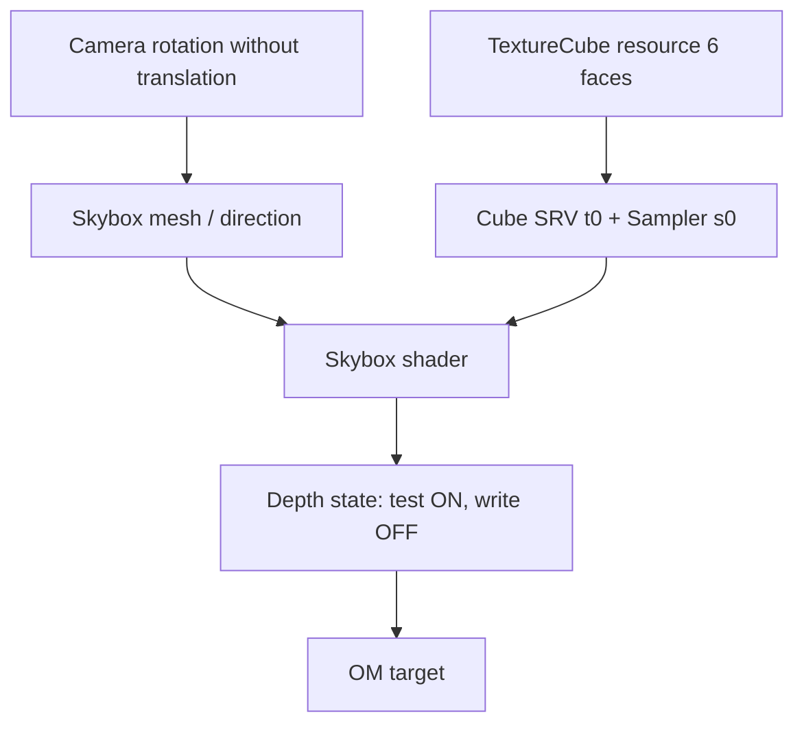
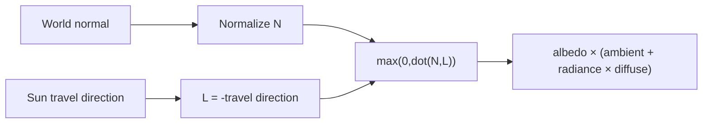

<callout icon="🌌" color="blue_bg">
	**DX11 07 · Skybox / DepthStencil / Lighting**
	<mention-date start="2026-10-16"/>. 기존 Skybox·스테이트·Lighting 메모를 TextureCube, 깊이·컬링, Lambert 조명으로 연결합니다. CPU 수치 모델은 검증했고 D3D11/GPU·HLSL 컴파일은 미검증입니다.
</callout>
## 1. Skybox와 TextureCube
Skybox는 멀리 있는 환경을 표현합니다. 카메라의 이동 성분을 View에서 제거하거나 Skybox Geometry를 카메라 위치에 둬서 시차가 없는 것처럼 그립니다. TextureCube는 일관된 방향·형식의 6개 면 데이터를 필요로 합니다. D3D11 Texture2DArray의 ArraySize=6과 D3D11_RESOURCE_MISC_TEXTURECUBE, Cube용 SRV Dimension을 구분하며, 배열 6개라고 자동으로 TextureCube가 되는 것은 아닙니다.

## 2. Depth와 Rasterizer 계약
<table fit-page-width="true" header-row="true">
<tr>
<td>Pass</td>
<td>DepthTest</td>
<td>DepthWrite</td>
<td>비고</td>
</tr>
<tr>
<td>Opaque</td>
<td>대개 LESS</td>
<td>ON</td>
<td>장면의 불투명 표면</td>
</tr>
<tr>
<td>Skybox (z=1)</td>
<td>예: LESS_EQUAL</td>
<td>OFF</td>
<td>깊이 경계 equal 허용</td>
</tr>
<tr>
<td>UI</td>
<td>게임 정책</td>
<td>보통 OFF</td>
<td>별도 레이어/Blend</td>
</tr>
</table>
D3D11_DEPTH_STENCIL_DESC가 OM 깊이/스텐실 정책을 정하고, 삼각형 앞/뒷면 컬링은 D3D11_RASTERIZER_DESC의 CullMode입니다. Cube 내부에서 보는 방식일 때 적절한 CullMode와 winding을 지정합니다. Skybox를 무조건 먼저/나중에 그리는 고정 규칙은 아니며 ZWrite와 DepthFunc가 그 순서에 맞아야 합니다. [D3D11_DEPTH_STENCIL_DESC](https://learn.microsoft.com/en-us/windows/win32/api/d3d11/ns-d3d11-d3d11_depth_stencil_desc).
## 3. 방향광과 표면 법선
Lambert diffuse는 L을 표면에서 광원으로 향하는 단위 방향, N을 단위 표면 법선으로 둘 때 max(0,dot(N,L))입니다. sunDirection을 빛이 **진행하는 방향**으로 저장했다면 L=-sunDirection입니다. CPU 모델은 선형 RGB에서 albedo×(ambient+radiance×max(0,dot(N,L)))을 계산합니다. HDR tone mapping, sRGB, Shadow/PBR/Normal map은 포함하지 않습니다.
비균일 스케일을 적용한 표면 법선은 필요에 따라 inverse-transpose 및 정규화를 사용하며, 단순 World에 곱한 결과가 언제나 올바른 것은 아닙니다.

## 4. 실제 실습·오류 한계
07A CPU 모델은 TextureCube의 6면 구성 일부, LESS vs LESS_EQUAL, Skybox DepthWrite, 카메라 상대 위치, Lambert의 앞·옆·뒷면과 잘못된 방향을 **28개 조건**으로 검사합니다. GCC14.2 C++20·C++11, Clang17 ASan/UBSan에서 동일 28조건·구성별 CTest 1/1 통과했습니다. 하위 07A에는 HLSL 참고 코드와 CMake, 실제 테스트 원시 출력도 보존합니다. 실제 HLSL 컴파일·GPU TextureCube 제작과 렌더링은 **실행하지 않았습니다**.
## 5. 자주 틀리는 점과 적용
Skybox의 depth=1 가정 없는 LESS_EQUAL 사용, Skybox용 Rasterizer Culling 방향 반전, 광선의 진행 방향과 광원으로 향하는 방향 혼동, sRGB로 저장된 Albedo의 선형 조명 수식 혼합은 실무 오류를 유발합니다. 패스가 끝나면 새 DepthStencil·Rasterizer·Texture/Sampler 상태를 다시 설정하는 정책을 명시합니다.

Q. Skybox에서 깊이 기록을 꺼 두는 이유는?

	실제 월드 Geometry의 Depth 값을 하늘 픽셀로 덮지 않기 위해서입니다. 패스 순서에 맞는 DepthTest 정책도 필요합니다.

Q. sunDirection이 광선 진행 방향일 때 Lambert의 L은?

	L=-sunDirection입니다. 방향 벡터의 정의를 통일해야 합니다.

Q. CullMode를 바꾸려면 DepthStencilState를 수정하나요?

	아닙니다. RasterizerState의 CullMode를 사용합니다.

## 변경 이력
<mention-date start="2026-10-16"/> v1.0. 원본 Skybox·Lighting의 숨은 전제와 상태 계약을 분리했습니다. 다음은 Terrain 격자·HeightMap·Splatting입니다.
<page url="https://app.notion.com/p/3fba99703f4081f2a25dd9874f6fa5cb">07A · Skybox·Lighting CPU·HLSL 전체 소스·검증</page>
