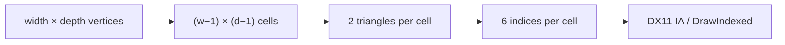
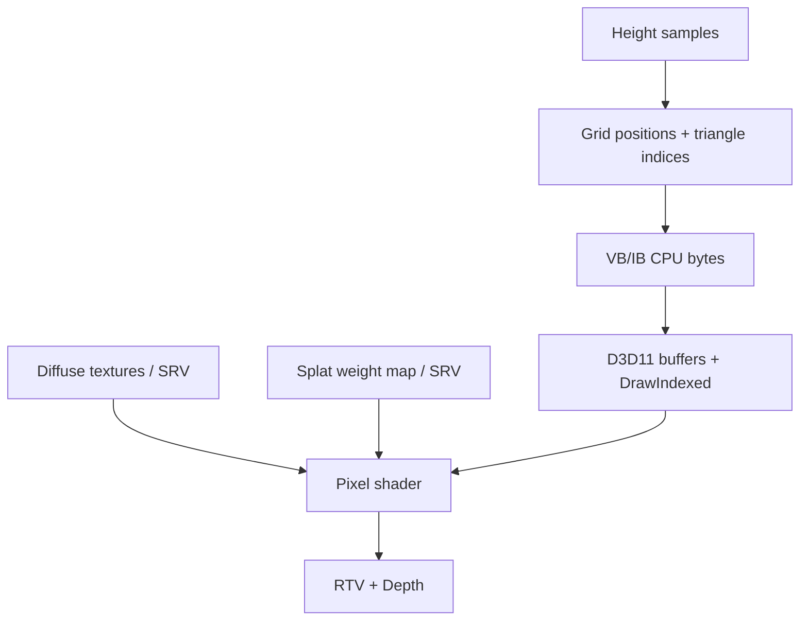

<callout icon="🏞️" color="blue_bg">
	**DX11 08 · Terrain Mesh / HeightMap**
	<mention-date start="2026-10-16"/>. 원문의 정점 격자·HeightMap·Splatting을 구분하고 CPU 높이 계산이 렌더 삼각형 표면과 일치하는 조건을 검증합니다.
</callout>
## 1. 정점 격자와 셀 수
width×depth가 정점 격자라면 Cell 수는 (width−1)×(depth−1), TriangleList 인덱스 수는 Cell×6입니다. 예를 들어 **정점 10×10 → 정점100, Cell81, 삼각형162, 인덱스486**입니다. 반대로 10×10 Cell이면 정점은 11×11이고 인덱스 600개입니다.

한 셀의 a=(0,0), b=(1,0), c=(0,1), d=(1,1)을 b–c 대각선으로 나누는 경우 삼각형은 a-b-c와 b-d-c입니다. 실제 메시에서 a–d 대각선을 사용하면 아래 높이 샘플링 공식도 바꾸어야 합니다.
## 2. 삼각형 높이 vs Bilinear
셀 내부 위치 (fx,fz)를 정규화한 \[0,1\] 구간에서 fx+fz≤1이라면 h=a(1−fx−fz)+b fx+c fz를 사용합니다. 나머지는 h=b(1−fz)+c(1−fx)+d(fx+fz−1)입니다.
예를 들어 a=b=c=0, d=10, (fx,fz)=(0.75,0.75)이면 **삼각형 메시 높이는 5**입니다. Bilinear는 5.625이므로 GPU가 두 삼각형으로 그리는 지형과 CPU의 캐릭터 높이가 어긋날 수 있습니다.

## 3. 입력·좌표·Pitch 조건
<table fit-page-width="true" header-row="true">
<tr>
<td>항목</td>
<td>계약</td>
<td>실수</td>
</tr>
<tr>
<td>인덱스</td>
<td>row major: z×width+x</td>
<td>width/depth 반전과 정수 오버플로</td>
</tr>
<tr>
<td>Height</td>
<td>정점마다 유한한 값</td>
<td>NaN/Inf·없는 픽셀·역순 저장 무시</td>
</tr>
<tr>
<td>World</td>
<td>지형 Local/World 공간 구분</td>
<td>기울어진 지형에 로컬 XZ만 샘플해 월드 수직 충돌이라 판단</td>
</tr>
<tr>
<td>Texture row</td>
<td>양수 Pitch 예제에서 pitch≥width×4</td>
<td>2차원 row padding·메모리 범위 무시</td>
</tr>
<tr>
<td>Draw</td>
<td>TriangleList + IndexCount</td>
<td>DX9 PrimitiveCount와 혼동</td>
</tr>
</table>
모든 BMP가 단순 grayscale인 것은 아닙니다. 포맷·팔레트·비트 수·상향/하향 저장·row padding을 검증해야 합니다. 이번 실습은 이미 파싱된 높이 배열을 입력으로 받아 **BMP 파일 파서는 구현하지 않습니다**. 월드에서 수직 Ray로 기울어진 지형을 선택하려면 올바른 좌표 변환과 Ray–Triangle 교차가 별도로 필요합니다.
## 4. Splatting의 범위
Splatting은 텍스처 여러 개와 가중치 맵을 사용한 재질 혼합입니다. Weight가 음수이거나 합이 1과 다르면 클램프/정규화 정책이 필요합니다. UV 반복·Mip·Sampler·ColorSpace/선형 RGB, 셰이더 슬롯과 Depth 상태를 명시해야 합니다. HeightMap의 수치 계산과 Splatting을 하나의 동작으로 혼동하지 않습니다.
## 5. 실습·검증 기록
08A 전체 C++ CPU 모델은 10×10 격자 수량, 두 삼각형의 순서, 경계·대각선·Bilinear와 다른 높이, NaN/Inf, 자료 길이·row Pitch·오버플로 입력을 **33개 조건**으로 검증했습니다. GCC14.2 C++20·C++11 및 Clang17 ASan/UBSan에서 동일 33조건, 구성별 CTest 1/1 통과했습니다. 원형 소스 초기 테스트는 vector를 이동한 뒤 이동 전 인자를 검사하는 오류로 실패했으며, 이동 후 **멤버 height.size()**를 검사하도록 수정해 재검증했습니다.
실제 D3D11 버퍼 생성·Draw, GPU HeightMap 텍스처 업로드, Splatting HLSL 컴파일은 실행하지 않았습니다. [Microsoft CreateTexture2D](https://learn.microsoft.com/en-us/windows/win32/api/d3d11/nf-d3d11-id3d11device-createtexture2d) · [SUBRESOURCE_DATA::SysMemPitch](https://learn.microsoft.com/en-us/windows/win32/api/d3d11/ns-d3d11-d3d11_subresource_data) · [DrawIndexed](https://learn.microsoft.com/en-us/windows/win32/api/d3d11/nf-d3d11-id3d11devicecontext-drawindexed).
## 6. 게임 개발 적용과 체크
대규모 Terrain은 LOD/Streaming/Culling으로 확장 가능하나 이 단원에서는 필수 구현한 것처럼 표시하지 않습니다. 높이 배열 소유권, GPU VB/IB 생성, 현재 Transform과 카메라, 지형 충돌·픽킹의 API 경계를 분리할 수 있어야 합니다.

Q. 10×10 셀의 인덱스도 486개인가요?

	아니요. 10×10은 위 예제에서 정점 수입니다. 셀 10×10개라면 인덱스 600개입니다.

Q. Bilinear 높이는 항상 GPU 삼각형 높이와 같나요?

	아닙니다. 대각선과 꼭짓점 높이에 따라 다릅니다. (0,0,0,10)의 (.75,.75)는 삼각형 5, Bilinear 5.625입니다.

Q. CPU 격자 검사가 통과하면 GPU Splatting도 검증된 건가요?

	아닙니다. Texture SRV와 HLSL·Sampler·RenderState는 별도 플랫폼 검증 대상입니다.

## 변경 기록
<mention-date start="2026-10-16"/> v1.0. 격자/Cell, 삼각형 보간, Pitch, Splatting의 전제를 분리했습니다. 다음은 Mesh·Material 로딩과 Assimp입니다.
<page url="https://app.notion.com/p/3fba99703f408195b6ebda312ec0c3b6">08A · Terrain Mesh·Height 전체 CPU 소스·검증</page>
