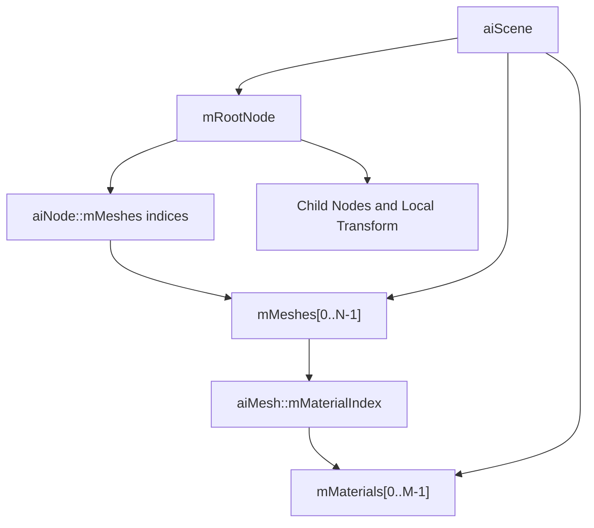

<callout icon="🧱" color="blue_bg">
	**DX11 09 · Assimp Mesh / Material / Node**
	<mention-date start="2026-10-16"/>. 원문에서 “재질 개수 != 메시 개수” 문제와 Mesh 로컬 위치를 혼동한 설명을 Assimp의 실제 자료 구조에 맞춰 재작성합니다. 하위 09A는 Assimp API를 직접 호출하지 않는 CPU 모델입니다.
</callout>
## 1. Assimp Scene의 인덱스 관계
aiScene에는 **Mesh 배열**과 **Material 배열**이 각각 있습니다. aiMesh::mMaterialIndex는 scene-\>mMaterials에 대한 별도 인덱스이므로 Mesh 번호나 Node 번호와 일치한다고 가정하면 안 됩니다. 한 Mesh는 하나의 Material Index를 갖지만, 복수 Mesh가 같은 Material을 참조할 수 있으며 Material이 더 많거나 적은 상황도 처리해야 합니다.
aiNode::mMeshes는 Mesh 구조체 배열이 아니라 **scene-\>mMeshes의 인덱스 목록**입니다. 한 Node에 Mesh가 없을 수도, 여러 Mesh가 있을 수도, 동일한 Mesh가 서로 다른 두 Node에서 재사용될 수도 있습니다.

공식 근거: [Assimp aiScene](https://github.com/assimp/assimp/blob/master/include/assimp/scene.h) · [aiMesh::mMaterialIndex](https://github.com/assimp/assimp/blob/master/include/assimp/mesh.h) · [Assimp usage / Node Hierarchy](https://github.com/assimp/assimp-docs/blob/master/source/usage/use_the_lib.rst).
## 2. Node 계층과 Local / World Transform
aiNode의 Local Transform은 부모의 공간에서 정의됩니다. World Transform은 자신의 Local과 상위 노드의 Transform을 **선택한 행/열 벡터 관례**에 맞게 합성해야 합니다. 09A CPU 모델은 행 벡터 규약에 맞춘 Translation만 사용해 부모와 자식 위치를 테스트합니다. 실제 aiMatrix4x4의 저장·합성 규약을 그대로 CPU Translation 함수에 대응시켰다는 뜻이 아닙니다.
Mesh 원본 정점을 영구 변환해 버리면 같은 Mesh를 다른 Node가 참조하는 경우 원래 위치를 복구하기 어렵습니다. 각 Draw마다 Node World를 적용하거나 Mesh 인스턴스별 변환을 따로 보관합니다.
## 3. 모델 Import의 실패·경계 조건
<table fit-page-width="true" header-row="true">
<tr>
<td>조건</td>
<td>검증/정책</td>
</tr>
<tr>
<td>ReadFile/Scene 실패</td>
<td>null Scene, Incomplete/RootNode, 오류 메시지 확인</td>
</tr>
<tr>
<td>Node Mesh Index</td>
<td>scene-\>mNumMeshes 미만인지 검사</td>
</tr>
<tr>
<td>Mesh Material Index</td>
<td>scene-\>mNumMaterials 미만인지 검사</td>
</tr>
<tr>
<td>Face</td>
<td>TriangleList만 렌더할 경우 mNumIndices=3 확인; 다른 primitive는 분리/거부</td>
</tr>
<tr>
<td>Optional streams</td>
<td>Norm/UV/Tangent/Bone 유무 확인 후 정책 선택</td>
</tr>
<tr>
<td>Texture</td>
<td>외부 경로와 Embedded Texture를 구분; 로드 실패 시 Fallback</td>
</tr>
</table>
aiProcess_Triangulate를 설정해도 선·점 Primitive가 모두 사라진다는 뜻은 아닙니다. 필요하면 SortByPType·PrimitiveType 검사까지 수행해야 합니다. 왼손 좌표/UV/Face Winding 변환도 Postprocess 설정을 확인합니다. [Assimp postprocess.h](https://github.com/assimp/assimp/blob/master/include/assimp/postprocess.h).
## 4. CPU 모델 검증
09A는 Scene에 Mesh 2개, Material 3개, root/child Node가 동일 Mesh를 공유하는 사례를 만듭니다. Mesh Index와 Material Index 불일치, 부모/자식 Transform, 잘못된 Mesh/Material/Vertex Index, 삼각형 아님, NaN Vertex, 무한 Transform, 깊은 Node 계층 제한을 **27개 조건**으로 검사했습니다. GCC14.2 C++20·C++11 및 Clang17 ASan/UBSan에서 동일 27조건/구성별 CTest 1/1 통과했습니다.
이 CPU 모델은 **실제 Assimp::Importer::ReadFile 실행·바이너리 파일 파서 검증·D3D11 버퍼 생성·GPU 렌더링을 하지 않았습니다.** Assimp SDK가 현재 환경에 설치되지 않아 실제 import와 ABI의 검증은 사용자 환경/후속 테스트로 남깁니다.
## 5. 게임 개발 적용
Importer가 Scene의 수명과 원본 참조를 제공하는 동안 엔진의 Model Asset으로 데이터를 복사/변환한다면 소유권을 확정해야 합니다. 한 Material의 텍스처 캐시를 여러 Mesh가 공유하더라도 Material ID와 Mesh ID를 별도 유지합니다. Node World는 재생되는 애니메이션 계층과도 연결되므로 뼈/메시/재질을 하나의 배열 인덱스로 취급하지 않습니다.

Q. Mesh 2개, Material 3개는 Import가 잘못된 것인가?

	아닙니다. 각각 별도 배열이며 각 Mesh의 mMaterialIndex가 유효하기만 하면 됩니다.

Q. 한 Mesh를 두 Node에서 사용하면 원본 Mesh 정점을 두 번 바꿔야 하나요?

	아닙니다. Mesh 데이터는 공유하고 각 Node/인스턴스의 World Transform을 Draw 시 적용할 수 있습니다.

Q. Triangulate 설정만으로 모든 Face가 삼각형인가요?

	선·점 Primitive가 있을 수 있으므로 렌더링 단계에서 유형과 인덱스 수를 확인합니다.

## 변경 기록
<mention-date start="2026-10-16"/> v1.0. Material Count != Mesh Count를 오류가 아닌 정상 가능 구조로 재해석하고, Node Mesh 참조·Transform·자료 유효성을 분리했습니다. 다음은 애니메이션 계층·채널·시간 샘플링입니다.
<page url="https://app.notion.com/p/3fba99703f4081c5afd4d0dba8aef10f">09A · Assimp Scene CPU 전체 C++·CMake·검증 로그</page>
