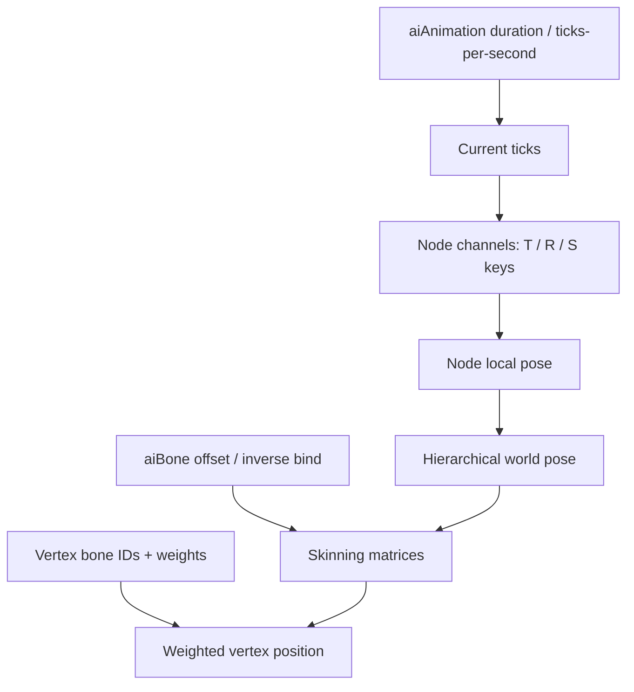
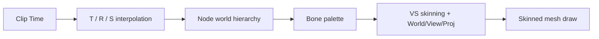

<callout icon="🎞️" color="blue_bg">
	**DX11 10 · Skeletal Animation / Channel / Skinning**
	<mention-date start="2026-10-16"/>. 기존 메모의 계층·Bone·Channel·Animation을 시간 샘플링 → Node Pose → Skinning 순으로 재구성합니다. CPU 수치 모델은 검증했지만 실제 Assimp·D3D11/GPU·HLSL 실행은 미검증입니다.
</callout>
## 1. Mesh, Bone과 Node Animation의 역할
aiMesh는 정점과 면 데이터를 갖고, aiBone은 이름·Mesh 정점에 적용되는 가중치와 mOffsetMatrix(inverse bind)를 제공합니다. aiNode는 계층 Local Transform을 갖고 aiNodeAnim은 특정 Node의 Position/Rotation/Scale Key 시퀀스를 나타냅니다. aiAnimation은 Duration(틱), TicksPerSecond, Channel 배열을 포함합니다. Bone 이름과 Node 계층 매핑을 먼저 결정한 뒤 실제 렌더용 Bone Matrix Palette를 만듭니다.

공식 근거: [Assimp anim.h](https://github.com/assimp/assimp/blob/master/include/assimp/anim.h) · [Assimp mesh.h — aiBone / mOffsetMatrix](https://github.com/assimp/assimp/blob/master/include/assimp/mesh.h).
## 2. 시간과 보간 정책
Animation Duration과 Key의 시간 단위는 초가 아니라 **Ticks**일 수 있습니다. TicksPerSecond가 명시적으로 0인 파일의 FPS 정책은 로더/게임이 별도 선택해야 하며 임의의 25나 30 FPS를 “Assimp의 보편 기본값”으로 단정하지 않습니다. 이 실습은 TicksPerSecond \> 0인 입력만 허용합니다.
Position/Scale은 보통 선형 보간하고 Quaternion은 방향을 고려한 slerp를 사용합니다. Quaternion Q와 -Q는 같은 회전을 나타내므로 짧은 호를 선택하려면 내적 부호를 확인해야 합니다. 작은 각도는 선형 보간 후 정규화할 수 있습니다. 시작/끝 시간 밖 처리(Clamp·Loop·Extrapolate)는 Animation별 정책이어야 합니다.
## 3. 계층과 Skinning Matrix
Node의 Local Pose는 부모 World Pose와 결합합니다. 이 단원 CPU 모델은 Quaternion Hamilton 곱과 변환 벡터 회전을 사용하며, GPU 상수 버퍼의 행렬 저장 방식은 별도입니다. Mesh 정점(바인드 공간)을 Bone Offset으로 옮겨 Animated Bone World로 변환한 후 각 Bone 결과에 Weight를 곱해 합산합니다.
GPU 구현에서는 **Mesh/Model World, Skeleton Global Inverse, Bone Offset, Current Node World의 곱 순서**가 프로젝트의 좌표/행렬 관례에 따라 명확해야 합니다. CPU 예제는 단순 Pose 합성으로 일부 관계만 검사하므로 실제 Assimp mOffsetMatrix와 그대로 바이트 호환이라고 표현하지 않습니다.
<table fit-page-width="true" header-row="true">
<tr>
<td>대상</td>
<td>조건</td>
<td>실패 사례</td>
</tr>
<tr>
<td>Channel</td>
<td>Node 이름/ID 매핑, Key 시간 정렬</td>
<td>키 0개·시간 중복·NaN</td>
</tr>
<tr>
<td>Quaternion</td>
<td>유한/비제로, 정규화, 짧은 호</td>
<td>제로 Quaternion·부호 반전</td>
</tr>
<tr>
<td>계층</td>
<td>Local→Parent World 합성</td>
<td>Bone만 갱신하고 부모 Node 누락</td>
</tr>
<tr>
<td>Influence</td>
<td>유효 Bone ID와 유한 비음수 Weight</td>
<td>합 1이 아님·4개 초과·범위 초과</td>
</tr>
<tr>
<td>Bone Palette</td>
<td>CB 크기/Feature limits/HLSL 배치</td>
<td>행렬 전치·Palette index 매핑 불일치</td>
</tr>
</table>
## 4. GPU/게임 렌더링 적용
Importer가 Load한 애니메이션은 Scene의 노드 수명과 연결됩니다. 게임은 Node Hierarchy, Animation Clips, Bone Map, Mesh GPU Buffers, Material, Vertex Blend Indices/Weights를 분리해 관리합니다. 프레임마다 시간 샘플 → Node Pose → Bone Palette 계산 → VS ConstantBuffer 갱신 → DrawIndexed를 수행할 수 있습니다. GPU Palette 수가 제한되면 Mesh 분할이나 다른 Skinning 방식을 고려해야 합니다.

## 5. 실행 가능 CPU 모델
10A 독립 C++20 프로그램은 Quaternion 회전·Slerp, Node 부모/자식 Pose, Key 시간 샘플·Loop, CPU Skinning 가중치 혼합 및 잘못된 클립/Key/Bone/Weight를 **33개 조건**으로 검사합니다. GCC14.2 C++20·C++11 및 Clang17 ASan/UBSan에서 동일 33조건과 CTest 구성별 1/1 통과했습니다. **Assimp::Importer::ReadFile, 실제 Anim Key 디코딩, Windows/MSVC, GPU/HLSL 컴파일은 미검증**입니다.
## 6. 이해 확인

Q. TicksPerSecond=0이라면 매 파일에 25를 정답처럼 적용하나요?

	아닙니다. 로더/프로젝트의 별도 정책과 원본 형식·애니메이션 데이터를 확인해야 합니다. 이 CPU 실습은 0을 거부합니다.

Q. 같은 회전을 나타내는 q와 -q를 slerp하면 반드시 긴 방향으로 회전해야 하나요?

	아닙니다. 내적이 음수이면 한쪽 부호를 바꿔 짧은 회전 호를 선택할 수 있습니다.

Q. CPU 33조건 통과는 GPU Skinning 결과의 검증인가요?

	아닙니다. 실제 Matrix Palette 업로드와 HLSL mul 순서, Vertex Layout, GPU Blend 결과는 Windows에서 별도 검증해야 합니다.

## 변경 기록
<mention-date start="2026-10-16"/> v1.0. Animation Load, Node, Channel, Bone Offset, CPU Skinning을 하나의 완결된 학습 단위로 연결했습니다. 다음은 Collider AABB·OBB와 충돌 판정입니다.
<page url="https://app.notion.com/p/3fba99703f4081488103f693dcda42a5">10A · Animation CPU 전체 C++·CMake·CTest 로그</page>
