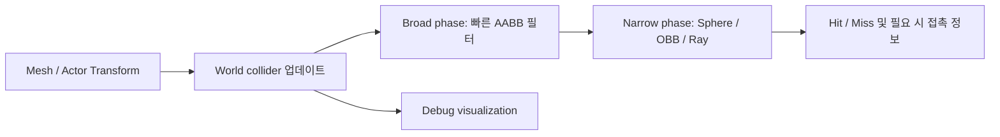

<callout icon="🛡️" color="blue_bg">
	**DX11 개정 11 · Collider — CPU 경계 상자·구·레이·평면 OBB 판정**
	<mention-date start="2026-10-16"/>. 기존 강의의 콜라이더·충돌체 그리기·충돌연산·AABB 구현을 검증 가능한 수학 계약으로 다시 정리했습니다. 이 실습은 D3D11 렌더링이 아니라 CPU 충돌 판정입니다.
</callout>
## 1. 정의: 충돌 판정 ≠ 물리 해결 ≠ 디버그 렌더링
- **Collider**는 모양과 위치를 표현하는 데이터입니다. **Intersection test**는 두 영역의 접촉/겹침 여부를 반환합니다. **Collision response**는 관통 깊이/법선/속도/충격량 등 추가 정보를 사용해 물리적 후속 처리를 수행합니다. 서로 다릅니다.
- CPU의 DirectXMath/DirectXCollision `BoundingBox`, `BoundingOrientedBox`, `BoundingSphere`는 D3D11 Device 생성 없이도 사용하는 충돌 수학 구조입니다. DirectX Tool Kit의 디버그 그리기는 **시각화**일 뿐 충돌의 진실 원본이 되어서는 안 됩니다.
- Local Collider를 World에 반영할 때는 위치만 단순 복사해서는 안 되고 회전·비균일 스케일·축 정의를 반영해야 합니다. 회전된 AABB의 World 경계는 다시 계산하거나 OBB로 표현할 수 있습니다.

## 2. 형상별 계약과 계산 방법
<table fit-page-width="true" header-row="true">
<tr>
<td>형상</td>
<td>저장</td>
<td>핵심 판정</td>
<td>주의</td>
</tr>
<tr>
<td>AABB (3D)</td>
<td>[min.xyz](http://min.xyz)·[max.xyz](http://max.xyz)</td>
<td>모든 축에서 닫힌 구간이 겹치는가</td>
<td>회전 방향을 직접 담지 못함</td>
</tr>
<tr>
<td>Sphere (3D)</td>
<td>중심·반지름</td>
<td>중심에서 AABB의 최근접점까지 거리² ≤ 반지름²</td>
<td>음수 반지름·NaN 거부</td>
</tr>
<tr>
<td>OBB XZ (2D 투영)</td>
<td>중심·XZ 반축·Yaw</td>
<td>양 사각형의 4개 축에 대한 SAT 분리축 검사</td>
<td>Y축을 검사하지 않음. 완전한 3D OBB가 아님</td>
</tr>
<tr>
<td>Ray × AABB (3D)</td>
<td>Origin·Direction·maxT</td>
<td>세 축의 Slab 진입/진출 매개변수 구간 교집합</td>
<td>Direction의 단위벡터 여부에 따라 t의 거리 의미가 달라짐</td>
</tr>
</table>
### AABB: 접촉을 포함하는 닫힌 구간 계약
`A.min.x <= B.max.x && A.max.x >= B.min.x`를 X,Y,Z 세 축 모두에서 검사합니다. 이 실습은 면·모서리에서 **접촉만 해도 true**로 정의합니다. 게임 로직이 관통만 충돌로 볼지 접촉을 포함할지 계약을 명확히 해야 합니다.
### Sphere × AABB: 좌표별 Clamp
구 중심 C를 AABB \[min,max\]에 각 축별 clamp하여 최근접점 Q를 만들고 `dot(C-Q,C-Q) <= r*r`를 판정합니다. 경계 조건과 제곱 거리를 사용하면 루트를 피할 수 있습니다.
### OBB × OBB: XZ 풋프린트 전용 SAT
코드의 `ObbXZ`는 XZ 평면에 직교하는 두 반축을 가지며 상대 상자와 총 네 방향의 축을 투영합니다. **Y가 20만큼 떨어져도 XZ가 겹치면 true**입니다. 전체 3D OBB × OBB 판정은 각 상자의 3개 축과 두 상자의 교차축 최대 9개를 포함하는 3D SAT 등 다른 알고리즘이 필요합니다. 충돌 컴포넌트에서 이 2D 테스트를 그대로 3D OBB 테스트로 대체하면 안 됩니다.
### Ray × AABB: 3축 Slab
레이 `origin+t*dir`에서 `0 <= t <= maxT`의 유효구간을 각 축 슬랩과 교차합니다. 축 방향 성분이 0에 가까우면 시작점이 해당 축 구간 안에 있는지 확인합니다. `outT`는 **적중할 때만** 유효하며 내부에서 출발한 레이는 0을 반환합니다. 이 CPU 예제의 `maxT`는 실제 길이가 아니라 매개변수 t 상한일 수 있습니다.
## 3. 정밀도·예외·수명 관리
NaN/Inf, 뒤집힌 min/max, 음수 반지름, 0 방향 레이는 거부합니다. 작은 epsilon은 모형에 도입했지만 실제 엔진에는 월드 스케일별 허용 오차가 필요합니다. 충돌 결과를 이용해 물리 반응을 하려면 **접촉 법선·깊이 또는 TOI, 단계적 이동** 등이 추가되어야 합니다. Ray 교차는 충돌체끼리의 상호작용과 다른 질문입니다.
메시의 렌더 컴포넌트와 Collider 컴포넌트는 수명·소유권·업데이트 타이밍이 다를 수 있습니다. 복제시 충돌 형상은 값 복사 또는 독립 소유로 관리하고, 공유 불변 형상 데이터와 인스턴스별 World 변환을 구분합니다.
## 4. 전체 실행 가능 실습
11A 전체 소스/로그: 해당 단원 하위 페이지 참조. `main.cpp` 단일 파일과 `CMakeLists.txt`로 실행합니다. 일반 C++11로도 빌드되는 독립 C++ 예제입니다. 원본 함수와 동일한 DTK 구현을 그대로 복사하지 않았습니다.
- GCC 14.2 / C++20: 29 조건, CTest 1/1 통과
- GCC 14.2 / C++11: 동일 29 조건, CTest 1/1 통과
- Clang 17 / C++20 + ASan/UBSan: 동일 29 조건, CTest 1/1 통과
- **Windows/MSVC·실제 DirectXCollision API 호출·DX11 GPU/DTK 디버그 렌더링은 미실행**
## 5. 흔한 오해와 이해 확인

Q. AABB에 회전을 더하면 그대로 OBB가 됩니까?

	아닙니다. AABB 표현은 월드 축 정렬을 전제합니다. 회전한 기하에 대해 새 World AABB를 재계산하거나 OBB 형상을 별도로 유지해야 합니다.

Q. 이 코드의 OBB 교차 결과로 위아래 층끼리 충돌을 판정할 수 있나요?

	안 됩니다. XZ 투영 SAT라 Y 분리가 완전히 무시됩니다. 높이 범위의 추가 검사 또는 완전한 3D SAT가 필요합니다.

Q. Ray Direction을 정규화하지 않으면 outT는 미터가 됩니까?

	아닙니다. 거리 = t \* \|Direction\|입니다. 단위 방향벡터면 t가 거리처럼 해석되지만 이 실습은 정규화를 요구하지 않습니다.

## 6. 공식 근거 · 변경 기록
- [Microsoft Learn · directxcollision.h](https://learn.microsoft.com/en-us/windows/win32/api/directxcollision/)
- [Microsoft Learn · BoundingBox](https://learn.microsoft.com/en-us/windows/win32/api/directxcollision/ns-directxcollision-boundingbox)
- [Microsoft Learn · BoundingOrientedBox](https://learn.microsoft.com/en-us/windows/win32/api/directxcollision/ns-directxcollision-boundingorientedbox)
- [Microsoft Learn · BoundingSphere](https://learn.microsoft.com/en-us/windows/win32/api/directxcollision/ns-directxcollision-boundingsphere)
<mention-date start="2026-10-16"/> v1.0. 콜라이더의 데이터/판정/해결/디버그 출력 역할을 분리하고, 평면 OBB와 3D OBB의 범위를 구분했습니다. 결과는 CPU 경계 수학의 범위 내에서만 검증됐습니다.
<page url="https://app.notion.com/p/3fba99703f40810fa644ef6c5351b3bf">11A · Collider CPU 전체 소스·CMake·검증 기록</page>
