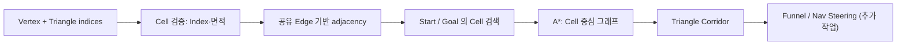

<callout icon="🗺️" color="blue_bg">
	**DX11 개정 12 · Navigation Mesh — Triangle Cell·인접성·Point Location·A**\*
	<mention-date start="2026-10-16"/>. 기존 네비게이션 메시 메모의 삼각형·공유 변·이웃 셀·이동 기능을 2D XZ CPU 모델로 분해했습니다. Navigation Mesh는 **걸을 수 있는 공간과 경로 계획**을 표현하며 모든 Collider를 대체하지 않습니다.
</callout>
## 1. 기본 계약
NavMesh는 삼각형/다각형의 **walkable region**과 연결성을 기록합니다. **Collider**는 물체끼리 겹치는지를 테스트하고, **NavMesh**는 에이전트가 어디를 지날 수 있는지 판단합니다. 동적 장애물, 캐릭터 간 충돌, 물리적 반응은 별도로 처리해야 합니다. 에이전트 반경에 따른 오프셋/장애물 여유폭도 이 예제에는 없습니다.

## 2. 세부 단계
### 2.1 자료 모델과 좌표
`points = vector<P{x,z}>`, `tris = vector<Tri{a,b,c}>`. 높이와 경사를 제외한 **XZ 평면 투영**입니다. 실제 3D 지형은 Y/경사·층 분리/오프메시 링크가 있어야 하며, 투영상 겹치는 다른 층을 하나의 면으로 혼동하지 않아야 합니다.
### 2.2 삼각형 유효성 검증
인덱스 범위, 세 정점의 중복, NaN/Inf, 외적에 의한 0면적 검사를 수행합니다. `cross(A,B,C)`의 부호가 Winding을 나타냅니다. 이 예제의 삼각형 포함 검사는 각 Triangle의 **부호가 함께 반전될 수 있도록** 분모 면적을 이용합니다. 실제 파일 Import 파이프라인에서는 중복 정점 병합 및 일정한 Winding을 별도 고려합니다.
### 2.3 공유 Edge 인접 그래프
서로 다른 두 Triangle이 **동일한 vertex index 두 개를 공유**하면 인접 셀로 연결합니다. 단지 좌표가 같은 별도 Vertex는 이 모델에서 이웃으로 취급하지 않습니다. 자료를 내보낼 때 인덱스 동일성 보장을 확인해야 합니다. 두 셀에 3점이 같은 경우 중복 Triangle로 거부합니다.
현 구현은 삼각형 모든 쌍을 비교하므로 이웃 구성 시간은 대략 `O(T²)`입니다. 실서비스의 대형 NavMesh는 정렬된 변 키 `(min(vertexId),max(vertexId))`로 해시/맵을 구성해 인접 탐색을 가속하고, **세 개 이상의 삼각형이 한 Edge를 공유하는 비매니폴드 구조**를 검출해야 합니다. 현재 실습은 비매니폴드 검출을 **구현하지 않았습니다**.
### 2.4 Point Location
삼각형의 외적/무게중심 계수로 현재 XZ 점을 포함하는 Cell을 찾습니다. 경계점은 오차 `1e-10` 범위 안에서 포함합니다. 같은 변 위의 점은 여러 Cell에 속할 수 있어 먼저 발견한 인덱스를 반환합니다. 이 검색은 단순 선형 `O(T)`이며 BVH/쿼드트리 같은 가속 구조가 없습니다.
### 2.5 A\* Triangle 경로
Cell 중심 간 거리로 Edge 비용을 정하고, 목표 중심까지의 직선 거리를 A* 휴리스틱으로 사용합니다. 결과는 삼각형 인덱스의 Corridor*\*이지 실제 캐릭터의 매끈한 3D 좌표 경로가 아닙니다. 좁은 통로나 코너에서 자연스러운 경로는 Portal/Funnel과 에이전트 반경을 고려하는 추가 단계가 필요합니다.
<table header-row="true">
<tr>
<td>구분</td>
<td>본 CPU 예제</td>
<td>엔진에 필요한 확장</td>
</tr>
<tr>
<td>공간</td>
<td>XZ 2D</td>
<td>3D Surface·층·경사</td>
</tr>
<tr>
<td>인접</td>
<td>공유 인덱스 두 개</td>
<td>Edge 해시·비매니폴드 검사</td>
</tr>
<tr>
<td>검색</td>
<td>선형 Cell 스캔</td>
<td>공간 인덱스</td>
</tr>
<tr>
<td>경로</td>
<td>Cell 중심 A\*</td>
<td>Portal/Funnel·Local avoidance</td>
</tr>
<tr>
<td>장애물</td>
<td>정적 연결성</td>
<td>Dynamic obstacle·Off-mesh link</td>
</tr>
</table>
## 3. 전체 실습·검증
12A 하위 페이지에 `main.cpp`, `CMakeLists.txt`, 실제 로그를 저장합니다. 전체 코드에서 4개 연결 삼각형·A\* 경로·같은 셀·고립 셀·부정확한 인덱스·중복 삼각형·퇴화 면·NaN을 테스트합니다.
- GCC 14.2 C++20: 27조건, CTest 1/1
- GCC 14.2 C++11: 동일 27조건, CTest 1/1
- Clang 17 C++20 + ASan/UBSan: 동일 27조건, CTest 1/1
- **실제 Recast/Detour SDK·Windows/D3D11·GPU는 검증하지 않음.**
## 4. 게임 개발에 적용
AI Steering은 `NavMesh -> Corridor -> Desired velocity -> Character movement -> Collision resolution`으로 책임을 나누는 편이 안전합니다. 경로 탐색을 이미 마쳤어도 매 프레임 움직이는 장애물에 부딪힐 수 있습니다. NavMesh만으로 장애물 처리를 완전히 없앨 수 있다는 기존 수업 메모의 표현은 과도합니다.

Q. 두 삼각형의 좌표값이 같으면 무조건 인접한가요?

	아닙니다. 현 CPU 실습은 같은 정점 인덱스 두 개를 공유하는지를 판단합니다. 좌표 동등성과 인덱스 동일성은 다른 계약입니다.

Q. A\*가 반환한 Cell 목록을 그대로 캐릭터가 통과할 수 있나요?

	꼭 그렇지는 않습니다. Cell 중심 경로는 최적의 실제 이동 경로가 아닙니다. Portal/Funnel, 에이전트 반경, 높이, 동적 장애물까지 다뤄야 합니다.

Q. 서로 다른 두 층의 XZ 위치가 같아도 본 실습에서 분리되나요?

	이 모델에는 Y가 없으므로 그 보장이 없습니다. 실제 NavMesh의 층·공간 관계를 따로 표현해야 합니다.

## 5. 참고 · 변경 기록
- [Recast Navigation 공식 저장소](https://github.com/recastnavigation/recastnavigation)
- [A\* 원 논문 Hart et al. (1968), IEEE](https://doi.org/10.1109/TSSC.1968.300136)
<mention-date start="2026-10-16"/> v1.0. 단순 삼각형 공유·내적 검사·메시당 충돌 대체라는 메모를 Cell 그래프/Pathfinding/물리 책임 분리로 재작성했습니다. C++ 모델은 설계의 제한을 표시한 채 독립 실행 가능하도록 만들었습니다.
<page url="https://app.notion.com/p/3fba99703f40813cbfb7f09b58180b55">12A · Navigation Mesh C++ 전체 소스·CMake·CTest 기록</page>
