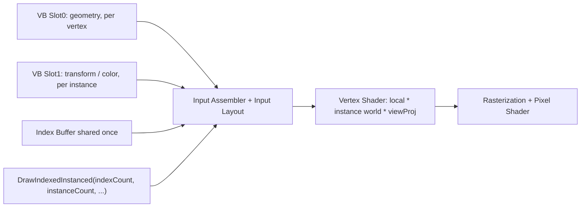
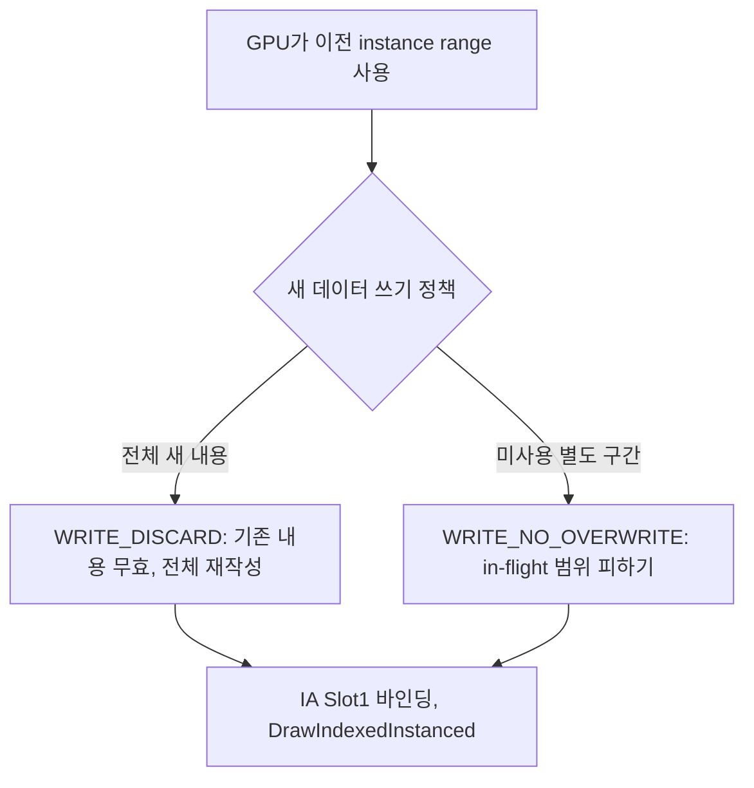

<callout icon="🧬" color="blue_bg">
	**DX11 13 · GPU Instancing — IA Slot, Per-Instance Input, DrawIndexedInstanced, Dynamic Buffer**
	<mention-date start="2026-10-16"/>. 기존 인스턴싱 메모의 “인덱스 버퍼를 인스턴스 수만큼 이어 만든다”, “NO_OVERWRITE로 이전 데이터에 +=” 부분을 D3D11 Input Assembler 규칙으로 교정합니다. 13A는 독립 CPU 계약 실습입니다.
</callout>
## 1. 왜 Instancing인가?
**공유 메시의 VB/IB 한 벌**을 재사용하고, 물체마다 달라지는 행렬/색/스프라이트 정보만 **별도 instance stream**에서 읽어 하나의 Draw 호출에 여러 인스턴스를 제출하는 기법입니다. Draw 호출과 그래픽스 파이프라인 상태 변경 비용을 줄일 수 있지만 GPU 정점 처리량/오버드로·가시성 컬링 비용이 사라지지는 않습니다. 메시와 파이프라인이 호환돼야 묶을 수 있습니다.

## 2. Input Layout 계약
D3D11은 Slot 별로 Stride·Offset을 바인딩하며, 각각의 `D3D11_INPUT_ELEMENT_DESC`가 어떤 Slot과 ByteOffset에서 읽을지를 지정합니다. `D3D11_INPUT_PER_VERTEX_DATA`이면 `InstanceDataStepRate=0`, `D3D11_INPUT_PER_INSTANCE_DATA`이면 StepRate로 instance record가 교체되는 빈도를 설정합니다. 이 예제는 **Slot 0의 MeshVertex와 Slot 1의 InstanceWorld** 두 스트림, StepRate=1로 고정합니다. StepRate가 1이 아닌 유효한 다른 방식도 있으므로 실습 모델의 ‘instance는 반드시 1’은 **교육용 정책이지 D3D11 전체 제약이 아닙니다**.
```c++
// Win32/D3D11에서 사용하는 구조 예시. 이 환경에서는 컴파일/실행하지 않음.
struct MeshVertex { float position[3]; float uv[2]; };
struct InstanceWorld { float r0[4], r1[4], r2[4], r3[4]; };
D3D11_INPUT_ELEMENT_DESC layout[] = {
 {"POSITION",0,DXGI_FORMAT_R32G32B32_FLOAT,0,0,D3D11_INPUT_PER_VERTEX_DATA,0},
 {"TEXCOORD",0,DXGI_FORMAT_R32G32_FLOAT,0,12,D3D11_INPUT_PER_VERTEX_DATA,0},
 {"INSTANCEWORLD",0,DXGI_FORMAT_R32G32B32A32_FLOAT,1,0,D3D11_INPUT_PER_INSTANCE_DATA,1},
 {"INSTANCEWORLD",1,DXGI_FORMAT_R32G32B32A32_FLOAT,1,16,D3D11_INPUT_PER_INSTANCE_DATA,1},
 {"INSTANCEWORLD",2,DXGI_FORMAT_R32G32B32A32_FLOAT,1,32,D3D11_INPUT_PER_INSTANCE_DATA,1},
 {"INSTANCEWORLD",3,DXGI_FORMAT_R32G32B32A32_FLOAT,1,48,D3D11_INPUT_PER_INSTANCE_DATA,1},
};
ID3D11Buffer* vbs[] = {meshVB, instanceVB};
UINT strides[] = {sizeof(MeshVertex), sizeof(InstanceWorld)};
UINT offsets[] = {0,0};
context->IASetVertexBuffers(0,2,vbs,strides,offsets);
context->IASetIndexBuffer(meshIB,DXGI_FORMAT_R32_UINT,0);
context->IASetInputLayout(inputLayout);
context->IASetPrimitiveTopology(D3D11_PRIMITIVE_TOPOLOGY_TRIANGLELIST);
context->DrawIndexedInstanced(indexCount, instanceCount, 0, 0, 0);
```
**사전 조건:** 위 예제의 `device/context/meshVB/instanceVB/meshIB/inputLayout`은 생성 및 초기화돼 있어야 하고, 적절한 VS/PS·RTV·Viewport 등의 상태 설정이 별도로 필요합니다. 함수 조각이지 완결된 Windows 실행 파일은 아닙니다.
## 3. DrawIndexedInstanced의 다섯 인자
<table fit-page-width="true" header-row="true">
<tr>
<td>인자</td>
<td>의미</td>
<td>실습 검증</td>
</tr>
<tr>
<td>IndexCountPerInstance</td>
<td>인스턴스당 읽을 index 개수</td>
<td>IB 범위 검사</td>
</tr>
<tr>
<td>InstanceCount</td>
<td>그릴 인스턴스 개수</td>
<td>instance capacity 범위</td>
</tr>
<tr>
<td>StartIndexLocation</td>
<td>Index Buffer 내 첫 인덱스</td>
<td>index offset+count 검사</td>
</tr>
<tr>
<td>BaseVertexLocation</td>
<td>각 Index에 더할 signed base</td>
<td>underflow/overflow 보호</td>
</tr>
<tr>
<td>StartInstanceLocation</td>
<td>instance stream의 시작 인덱스 편향</td>
<td>StartInstance+InstanceCount 범위</td>
</tr>
</table>
`indexCount`를 인스턴스 수만큼 곱해서 IB를 물리적으로 늘릴 필요가 **없습니다**. `IndexCountPerInstance`와 `InstanceCount`는 서로 다른 차원입니다. CPU 모델의 `checkDraw`는 같은 정보를 검사하지만 GPU 드라이버 API와 동일하게 에러를 반환하는 함수는 아닙니다.
## 4. Dynamic Instance Buffer와 Map
각 프레임 변경되는 인스턴스 정보에 `D3D11_USAGE_DYNAMIC + D3D11_CPU_ACCESS_WRITE` 버퍼를 사용하고, 데이터 전체를 새로 쓸 때 `D3D11_MAP_WRITE_DISCARD`를 고려합니다. 한 버퍼의 사용하지 않은 **다른 범위**에 순차적으로 추가할 때 `WRITE_NO_OVERWRITE`는 이미 GPU가 읽는 범위를 덮어쓰지 않는다는 호출자의 약속입니다. `NO_OVERWRITE` 자체가 자동 GPU 동기화를 보장하거나 누적 이동(`+=`) 의미를 가지는 것이 아닙니다. 동적 VB/IB의 11.0 사용 규칙과 11.1의 CB 확장 차이를 구분해야 합니다.

## 5. 행렬·HLSL 연결
```plain text
cbuffer Frame : register(b0) { row_major float4x4 ViewProj; };
struct VSIn {
 float3 position : POSITION; float2 uv : TEXCOORD0;
 float4 r0 : INSTANCEWORLD0; float4 r1 : INSTANCEWORLD1;
 float4 r2 : INSTANCEWORLD2; float4 r3 : INSTANCEWORLD3;
};
struct VSOut { float4 position : SV_POSITION; float2 uv : TEXCOORD0; };
VSOut VSMain(VSIn i) {
 float4x4 world = float4x4(i.r0,i.r1,i.r2,i.r3);
 VSOut o;
 o.position = mul(mul(float4(i.position,1),world),ViewProj);
 o.uv=i.uv; return o;
}
float4 PSMain(VSOut i): SV_Target { return float4(i.uv,0,1); }
```
이 예제는 **행벡터 mul 순서와 행렬 행(row) 표현을 일치시키겠다는 명시적 계약**입니다. 실제 행렬 업로드에서 DirectXMath 저장 레이아웃·HLSL packing·Shader compile과 VS input signature의 일치를 반드시 검증해야 합니다.
## 6. CPU 실습·검증
13A의 전체 C++ CPU 모델은 Layout Slot/Stride/Offset/StepRate·인덱스 범위·signed BaseVertex·InstanceSpan·WRITE_DISCARD/NO_OVERWRITE로 단순화한 in-flight 범위 정책을 검사합니다. 일반 C++11에서 컴파일 가능합니다.
- GCC14.2 C++20: **37조건**, CTest 1/1
- GCC14.2 C++11: 동일 37조건, CTest 1/1
- Clang17 C++20 ASan/UBSan: 동일 37조건, CTest 1/1
- Windows/MSVC·D3D11 런타임·HLSL 컴파일·GPU 인스턴스 드로우/성능 측정은 **미검증**입니다.
<details>
<summary>Q. 1만 개 인스턴스를 그리려면 Index Buffer의 6개 사각형 Index를 1만 번 복제해야 합니까?</summary>
	아닙니다. 하나의 Index Buffer를 공유하고 DrawIndexedInstanced의 InstanceCount에 10000을 전달하면 됩니다. Instance record 또는 다른 방식으로 각 인스턴스 데이터를 제공해야 합니다.
</details>
<details>
<summary>Q. Slot 1의 Matrix가 네 개의 float4라면 InputLayout에는 한 항목만 추가하나요?</summary>
	일반적인 4x4 Matrix Stream은 4개의 별도 InputElement로 나누고 SemanticIndex 0\~3과 ByteOffset 0,16,32,48을 맞춥니다.
</details>
<details>
<summary>Q. NO_OVERWRITE를 쓰면 이전 프레임의 World Matrix에 +=해도 안전합니까?</summary>
	안 됩니다. NO_OVERWRITE는 해당 버퍼 구간을 이미 GPU가 읽는 동안 덮어쓰지 않는다는 약속이지 수학적 누적 연산이나 동기화를 의미하지 않습니다.
</details>
## 공식 출처·변경 기록
- [D3D11_INPUT_ELEMENT_DESC](https://learn.microsoft.com/en-us/windows/win32/api/d3d11/ns-d3d11-d3d11_input_element_desc)
- [IASetVertexBuffers](https://learn.microsoft.com/en-us/windows/win32/api/d3d11/nf-d3d11-id3d11devicecontext-iasetvertexbuffers)
- [DrawIndexedInstanced](https://learn.microsoft.com/en-us/windows/win32/api/d3d11/nf-d3d11-id3d11devicecontext-drawindexedinstanced)
- [D3D11_MAP](https://learn.microsoft.com/en-us/windows/win32/api/d3d11/ne-d3d11-d3d11_map)
<mention-date start="2026-10-16"/> v1.0. 기존 강의의 인덱스 복제·NoOverwrite 오해를 교정하고 개별 입력 스트림/Shader/Dynamic Buffer 계약을 분리했습니다.
## 2026-10-18 재현 검증 추가
현재 13A 코드 6,043바이트 복원본으로 GCC C++20·C++11 및 Clang ASan/UBSan CPU CTest 각 1/1 통과. 새 로그 9개는 <mention-page url="https://app.notion.com/p/3fda99703f4081d5ae1ac37e1b558bd0"/> 에 저장·재조회했습니다. 과거 원본 SHA와 현재 소스 SHA 불일치는 계속 보존합니다. Windows/GPU 미검증.
## 소스 보관 상태
**2026-10-18 14시 기준 최신 상태:** <mention-page url="https://app.notion.com/p/3fba99703f40810b826cc7eec5b1f039">13A · Instancing CPU 구현·검증 색인과 전체 소스 보관</mention-page>가 실제 생성되어 CPU `main.cpp` 네 블록, CMake 한 블록, 환경별 과거 `CTest -V` 로그 세 블록이 저장돼 있습니다. 이전의 '13A 하위 문서 미생성' 안내는 오래된 기록입니다. CMake SHA-256은 기존 기록과 일치합니다. **2026-10-18 15시 후속 재검증**에서 현재 Notion `main.cpp` 4블록을 각 블록 뒤 LF 1개 규칙으로 재조립하여 6,043바이트·SHA-256 `ef9b0cfe2e764adc896a45451f5607fd751ab0c8b523e6477339994ba758a4b8`의 **현재 버전**을 GCC 14.2 C++20/C++11 및 Clang 17 ASan/UBSan으로 CPU 재실행해 각 CTest 1/1을 통과했습니다. Configure·Build·CTest 원시 로그 9개는 <mention-page url="https://app.notion.com/p/3fda99703f4081d5ae1ac37e1b558bd0"/>에 저장·재조회했습니다. 다만 이전 원본 해시 `fd3839f7...4472ae`와는 여전히 일치하지 않으므로 **역사적 원본 동일성·Windows/D3D11/GPU 실행은 미검증**입니다. Windows/MSVC·DX11/GPU 실측은 미검증입니다.
<page url="https://app.notion.com/p/3fba99703f40810b826cc7eec5b1f039">13A · Instancing CPU 구현·검증 색인과 전체 소스 보관</page>
<page url="https://app.notion.com/p/3fda99703f4081ef8863c783ed5a6e8f">13B · Instancing InputLayout 오버플로·StepRate 경계 CPU 실습</page>
<page url="https://app.notion.com/p/3fda99703f408129bdf8f87a5765a45b">13A 과거 SHA-256 불일치 — 현행 코드와 역사적 동일성 분리 감사 · 2026-10-19</page>
