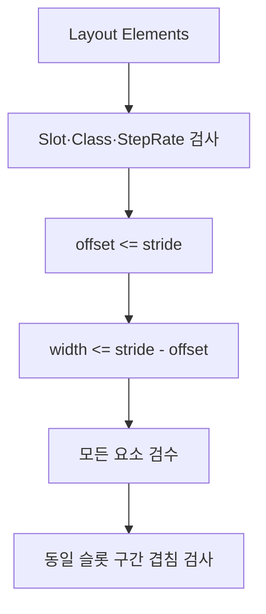

<callout icon="🧬" color="blue_bg">
	**DX11 13B InputLayout 경계조건을 보완하는 독립 CPU 실습.** 기존 13A의 소스와 SHA 이력은 변경하지 않습니다. 실제 Windows/D3D11/GPU 실행을 대신하지 않습니다.
</callout>
## 정의·작동 원리·전제
D3D11 Input Assembler는 바인딩된 Vertex Buffer의 Slot·Stride를 Input Layout의 Attribute Offset·Format에 맞춰 읽습니다. Slot 0을 정점, Slot 1을 인스턴스로 제한한 교육용 모델입니다. 다른 유효한 DX11 슬롯 배치는 이 모델 밖입니다. Per-vertex StepRate는 0이며 per-instance StepRate는 양수일 수 있고 **1로만 고정되지는 않습니다**. 검사는 개별 요소의 Offset·Width를 검증한 후 같은 Slot끼리 영역이 겹치는지 검사합니다. 부호 없는 정수에 대한 Offset+Width를 먼저 계산하면 wrap 가능성이 있으므로 Offset\<=Stride, Width\<=Stride-Offset 순으로 검증합니다.

<table header-row="true">
<tr>
<td>항목</td>
<td>반례/실수</td>
<td>이 예제의 처리</td>
</tr>
<tr>
<td>Offset 4,294,967,292 + Width 16</td>
<td>32비트 overflow</td>
<td>뺄셈 검사로 거부</td>
</tr>
<tr>
<td>20바이트 Stride에서 Offset 20 Width 1</td>
<td>끝을 1바이트 넘어감</td>
<td>거부</td>
</tr>
<tr>
<td>Offset 0 Width 12와 Offset 12 Width 8</td>
<td>맞닿음을 겹침으로 판단</td>
<td>허용</td>
</tr>
<tr>
<td>StepRate 2</td>
<td>무조건 1이어야 한다는 오해</td>
<td>교육용 정책에서 허용</td>
</tr>
</table>
게임 엔진에서는 공유 메시와 per-instance World Matrix를 별도 스트림으로 공급하기 전에 Attribute의 바이트 범위와 IA Slot 설정을 확인할 수 있습니다. 다만 HLSL Semantic, DXGI_FORMAT별 크기, 실제 버퍼 바인딩, GPU 동기화까지 검증하는 것은 아닙니다.
## C++20 전체 실행 소스 · C++11 호환
main.cpp 2,840바이트, SHA256 9002375bbb188e31aa02d999739b66ada0dd74e0a87aeb82be703b04978b5324, FNV64 02218c40adef928a. C++11 문법 부분집합만 사용하며 두 표준을 실제 컴파일했습니다.
```c++
// DX11 13B: educational CPU-only InputLayout contract; not GPU/API execution.
// C++11 source, tested with C++11 and C++20.
#include <cstdint>
#include <iostream>
#include <limits>
#include <stdexcept>
#include <vector>

struct Element {
    std::uint32_t slot, offset, bytes, step;
    bool per_instance;
};
struct Layout {
    std::uint32_t vertex_stride, instance_stride;
    std::vector<Element> elements;
};

void validate(const Layout& l) {
    if (!l.vertex_stride || !l.instance_stride || l.elements.empty())
        throw std::invalid_argument("missing stream");
    // Stage 1: validate ALL elements before calculating any end offsets.
    for (std::size_t i = 0; i < l.elements.size(); ++i) {
        const Element& e = l.elements[i];
        if (e.slot > 1 || !e.bytes || e.per_instance != (e.slot == 1) ||
            (e.per_instance ? e.step == 0 : e.step != 0))
            throw std::invalid_argument("slot or class");
        const std::uint32_t stride = e.slot == 0 ? l.vertex_stride : l.instance_stride;
        if (e.offset > stride || e.bytes > stride - e.offset)
            throw std::out_of_range("element beyond stride");
    }
    // Stage 2: safe sums, because Stage 1 proved offset+bytes <= stride.
    for (std::size_t i = 0; i < l.elements.size(); ++i)
        for (std::size_t j = i + 1; j < l.elements.size(); ++j) {
            const Element& a = l.elements[i];
            const Element& b = l.elements[j];
            if (a.slot == b.slot && a.offset < b.offset + b.bytes &&
                b.offset < a.offset + a.bytes)
                throw std::invalid_argument("overlapping elements");
        }
}

bool valid(const Layout& l) {
    try { validate(l); return true; }
    catch (const std::invalid_argument&) { return false; }
    catch (const std::out_of_range&) { return false; }
}
int main() {
    unsigned checks = 0;
    const auto expect = [&](bool result) {
        ++checks;
        if (!result) throw std::runtime_error("layout assertion failed");
    };
    expect(valid({20,64,{{0,0,12,0,false},{0,12,8,0,false},
         {1,0,16,2,true},{1,16,16,2,true},{1,32,16,2,true},{1,48,16,2,true}}}));
    expect(!valid({0,64,{{0,0,4,0,false}}}));
    expect(!valid({20,64,{}}));
    expect(!valid({20,64,{{2,0,4,0,false}}}));
    expect(!valid({20,64,{{0,0,0,0,false}}}));
    expect(!valid({20,64,{{0,0,4,1,false}}}));
    expect(!valid({20,64,{{1,0,4,0,true}}}));
    expect(!valid({20,64,{{0,20,1,0,false}}}));
    expect(!valid({20,64,{{0,4294967292U,16,0,false}}}));
    expect(!valid({20,64,{{0,0,12,0,false},{0,8,8,0,false}}}));
    expect(valid({20,64,{{0,0,12,0,false},{0,12,8,0,false}}}));
    expect(valid({20,64,{{0,0,12,0,false},{1,0,12,1,true}}}));
    expect(!valid({20,64,{{0,0,12,0,false},{1,63,2,1,true}}}));
    std::cout << "PASS " << checks << " CPU InputLayout checks\n";
}
```
## 전체 CMakeLists.txt
```plain text
cmake_minimum_required(VERSION 3.16)
project(dx11_13b_layout LANGUAGES CXX)
set(LAB_STD 20 CACHE STRING "C++ standard, 11 or 20")
if(NOT LAB_STD STREQUAL "11" AND NOT LAB_STD STREQUAL "20")
  message(FATAL_ERROR "LAB_STD must be 11 or 20")
endif()
add_executable(dx11_13b_layout main.cpp)
set_target_properties(dx11_13b_layout PROPERTIES CXX_STANDARD ${LAB_STD} CXX_STANDARD_REQUIRED YES CXX_EXTENSIONS NO)
if(CMAKE_CXX_COMPILER_ID MATCHES "GNU|Clang")
  target_compile_options(dx11_13b_layout PRIVATE -Wall -Wextra -Wpedantic -Werror)
endif()
enable_testing()
add_test(NAME dx11_13b_layout COMMAND dx11_13b_layout)
```
CMakeLists.txt 616바이트, SHA256 ad7635f631dcdc11955a100a48f10d2abc4f033000350a466cad848b194f40bd, FNV64 7ad4bb35e2621f80.
## 로컬 빌드·검증 명령
```bash
CXX=g++ cmake -S . -B build-gcc20 -DLAB_STD=20
cmake --build build-gcc20
ctest --test-dir build-gcc20 -V
CXX=g++ cmake -S . -B build-gcc11 -DLAB_STD=11
cmake --build build-gcc11
ctest --test-dir build-gcc11 -V
CXX=clang++ CXXFLAGS='-fsanitize=address,undefined -fno-omit-frame-pointer' LDFLAGS='-fsanitize=address,undefined' cmake -S . -B build-clangsan -DLAB_STD=20
cmake --build build-clangsan
ctest --test-dir build-clangsan -V
```
<table header-row="true">
<tr>
<td>환경</td>
<td>CTest</td>
<td>기본 검사</td>
</tr>
<tr>
<td>GCC 14.2 C++20</td>
<td>1/1 PASS</td>
<td>13조건</td>
</tr>
<tr>
<td>GCC 14.2 C++11</td>
<td>1/1 PASS</td>
<td>동일 13조건</td>
</tr>
<tr>
<td>Clang 17 C++20 ASan/UBSan</td>
<td>1/1 PASS</td>
<td>동일 13조건</td>
</tr>
</table>
동일한 13조건을 세 환경에서 반복한 결과이며 **독립된 39개 테스트로 집계하지 않습니다**. Configure·Build·CTest의 원시 로그 9개를 하위 페이지 3fda99703f40817dbe67d998687b1c6d에 저장하고 fetch로 바이트·FNV64 9/9 일치를 검증했습니다. Windows/MSVC·D3D11/GPU·FXC/DXC·Unity 실행은 미검증입니다.
<details>
<summary>Q1. 왜 Offset+Width를 처음부터 비교하지 않나요?</summary>
	Unsigned overflow를 배제할 수 없기 때문입니다. 모든 요소를 뺄셈 기반으로 먼저 검증하면 이후 범위 끝 계산은 stride 이하입니다.
</details>
<details>
<summary>Q2. StepRate=2는 틀린 값인가요?</summary>
	아닙니다. 인스턴스별 데이터 진행 간격을 바꿀 수 있습니다. 단 이 예제는 별도 2슬롯 정책을 둡니다.
</details>
<details>
<summary>Q3. CPU 13조건을 모두 통과하면 GPU Draw도 안전한가요?</summary>
	아닙니다. GPU InputLayout 생성·Shader 입력 서명·드라이버 실행은 별도로 검증해야 합니다.
</details>
## 공식 자료·변경 내역
- [Microsoft D3D11_INPUT_ELEMENT_DESC](https://learn.microsoft.com/en-us/windows/win32/api/d3d11/ns-d3d11-d3d11_input_element_desc)
- [Microsoft IASetVertexBuffers](https://learn.microsoft.com/en-us/windows/win32/api/d3d11/nf-d3d11-id3d11devicecontext-iasetvertexbuffers)
- <mention-date start="2026-10-18"/>: 기존 13A를 유지하고 InputLayout overflow·중첩·StepRate 경계 실습을 독립적으로 보강했습니다.
<page url="https://app.notion.com/p/3fda99703f40817dbe67d998687b1c6d">13B · Linux CPU 3환경 Configure·Build·CTest -V 원시 로그 9개</page>
