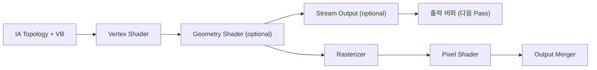

<callout icon="🔺" color="blue_bg">
	**DX11 개정 14 · Geometry Shader Stage — 입력 Primitive·출력 Stream·Sprite Expansion**
	<mention-date start="2026-10-16"/>. 본문은 실제 D3D11 문서 계약을 기준으로 쓰고, CPU 실습과 HLSL 미실행 사항을 분리합니다. 13 Instancing의 대안이 아니라 서로 다른 파이프라인 작업입니다.
</callout>
## 1. 개념과 위치
Geometry Shader(GS)는 **Vertex Shader 이후, Rasterizer 이전**의 선택적 Stage입니다. IA Topology(POINTLIST / LINELIST / TRIANGLELIST 등)와 일치하는 하나의 Primitive를 입력받아 출력 Primitive Stream으로 **0개 이상의 정점을 내보낼 수 있습니다.** 호출 단위는 Primitive이므로 VS처럼 꼭 정점 하나당 한 번 호출되는 단계가 아닙니다. GPU 입력 데이터와 실제 Draw 양을 동일시하는 오류를 피해야 합니다.

## 2. Input / Output 계약
<table fit-page-width="true" header-row="true">
<tr>
<td>항목</td>
<td>핵심 조건</td>
<td>실수</td>
</tr>
<tr>
<td>입력 Primitive</td>
<td>`point input[1]`, `line input[2]`, `triangle input[3]` 등과 IA Topology 대응</td>
<td>POINTLIST를 triangle 입력 GS에 연결</td>
</tr>
<tr>
<td>출력 Stream</td>
<td>`PointStream` / `LineStream` / `TriangleStream`</td>
<td>출력 삼각 스트립의 순서·와인딩 무시</td>
</tr>
<tr>
<td>정점 상한</td>
<td>`[maxvertexcount(N)]` 정적 선언, 실제 출력은 그 이하</td>
<td>실시간 무제한 출력으로 오해</td>
</tr>
<tr>
<td>스트립 분리</td>
<td>`Append`, `RestartStrip`</td>
<td>서로 다른 Sprite 삼각형 연결</td>
</tr>
<tr>
<td>실제 D3D11</td>
<td>CreateGeometryShader → GSSetShader</td>
<td>VSSetShader가 GS까지 자동 바인딩한다고 오해</td>
</tr>
</table>
## 3. 예시 — 1 Point를 화면 공간 Quad 4정점으로
이 예시는 `halfExtentNdc`를 정규화 기기 좌표의 절반 크기로 지정해 카메라 거리에 관계없는 **화면 크기**를 얻습니다. `clip.w`를 곱하여 clip space에서 더하는 이유를 반드시 이해해야 합니다. 크기를 월드 단위로 사용하려면 카메라 right/up으로 월드 좌표를 먼저 확장한 뒤 VP 변환해야 합니다.
**언어 표기 주의:** 아래 코드는 **HLSL Geometry Shader** 예시입니다. Notion 코드 블록의 언어 메타데이터가 현재 `javascript`로 표시되지만 JavaScript 소스가 아니며, FXC/DXC·GPU 실행으로 검증하지 않았습니다.
```plain text
struct VSOut {
    float4 pos : SV_POSITION;
    float2 halfExtentNdc : TEXCOORD0;
};
struct GSOut {
    float4 pos : SV_POSITION;
    float2 uv : TEXCOORD0;
};
[maxvertexcount(4)]
void GS(point VSOut src[1], inout TriangleStream<GSOut> stream) {
    float2 offsets[4] = {
        float2(-1,-1), float2(-1,1),
        float2( 1,-1), float2( 1,1)
    };
    float2 uv[4] = {
        float2(0,1), float2(0,0),
        float2(1,1), float2(1,0)
    };
    [unroll] for (uint i=0; i<4; ++i) {
        GSOut outV;
        outV.pos = src[0].pos;
        outV.pos.xy += offsets[i] * src[0].halfExtentNdc * outV.pos.w;
        outV.uv = uv[i];
        stream.Append(outV);
    }
    stream.RestartStrip();
}
```
HLSL `SV_POSITION`에 입력되는 VS 출력은 clip-space 위치로 취급합니다. `w<=0` 등을 CPU에서 거부하는 실습은 구현 정책이며 GPU는 후속 clipping을 수행합니다.
## 4. CPU 참조 구현 테스트
Point 한 개에서 출력 4정점 및 UV·Clip.w 보존, NDC 결과, 출력 상한, 미유한수·0/음수 크기 거부, 스트립 재시작을 검사하는 **31개 조건**을 구현했습니다. GCC14.2 C++20·C++11과 Clang17 C++20 ASan/UBSan에서 각 31조건, 배치 CTest 3/3 통과 기록이 있습니다. CPU 테스트는 GPU GS의 실제 동작·컴파일을 증명하지 않습니다. 전체 C++·공용 CMake·GCC/Clang CTest 원시 로그는 아래 부록에 저장되어 있습니다. 소스 재조립·바이트 단위 최종 검수는 별도 단계로 유지합니다.
## 5. 엔진 설계
GS는 입출력 Primitive 수·출력 정점 증가·추가 실행 비용을 동반할 수 있으므로 무조건 빠른 방법이 아닙니다. Sprite는 Instancing Quad VS로도 만들 수 있고, Particle·Billboard·Shadow Volume처럼 **그 자리에서 Primitive를 생성**해야 하는 작업에 적합한지 별도 벤치마크가 필요합니다. Pass 종료 후 `GSSetShader(nullptr,...)` 또는 다른 GS로 상태를 명시적으로 변경하는 것이 다음 Draw의 오염을 줄입니다.
<details>
<summary>Q. 입력 POINT 1개가 TriangleStrip 4정점을 내보내면 삼각형 몇 개가 되나요?</summary>
	연속 4정점 Triangle Strip이면 2개 삼각형입니다. 출력 와인딩·Rasterizer CullMode도 함께 확인해야 합니다.
</details>
<details>
<summary>Q. maxvertexcount가 4면 무조건 4정점을 출력하나요?</summary>
	아닙니다. 최댓값이고 분기 조건에 따라 0\~4개가 가능합니다.
</details>
<details>
<summary>Q. Stream Output은 매 프레임 CPU가 읽어야 하나요?</summary>
	아닙니다. GPU 버퍼에 저장 후 다음 패스에서 재사용할 수 있으며 CPU Readback은 필요 시 STAGING 등을 사용합니다.
</details>
## 공식 근거 · 개정 이력
- [Microsoft Geometry Shader Stage](https://learn.microsoft.com/en-us/windows/win32/direct3d11/geometry-shader-stage)
- [Geometry Shader with Stream Output](https://learn.microsoft.com/en-us/windows/win32/direct3d11/d3d10-graphics-programming-guide-output-stream-stage-getting-started)
- [ID3D11GeometryShader](https://learn.microsoft.com/en-us/windows/win32/api/d3d11/nn-d3d11-id3d11geometryshader)
<mention-date start="2026-10-16"/> v1.0 · GS의 선택적 역할, Sprite NDC/Clip 계약, 출력 Stream/상한, SO와 Rasterizer 경로 및 CPU/GPU 검증의 차이를 정리했습니다.
## 부록 14A · CPU 참조 프로그램 시작부
```c++
// CPU reference: Geometry Shader concept only; no D3D11 runtime.
#include <array>
#include <cmath>
#include <cstddef>
#include <iostream>
#include <limits>
#include <stdexcept>
#include <vector>
struct Vec2 { float x, y; };
struct Vec4 { float x, y, z, w; };
struct Sprite { Vec4 clipCenter; float halfWidth, halfHeight; };
struct Output { Vec4 position; Vec2 uv; };
struct Stream { std::vector<Output> vertices; unsigned restarts = 0; };
```
해당 코드 시작부만 추가했으며 전체 원문 보존은 다음 보관 단계가 필요합니다.
## 부록 14A · main.cpp · validation 함수
```c++
bool finite(float f) { return std::isfinite(f); }
bool valid(const Sprite& s) {
    return finite(s.clipCenter.x) && finite(s.clipCenter.y) &&
           finite(s.clipCenter.z) && finite(s.clipCenter.w) &&
           finite(s.halfWidth) && finite(s.halfHeight) &&
           s.clipCenter.w > 0.0f && s.halfWidth > 0.0f && s.halfHeight > 0.0f;
}
```
## 부록 14A · main.cpp · sprite 함수
```c++
void emitPointSprite(const Sprite& sprite, Stream& output, std::size_t maxVertices) {
    if (!valid(sprite)) throw std::invalid_argument("invalid sprite");
    if (maxVertices < 4 || output.vertices.size() > maxVertices - 4)
        throw std::length_error("GS output vertex cap exceeded");
    // Width and height are NDC half-extents: shift clip coordinates by w*NDC.
    const std::array<Vec2, 4> corners{{{-1,-1}, {-1,1}, {1,-1}, {1,1}}};
    const std::array<Vec2, 4> uv{{{0,1}, {0,0}, {1,1}, {1,0}}};
    for (std::size_t i=0; i<corners.size(); ++i) {
        const Vec4& c=sprite.clipCenter;
        const Vec2 p=corners[i];
        output.vertices.push_back({{c.x+p.x*sprite.halfWidth*c.w,
                                    c.y+p.y*sprite.halfHeight*c.w,c.z,c.w}, uv[i]});
    }
    ++output.restarts;
}
```
## 부록 14A · main.cpp · 테스트 앞부분
```c++
unsigned testCount=0;
void verify(bool value, const char* message) {
    ++testCount; if (!value) throw std::runtime_error(message);
}
template<class Exception, class Callable> void expectThrow(Callable call) {
    bool caught=false; try { call(); } catch (const Exception&) { caught=true; }
    verify(caught,"expected specific exception");
}
int main() {
    const Sprite s{{0.0f,0.0f,0.5f,2.0f},0.25f,0.5f};
    Stream out;
    emitPointSprite(s,out,4);
    verify(out.vertices.size()==4,"quad has 4 vertices");
    verify(out.restarts==1,"end strip counted");
    verify(out.vertices[0].position.x==-0.5f,"left lower x");
    verify(out.vertices[1].position.x==-0.5f,"left upper x");
    verify(out.vertices[2].position.x==0.5f,"right lower x");
    verify(out.vertices[3].position.x==0.5f,"right upper x");
    verify(out.vertices[0].position.y==-1.0f,"lower y");
    verify(out.vertices[1].position.y==1.0f,"upper y");
    verify(out.vertices[2].position.y==-1.0f,"lower right y");
    verify(out.vertices[3].position.y==1.0f,"upper right y");
    verify(out.vertices[0].position.z==0.5f,"z unaffected");
    verify(out.vertices[2].position.w==2.0f,"w unaffected");
    verify(out.vertices[0].uv.x==0 && out.vertices[0].uv.y==1,"uv lower left");
    verify(out.vertices[3].uv.x==1 && out.vertices[3].uv.y==0,"uv upper right");
    verify((out.vertices[0].position.x/out.vertices[0].position.w)==-0.25f,"NDC left offset");
    verify((out.vertices[3].position.y/out.vertices[3].position.w)==0.5f,"NDC top offset");
```
## 부록 14A · main.cpp · 테스트 후반과 종료
```c++
    expectThrow<std::length_error>([&]{emitPointSprite(s,out,7);});
    verify(out.vertices.size()==4,"overflow preserves output");
    emitPointSprite(s,out,8);
    verify(out.vertices.size()==8,"second strip emits 4 vertices");
    verify(out.restarts==2,"two separate strips");
    expectThrow<std::length_error>([&]{emitPointSprite(s,out,8);});
    verify(out.restarts==2,"failed capacity preserves strips");
    expectThrow<std::length_error>([&]{Stream local;emitPointSprite(s,local,3);});
    expectThrow<std::invalid_argument>([&]{Stream local;emitPointSprite({{0,0,0,0},1,1},local,4);});
    expectThrow<std::invalid_argument>([&]{Stream local;emitPointSprite({{0,0,0,-1},1,1},local,4);});
    expectThrow<std::invalid_argument>([&]{Stream local;emitPointSprite({{0,0,0,1},0,1},local,4);});
    expectThrow<std::invalid_argument>([&]{Stream local;emitPointSprite({{0,0,0,1},1,-1},local,4);});
    const float nan=std::numeric_limits<float>::quiet_NaN();
    expectThrow<std::invalid_argument>([&]{Stream local;emitPointSprite({{nan,0,0,1},1,1},local,4);});
    expectThrow<std::invalid_argument>([&]{Stream local;emitPointSprite({{0,0,0,1},nan,1},local,4);});
    const float inf=std::numeric_limits<float>::infinity();
    expectThrow<std::invalid_argument>([&]{Stream local;emitPointSprite({{0,0,inf,1},1,1},local,4);});
    verify(out.vertices[4].uv.y==1 && out.vertices[7].uv.y==0,"repeat strip UV");
    std::cout << "PASS " << testCount << " geometry shader CPU contracts\n";
}
```
## 공용 Root CMakeLists.txt (14/15/16 세 CPU 실행 파일)
**언어 표기 주의:** 아래 블록은 **CMakeLists.txt**의 CMake DSL입니다. Notion 코드 블록의 `javascript` 라벨은 실제 소스 언어가 아닙니다.
```plain text
cmake_minimum_required(VERSION 3.16)
project(dx11_14_16_contracts LANGUAGES CXX)
set(LAB_CXX_STANDARD 20 CACHE STRING "C++ language version")
enable_testing()
foreach(SAMPLE 14_geometry 15_frustum 16_quadtree)
    add_executable(${SAMPLE} ${SAMPLE}/main.cpp)
    set_target_properties(${SAMPLE} PROPERTIES CXX_STANDARD ${LAB_CXX_STANDARD} CXX_STANDARD_REQUIRED YES CXX_EXTENSIONS NO)
    if(MSVC)
        target_compile_options(${SAMPLE} PRIVATE /W4 /EHsc)
    else()
        target_compile_options(${SAMPLE} PRIVATE -Wall -Wextra -Wpedantic -Werror)
    endif()
    add_test(NAME ${SAMPLE}_cpu COMMAND ${SAMPLE})
endforeach()
```
**실습 폴더는 Root와 ****`14_geometry/main.cpp`****, ****`15_frustum/main.cpp`****, ****`16_quadtree/main.cpp`**** 3개를 갖는 구조입니다.** 공용 CMake는 세 실습 소스가 모두 있어야 빌드됩니다.
## 원시 검증 로그 — GCC 14.2 C++20
```plain text
Internal ctest changing into directory: /mnt/data/notion_run2/dx11_14_16/build-gcc20
UpdateCTestConfiguration  from :/mnt/data/notion_run2/dx11_14_16/build-gcc20/DartConfiguration.tcl
UpdateCTestConfiguration  from :/mnt/data/notion_run2/dx11_14_16/build-gcc20/DartConfiguration.tcl
Test project /mnt/data/notion_run2/dx11_14_16/build-gcc20
Constructing a list of tests
Done constructing a list of tests
Updating test list for fixtures
Added 0 tests to meet fixture requirements
Checking test dependency graph...
Checking test dependency graph end
test 1
    Start 1: 14_geometry_cpu

1: Test command: /mnt/data/notion_run2/dx11_14_16/build-gcc20/14_geometry
1: Working Directory: /mnt/data/notion_run2/dx11_14_16/build-gcc20
1: Test timeout computed to be: 10000000
1: PASS 31 geometry shader CPU contracts
1/3 Test #1: 14_geometry_cpu ..................   Passed    0.00 sec
test 2
    Start 2: 15_frustum_cpu

2: Test command: /mnt/data/notion_run2/dx11_14_16/build-gcc20/15_frustum
2: Working Directory: /mnt/data/notion_run2/dx11_14_16/build-gcc20
2: Test timeout computed to be: 10000000
2: PASS 33 frustum plane and AABB CPU checks
2/3 Test #2: 15_frustum_cpu ...................   Passed    0.00 sec
test 3
    Start 3: 16_quadtree_cpu

3: Test command: /mnt/data/notion_run2/dx11_14_16/build-gcc20/16_quadtree
3: Working Directory: /mnt/data/notion_run2/dx11_14_16/build-gcc20
3: Test timeout computed to be: 10000000
3: PASS 124 quadtree CPU broadphase checks
3/3 Test #3: 16_quadtree_cpu ..................   Passed    0.00 sec

100% tests passed, 0 tests failed out of 3

Total Test time (real) =   0.01 sec
```
## 원시 검증 로그 — GCC 14.2 C++11
```plain text
Internal ctest changing into directory: /mnt/data/notion_run2/dx11_14_16/build-gcc11
UpdateCTestConfiguration  from :/mnt/data/notion_run2/dx11_14_16/build-gcc11/DartConfiguration.tcl
UpdateCTestConfiguration  from :/mnt/data/notion_run2/dx11_14_16/build-gcc11/DartConfiguration.tcl
Test project /mnt/data/notion_run2/dx11_14_16/build-gcc11
Constructing a list of tests
Done constructing a list of tests
Updating test list for fixtures
Added 0 tests to meet fixture requirements
Checking test dependency graph...
Checking test dependency graph end
test 1
    Start 1: 14_geometry_cpu

1: Test command: /mnt/data/notion_run2/dx11_14_16/build-gcc11/14_geometry
1: Working Directory: /mnt/data/notion_run2/dx11_14_16/build-gcc11
1: Test timeout computed to be: 10000000
1: PASS 31 geometry shader CPU contracts
1/3 Test #1: 14_geometry_cpu ..................   Passed    0.00 sec
test 2
    Start 2: 15_frustum_cpu

2: Test command: /mnt/data/notion_run2/dx11_14_16/build-gcc11/15_frustum
2: Working Directory: /mnt/data/notion_run2/dx11_14_16/build-gcc11
2: Test timeout computed to be: 10000000
2: PASS 33 frustum plane and AABB CPU checks
2/3 Test #2: 15_frustum_cpu ...................   Passed    0.00 sec
test 3
    Start 3: 16_quadtree_cpu

3: Test command: /mnt/data/notion_run2/dx11_14_16/build-gcc11/16_quadtree
3: Working Directory: /mnt/data/notion_run2/dx11_14_16/build-gcc11
3: Test timeout computed to be: 10000000
3: PASS 124 quadtree CPU broadphase checks
3/3 Test #3: 16_quadtree_cpu ..................   Passed    0.00 sec

100% tests passed, 0 tests failed out of 3

Total Test time (real) =   0.01 sec
```
## Clang ASan/UBSan CTest 원시 로그 · 1/2
```plain text
Internal ctest changing into directory: /mnt/data/notion_run2/dx11_14_16/build-clangsan
UpdateCTestConfiguration  from :/mnt/data/notion_run2/dx11_14_16/build-clangsan/DartConfiguration.tcl
UpdateCTestConfiguration  from :/mnt/data/notion_run2/dx11_14_16/build-clangsan/DartConfiguration.tcl
Test project /mnt/data/notion_run2/dx11_14_16/build-clangsan
Constructing a list of tests
Done constructing a list of tests
Updating test list for fixtures
Added 0 tests to meet fixture requirements
Checking test dependency graph...
Checking test dependency graph end
test 1
    Start 1: 14_geometry_cpu

1: Test command: /mnt/data/notion_run2/dx11_14_16/build-clangsan/14_geometry
1: Working Directory: /mnt/data/notion_run2/dx11_14_16/build-clangsan
1: Test timeout computed to be: 10000000
1: PASS 31 geometry shader CPU contracts
1/3 Test #1: 14_geometry_cpu ..................   Passed    0.01 sec
```
## Clang ASan/UBSan CTest 원시 로그 · 2/2
```plain text
test 2
    Start 2: 15_frustum_cpu

2: Test command: /mnt/data/notion_run2/dx11_14_16/build-clangsan/15_frustum
2: Working Directory: /mnt/data/notion_run2/dx11_14_16/build-clangsan
2: Test timeout computed to be: 10000000
2: PASS 33 frustum plane and AABB CPU checks
2/3 Test #2: 15_frustum_cpu ...................   Passed    0.01 sec
test 3
    Start 3: 16_quadtree_cpu

3: Test command: /mnt/data/notion_run2/dx11_14_16/build-clangsan/16_quadtree
3: Working Directory: /mnt/data/notion_run2/dx11_14_16/build-clangsan
3: Test timeout computed to be: 10000000
3: PASS 124 quadtree CPU broadphase checks
3/3 Test #3: 16_quadtree_cpu ..................   Passed    0.01 sec

100% tests passed, 0 tests failed out of 3

Total Test time (real) =   0.03 sec
```
