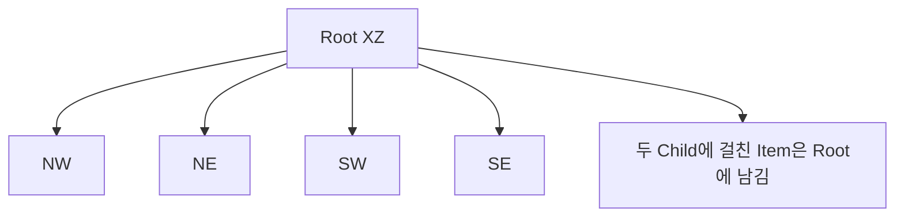
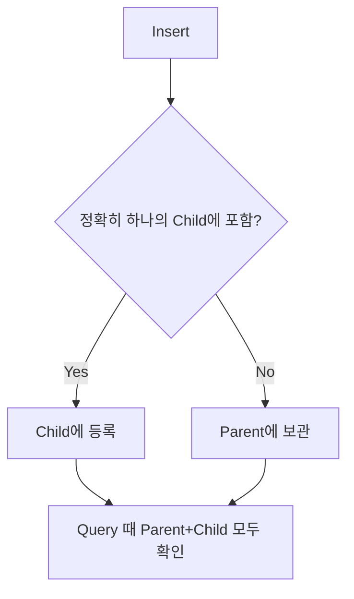

<callout icon="🌲" color="blue_bg">
	**DX11 개정 16 · QuadTree — XZ 분할과 Broad-phase**
	<mention-date start="2026-10-16"/>. 넓은 객체를 한 Child에 억지로 넣지 않고 부모에 유지해 누락·중복을 막는 삽입 정책을 다룹니다.
</callout>
## 1. QuadTree의 실제 역할
3D 월드의 XZ 평면을 네 사분면으로 반복 분할하는 **공간 인덱스**입니다. 2차원 AABB 영역 질의로 잠재적 충돌·가시성 후보를 줄이지만 Y축과 Occlusion은 처리하지 않습니다. Narrow-phase와는 구별해야 합니다.

## 2. Rect와 경계 정책
```c++
struct Rect { double xmin, zmin, xmax, zmax; };
bool overlaps(Rect a, Rect b) {
    return a.xmin<=b.xmax && a.xmax>=b.xmin &&
           a.zmin<=b.zmax && a.zmax>=b.zmin;
}
```
Root는 양의 XZ 넓이가 필요합니다. Item은 `xmin<=xmax`, `zmin<=zmax`를 허용하므로 점도 등록할 수 있습니다. NaN/Inf 값은 거부합니다. 여기서는 **경계에 닿아도 겹침**으로 판정합니다.
## 3. 삽입과 질의
현재 Node에서 단일 Child에 완전히 들어간다면 해당 Child에만 삽입합니다. 분할선 또는 큰 Item은 부모에 보관합니다. `maxItems`, `maxDepth`를 설정하고 분할할 수 없는 작은 영역에서는 추가 세분화를 중지합니다. 질의는 Node/Query가 겹치지 않으면 가지 전체를 건너뛰고, 겹치면 **현재 Node에 있는 Item도 반드시 검사**한 뒤 Child로 진행합니다.

<table fit-page-width="true" header-row="true">
<tr>
<td>선택</td>
<td>장점</td>
<td>주의</td>
</tr>
<tr>
<td>부모에 겹친 물체 유지</td>
<td>중복 ID 적음</td>
<td>큰 객체 검사량 증가</td>
</tr>
<tr>
<td>여러 Child 복제</td>
<td>각 Child에 지역 후보 보관</td>
<td>질의 시 중복 제거 필수</td>
</tr>
<tr>
<td>Loose QuadTree</td>
<td>움직이는 객체에 유리할 수 있음</td>
<td>넓어진 Child 경계 관리</td>
</tr>
</table>
## 4. 검증·한계
독립 C++ CPU 참조 구현은 삽입/Query 일관성, Brute-force 결과 동치, 경계값·중복 ID·NaN/Inf·Out-of-root·Depth 제한에 대한 **124조건**을 검사했습니다. GCC14.2 C++20·C++11과 Clang17 C++20 ASan/UBSan에서 같은 124조건을 각각 통과, 각 환경 14\~16 배치 CTest 3/3. 이는 GPU·D3D11·Windows 결과가 아닙니다. **전체 CPU 코드 조각은 본문 부록에 있으나, 현재 재조립한 원본의 바이트 단위 재검증은 미완료**로 기록합니다.
<details>
<summary>Q. 한 객체가 분할선에 걸치면 복제하나요?</summary>
	이 모델에서는 부모에 보관합니다. 경계 위에 정중앙으로 놓인 점도 여러 Child 후보이므로 부모에 남습니다.
</details>
<details>
<summary>Q. 항상 O(log N)이 보장되나요?</summary>
	아닙니다. 객체 크기와 편중·Root 잔여 객체 때문에 최악은 O(N)입니다.
</details>
## 참고 자료
- [Microsoft BoundingBox](https://learn.microsoft.com/en-us/windows/win32/api/directxcollision/ns-directxcollision-boundingbox)
<mention-date start="2026-10-16"/> v1.0. 트리 정책은 DirectX11의 고유 API가 아니라 일반 공간 인덱스의 설계입니다.
## 부록 16A · CPU 재현 전체 소스 1/5
```c++
// CPU broad-phase quadtree. Objects spanning child boundaries remain in parent.
#include <algorithm>
#include <array>
#include <cmath>
#include <iostream>
#include <limits>
#include <memory>
#include <set>
#include <stdexcept>
#include <vector>
struct Rect{double xmin,zmin,xmax,zmax;};
struct Item{unsigned id;Rect box;};
```
## 부록 16A · CPU 재현 전체 소스 2/5
```c++
bool valid(Rect b){return std::isfinite(b.xmin)&&std::isfinite(b.zmin)&&std::isfinite(b.xmax)&&std::isfinite(b.zmax)&&b.xmin<=b.xmax&&b.zmin<=b.zmax;}
bool contains(Rect outer,Rect inner){return outer.xmin<=inner.xmin&&outer.zmin<=inner.zmin&&outer.xmax>=inner.xmax&&outer.zmax>=inner.zmax;}
bool overlaps(Rect a,Rect b){return a.xmin<=b.xmax&&a.xmax>=b.xmin&&a.zmin<=b.zmax&&a.zmax>=b.zmin;}
struct Node{
 Rect bounds;unsigned depth;std::vector<Item> objects;std::array<std::unique_ptr<Node>,4> child;
 Node(Rect b,unsigned d):bounds(b),depth(d){}
 bool divided()const{return child[0]!=nullptr;}
 int childIndex(Rect r)const{
  if(!divided())return -1;
  int chosen=-1;
  for(int i=0;i<4;++i)if(contains(child[static_cast<std::size_t>(i)]->bounds,r)){
   if(chosen!=-1)return -1; // boundary-sharing object: keep at parent
   chosen=i;
  }
  return chosen;
 }
```
## 부록 16A · CPU 재현 전체 소스 3/5
```c++
void split(unsigned maxDepth){
 if(divided()||depth>=maxDepth)return;
 const double xm=(bounds.xmin+bounds.xmax)*0.5;
 const double zm=(bounds.zmin+bounds.zmax)*0.5;
 if(xm<=bounds.xmin||xm>=bounds.xmax||zm<=bounds.zmin||zm>=bounds.zmax)return;
 const std::array<Rect,4> r{{{bounds.xmin,bounds.zmin,xm,zm},{xm,bounds.zmin,bounds.xmax,zm},
                             {bounds.xmin,zm,xm,bounds.zmax},{xm,zm,bounds.xmax,bounds.zmax}}};
 for(int i=0;i<4;++i)child[static_cast<std::size_t>(i)].reset(new Node(r[static_cast<std::size_t>(i)],depth+1));
 std::vector<Item> remaining;
 for(const Item& it:objects){const int index=childIndex(it.box);
  if(index>=0)child[static_cast<std::size_t>(index)]->objects.push_back(it);
  else remaining.push_back(it);
 }
 objects.swap(remaining);
}
void insert(const Item& item,unsigned maxObjects,unsigned maxDepth){
 const int target=childIndex(item.box);
 if(target>=0){child[static_cast<std::size_t>(target)]->insert(item,maxObjects,maxDepth);return;}
 objects.push_back(item);
 if(objects.size()>maxObjects && depth<maxDepth){
  if(!divided())split(maxDepth);
  if(divided()){
   std::vector<Item> remain;
   for(const Item& it:objects){const int idx=childIndex(it.box);
    if(idx>=0)child[static_cast<std::size_t>(idx)]->insert(it,maxObjects,maxDepth);
    else remain.push_back(it);
   }
   objects.swap(remain);
  }
 }
}
```
## 부록 16A · CPU 재현 전체 소스 4/5
```c++
 void query(Rect area,std::vector<unsigned>& ids)const{
  if(!overlaps(bounds,area))return;
  for(const Item& item:objects)if(overlaps(area,item.box))ids.push_back(item.id);
  if(divided())for(const auto& c:child)c->query(area,ids);
 }
};
struct QuadTree{
 Node root;unsigned maxObjects,maxDepth;std::set<unsigned> ids;
 QuadTree(Rect bounds,unsigned cap,unsigned maxD):root(bounds,0),maxObjects(cap),maxDepth(maxD){
  if(!valid(bounds)||bounds.xmin>=bounds.xmax||bounds.zmin>=bounds.zmax||!cap||!maxD)throw std::invalid_argument("bad root");
 }
 void insert(const Item& item){
  if(!valid(item.box)||!contains(root.bounds,item.box)||!ids.insert(item.id).second)
   throw std::invalid_argument("item out of root or duplicate");
  root.insert(item,maxObjects,maxDepth);
 }
 std::vector<unsigned> query(Rect area)const{
  if(!valid(area))throw std::invalid_argument("query area");
  std::vector<unsigned> found;root.query(area,found);
  std::sort(found.begin(),found.end());return found;
 }
};
unsigned checks=0;
void ck(bool b,const char* label){++checks;if(!b)throw std::runtime_error(label);}
template<class F>void rejects(F f){bool caught=false;try{f();}catch(const std::invalid_argument&){caught=true;}ck(caught,"expect invalid argument");}
```
## 부록 16A · CPU 재현 전체 소스 5a/5b
```c++
int main(){
 const Rect extent{0,0,16,16};
 rejects([&]{QuadTree bad({0,0,0,1},2,4);});
 rejects([&]{QuadTree bad(extent,0,4);});
 rejects([&]{QuadTree bad(extent,2,0);});
 rejects([&]{QuadTree bad({0,0,1,-1},2,4);});
 QuadTree tree(extent,2,5);
 const std::vector<Item> items{{1,{1,1,2,2}},{2,{12,12,14,14}},{3,{7,7,9,9}},
  {4,{1,12,3,15}},{5,{13,1,15,3}},{6,{4,4,4,4}},
  {7,{0,0,16,16}},{8,{2,2,4,4}},{9,{8,2,10,4}},
  {10,{2,8,4,10}},{11,{8,8,10,10}},{12,{6,0,8,1}}};
 for(const Item& i:items){tree.insert(i);ck(tree.ids.count(i.id)==1,"inserted id");}
 ck(tree.root.divided(),"root divides");
 ck(tree.query(extent).size()==items.size(),"all ids found exactly once");
 auto compare=[&](Rect region){
  std::vector<unsigned> brute,actual=tree.query(region);
  for(const Item& item:items)if(overlaps(item.box,region))brute.push_back(item.id);
  std::sort(brute.begin(),brute.end());
  ck(actual==brute,"quadtree equals brute force");
  ck(std::adjacent_find(actual.begin(),actual.end())==actual.end(),"query unique");
 };
```
## 부록 16A · CPU main 끝부분 A
```c++
compare({1,1,2,2});compare({15,15,16,16});compare({7,7,8,8});
compare({-1,-1,1,1});compare({20,20,22,22});compare({0,0,16,16});
compare({8,0,8,16});compare({0,8,16,8});compare({-10,5,5,10});
```
## 부록 16A · CPU main 끝부분 B
```c++
compare({4,4,4,4});compare({5,5,6,6});compare({2,2,4,4});
for(unsigned x=0;x<16;x+=3)for(unsigned z=0;z<16;z+=3)
 compare({static_cast<double>(x),static_cast<double>(z),static_cast<double>(x+2),static_cast<double>(z+2)});
rejects([&]{tree.insert({99,{-1,0,1,1}});});
rejects([&]{tree.insert({1,{5,5,6,6}});});
rejects([&]{tree.insert({99,{5,5,4,6}});});
```
## 부록 16A · CPU main 끝부분 C
```c++
 rejects([&]{tree.query({1,0,0,1});});
 rejects([&]{const double nan=std::numeric_limits<double>::quiet_NaN();tree.query({0,0,nan,1});});
 ck(tree.ids.size()==items.size(),"no invalid inserts");
 ck(overlaps({0,0,1,1},{1,1,2,2}),"inclusive boundary");
 ck(!overlaps({0,0,1,1},{2,2,3,3}),"separated");
 ck(contains(extent,{0,0,16,16}),"exact containment");
 ck(!contains({0,0,1,1},{-0.1,0,0,1}),"root rejection");
 std::cout<<"PASS "<<checks<<" quadtree CPU broadphase checks\n";
}
```
공용 Root CMakeLists.txt는 <mention-page url="https://app.notion.com/p/3fba99703f4081238d99e7872c068e3f"/>의 부록에 전문이 있으며 `16_quadtree/main.cpp` 경로로 빌드합니다.
