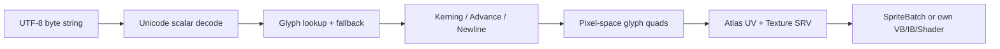

<callout icon="🔤" color="blue_bg">
	**DX11 개정 17 — Font / SpriteBatch / Unicode·Glyph Atlas**
	<mention-date start="2026-10-16"/>. 01\~16의 리소스·텍스처·렌더 타깃 설명을 바탕으로 기존 Font Manager 메모를 기술적으로 재정리합니다. 과거 원본과 백업은 변경하지 않습니다. 실습은 GPU가 없는 환경의 **CPU 계약 모델**입니다.
</callout>
## 1. 정의: 문자열, 글리프, 아틀라스는 다르다
문자열의 UTF-8 바이트는 곧바로 Quad 개수가 아닙니다. Unicode 코드 포인트를 해독한 뒤 Font의 글리프 맵에서 Rect·advance·bearing을 찾아 Quad 위치와 UV를 배치합니다. 글리프가 없는 경우는 오류를 발생시키거나 명시한 대체 글리프를 사용합니다. 조합 문자·자모 조형·BiDi 처리는 별도의 **text shaping** 기능이 필요합니다. 이 학습 모델은 단순 bitmap-font만 다룹니다.

## 2. 단어를 정확히 구별한다
<table fit-page-width="true" header-row="true">
<tr>
<td>용어</td>
<td>의미</td>
<td>실패·주의</td>
</tr>
<tr>
<td>Code point</td>
<td>UTF-8에서 디코딩된 Unicode scalar</td>
<td>바이트당 한 글자라고 계산하지 않는다.</td>
</tr>
<tr>
<td>Glyph</td>
<td>Font가 실제로 그리는 형상과 Metrics</td>
<td>하나의 Code point와 1:1이 아닐 수 있다.</td>
</tr>
<tr>
<td>Atlas</td>
<td>Glyph bitmap들을 모은 Texture2D</td>
<td>Bounds·UV·인접 글리프 bleeding 주의</td>
</tr>
<tr>
<td>Advance</td>
<td>다음 글리프 시작 위치로 펜을 이동할 거리</td>
<td>Bitmap 폭, Bearing과 같지 않다.</td>
</tr>
<tr>
<td>Kerning</td>
<td>특정 글리프 쌍의 간격 보정</td>
<td>글줄 바꿈 직후 이전 글리프와 연결 금지</td>
</tr>
<tr>
<td>Shaping</td>
<td>Ligature/Combining/BiDi 등의 텍스트 조판</td>
<td>간단한 SpriteFont로 복잡한 언어가 자동 처리되지 않음</td>
</tr>
</table>
**자주 틀리는 점:** `fontMap[text[0]]`은 UTF-8 첫 *문자*가 아니라 첫 **바이트**를 조회할 수 있습니다. 한글 1글자도 보통 UTF-8에서 여러 바이트입니다. `wchar_t`의 크기도 모든 플랫폼에서 2바이트인 것은 아닙니다.
## 3. DirectXTK SpriteFont의 실제 역할
DirectX Tool Kit의 `SpriteFont`는 D3D11 bitmap-font 렌더러이며 `SpriteBatch`와 `.spritefont` 데이터가 필요합니다. 자체적으로 FontManager를 설계한다면 식별자→Font 리소스 맵, 생성·해제·문자 집합·크기·렌더 스테이트 관리 책임을 분리합니다. `DrawString`, `MeasureString`, `ContainsCharacter`, `SetDefaultCharacter`를 활용할 수 있습니다. `MeasureString`의 폭/끝 공백 취급은 아래 단순 CPU 모델의 `maxAdvance`와 같다고 가정하지 않습니다.
```c++
// 실제 DirectXTK 호출 구조의 예시. 이 환경에서 Windows 컴파일·GPU 실행하지 않음.
#include <SpriteBatch.h>
#include <SpriteFont.h>
#include <memory>
#include <DirectXMath.h>
std::unique_ptr<DirectX::SpriteBatch> batch;
std::unique_ptr<DirectX::SpriteFont> font;
// Device/Context가 살아 있을 때:
batch = std::make_unique<DirectX::SpriteBatch>(context.Get());
font = std::make_unique<DirectX::SpriteFont>(device.Get(), L"ui.spritefont");
batch->Begin();
font->DrawString(batch.get(), L"안녕하세요", DirectX::XMFLOAT2(24.f, 32.f));
batch->End();
```
실제 출력 전에 `.spritefont`에 해당 한글 글리프가 포함됐는지 검사해야 합니다. DirectXTK의 SpriteFont는 복잡한 조판·언어를 폭넓게 지원하는 DirectWrite 대체물이 아닙니다. 긴 다국어 문자열·RTL·벡터 확장 품질까지 요구한다면 Direct2D/DirectWrite 경로를 검토합니다.
## 4. GPU 연결 시 책임·상태
Pixel Quad의 Position/UV를 작성한 후 Texture SRV, Sampler, BlendState(투명 영역), DepthState(UI의 Depth 검사 여부), Viewport와 RenderTarget을 일치시켜 Draw 합니다. 화면 픽셀 좌표를 NDC로 변환하거나 Orthographic Projection을 사용해야 합니다. FontManager는 **글꼴 리소스 캐시**를, Renderer는 **GPU 바인딩·Draw**를 담당하게 합니다. 종료 시 Font 리소스와 Device 수명 순서를 지키되 임의의 싱글톤 전역 소유를 강제하지 않습니다.
## 5. 재현 가능한 CPU 실습
완전한 독립 C++ 구현은 17A에 전체 `main.cpp`·공유 `CMakeLists.txt`·README·실행 로그를 보관합니다. UTF-8 1\~4바이트 유효성, 과잉 인코딩, surrogate 차단, 아틀라스 경계/겹침, 한글 glyph, replacement, 개행, space width, Kerning 및 UV 계산을 확인합니다. Unicode grapheme cluster/line-breaking/bidi·실제 글꼴 rasterization을 구현하지 않습니다.
- GCC14.2 C++20 **38 CPU 조건**, CTest 1/1.
- GCC14.2 C++11 동일 조건, CTest 1/1.
- Clang17 C++20 ASan/UBSan 동일 조건, CTest 1/1.
- Windows/MSVC·GPU·SpriteFont 로드·Font 생성·HLSL 컴파일 **미실행**.
## 6. 이해 확인
<details>
<summary>Q. UTF-8 문자열의 바이트 길이만큼 Quad를 만들어도 한글이 정상 출력되나요?</summary>
	안 됩니다. UTF-8의 각 Unicode scalar로 디코딩하고 실제 글리프를 조회해야 합니다. 공백은 Advance만 존재할 수 있고 복잡한 언어는 shaping을 별도 구현합니다.
</details>
<details>
<summary>Q. Atlas Rect의 폭과 Advance가 같나요?</summary>
	반드시 같지 않습니다. Bearing·글리프 간격·Kerning으로 인해 UV Bitmap 크기와 다음 펜 위치는 서로 다릅니다.
</details>
<details>
<summary>Q. CPU maxAdvance와 DirectXTK MeasureString이 같은가요?</summary>
	동일하다고 가정하면 안 됩니다. 실제 렌더링 폭 및 trailing whitespace 계산 규칙이 달라질 수 있습니다.
</details>
## 공식 출처·검증·변경 기록
- [Microsoft DirectXTK · SpriteFont](https://github.com/microsoft/DirectXTK/wiki/SpriteFont)
- [Microsoft DirectXTK · Drawing text](https://github.com/microsoft/DirectXTK/wiki/Drawing-text)
<mention-date start="2026-10-16"/> v1.0. Font Manager의 Add/Find 중심 설명을 UTF-8→Unicode→Glyph Atlas→SpriteBatch 파이프라인과 텍스처 소유·UI 상태 계약으로 교정. 실제 GPU 실행 검증과 CPU 계약 테스트를 분리했습니다.
## 부록 · 17 CPU 구현 검증 및 빌드 조건
`17_font/main.cpp`는 CPU-only 테스트 실행 파일입니다. UTF-8·Atlas·Layout의 38조건을 GCC14.2 C++20, GCC14.2 C++11, Clang17 C++20 ASan/UBSan에서 검증했고, 각 구성에서 CTest 1/1 통과했습니다. 실제 SpriteFont/GPU는 미실행입니다. 다음으로 전체 소스를 분할 보관합니다.
<page url="https://app.notion.com/p/3fba99703f4081fca31dc9ac2748a4a6">17A · Font CPU 원본 소스·CMake·검증</page>
<page url="https://app.notion.com/p/3fba99703f408105a5c8c1d371e2c8cb">17B · Font UTF-8·Glyph Atlas CPU v2 헤더 전체 소스</page>
<page url="https://app.notion.com/p/3fba99703f4081aeb641e5b540bf2848">17C · Font CPU v2 전체 main.cpp · 49조건 테스트</page>
## 최신 소스 (v2)
17B 전체 헤더 <mention-page url="https://app.notion.com/p/3fba99703f408105a5c8c1d371e2c8cb">17B · Font UTF-8·Glyph Atlas CPU v2 헤더 전체 소스</mention-page> 및 17C 테스트 <mention-page url="https://app.notion.com/p/3fba99703f4081aeb641e5b540bf2848">17C · Font CPU v2 전체 main.cpp · 49조건 테스트</mention-page>. C++11·C++20 49조건 통과, GPU 미검증.
## 2026-10-17 20시 재검수 · CPU v2 소스/원시 로그 보관 완료
17B `fontlab.hpp` 3,777바이트 FNV64 `df9977f4b72878d6`, 17C `main.cpp` 3,736바이트 FNV64 `0c6e6785dee070f8`: Notion 네이티브 원본과 이번 로컬 컴파일 소스 일치. 재현 CMake 433바이트 FNV64 `2538e08efd2fbfce`. GCC14.2 C++20·C++11 및 Clang17 C++20 ASan/UBSan 모두 CTest 1/1·동일 49조건 통과. Configure·Build·CTest 원시 로그 9/9개를 17D/17E/17F 네이티브 코드 블록에 영구 보관하고 재조회 FNV64 일치 확인. 상세: <mention-page url="https://app.notion.com/p/3fca99703f4081e7bf33f80f5bb1ed47">17D · Font CPU v2 빌드·검증 원장 · 2026-10-17</mention-page>. Windows/MSVC/DirectXTK/D3D11/GPU 실제 실행은 미검증이며 렌더 화면도 미확인.
<page url="https://app.notion.com/p/3fca99703f4081e7bf33f80f5bb1ed47">17D · Font CPU v2 빌드·검증 원장 · 2026-10-17</page>
