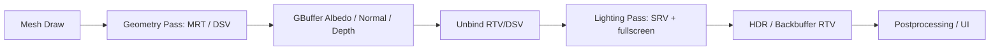
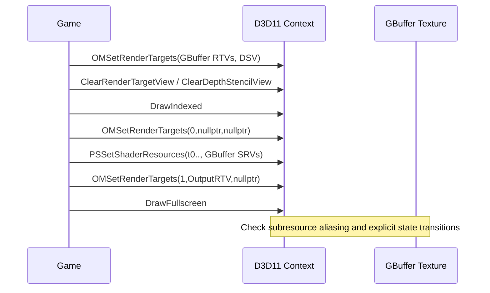

<callout icon="🧪" color="blue_bg">
	**DX11 개정 18 — Deferred Rendering / MRT / G-Buffer / View Hazard**
	<mention-date start="2026-10-16"/>. 기존 렌더 타깃 매니저의 Add/Find·리스트 삭제 중심 메모를, **D3D11 Output-Merger와 Resource/View 수명·패스 전환** 규칙으로 독립 재작성합니다. 완성한 코드 테스트는 CPU 상태 모델입니다.
</callout>
## 1. 정의: Deferred는 Rendering Pass 분리
Forward에서는 표면별 셰이더가 조명 계산을 같이 수행할 수 있습니다. Deferred의 대표 구조는 Geometry Pass에서 Surface Data(예: Albedo, Normal, Depth)를 G-Buffer에 기록하고, Lighting Pass가 그 텍스처들을 SRV로 읽어 조명을 계산합니다. Light를 화면 공간에서 처리하는 방식에 따라 조명 횟수 비용을 조절할 수 있지만 반투명 물체·MSAA·복잡한 Material 모델 등은 별도 처리/트레이드오프가 필요합니다.

## 2. D3D11 리소스와 View의 실제 계약
D3D11에는 고정 파이프라인 Deferred Renderer가 따로 있는 것이 아닙니다. `ID3D11Texture2D`와 그에 맞는 `ID3D11RenderTargetView`·`ID3D11ShaderResourceView`·`ID3D11DepthStencilView`를 만들고 `OMSetRenderTargets`, `PSSetShaderResources`, VS/PS와 Draw 호출을 설계합니다.
<table fit-page-width="true" header-row="true">
<tr>
<td>패스</td>
<td>쓰기</td>
<td>읽기</td>
<td>필수 조치</td>
</tr>
<tr>
<td>Geometry</td>
<td>GBuffer RTV 1\~N, Depth DSV</td>
<td>Mesh Texture SRV</td>
<td>같은 subresource가 읽기/쓰기로 충돌하지 않게 함</td>
</tr>
<tr>
<td>Lighting</td>
<td>별도 HDR/Backbuffer RTV</td>
<td>GBuffer SRVs</td>
<td>GBuffer를 OM에서 먼저 해제</td>
</tr>
<tr>
<td>Postprocess</td>
<td>서로 다른 결과 RTV</td>
<td>앞 패스 결과 SRV</td>
<td>Ping-pong, Copy/Resolve, 상충 View 해제</td>
</tr>
<tr>
<td>Resize</td>
<td>새 폭·높이의 View</td>
<td>구 View는 무효화</td>
<td>참조·바인딩 해제, DXGI ResizeBuffers 수명 준수</td>
</tr>
</table>
`OMSetRenderTargets`는 출력 RTV 최대 8개를 지정할 수 있습니다. 같이 바인딩하는 모든 RTV와 DSV의 너비·높이·MSAA Sample Count 등이 서로 맞아야 합니다. 각 RTV의 Format은 동일할 필요가 없습니다. 다중 렌더 타깃은 Pixel Shader에서 `SV_Target0`, `SV_Target1` 등으로 작성합니다. 같은 subresource를 서로 다른 출력 슬롯에 중복 바인딩할 수 없습니다.
**중요한 API 구분:** D3D11 Runtime은 `OMSetRenderTargets`를 호출할 때 겹치는 읽기/쓰기 바인딩을 자동 `NULL` 처리할 수 있습니다. 이는 호출자의 리소스 관리 계약이 안전하다는 뜻이 아닙니다. 이 실습의 CPU 상태 모델은 실수를 조기에 드러내기 위해 겹침을 **명시적 오류로 거부**합니다. 따라서 모델의 오류와 실제 D3D11 API 오류 동작을 혼동하지 마세요.
## 3. D3D11 Shader 간단 예시 — GPU 미컴파일
```c++
struct VSOut { float4 pos : SV_POSITION; float3 normal : NORMAL; float2 uv : TEXCOORD0; };
struct GBOut { float4 albedo : SV_Target0; float4 normal : SV_Target1; };
Texture2D DiffuseMap : register(t0);
SamplerState LinearSampler : register(s0);
GBOut PSGeometry(VSOut i) {
    GBOut o;
    o.albedo = DiffuseMap.Sample(LinearSampler, i.uv);
    o.normal = float4(normalize(i.normal)*0.5f+0.5f, 1.f);
    return o;
}
// Lighting pass의 Pixel Shader는 GBuffer를 t0/t1 등 SRV로 읽어 조명 처리.
```
법선은 계산한 공간(World/View)에 대해 Pass 전체가 합의해야 하고 encode/decode도 일치해야 합니다. sRGB albedo 해석, HDR format, Depth reconstruct의 projection convention도 별도 계약입니다. 위 샘플은 교육용 경로이며 실행 가능한 완성 Deferred Renderer가 아닙니다.
## 4. 상태 전환의 수명과 Resize

DX9의 Render Target Surface를 보관하던 매니저 구조를 그대로 붙여넣기보다, DX11에서는 **Resource ID + View ID + Format + subresource + width/height + sample count + lifetime/resize generation**을 기록합니다. 다중 RTV를 사용할 때 배열 포인터는 호출 범위 동안 유효해야 하며, COM 수명과 Pipeline 레퍼런스는 별도로 검토합니다.
## 5. 독립 CPU 계약 실습
18A의 완전한 CPU 구현은 Texture/View descriptor를 축소 표현하고 **MRT 크기·샘플 수/Format·BindFlags·미프/배열 slice 겹침·DSV/RTV 동시 기록·SRV/RTV Hazard·Depth 부호·Resize generation**을 검사합니다. `unbindTargets()` 뒤 SRV로 읽는 정책을 구현합니다. 실제 `OMSetRenderTargets`의 자동 Nulling, Driver Feature Query, typeless depth SRV format, MSAA resolve, UAV, Deferred Context, Resource Barrier 등은 모델에 포함하지 않았습니다.
- GCC14.2 C++20: **39 CPU 조건**, CTest 1/1.
- GCC14.2 C++11 동일 39조건, CTest 1/1.
- Clang17 C++20 + ASan/UBSan 동일 39조건, CTest 1/1.
- Windows/MSVC·D3D11/GPU·HLSL 컴파일은 **미실행**입니다.
## 6. 실무 실수·이해 확인
<details>
<summary>Q. Geometry Pass의 Normal RTV를 Lighting PS SRV로 바로 동시에 바인딩하나요?</summary>
	같은 subresource에서 읽고 쓰는 Hazard를 피해야 합니다. Geometry Output-Merger 바인딩을 종료하고 SRV로 전환하세요.
</details>
<details>
<summary>Q. MRT의 색상 Format은 서로 같아야 하나요?</summary>
	다를 수 있지만 가로·세로 크기와 Sample Count 등의 동시 바인딩 조건을 일치시켜야 합니다.
</details>
<details>
<summary>Q. ClearRenderTargetView는 Viewport 내부만 Clear하나요?</summary>
	아닙니다. View 전체를 Clear합니다. Viewport·Scissor 설정은 이 Clear 범위에 적용되지 않습니다.
</details>
<details>
<summary>Q. CPU 상태 모델 통과는 실제 GPU Deferred Render의 정상 동작을 증명하나요?</summary>
	아닙니다. CPU 모델은 드라이버 상태를 정확히 재현하지 않습니다. GPU 셰이더·MRT 포맷·메모리 대역폭·성능은 별도 검증해야 합니다.
</details>
## 공식 출처·검증·변경 기록
- [Microsoft · OMSetRenderTargets](https://learn.microsoft.com/en-us/windows/win32/api/d3d11/nf-d3d11-id3d11devicecontext-omsetrendertargets)
- [Microsoft · ClearRenderTargetView](https://learn.microsoft.com/en-us/windows/win32/api/d3d11/nf-d3d11-id3d11devicecontext-clearrendertargetview)
- [Microsoft · Depth/Stencil + MRT](https://github.com/MicrosoftDocs/win32/blob/docs/desktop-src/direct3d11/d3d10-graphics-programming-guide-depth-stencil.md)
<mention-date start="2026-10-16"/> v1.0. RenderTarget Manager 원문을 MRT/RTV/SRV/DSV의 실제 쓰기·읽기/수명 규칙으로 교정했습니다. CPU 모델과 실제 D3D11 자동 상태 변경을 명확히 분리합니다.
<page url="https://app.notion.com/p/3fba99703f408152b84bf279803f3e98">18A · Deferred MRT CPU 구현·CTest·소스 보관 상태</page>
<page url="https://app.notion.com/p/3fba99703f4081c68669c3d4a2d5eb89">18B · Deferred MRT CPU v2 전체 main.cpp · 41조건</page>
## 최신 소스 (v2)
전체 CPU `main.cpp`: <mention-page url="https://app.notion.com/p/3fba99703f4081c68669c3d4a2d5eb89">18B · Deferred MRT CPU v2 전체 main.cpp · 41조건</mention-page>. GCC C++20·C++11 및 Clang ASan/UBSan에서 41조건. 실제 GPU 미검증.
<page url="https://app.notion.com/p/3fca99703f4081cda923c214901bed45">18C · Deferred CPU v2 CMake·실행 검증 원장 · 2026-10-17</page>
