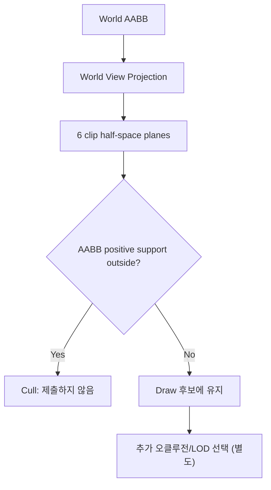

# Notion 학습 원본 보존

원본: https://app.notion.com/p/3fba99703f40812682f6df8327550441

> 이 파일은 프로토타입 시점의 Notion 원문입니다. 변환 시 누락 여부 확인과 링크 추적용입니다.

<callout icon="📐" color="blue_bg">
	**DX11 개정 15 · View Frustum — Plane 추출·AABB Conservative Culling**
	<mention-date start="2026-10-16"/>. 카메라 행렬에서 여섯 평면을 만들고 World AABB가 전부 밖인 경우만 안전하게 제거하는 엔진 렌더 큐 전처리입니다. Debug Draw 또는 GPU Occlusion Query와는 목적이 다릅니다.
</callout>
## 1. 좌표 계약을 먼저 고정
D3D 스타일 Clip Space에서는 `-w <= x <= w`, `-w <= y <= w`, **`0 <= z <= w`** 조건을 사용합니다. 여기서 예제의 수학은 **열벡터 ****`clip = M * [x,y,z,1]^T`**와 행을 `r0,r1,r2,r3`로 읽는 표현입니다. DirectXMath를 사용한 엔진이 행벡터 `v * M`을 채택했다면 접근 행/열과 곱셈 순서를 그대로 복사하면 잘못됩니다. HLSL `mul`도 같은 계약에 맞춰야 합니다.

## 2. Matrix 행에서 여섯 평면 구하기
이 단원의 `M`이 월드→클립을 한 번에 변환하면(열벡터 규약) 다음과 같습니다.
<table fit-page-width="true" header-row="true">
<tr>
<td>평면</td>
<td>4차원 방정식의 계수</td>
<td>조건</td>
</tr>
<tr>
<td>Left</td>
<td>r3 + r0</td>
<td>x + w ≥ 0</td>
</tr>
<tr>
<td>Right</td>
<td>r3 - r0</td>
<td>w - x ≥ 0</td>
</tr>
<tr>
<td>Bottom</td>
<td>r3 + r1</td>
<td>y + w ≥ 0</td>
</tr>
<tr>
<td>Top</td>
<td>r3 - r1</td>
<td>w - y ≥ 0</td>
</tr>
<tr>
<td>Near</td>
<td>r2</td>
<td>z ≥ 0 (Direct3D)</td>
</tr>
<tr>
<td>Far</td>
<td>r3 - r2</td>
<td>w - z ≥ 0</td>
</tr>
</table>
평면 `n·p+d ≥ 0` 기준으로 AABB에서 `positiveVertex`(n 성분 부호 따라 축의 최대/최소 선택)를 계산합니다. 이 점이 평면 밖(`<0`)이면 **AABB 전체가 그 평면 밖이므로 제거**합니다. 이 코드는 수학적 부호 판정에 0을 사용하지만, 실게임 부동소수점 좌표·행렬의 반올림 오차는 별개입니다. 시야 경계의 오제거를 막으려면 엔진 좌표 스케일을 고려한 보수적 오차 여유(epsilon)나 부풀린 Bounds를 정하고 별도 시각 검증해야 하며, 여유를 크게 잡으면 culling 효율이 낮아집니다. 반대로 Negative Support는 모든 점이 안인지/걸쳐 있는지를 판단하는 데 사용합니다. Normal은 `||n||`으로 정규화하되 0·NaN·Inf이면 거부해야 합니다.
## 3. 작은 계산 예시
```c++
struct Vec3 { double x,y,z; };
struct Plane { Vec3 n; double d; };
struct AABB { Vec3 lo,hi; };
bool entirelyOutside(const Plane& p,const AABB& b) {
    const Vec3 positive = {
        p.n.x >= 0 ? b.hi.x : b.lo.x,
        p.n.y >= 0 ? b.hi.y : b.lo.y,
        p.n.z >= 0 ? b.hi.z : b.lo.z
    };
    return p.n.x*positive.x + p.n.y*positive.y +
           p.n.z*positive.z + p.d < 0;
}
```
이 조각은 개념 설명용입니다. 전체 독립 실행 C++20/11 프로그램은 6평면 추출·분류·경계 테스트까지 포함하고 있습니다.
## 4. 보수적인 판정의 의미
<table fit-page-width="true" header-row="true">
<tr>
<td>결과</td>
<td>GPU Draw 후보</td>
<td>주의</td>
</tr>
<tr>
<td>Outside</td>
<td>제출 생략 가능</td>
<td>평면 방향/행렬이 틀리면 화면에서 갑자기 사라짐</td>
</tr>
<tr>
<td>Intersect</td>
<td>유지</td>
<td>카메라에 가려져 있어도 Frustum만으로 제외 불가</td>
</tr>
<tr>
<td>Inside</td>
<td>유지</td>
<td>Mesh 자체가 보이지 않을 수 있음; Frustum은 Occlusion이 아님</td>
</tr>
</table>
## 5. 검증과 한계
본 단원은 정규 직육면체와 D3D형 원근 행렬(열벡터)을 이용하여 **33조건**을 테스트했습니다. 좌/우/상/하/near/far 외부, 교차, 경계 포함, NaN/Inf, Near/Far 오류, 카메라 뒤 AABB까지 검사합니다. GCC14.2 C++20 및 C++11, Clang17 C++20 ASan/UBSan 세 환경에서 각 동일 33조건·배치 CTest 3/3 통과. CPU 참조와 실제 DirectXMath의 행렬·좌표 관례를 같다고 가정하면 안 됩니다. 특히 본문의 평면 추출은 **월드 공간 AABB와 월드→클립 변환을 결합한 M**을 쌍으로 사용하는 계약입니다. 오브젝트 로컬 AABB라면 오브젝트의 월드 변환을 적용해 World AABB로 만든 뒤 분류하거나, 평면을 일관된 로컬 공간으로 옮겨야 합니다. 서로 다른 공간의 평면과 AABB를 비교하면 화면 밖 제거 오류가 발생합니다. Windows/MSVC·D3D11·GPU 미실행입니다.
<details>
<summary>Q. D3D near plane은 r3+r2인가요?</summary>
	아닙니다. 이 예제의 열벡터 Clip 규약에서는 `z>=0`이므로 `r2`입니다. OpenGL의 전통적 `-w<=z` 규약과 혼동하지 않습니다.
</details>
<details>
<summary>Q. Frustum 판정으로 가려진 물체를 제거할 수 있나요?</summary>
	아닙니다. 다른 물체 뒤에 가려진 것은 Occlusion 문제입니다. 화면 영역 밖 후보만 제거합니다.
</details>
<details>
<summary>Q. AABB의 Center만 Frustum 안인지 검사하면 되나요?</summary>
	아닙니다. Center는 밖이지만 큰 AABB 일부는 화면 안에 걸칠 수 있습니다.
</details>
## 공식 자료·변경 기록
- [DirectXCollision BoundingFrustum](https://learn.microsoft.com/en-us/windows/win32/api/directxcollision/ns-directxcollision-boundingfrustum)
- [BoundingFrustum::Contains BoundingBox](https://learn.microsoft.com/en-us/windows/win32/api/directxcollision/nf-directxcollision-boundingfrustum-contains%28constboundingbox_%29)
- [CreateFromMatrix - Perspective only](https://learn.microsoft.com/en-us/windows/win32/api/directxcollision/nf-directxcollision-boundingfrustum-createfrommatrix)
<mention-date start="2026-10-16"/> v1.0. D3D Depth-Range와 HLSL 행렬 계약, Positive Support conservative rejection, DirectXCollision API 범위를 분리했습니다.
## 15A CPU 전체 소스 · main.cpp 1/4
```c++
// CPU-only Direct3D-style frustum plane extraction for clip coordinates 0<=z<=w.
#include <array>
#include <cmath>
#include <iostream>
#include <limits>
#include <stdexcept>
struct Vec3 { double x,y,z; };
struct Vec4 { double x,y,z,w; };
struct Matrix { std::array<Vec4,4> r; }; // column vector: clip = M * vec4(world,1)
struct Plane { Vec3 n; double d; };
struct AABB { Vec3 lo,hi; };
enum class Visibility { Outside, Intersect, Inside };
Vec4 add(Vec4 a,Vec4 b){return {a.x+b.x,a.y+b.y,a.z+b.z,a.w+b.w};}
Vec4 sub(Vec4 a,Vec4 b){return {a.x-b.x,a.y-b.y,a.z-b.z,a.w-b.w};}
bool isFinite(double v){return std::isfinite(v);}
std::array<Plane,6> extract(const Matrix& m){
 const Vec4& x=m.r[0];const Vec4& y=m.r[1];const Vec4& z=m.r[2];const Vec4& w=m.r[3];
 const std::array<Vec4,6> rows{{add(w,x),sub(w,x),add(w,y),sub(w,y),z,sub(w,z)}};
 std::array<Plane,6> planes{};
 for(std::size_t i=0;i<6;++i){const Vec4 a=rows[i];
  if(!isFinite(a.x)||!isFinite(a.y)||!isFinite(a.z)||!isFinite(a.w))throw std::invalid_argument("nonfinite plane");
  const double norm=std::sqrt(a.x*a.x+a.y*a.y+a.z*a.z);
  if(!(norm>0)||!isFinite(norm))throw std::invalid_argument("degenerate frustum plane");
  planes[i]={{a.x/norm,a.y/norm,a.z/norm},a.w/norm};
 }
 return planes;
}
```
다음 3개 코드 블록을 이 블록 뒤에 연결하면 `15_frustum/main.cpp` 전문이 됩니다.
## 15A CPU 전체 소스 · main.cpp 2/4
```c++
Visibility classify(const std::array<Plane,6>& planes,const AABB& box){
 const Vec3 a=box.lo,b=box.hi;
 if(!isFinite(a.x)||!isFinite(a.y)||!isFinite(a.z)||!isFinite(b.x)||!isFinite(b.y)||!isFinite(b.z)||
    a.x>b.x||a.y>b.y||a.z>b.z)throw std::invalid_argument("invalid AABB");
 bool straddles=false;
 for(const Plane& p:planes){
  const Vec3 positive{p.n.x>=0?b.x:a.x,p.n.y>=0?b.y:a.y,p.n.z>=0?b.z:a.z};
  const Vec3 negative{p.n.x>=0?a.x:b.x,p.n.y>=0?a.y:b.y,p.n.z>=0?a.z:b.z};
  const double maxDist=p.n.x*positive.x+p.n.y*positive.y+p.n.z*positive.z+p.d;
  const double minDist=p.n.x*negative.x+p.n.y*negative.y+p.n.z*negative.z+p.d;
  if(maxDist<0)return Visibility::Outside;
  if(minDist<0)straddles=true;
 }
 return straddles?Visibility::Intersect:Visibility::Inside;
}
Matrix identity(){Matrix m{};m.r[0]={1,0,0,0};m.r[1]={0,1,0,0};m.r[2]={0,0,1,0};m.r[3]={0,0,0,1};return m;}
Matrix perspectiveLH(double nearZ,double farZ){
 if(!(nearZ>0&&farZ>nearZ))throw std::invalid_argument("near/far");
 const double q=farZ/(farZ-nearZ);
 Matrix m{};m.r[0]={1,0,0,0};m.r[1]={0,1,0,0};m.r[2]={0,0,q,-q*nearZ};m.r[3]={0,0,1,0};return m;
}
unsigned count=0;
void ck(bool b,const char* msg){++count;if(!b)throw std::runtime_error(msg);}
template<class F> void reject(F f){bool failed=false;try{f();}catch(const std::invalid_argument&){failed=true;}ck(failed,"expected invalid_argument");}
```
## 15A CPU 전체 소스 · main.cpp 3/4
```c++
int main(){
 const auto unit=extract(identity());
 ck(classify(unit,{{0,0,0.5},{0,0,0.5}})==Visibility::Inside,"central point inside");
 ck(classify(unit,{{-0.1,-0.1,0.3},{0.1,0.1,0.7}})==Visibility::Inside,"box inside");
 ck(classify(unit,{{2,0,0.5},{3,1,0.9}})==Visibility::Outside,"x right outside");
 ck(classify(unit,{{-3,0,0.2},{-2,0.3,0.8}})==Visibility::Outside,"x left outside");
 ck(classify(unit,{{0,2,0.2},{1,3,0.9}})==Visibility::Outside,"y top outside");
 ck(classify(unit,{{0,-3,0.2},{1,-2,0.9}})==Visibility::Outside,"y bottom outside");
 ck(classify(unit,{{0,0,-2},{0.5,0.5,-1}})==Visibility::Outside,"z near outside");
 ck(classify(unit,{{0,0,2},{0.5,0.5,3}})==Visibility::Outside,"z far outside");
 ck(classify(unit,{{0.5,0,0.5},{1.5,0.5,0.8}})==Visibility::Intersect,"x straddles");
 ck(classify(unit,{{0,0,-0.2},{0.3,0.3,0.2}})==Visibility::Intersect,"near straddles");
 ck(classify(unit,{{0,0,0.8},{0.3,0.3,1.2}})==Visibility::Intersect,"far straddles");
 ck(classify(unit,{{1,0,0.5},{1,0,0.5}})==Visibility::Inside,"boundary is visible");
 ck(classify(unit,{{0,0,0},{0,0,0}})==Visibility::Inside,"near plane boundary");
 ck(classify(unit,{{0,0,1},{0,0,1}})==Visibility::Inside,"far plane boundary");
 ck(classify(unit,{{-1,-1,0},{1,1,1}})==Visibility::Inside,"full viewport inclusive");
 reject([&]{classify(unit,{{1,0,0},{-1,1,1}});});
 reject([&]{classify(unit,{{0,1,0},{1,0,1}});});
 reject([&]{classify(unit,{{0,0,1},{1,1,0}});});
 reject([&]{const double n=std::numeric_limits<double>::quiet_NaN();classify(unit,{{n,0,0},{1,1,1}});});
 reject([&]{const double n=std::numeric_limits<double>::infinity();classify(unit,{{0,0,0},{n,1,1}});});
```
## 15A CPU 전체 소스 · main.cpp 4/4
```c++
 reject([&]{Matrix m{};extract(m);});
 reject([&]{auto m=identity();m.r[3].w=std::numeric_limits<double>::quiet_NaN();extract(m);});
 reject([&]{perspectiveLH(0,10);});reject([&]{perspectiveLH(10,10);});reject([&]{perspectiveLH(10,1);});
 const auto depth=extract(perspectiveLH(0.5,10.0));
 ck(classify(depth,{{0,0,1},{0,0,1}})==Visibility::Inside,"perspective inside");
 ck(classify(depth,{{0,0,0.1},{0,0,0.2}})==Visibility::Outside,"perspective near reject");
 ck(classify(depth,{{0,0,11},{0,0,12}})==Visibility::Outside,"perspective far reject");
 ck(classify(depth,{{3,0,1},{4,0,1}})==Visibility::Outside,"perspective right reject");
 ck(classify(depth,{{-0.5,-0.5,1},{0.5,0.5,1}})==Visibility::Inside,"perspective middle");
 ck(classify(depth,{{0,0,0.3},{0,0,0.7}})==Visibility::Intersect,"perspective near cross");
 ck(classify(depth,{{0,0,9.5},{0,0,10.5}})==Visibility::Intersect,"perspective far cross");
 ck(classify(depth,{{-0.2,-0.2,-2},{0.2,0.2,-1}})==Visibility::Outside,"behind camera");
 std::cout<<"PASS "<<count<<" frustum plane and AABB CPU checks\n";
}
```
공용 14\~16 Root CMake는 <mention-page url="https://app.notion.com/p/3fba99703f4081238d99e7872c068e3f"/>의 부록에 전문이 있습니다. 원시 CTest 로그는 같은 배치에서 각 환경 3/3이며 14 본문에 이어 보관합니다.
