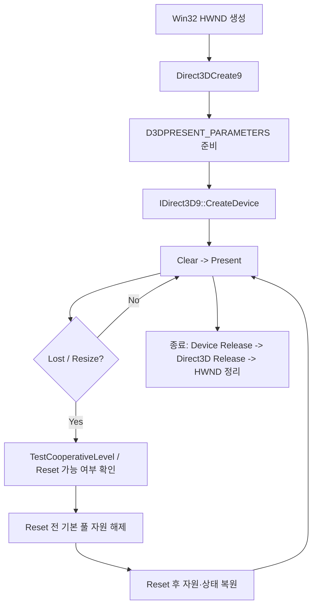

<callout icon="🧰" color="blue_bg">
	**DX9 구현 개정 01 · 장치 생성과 COM 소유권**
	기존 DX9 원문의 장치 초기화, AddRef/Release 메모를 독립 학습 본문으로 교정했습니다. Windows API 실행은 별도 검증이 필요합니다.
</callout>
<table_of_contents color="gray"/>
## 목표와 전제
한 프레임의 화면 출력은 Win32 창, Direct3D 인터페이스, 렌더링 장치, 백 버퍼라는 서로 다른 수명과 책임의 객체를 통과합니다. 이 장에서는 C++11 이상의 소유권 규칙과 D3D9 생성 API의 실제 계약을 구분합니다. D3D9의 고정 기능·셰이더 파이프라인은 앞선 <mention-page url="https://app.notion.com/p/3e66577f53a549fe99a94ac26f68a685"/>을 참조합니다.
## 생성과 소유권의 전체 흐름

## 핵심 계약
- **Direct3DCreate9(D3D_SDK_VERSION)**: 성공하면 IDirect3D9 인터페이스 포인터를 반환합니다. 실패하면 null입니다. 이 포인터는 호출자가 소유한 COM 참조입니다.
- **CreateDevice**: Adapter, HAL 등의 DeviceType, 포커스 창, vertex processing 플래그, D3DPRESENT_PARAMETERS, 출력 포인터가 계약입니다. HRESULT 성공 여부를 반드시 확인합니다. 초기화 코드는 WM_CREATE 처리 중에 호출하지 않습니다.
- **Windowed + D3DFMT_UNKNOWN**: 창 모드에서 백 버퍼 형식을 데스크톱 형식에 맞출 때 사용할 수 있습니다. 전체 화면에서는 그 형식을 명시해야 합니다.
- **하드웨어 정점 처리 실패**: 드라이버/장치의 지원 수준과 리소스 조건에 따라 실패할 수 있습니다. 소프트웨어 정점 처리로 재시도할 때는 상호 배타적인 vertex processing 플래그를 동시에 넣지 않습니다.
- **스레드 제약**: 장치 생성·Reset·TestCooperativeLevel 등은 지정된 스레드 계약이 있습니다. 별도 로딩 스레드로 무작정 이동하지 않습니다.
## COM 참조 수명
COM 포인터는 C++ 객체 포인터와 같은 방식으로 delete해서 정리하지 않습니다. COM 인터페이스의 Release는 참조 하나를 반환합니다. AddRef는 새 소유 참조가 필요한 경우에만 호출합니다. 메모리를 관리하는 주체가 누군지 결정하지 않고 AddRef를 누적하면 누수로 이어집니다.

아래 portable ComOwner는 기존 강의의 커스텀 AddRef 래퍼 자체를 '정답'으로 전제하지 않습니다. **단일 COM 참조 1개를 단독 소유하는 최소 예제**로, 복사를 금지하고 move와 Release를 테스트합니다. 복수 소유에는 각 소유권별 AddRef가 필요합니다. 프로덕션 코드는 Microsoft WRL ComPtr 등의 기존 검증된 유틸리티를 검토합니다.
## 실습 원본 파일
<file src="notion-file-block://37ec2371-43d4-4cd6-8e51-1dacc2f973a3/aba56476-59f0-4f0e-8b96-ceffd007c626?space_id=815d1335-3b56-43a7-903b-d7addf097c9f&name=dx9_com_owner_h.txt">com_owner.h — C++11 소유권 래퍼 전체 소스</file>
<file src="notion-file-block://7b723437-3dc4-4101-bb8b-e82126272db3/76dabbd6-3481-4029-b24a-502a63241ec0?space_id=815d1335-3b56-43a7-903b-d7addf097c9f&name=dx9_com_owner_tests_cpp.txt">com_owner_tests.cpp — fake COM 수명 테스트 전체 소스</file>
<file src="notion-file-block://d648589d-8e26-42e5-968d-d27b4ee9ff90/c783bd06-c907-43c9-97e0-8806296e3f04?space_id=815d1335-3b56-43a7-903b-d7addf097c9f&name=dx9_device_validation.txt">CPU 검증 상태 기록</file>
### 재현 방법
파일 이름을 각각 com_owner.h와 com_owner_tests.cpp로 저장하여 같은 디렉터리에 둡니다. Linux 또는 Windows의 C++11 컴파일러에서 `g++ -std=c++11 -Wall -Wextra -Werror com_owner_tests.cpp -o test && ./test`를 실행합니다. 종료 시 created=4, destroyed=4, AddRef=1, Release=5를 확인합니다. 이것은 fake COM 객체 수명의 테스트이지 D3D9 GPU 실행 테스트가 아닙니다.
## Lost Device·Reset은 'Release 재호출'이 아닙니다
D3DERR_DEVICELOST 상태에서는 렌더링을 일시 중단하고, TestCooperativeLevel이 D3DERR_DEVICENOTRESET을 돌려줄 수 있을 때 Reset을 검토합니다. Reset 전에는 기본 풀 텍스처·버퍼, 명시적 RT/DS 표면, 추가 스왑체인, state block 등 Reset이 요구하는 자원을 정리해야 합니다. 성공 후 필요한 상태를 재설정하고 기본 풀 자원을 다시 만듭니다. 이 정리와 재생성에 관한 상세 예제는 별도 후속 본문에서 다룹니다.
## 흔히 생기는 오류와 진단
<table fit-page-width="true" header-row="true">
<tr>
<td>증상</td>
<td>검사 지점</td>
</tr>
<tr>
<td>CreateDevice 실패</td>
<td>창의 client 크기 0인지, HRESULT, SDK 라이브러리/아키텍처, 플래그 상호 배제 여부</td>
</tr>
<tr>
<td>창은 열리지만 화면이 안 나옴</td>
<td>Clear/Present 반환 코드, 장치 생성/Reset 상태, 백 버퍼와 HWND</td>
</tr>
<tr>
<td>Reset 이후 검은 화면</td>
<td>기본 풀 자원 해제/재생성, 렌더 상태 재적용, Reset 실패 코드</td>
</tr>
<tr>
<td>종료 시 누수</td>
<td>Release 호출 개수 대신 실제 소유 COM 참조 수, 중복 AddRef와 순환 소유</td>
</tr>
</table>
## 이해 확인

Q1. Device 포인터를 두 클래스가 갖고 싶다면 같은 포인터를 각각 ComOwner에 넣으면 될까?

	아닙니다. 참조가 하나인데 Release가 두 번 발생합니다. 별도 소유자마다 AddRef로 새로운 소유 참조를 확보하거나 한쪽은 수명이 보장되는 비소유 포인터만 사용해야 합니다.

Q2. WM_CREATE 안에서 곧바로 CreateDevice를 호출해도 되는가?

	Microsoft CreateDevice 문서는 WM_CREATE 처리 중 장치 생성 호출을 하지 말라고 명시합니다. 메시지 처리 스레드 계약과 생성 시점을 함께 지켜야 합니다.

Q3. Reset 뒤에도 오래된 D3DPOOL_DEFAULT 정점 버퍼를 그대로 사용해도 될까?

	안 됩니다. Reset에 필요한 자원 해제와 성공 후 재생성 절차를 준비해야 합니다. 이 예제는 전체 자원 관리 엔진이 아니라 장치 수명 학습 단위입니다.

## 실제 검증과 범위
Linux x86-64의 GCC 14.2·Clang 17 C++11 실행과 Clang ASan/UBSan에서 fake COM 소유권 테스트가 각각 통과했습니다. CMake/CTest의 1개 테스트도 통과했습니다. 이것을 독립적인 여러 GPU 테스트라고 합산하지 않습니다. **Windows/MSVC 빌드, Win32 창, D3D9 HAL, GPU, Resize·Alt-Tab·Reset 동작은 미검증**입니다. 사용자 환경 검증이 필요합니다.
## 공식 출처와 교정 기록
- [Microsoft Direct3DCreate9](https://learn.microsoft.com/en-us/windows/win32/api/d3d9/nf-d3d9-direct3dcreate9)
- [Microsoft IDirect3D9::CreateDevice](https://learn.microsoft.com/en-us/windows/win32/api/d3d9/nf-d3d9-idirect3d9-createdevice)
- [Microsoft TestCooperativeLevel](https://learn.microsoft.com/en-us/windows/win32/api/d3d9helper/nf-d3d9helper-idirect3ddevice9-testcooperativelevel)
- [Microsoft Reset](https://learn.microsoft.com/en-us/windows/win32/api/d3d9/nf-d3d9-idirect3ddevice9-reset)
개정일 <mention-date start="2026-10-13"/>. 원문에 있던 '래퍼 카운트'를 모든 객체가 동일한 방식으로 관리된다는 설명 대신, COM 참조와 일반 게임 오브젝트의 논리적 수명을 구분했습니다. 이어지는 본문은 엔진/클라이언트 DLL 경계, COM API 반환 규칙, 실제 자원 및 Reset 시퀀스를 다룹니다.
검증 빌드 설정: C++11, CMake 3.16 이상. Linux에서 CTest 1/1 통과.
<page url="https://app.notion.com/p/3fba99703f40818aaa64e05944ea69a6">01A · 장치·COM 전체 소스 복구와 재검증</page>
