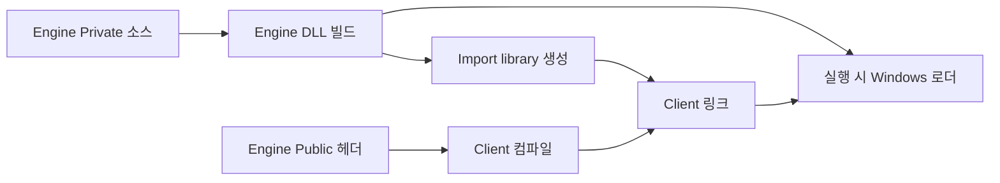
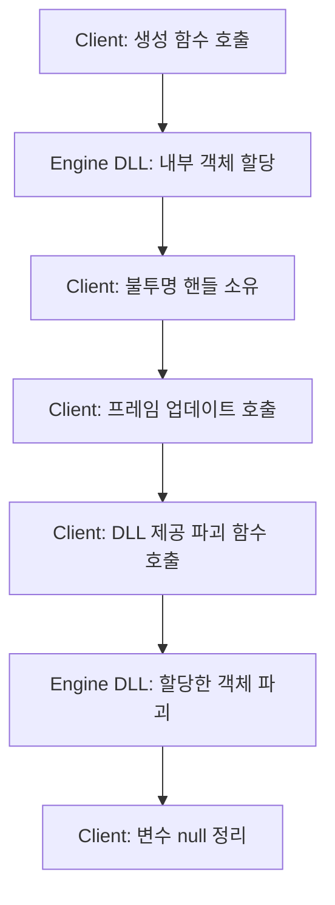
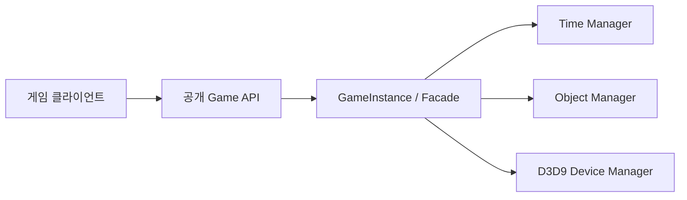

<callout icon="🧩" color="blue_bg">
	**DX9 구현 02 · 엔진 DLL과 클라이언트 사이의 경계**
	2026-10-13 개정. Windows DLL 계약과 C++11 공유 라이브러리 실습을 구분합니다.
</callout>
## 문제 정의
엔진과 클라이언트를 DLL·EXE로 나누면 코드 소유권과 프로그램의 실행 경계가 생깁니다. 공개 헤더는 클라이언트가 사용할 함수와 타입을 선언하고, 엔진의 Private 소스는 내부 구현을 담당합니다. 빌드·링크·DLL 탐색, 인터페이스 호환성, 객체 생성과 해제 책임은 별도 문제입니다.
## 코드와 결과물의 관계
<table fit-page-width="true" header-row="true">
<tr>
<td>구분</td>
<td>의미</td>
</tr>
<tr>
<td>헤더(.h)</td>
<td>공개 선언과 ABI 계약. 헤더를 복사했다고 구현 코드를 복사한 것은 아닙니다.</td>
</tr>
<tr>
<td>Import .lib</td>
<td>MSVC 링커가 DLL의 수출 심볼에 대한 참조를 해결하는 정보입니다.</td>
</tr>
<tr>
<td>Static .lib</td>
<td>객체 코드 자체를 묶어 링크하는 라이브러리입니다. Import .lib와 확장자만 같습니다.</td>
</tr>
<tr>
<td>DLL</td>
<td>실행 시 로더가 찾는 구현 모듈입니다. Client.exe만으로 DLL 의존성을 해결할 수 없습니다.</td>
</tr>
</table>

## 핵심 교정
- `__declspec(dllexport)`는 엔진 DLL 빌드 시 공개, `__declspec(dllimport)`는 소비자가 사용할 때의 선언입니다.
- `extern "C"`는 C 링크 지정으로 이름 장식 문제를 줄이지만, 호출 규약·자료형 배치·ABI 버전까지 호환시키지는 않습니다.
- DLL에 컴파일된 .cpp의 **원본 소스가 공개되지 않을 수 있지만**, 컴파일된 바이너리는 보안상 불투명하다고 보장할 수 없습니다.
- DLL은 EXE의 폴더에 두면 간단히 배포할 수 있지만, 실제 DLL 검색은 Windows 로더의 검색 정책에 따릅니다.
## 공식 기준
- [Microsoft: Create and use a DLL](https://learn.microsoft.com/en-us/cpp/build/walkthrough-creating-and-using-a-dynamic-link-library-cpp)
- [Microsoft: Import library의 역할](https://learn.microsoft.com/en-us/windows/win32/dlls/dynamic-link-library-creation)
- [Microsoft: DLL 검색 순서](https://learn.microsoft.com/en-us/windows/win32/dlls/dynamic-link-library-search-order)
## DLL 경계에서 소유권은 왜 더 중요해지는가
한 모듈에서 `new`한 객체를 다른 모듈이 `delete`하면 두 모듈이 사용하는 CRT·힙·객체 레이아웃·도구 버전이 일치해야 합니다. 운영 환경을 통제할 수 있다 해도, 경계가 확장될수록 위험이 커집니다. 이번 실습은 **불투명 핸들(opaque handle)** 방식으로 크기와 내부 멤버를 공개하지 않습니다.

공개 ABI는 함수 형태의 `Engine_Create`, `Engine_Tick`, `Engine_GetElapsed`, `Engine_Reset`, `Engine_Destroy`입니다. 성공과 실패는 명시적인 결과 코드로 돌려주며 예외를 DLL 밖으로 전파하지 않습니다. 저장된 핸들은 Client가 직접 `delete`하지 않습니다. `Engine_Destroy(&handle)`은 원본 변수 자체를 null로 만들므로 해당 변수에 대해서는 중복 호출을 처리할 수 있습니다. **복사해 둔 포인터까지 안전하게 정리되는 것은 아닙니다.**
```c++
// 공개 API의 핵심 형태를 읽기 위한 개념 발췌
struct Engine_Handle; // 정의는 엔진 내부에만 존재
// Create(Engine_Handle** out), Tick(handle, dt), Destroy(&handle)
```
이번 실습의 허용 delta 범위는 0\~1초입니다. 그 외 값과 NaN·무한대는 거부하며 누적 시간을 바꾸지 않습니다. 이는 **예제만의 제약**이고 DX9의 공식 시간 기준이 아닙니다. API 계약을 바꾸는 경우 핸들 레이아웃 대신 명시적으로 ABI 버전을 올리거나 버전 협상 방식을 도입해야 합니다.
## GameInstance와 Manager 경계
원본의 GameInstance는 TimerManager·ObjectManager·GraphicDeviceManager를 담고 클라이언트에 일부 기능만 위임하는 **Facade** 역할을 합니다. 각 관리자의 맵·캐시·D3D9 내부 타입이 클라이언트의 공개 API가 되지 않도록 할 수 있습니다. 하지만 Facade를 C++ 클래스 형태로 DLL에 그대로 export한다고 해서 ABI 문제가 저절로 해결되는 것은 아닙니다.

**구별해야 할 두 수명:** COM `IUnknown::AddRef/Release`는 COM 객체의 소유 참조 계약입니다. 원본 강의의 `CBase::AddRef/Free`는 프레임워크가 직접 만든 일반 객체 수명 규칙입니다. 동일한 이름 때문에 참조 카운트의 초기값·파괴 타이밍이 자동으로 같아지지는 않습니다. `Free()`에서 `Parent::Free()`를 호출해도 C++ 소멸자 실행 순서를 변경하는 것은 아닙니다. 사용자 정의 정리 함수 호출 순서만 정하는 것입니다.
## DLL을 링크했는데 실행되지 않을 때
빌드 중 미해결 외부 심볼이면 **함수 선언·export 매크로·import library·플랫폼 구성을** 먼저 조사합니다. 링크가 성공했는데 실행 실패라면 **DLL 및 종속성 배포·32/64비트 일치·Windows DLL 로더의 검색 경로**를 조사합니다. 실행 후 메모리 손상은 **생성한 모듈과 해제한 모듈, COM 참조권, 캐시와 비소유 포인터**를 구분하여 추적합니다. 삭제 함수나 DLL 언로드 전에 외부의 살아 있는 객체와 콜백이 없는지 확인합니다.
- [Microsoft: CRT 객체의 DLL 경계 전달 문제](https://learn.microsoft.com/cpp/c-runtime-library/potential-errors-passing-crt-objects-across-dll-boundaries)
- [Microsoft: Load-time linking](https://learn.microsoft.com/en-us/windows/win32/dlls/load-time-dynamic-linking)
- [Microsoft: Runtime linking](https://learn.microsoft.com/en-us/windows/win32/dlls/run-time-dynamic-linking)
## 검증 기록
Linux GCC·Clang에서 공유 라이브러리 실습을 수행했습니다. <mention-date start="2026-10-16"/> 수동 검수 12에서 <mention-page url="https://app.notion.com/p/3fba99703f4081c38a5cce69f6b0542f">02A · DLL·클라이언트 전체 소스 복구와 재검증</mention-page>에 공개 헤더·라이브러리·클라이언트·테스트·CMake 전체와 재현 안내·검증 결과를 네이티브 코드 블록으로 보관하고 다시 읽었습니다. 이번 재실행은 GCC Debug와 Clang Debug ASan/UBSan 각각 CTest 2/2, 동일 계약 조건 21개 통과입니다. 아래의 세 구성 결과는 이전 실행 기록이며 Windows/MSVC·실제 D3D9·GPU 실행과 구분합니다.
GCC 14.2·Clang 17·Clang ASan/UBSan에서 CTest 2/2와 동일 API 계약 조건 21개를 각각 통과했습니다.
```bash
cmake -S . -B build -DCMAKE_BUILD_TYPE=Debug
cmake --build build --config Debug
ctest --test-dir build -C Debug --output-on-failure
```
<page url="https://app.notion.com/p/3fba99703f4081c38a5cce69f6b0542f">02A · DLL·클라이언트 전체 소스 복구와 재검증</page>
