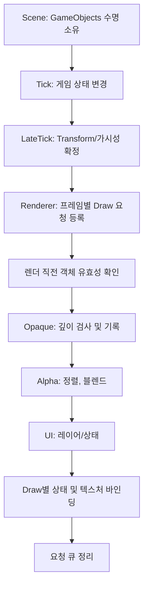
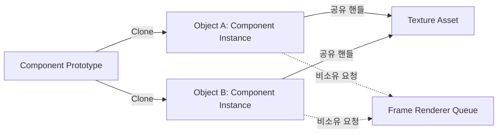

## 04 · Renderer와 Transform, 컴포넌트 수명 — 개정 본문
### 기존 메모에서 교정할 개념
Renderer는 컴포넌트 구현 방식일 수 있지만 **반드시 싱글턴이어야 하는 것은 아닙니다.** Scene의 GameObject가 프레임별 그리기 항목을 제출하고 Renderer가 순서를 정하는 구조와, 객체가 실제 그래픽 자원을 소유하는 구조를 구분해야 합니다. 렌더 큐는 지연 실행되므로 오브젝트가 파괴된 뒤 저장된 포인터로 접근하지 않도록 유효한 수명 계약을 갖추어야 합니다.
### RenderGroup의 상태
Opaque는 보통 깊이 검사와 깊이 기록을 켜며, 표준 알파 블렌딩에서는 깊이 검사를 유지하고 깊이 기록을 꺼 둔 뒤 먼 객체부터 그리는 경우가 많습니다. UI는 콘텐츠에 따라 별도 깊이·레이어 정책을 둡니다. 이러한 정렬은 교차하는 투명 면의 완벽한 처리가 아닙니다.
### 컴포넌트와 텍스처의 소유권
Prototype을 Clone했을 때 새 Component 인스턴스와 공유 가능한 Texture 자원을 구별합니다. C++ `shared_ptr` 예제의 참조 수명은 D3D9의 COM `AddRef/Release` 계약과 별개입니다. `SetTexture`는 텍스처를 지정한 스테이지에 바인딩하는 API이며 HRESULT를 반환합니다. 리소스의 Default/Managed 풀과 장치 Reset을 구분하고 Renderer 종료 시 상태·바인딩 누수를 점검합니다.
### Transform 규약과 실습
행 벡터에 대한 `S * R * T * ParentWorld` 순서를 채택했습니다. 로컬 점 (1,0,0)은 Scale 2, Yaw +90도, Translate(1,2,3) 이후 (1,2,1), 부모 Translate(10,0,0) 이후 (11,2,1)입니다. 임의로 행렬 포인터를 float3\*로 재해석하는 대신 구조체 레이아웃과 별칭 규칙을 검토합니다.
### 검증
이전 26조건 검증 기록을 보존합니다. <mention-date start="2026-10-16"/> 수동 검수 13에서 <mention-page url="https://app.notion.com/p/3fba99703f40816db73cf3e6c93d0b56">04A · Renderer·Transform 전체 소스와 재검증</mention-page>에 확장 소스와 별도 미니 소스 전체, CMake, 재현 안내·결과를 보관했습니다. 확장 26조건과 미니 실행을 GCC C++20·GCC C++11·Clang ASan/UBSan에서 각각 재통과했고, 게시한 확장 전용 CMake도 CTest 1/1을 확인했습니다. Windows/MSVC·COM·D3D9·GPU는 미검증입니다.
공식 자료: [SetTexture](https://learn.microsoft.com/en-us/windows/win32/api/d3d9/nf-d3d9-idirect3ddevice9-settexture), [Managing Resources](https://learn.microsoft.com/en-us/windows/win32/direct3d9/managing-resources), [Alpha Blending](https://learn.microsoft.com/en-us/windows/win32/direct3d9/alpha-blending).
### 프레임 흐름과 소유권을 별도로 모델링
컴포넌트를 Has-a로 구성하는 것과 렌더링 순서를 결정하는 것은 서로 다른 책임입니다. 강의의 LateTick 등록 방식은 하나의 프레임워크 설계이지 모든 GameObject가 Renderer를 소유해야 한다는 보편 규칙이 아닙니다. 특히 프레임 도중 삭제된 객체가 Render에서 사용되지 않도록 수명 계약이 필요합니다.

### 네 가지 수명
<table fit-page-width="true" header-row="true">
<tr>
<td>대상</td>
<td>소유자</td>
<td>정리 조건</td>
</tr>
<tr>
<td>Component Prototype</td>
<td>ComponentCatalog</td>
<td>원형 보관 기간이 끝날 때</td>
</tr>
<tr>
<td>Component Instance</td>
<td>GameObject</td>
<td>해당 Object 파괴 또는 컴포넌트 제거 때</td>
</tr>
<tr>
<td>Texture Asset</td>
<td>ResourceManager / 명시된 COM 소유자</td>
<td>마지막 소유 참조를 해제. Device Reset 규칙도 적용</td>
</tr>
<tr>
<td>프레임 Render 요청</td>
<td>Renderer</td>
<td>매 프레임 소비한 뒤 비우고 대상 객체의 유효성 확인</td>
</tr>
</table>

**이중 포인터 주의:** Base 포인터의 이중 포인터를 Derived 이중 포인터로 강제 캐스팅하는 패턴은 타입 안전성이 없습니다. 복제 결과를 적절한 타입 검사·소유권 인계 API로 전달하고 COM 출력 매개변수의 인터페이스 타입도 확인해야 합니다.
### 렌더 그룹 상태와 정렬
교육용 렌더러에서 Opaque는 깊이 테스트/기록을 켜고 Alpha는 깊이 테스트를 유지한 채 깊이 기록을 끄며 일반 알파 블렌딩을 적용합니다. UI는 레이어 순서를 따릅니다. Opaque 앞→뒤와 Alpha 뒤→앞 정렬은 하나의 예시일 뿐이고, 실제로는 머티리얼 배칭 및 공간 분할과 절충할 수 있습니다. 메시 내부에서 교차하는 투명 삼각형은 객체 중심점 정렬만으로 해결되지 않습니다.
```c++
// Direct3D 9 상태 계약의 예 (실제 호출 코드가 아닌 체크리스트)
// Opaque: ZENABLE=TRUE, ZWRITEENABLE=TRUE, ALPHABLENDENABLE=FALSE
// Alpha : ZENABLE=TRUE, ZWRITEENABLE=FALSE, ALPHABLENDENABLE=TRUE
//         SRCBLEND=SRCALPHA, DESTBLEND=INVSRCALPHA (straight alpha)
// UI    : 깊이 사용 여부와 순서는 프로젝트 요구사항에 따라 결정
// Draw 전에 텍스처 스테이지, 스트림, FVF/Declaration, RenderState 바인딩 확인.
```
상태를 바꾸는 D3D9 호출의 HRESULT를 확인하고, 텍스처를 사용할 때마다 적절한 Stage에 SetTexture를 지정합니다. 이전 객체의 텍스처·알파·깊이 상태가 다음 객체로 새어 나가지 않게 렌더 패스의 초기 상태를 정의합니다.
### Transform 수치 추적
예제는 행 벡터, +Z 전방 왼손 좌표계, Local = Scale × YawY × Translation, World = Local × ParentWorld를 고정했습니다. Scale 2인 로컬 점 (1,0,0)은 Yaw +90° 후 (0,0,-2), Local Translation (1,2,3) 후 (1,2,1), Parent Translation (10,0,0) 후 (11,2,1)이 됩니다. 행렬의 기저 벡터 길이를 원래 축 Scale로 읽는 관행은 회전과 스케일이 직교 기저를 유지한 특정 조건의 근사이며, Shear가 포함된 일반 4×4에서는 통하지 않습니다.
<details>
<summary>Q1. 렌더 큐에 일반 포인터만 저장하면 삭제 후에도 안전한가?</summary>
	안전하지 않습니다. 삭제 지연, 객체 핸들 유효성 검사, 큐 처리 동안 별도의 소유 참조 확보 중 일관된 규칙이 필요합니다.
</details>
<details>
<summary>Q2. Component 인스턴스 2개가 Texture 한 개를 공유한다면 모든 상태가 깊은 복사인가?</summary>
	아닙니다. 인스턴스의 자체 상태와 소유권은 분리되어 있지만 내부 Texture Asset 핸들은 공유하므로 전체 객체 그래프의 깊은 복사와 다릅니다.
</details>
<details>
<summary>Q3. Alpha를 뒤부터 그리면 교차하는 모든 반투명 표면이 해결되는가?</summary>
	아닙니다. 객체 단위 깊이 정렬로는 메시 내부·서로 교차하는 표면의 정확한 순서를 결정할 수 없습니다.
</details>
<page url="https://app.notion.com/p/3f8a99703f408171ab68e3ed5b265f01">05 · 씬·게임 오브젝트와 프레임 루프 — 개정 본문</page>
<page url="https://app.notion.com/p/3f8a99703f40817cbe12e85790420aab">06 · VIBuffer·Texture의 D3D9 API 계약 — 개정 본문</page>
<page url="https://app.notion.com/p/3f8a99703f4081e3b908de685a551c23">07 · 카메라·지형·피킹 — 좌표 변환과 Ray 교차</page>
<page url="https://app.notion.com/p/3f8a99703f40811ca79ae3e8a74806d7">08 · 스카이박스·UI 좌표·렌더 상태 계약</page>
<page url="https://app.notion.com/p/3f8a99703f4081ba8b8ae2fc6650bde2">09 · 월드 알파·빌보드·이펙트</page>
<page url="https://app.notion.com/p/3f8a99703f408155a685d66590c67b7a">10 · DX9 Shader·Effect 입력/출력 계약과 Fog 실습</page>
<page url="https://app.notion.com/p/3fba99703f40816eb333f270aad46a46">11 · Frustum 컬링 — 6평면·Sphere·AABB</page>
<page url="https://app.notion.com/p/3fba99703f408129bd94deff3cc1c807">03A · VB/IB 입력 검증 보완·전체 CPU 소스 v1.1</page>
<page url="https://app.notion.com/p/3fba99703f40816db73cf3e6c93d0b56">04A · Renderer·Transform 전체 소스와 재검증</page>
<page url="https://app.notion.com/p/3fba99703f4081bfbad0d047f8a8d58f">12 · 삼각형·텍스처 사각형·Reset — 통합 프로젝트</page>
