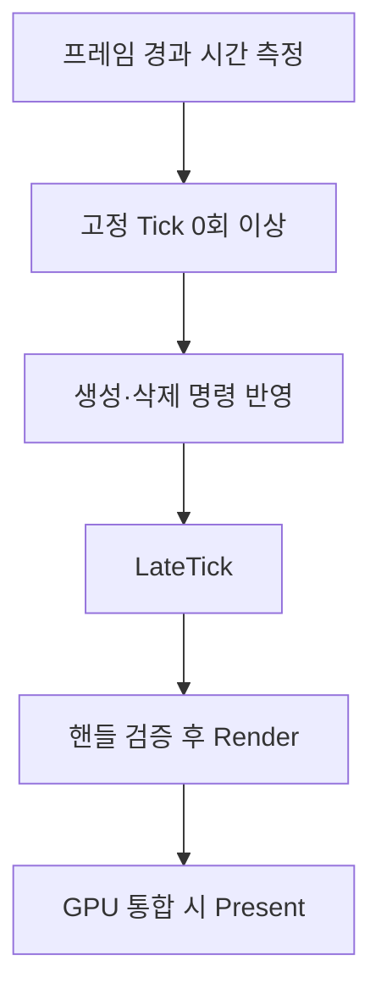

<callout icon="🎮" color="blue_bg">
	**05 · 씬·게임 오브젝트와 프레임 루프**
	DX9 구현 5차 개정. C++11 단일 스레드 교육용 CPU 모델이며 실제 GPU 호출은 포함하지 않습니다.
</callout>
## 씬과 객체 수명
`Engine`은 현재 `World`를 소유합니다. `World`는 레이어별 `Actor`를 소유하고, 렌더 큐는 객체를 소유하지 않는 핸들만 보유합니다. 객체 생성·삭제는 매 프레임 안전 지점에 반영하고, 장면 전환은 실행 중인 장면의 콜스택이 끝난 뒤 반영합니다.
## 프레임 처리 원칙

학습 예제는 1/60초의 고정 Tick, 입력 델타 최대 0.25초, 프레임당 최대 5회 Tick을 적용합니다. `LateTick`과 `Render`는 프레임당 한 번입니다. 과부하 시간의 잔여분은 버리는 명시적 정책입니다.
## 확인할 개념
씬 변경 시 이전 장면의 Render를 계속 호출하지 않습니다. 개별 객체의 유일 소유권과 임시 렌더 요청을 분리합니다. `map` 안에 `vector`가 들어가는 STL 중첩은 금지된 C++ 문법이 아닙니다.
공식 참고: [Direct3D9 EndScene](https://learn.microsoft.com/en-us/windows/win32/api/d3d9/nf-d3d9-idirect3ddevice9-endscene), [QueryPerformanceCounter](https://learn.microsoft.com/en-us/windows/win32/api/profileapi/nf-profileapi-queryperformancecounter).
## 실행 검증과 한계
기존 v1은 Linux GCC 14.2 및 Clang 17, Clang ASan·UBSan에서 39조건과 CTest 1/1을 통과했습니다. 이는 과거의 해당 입력 범위에 대한 기록입니다.
<mention-date start="2026-10-16"/> 수동 검수 13: <mention-page url="https://app.notion.com/p/3fba99703f4081a3bfbec249986a6a3e">05A · 고정 Tick 음수 보간 교정·전체 소스 v1.1</mention-page>에 전체 헤더·테스트·CMake·재현 안내·실패 반례와 새 실행 결과를 보관했습니다. 허용 오차로 Tick을 실행한 뒤 잔여 시간이 음수가 되는 경우를 재현했고, 잔여 시간을 0 이상으로 보정한 v1.1은 42조건을 GCC C++20·GCC C++11·Clang ASan/UBSan에서 각각 통과했습니다. 개별 CMake도 실행하여 CTest 1/1을 확인했습니다. 실제 Windows/MSVC·D3D9·GPU는 미검증입니다.
## 세부 계약과 현재 실습
이제 확장 실습의 기준은 05A입니다. 콜백 안에서 Commit·ApplyPending·RunFrame을 재진입 호출하지 않는 전제, Scene 전환의 안전 지점, 보간 계수와 실제 Transform 보간의 차이를 함께 읽습니다. 아래의 기존 상세 본문과 미니 실습은 별도 자료로 유지합니다.
<page url="https://app.notion.com/p/3f8a99703f4081b38d24c9e65487028b">05 · Scene 프레임 루프 — 상세 계약과 검증</page>
<page url="https://app.notion.com/p/3f8a99703f4081a8a6fcec673f79a98a">05 · C++11 Scene 프레임 루프 미니 실습 — 전체 소스</page>
<page url="https://app.notion.com/p/3fba99703f4081a3bfbec249986a6a3e">05A · 고정 Tick 음수 보간 교정·전체 소스 v1.1</page>
