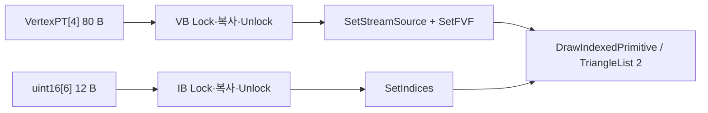

<callout icon="🎮" color="blue_bg">
	**06 · VIBuffer / Texture 실전 계약**
	2026-10-13 개정. Direct3D9의 실제 API와 강의 프레임워크의 컴포넌트 설계를 구별합니다.
</callout>
## 1. 먼저 무엇을 소유하는가
`VIBuffer`는 Direct3D9 인터페이스 이름이 아니라 엔진의 정점·인덱스 버퍼 래퍼 설계입니다. `IDirect3DVertexBuffer9`는 정점 바이트를, `IDirect3DIndexBuffer9`는 정점 번호를 보관하고, `IDirect3DTexture9`는 텍스처 자원을 나타냅니다. 개별 GameObject가 컴포넌트를 복제하더라도 텍스처 자원은 명시적인 참조 소유권에 따라 공유할 수 있습니다. COM 포인터 소유자는 종료 시 `Release`해야 합니다.
## 2. 바이트 수와 드로우 범위
`struct VertexPT {float x,y,z,u,v;};`는 일반적인 32비트 float 환경에서 stride 20바이트입니다. 정점 4개는 80바이트, uint16 인덱스 6개는 12바이트입니다. 사각형을 TriangleList 두 개로 그릴 때 `DrawIndexedPrimitive`의 PrimitiveCount는 **2**이고 6이 아닙니다. `StartIndex`는 인덱스 배열 시작 위치, `MinVertexIndex`와 `NumVertices`는 해당 Draw의 원시 인덱스 범위, `BaseVertexIndex`는 실제 VB 접근에 더해지는 값입니다.

## 3. 텍스처 행 피치
`LockRect`의 `D3DLOCKED_RECT.Pitch`는 목적지 연속 행의 바이트 간격입니다. 반드시 `width × bytesPerPixel`과 같지는 않습니다. 예를 들어 32비트 1×2 텍스처에서 원본 유효 행은 4바이트지만 `Pitch=8`이면 첫 행은 offset 0\~3, 둘째 행은 offset 8\~11에 복사해야 합니다. 압축 포맷·mip level·잠금 불가능한 자원에는 별도 규칙이 있습니다.
## 4. 상태와 자원 수명
`SetTexture`는 텍스처 바인딩이며 샘플러와 텍스처 스테이지, 깊이·알파·컬링 상태를 자동으로 완성하지 않습니다. 그룹별 Draw 전에 `SetSamplerState`와 필요한 RenderState를 설정합니다. 일반 D3D9에서 DEFAULT 풀 자원은 Reset 전 해제·성공 후 재생성이 요구되는 반면 MANAGED 자원은 별도 관리됩니다. 동적 VB/IB와 `D3DPOOL_MANAGED`를 함께 사용하지 않습니다.
## 5. 검증과 다음 절
원형 v1의 과거 검증은 22조건·CTest 1/1입니다. <mention-date start="2026-10-16"/> 수동 검수 13에서 추가 반례를 검사한 결과, 같은 vector로 Pitch 확장 복사를 하면 아직 읽지 않은 다음 행을 덮어쓰는 문제가 재현됐습니다.
현재 전체 확장 실습은 <mention-page url="https://app.notion.com/p/3fba99703f40814ba45ec3bbbc84ec1e">06A · Pitch 별칭·인덱스 범위 교정·전체 소스 v1.1</mention-page>에 네이티브 코드 블록으로 보관했습니다. 같은 버퍼의 제자리 복사를 변경 없이 거부하고 Base 적용 후 선언 범위 양 끝도 검사하는 v1.1은 28조건을 GCC C++20·GCC C++11·Clang ASan/UBSan에서 각각 통과했습니다. 게시한 개별 CMake도 빌드·실행해 CTest 1/1을 확인했습니다. 이전 미니 12조건은 별도 자료로 유지합니다. **실제 Windows/MSVC·D3D9/GPU/HLSL은 미검증**입니다. 복사 가능한 전체 소스·빌드 안내·결과는 이제 06A에서 다시 읽을 수 있습니다.

이해 확인: 인덱스 여섯 개면 PrimitiveCount도 6인가?

	아닙니다. TriangleList에서는 세 인덱스가 하나의 삼각형이므로 PrimitiveCount는 2입니다.

이해 확인: Pitch 8, 픽셀 유효 폭 4바이트이면 다음 행은 어디서 시작하는가?

	첫 행에서 8바이트 떨어진 곳이며, 원본의 다음 행을 목적지 offset 8에서 시작해 복사합니다.

공식 출처: [CreateVertexBuffer](https://learn.microsoft.com/en-us/windows/win32/api/d3d9/nf-d3d9-idirect3ddevice9-createvertexbuffer) · [DrawIndexedPrimitive](https://learn.microsoft.com/en-us/windows/win32/api/d3d9/nf-d3d9-idirect3ddevice9-drawindexedprimitive) · [Texture Filtering](https://learn.microsoft.com/en-us/windows/win32/direct3d9/texture-filtering) · [Managing Resources](https://learn.microsoft.com/en-us/windows/win32/direct3d9/managing-resources).
다음: 카메라·지형·피킹의 좌표 규약과 실습 검증.
<page url="https://app.notion.com/p/3f8a99703f4081058f96d3bd885a4ef7">06 · C++11 VIBuffer·Texture 입력 계약 — 전체 미니 소스</page>
<page url="https://app.notion.com/p/3fba99703f40814ba45ec3bbbc84ec1e">06A · Pitch 별칭·인덱스 범위 교정·전체 소스 v1.1</page>
