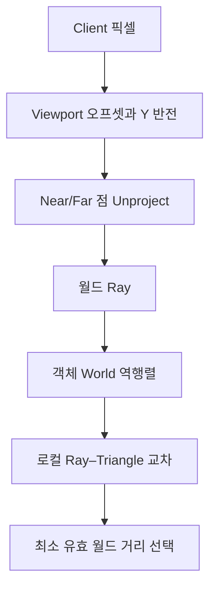

<callout icon="🎯" color="blue_bg">
	**DX9 카메라·지형·피킹의 공통 좌표 계약**
	개정 07 · 2026-10-13. 행 벡터, 왼손 +Z 전방, 화면 좌상단 원점, near/far 범위를 기본 규약으로 고정합니다. 실제 Direct3D9/GPU 실행을 뜻하지 않습니다.
</callout>
<table_of_contents color="gray"/>
## 1. 월드·뷰·투영의 책임
로컬 정점의 동차좌표는 World → View → Projection을 순서대로 적용해 클립 좌표가 됩니다. 행 벡터 관례는 p_clip = p_local × World × View × Projection입니다. View는 카메라 월드 행렬의 역행렬이며, Camera가 반드시 GameObject를 상속해야 한다는 보편 규칙은 아닙니다. 강의 프레임워크의 객체 설계와 그래픽 API 계약을 분리합니다.
D3DXMatrixLookAtLH는 Eye, At, Up을 받아 왼손 뷰 행렬을 계산합니다. F=normalize(At−Eye), R=normalize(cross(Up,F)), U=cross(F,R)입니다. Eye=At이거나 Up이 F와 평행하면 올바른 카메라 기저를 만들 수 없어 초기화를 거부합니다.
D3DXMatrixPerspectiveFovLH는 수직 FOV(라디안), 화면 종횡비 Width/Height, zn\>0, zf\>zn을 사용합니다. 투영 직후 좌표는 4성분 clip이므로 단순히 화면 x,y 범위가 \[-1,1\]이 되는 것이 아닙니다. 클리핑·원근 나눗셈 이후의 NDC 범위는 x,y \[-1,1\], z \[0,1\]입니다.
## 2. 화면 픽셀에서 월드 Ray 생성
뷰포트가 (X,Y,Width,Height)라면 NDC.x=2(mouse.x-X)/Width−1, NDC.y=1−2(mouse.y-Y)/Height입니다. 매번 화면 전체 크기만 사용하면 부분 뷰포트·에디터 패널에서 클릭이 어긋납니다. 픽셀 좌표에는 DPI와 렌더 타깃 스케일 등도 영향을 줄 수 있습니다.
대칭 Perspective LH에서 h=tan(fovy/2), aspect=Width/Height, 카메라 직교기저 F,R,U를 쓰면 V=F + R*(NDC.x*aspect*h) + U*(NDC.y*h)입니다. NearPoint=Eye+V*zn, FarPoint=Eye+V\*zf이며, RayOrigin=NearPoint, RayDir=normalize(V), RayMaxT=length(FarPoint−NearPoint)입니다. 비대칭 투영·jitter 사용 시에는 실제 World/View/Projection 역행렬 기반의 Unproject를 사용합니다.
예제: 뷰포트 (100,50,800,600), 마우스 (500,350), Eye(0,0,0), At(0,0,1), FOV 90°, near=1, far=100이면 NDC=(0,0), RayOrigin=(0,0,1), RayDir=(0,0,1), RayMaxT=99가 됩니다. D3DXVec3Unproject는 스크린 좌표와 D3DVIEWPORT9, World/View/Projection을 받아 객체 공간 좌표를 구하므로, 어느 공간의 두 점을 요구하는지 명시해야 합니다.

## 3. 객체 로컬 공간과 삼각형 교차
월드 레이 P=O+tD에서 D가 단위 방향이면 t는 월드 단위 거리입니다. 객체 World 역행렬로 원점 O는 w=1(TransformCoord), 방향 D는 w=0(TransformNormal)으로 바꿉니다. **로컬 방향을 다시 정규화하지 않으면 t가 그대로 유지됩니다.** 비균일 스케일 후 재정규화한 로컬 t를 월드 거리와 그대로 비교하는 실수를 피합니다. 역행렬 불가능한 월드 행렬은 거부합니다. 일반 법선 벡터 변환의 inverse-transpose는 이 광선 방향 변환과 구분합니다.
D3DXIntersectTri의 u,v는 텍스처 UV가 아니라 무게중심 좌표입니다. 교차점은 A*(1-u-v)+B*u+C\*v이며 u≥0, v≥0, u+v≤1, t≥0과 near/far 제한 t≤RayMaxT를 함께 검사합니다. 행렬식이 0 근처인 평행·퇴화 삼각형은 거부합니다. 이 예제의 Ray와 삼각형 A=(-1,-1,5), B=(1,-1,5), C=(0,1,5)는 t=4, u=.25, v=.5에서 교차합니다. 실제 사용에서는 가장 가까운 hit를 선택하고 BVH/AABB 등으로 삼각형 검사를 줄입니다. 메시의 앞/뒷면 컬링 여부는 별도의 정책입니다.
## 4. 지형 인덱스, 높이맵과 보간
10×10이 정점 격자라면 정점 100개, 셀 81개, 삼각형 162개, TriangleList 인덱스 486개입니다. 반면 셀을 10×10개 만든다면 정점은 11×11개입니다. 원문처럼 개수 정의를 혼동해서는 안 됩니다.
행 우선 격자 index=z*width+x에서 셀의 꼭짓점 a=(0,0), b=(1,0), c=(0,1), d=(1,1)을 정의하고 b–c 대각선으로 둘로 나눕니다. 셀 내부 위치 fx,fz에 대해 fx+fz≤1이면 높이 h=a*(1-fx-fz)+b*fx+c*fz, 그 밖에는 h=d*(fx+fz-1)+b*(1-fz)+c\*(1-fx)를 사용합니다.
높이 네 개가 (a,b,c,d)=(0,0,0,10)일 때 (fx,fz)=(.75,.75)의 **삼각형 높이는 5**지만 bilinear 높이는 5.625입니다. 지형 위에 걷는 위치가 그려진 삼각형 메시의 높이와 맞으려면 렌더 메시의 대각선과 같은 보간식을 사용해야 합니다.
지형 Transform이 있을 때 플레이어 월드 점을 지형 로컬로 역변환해 높이를 계산하고 그 결과를 다시 월드로 변환합니다. 다만 지형이 기울어져 있고 월드에서 수직으로 내린 교점을 원한다면 단순 로컬 XZ 높이 샘플이 아니라 실제 월드 수직 Ray–Triangle 교차가 필요합니다.
모든 BMP가 grayscale인 것은 아닙니다. BMP 포맷, 색상 깊이, 팔레트, row pitch, 상향/하향 저장 순서, 채널 순서를 확인해야 하며 GPU 텍스처의 Pitch는 이미지 width×픽셀 크기와 항상 같지 않습니다.
## 5. 디버깅과 체크포인트
<table fit-page-width="true" header-row="true">
<tr>
<td>문제</td>
<td>확인할 사항</td>
</tr>
<tr>
<td>중앙 클릭 위치가 어긋남</td>
<td>Viewport 오프셋, DPI, 렌더 타깃 크기, Y 반전</td>
</tr>
<tr>
<td>스케일된 오브젝트에서 선택 우선순위가 틀림</td>
<td>로컬 Ray 정규화와 t 거리 환산</td>
</tr>
<tr>
<td>캐릭터가 지형 위에서 뜸</td>
<td>삼각형 대각선, 보간, 좌표 공간</td>
</tr>
<tr>
<td>근평면 앞·원평면 밖이 선택됨</td>
<td>Ray 시작점·최대 구간과 t 검사</td>
</tr>
<tr>
<td>모서리 클릭에서만 실패</td>
<td>수치 허용오차·컬링·정점 winding</td>
</tr>
</table>

Q1. (100,50)에서 시작하는 800×600 뷰포트의 중앙 클릭 좌표는?

	(500,350). (400,300)은 화면 전체 원점을 사용한 잘못된 결과입니다.

Q2. 로컬 Ray의 방향을 역변환 후 다시 normalize하면 왜 위험한가?

	비균일 스케일에서 교차 파라미터 t의 길이 단위가 달라져 가장 가까운 물체 판단이 잘못될 수 있습니다. 단위를 보존하거나 월드 거리로 다시 계산해야 합니다.

Q3. b–c 대각선 지형 높이 (0,0,0,10)의 (.75,.75)는?

	삼각형 내부 보간 결과는 5입니다. bilinear 방식은 5.625여서 실제 삼각형 표면과 달라집니다.

## 6. 재현 가능한 실습과 검증 한계
원형 v1의 과거 검증은 확장 25조건·CTest 1/1, 별도 미니 7조건입니다. <mention-date start="2026-10-16"/> 수동 검수 13에서 NaN이 들어간 삼각형을 hit=true와 NaN 거리로 반환하는 반례를 실제 재현했습니다.
수정된 전체 확장 실습은 <mention-page url="https://app.notion.com/p/3fba99703f4081979e96cb9345976cce">07B · NaN 피킹 오류 교정·전체 카메라·지형 소스 v1.1</mention-page>에 저장했습니다. 입력·계산 결과의 유한성, 아핀 World 조건, 높이 값을 검증하는 v1.1은 33조건을 GCC C++20·GCC C++11·Clang ASan/UBSan에서 각각 통과했습니다. 별도 미니는 각 구성에서 7조건을 재통과했고, 게시한 확장 전용 CMake도 CTest 1/1을 확인했습니다. 같은 조건의 반복 결과이며 Windows/MSVC·D3DX·D3D9·GPU 실행은 미검증입니다. 전체 코드·빌드 안내·실패 반례·검증 결과를 07B에서 다시 읽을 수 있으므로 대화 파일만을 유일한 원본으로 두지 않습니다.
## 7. 공식 근거 및 변경 기록
[D3DXMatrixLookAtLH](https://learn.microsoft.com/en-us/windows/win32/direct3d9/d3dxmatrixlookatlh), [D3DXMatrixPerspectiveFovLH](https://learn.microsoft.com/en-us/windows/win32/direct3d9/d3dxmatrixperspectivefovlh), [D3DXVec3Unproject](https://learn.microsoft.com/en-us/windows/win32/direct3d9/d3dxvec3unproject), [D3DXIntersectTri](https://learn.microsoft.com/en-us/windows/win32/direct3d9/d3dxintersecttri), [D3DXVec3TransformCoord](https://learn.microsoft.com/en-us/windows/win32/direct3d9/d3dxvec3transformcoord), [D3DXVec3TransformNormal](https://learn.microsoft.com/en-us/windows/win32/direct3d9/d3dxvec3transformnormal). D3DX는 지원 종료된 레거시 유틸리티로 신규 프로젝트에는 DirectXMath 등의 대안을 검토합니다.
원본의 카메라·지형·피킹 절을 교정했으며, 원문·이미지 복제본 <mention-page url="https://app.notion.com/p/3f8a99703f40816eb9dbdced1f9a1855"/>은 보존합니다. 기존 화면 캡처를 모두 전사·실행한 것은 아닙니다. 다음 개정: 스카이박스·UI·알파·이펙트·셰이더·Frustum 컬링.
<page url="https://app.notion.com/p/3f8a99703f4081da9335faf6d568d1c3">07A · C++11 전체 미니 소스와 재현 방법</page>
<page url="https://app.notion.com/p/3fba99703f4081979e96cb9345976cce">07B · NaN 피킹 오류 교정·전체 카메라·지형 소스 v1.1</page>
