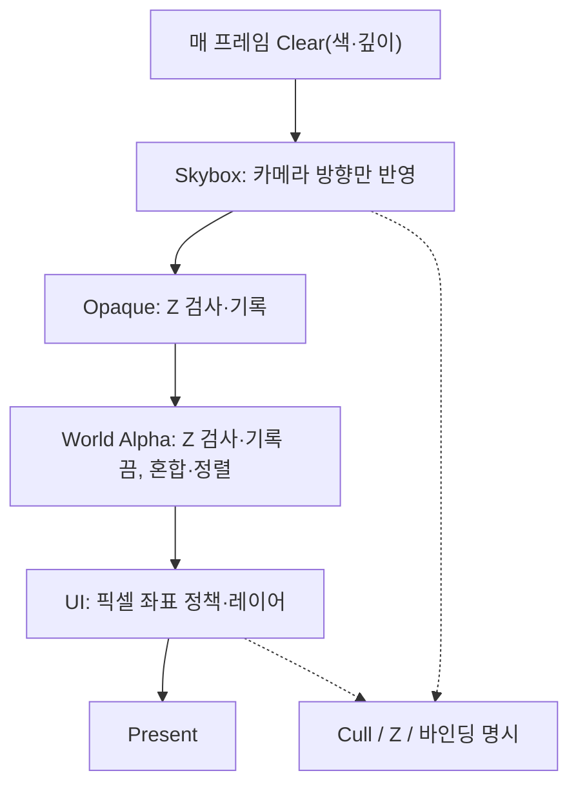

<callout icon="🌌" color="blue_bg">
	**08 · 스카이박스·UI 좌표·렌더 상태 계약**
	2026-10-13 · Direct3D 9 강의 메모 개정 · C++11 CPU 검산 포함. 원본 이미지·설명은 DX9 상위 페이지 및 기존 복제본에 남깁니다. 이 문서는 실제 D3D9 GPU 드로우 검증이 아닙니다.
</callout>
<table_of_contents color="gray"/>
## 1. 렌더 패스를 나누는 이유
하늘·불투명 지형·월드 투명체·HUD는 같은 장면에 있지만 깊이 정책과 좌표계가 다릅니다. 각 객체가 전역 장치 상태를 임의로 바꾸도록 방치하면 다음 드로우에 깊이·컬링·알파 상태가 누수됩니다. **렌더 패스 시작 시 필요한 상태를 명시**하고 종료 시 복원하거나 다음 패스가 모든 필수 상태를 다시 설정하도록 계약합니다.

이 그림은 강의 엔진에서 채택할 수 있는 **예시 패스 순서**입니다. 실제 게임은 후처리·렌더타깃·효과에 따라 달라집니다. 지금은 Skybox·Opaque·UI 세 패스의 상태 경계만 CPU 실습으로 모델링하고, World Alpha 세부 사항은 다음 개정에서 다룹니다.
## 2. 스카이박스: 카메라는 따라가고 회전은 구별한다
스카이박스는 화면 배경에 먼 환경을 표현합니다. 위치는 카메라와 함께 이동하거나 **뷰 변환의 이동 성분을 제거**해 카메라의 병진에 따른 시차를 없앱니다. 환경 무늬는 카메라 회전에 따라 변해야 하므로 뷰 회전까지 지우면 안 됩니다.
큐브 안쪽을 보여 주기 위한 컬링 방식은 **정점 winding에 종속**됩니다. 일반 메시에서 `D3DCULL_CCW`가 기본이라고 해서 모든 스카이큐브에 `D3DCULL_CW`가 정답은 아닙니다. 실제 메쉬의 면 방향을 확인하고 winding을 뒤집거나 `D3DCULL_NONE`을 사용할 수 있습니다(양면 드로우 비용에 유의). 큐브맵 샘플러는 면별 평면 UV와 달리 **3D 방향 벡터**를 사용합니다. 고정 기능의 정점 입력은 TEXCOORD0의 3성분 크기 선언(예: `D3DFVF_TEXCOORDSIZE3(0)`) 또는 동등한 정점 선언/셰이더 입력을 요구합니다. 일반 2D TEXCOORD라고 간주하지 않습니다.
**첫 패스 전략:** 색·깊이를 Clear한 다음 `ZENABLE=FALSE`, `ZWRITEENABLE=FALSE`, `ALPHABLENDENABLE=FALSE`에서 하늘을 그립니다. 이후 Opaque는 `ZENABLE=TRUE`, `ZWRITEENABLE=TRUE`로 바꾸어 더 가까운 3D 물체가 하늘 색을 덮도록 합니다. 하늘이 깊이를 기록하지 않으므로 나중 3D 물체가 하늘 때문에 가려지지 않습니다.
**마지막 패스 대안:** 불투명 물체를 먼저 그리고 깊이 테스트를 켠 상태에서 스카이의 깊이를 far 끝으로 보내고, 프로젝트가 선택한 `ZFUNC`(예: LESSEQUAL) 및 z-write 비활성화로 배경만 채우는 방법도 있습니다. 첫 패스의 Z 비활성화와 이 대안은 **서로 다른 구현**이므로 섞어 설명하지 않습니다. z=1과 `LESS`를 쓰면 Clear 값 1과 동률인 빈 배경에서 실패합니다.
## 3. UI의 좌표는 선택한 투영 방식으로 결정된다
기존 메모의 “직교 투영에서는 (0,0)이 화면 가운데”는 **대칭 OrthoLH(Width, Height)** 같은 특정 규약에서만 성립합니다. 화면 좌상단 원점 픽셀 좌표를 그 대칭 직교 공간으로 보내려면 다음과 같이 변환합니다.
```plain text
UI local centered, +Y 위쪽, 화면 W=800 H=600:
x_ortho = x_pixel - W/2
y_ortho = H/2 - y_pixel

pixel (0,0)     → ortho (-400,+300)
pixel (400,300) → ortho (0,0)
pixel (800,600) → ortho (+400,-300) [화면 경계]
```
반면 `D3DXMatrixOrthoOffCenterLH(&P, 0, W, H, 0, zn, zf)`를 사용하면 **투영 공간에서** 직접 화면 왼쪽=0, 위=0, 아래=H라는 좌표 계약을 만들 수 있습니다. 주어진 매개변수의 bottom=H, top=0이므로 y축이 아래로 증가합니다. 창 클라이언트 크기와 실제 뷰포트·렌더타깃 크기가 다를 수 있으므로 1:1 UI를 원한다면 오프셋·DPI·스케일링을 함께 정의해야 합니다. UI가 월드 오브젝트 위의 화면 고정 HUD인지, 월드 공간 UI인지를 구분합니다.
**DX9 픽셀/텍셀 중심:** 사전 변환 XYZRHW 정점으로 UI를 구성할 때 반 픽셀 정렬 이슈가 있을 수 있습니다. XYZRHW와 정점 셰이더 경로·샘플러 필터가 다른데 일괄적으로 모든 UI 정점에 ±0.5를 적용하면 오히려 오차가 생깁니다. 렌더 경로를 특정한 뒤 테스트 패턴으로 검증합니다.
## 4. 장치 상태는 그린 객체가 아니라 패스의 계약이다
<table fit-page-width="true" header-row="true">
<tr>
<td>패스</td>
<td>Z 검사</td>
<td>Z 기록</td>
<td>알파 혼합</td>
<td>면 컬링</td>
</tr>
<tr>
<td>Sky first</td>
<td>끄기</td>
<td>끄기</td>
<td>끄기</td>
<td>메쉬 winding 검토 후 지정</td>
</tr>
<tr>
<td>Opaque</td>
<td>켜기</td>
<td>켜기</td>
<td>끄기</td>
<td>메쉬 정점 방향에 맞게 지정</td>
</tr>
<tr>
<td>World Alpha</td>
<td>일반적으로 켜기</td>
<td>일반적으로 끄기</td>
<td>켜기</td>
<td>효과별 결정</td>
</tr>
<tr>
<td>Screen UI</td>
<td>일반적으로 끄기</td>
<td>끄기</td>
<td>투명도 필요 시 켜기</td>
<td>정점 방향/스프라이트 구현에 따름</td>
</tr>
</table>
`D3DRS_ZENABLE`은 깊이 비교 활성화, `D3DRS_ZWRITEENABLE`은 깊이 기록 허용으로 **별개**입니다. ZWrite를 꺼도 ZEnable이 살아 있으면 깊이 비교는 계속 수행할 수 있습니다. 또한 `D3DRS_CULLMODE`는 CCW/CW/NONE 중 하나를 지정하며 기본값은 CCW입니다.
`IDirect3DDevice9::CreateStateBlock(D3DSBT_ALL, &block)`은 현재 장치 상태의 스냅샷을 캡처하고 `block->Apply()`로 복원할 수 있습니다. 반면 `BeginStateBlock/EndStateBlock`은 호출 사이의 **변경된 상태**를 기록하는 방식이므로 이전 상태 스냅샷과 혼동하면 안 됩니다. StateBlock이 다루지 않는 렌더 타깃/DepthStencil 등은 별도의 저장·복원 소유권 계약을 갖추고, COM 객체의 Release도 필요합니다. 다중 패스에서 “마지막에 원래 상태가 돌아오겠지”라고 기대하지 말고 실제 설정과 HRESULT를 검증합니다.

## 5. CPU 실습: 패스 전환, 깊이/블렌딩, 화면 좌표
아래는 **실제 D3D9 호출이 없는 C++11 독립 모델**입니다. Sky가 깊이를 건드리지 않고, Opaque가 가까운 픽셀을 덮으며, UI 혼합 후에도 깊이 버퍼와 이전 상태가 보존되는지를 검사합니다. 내부 Color는 선형 공간이라고 단순 가정한 수치 모형이며 sRGB, MSAA, 텍스처 필터, GPU 깊이 정밀도를 구현하지 않습니다.
```c++
#include <cassert>
#include <cmath>
#include <iostream>
#include <stdexcept>
#include <vector>

// Cross-platform CPU model, NOT a D3D9 implementation.
enum Cull { CullNone, CullCW, CullCCW };
struct State {
    bool depthTest;
    bool depthWrite;
    bool alphaBlend;
    Cull cull;
};
bool same(const State& a, const State& b) {
    return a.depthTest == b.depthTest && a.depthWrite == b.depthWrite &&
           a.alphaBlend == b.alphaBlend && a.cull == b.cull;
}
struct DeviceModel { State state; };
class ScopedState {
public:
    explicit ScopedState(DeviceModel& dev) : device_(dev), old_(dev.state) {}
    ~ScopedState() { device_.state = old_; }
private:
    ScopedState(const ScopedState&);
    ScopedState& operator=(const ScopedState&);
    DeviceModel& device_;
    State old_;
};
void set_sky_first(DeviceModel& d) {
    d.state = State{false, false, false, CullNone};
}
void set_opaque(DeviceModel& d) {
    d.state = State{true, true, false, CullCCW};
}
void set_ui(DeviceModel& d) {
    d.state = State{false, false, true, CullNone};
}
struct Point { double x, y; };
bool pixel_to_centered_ortho(double x, double y, double width, double height,
                            Point& out) {
    if (width <= 0 || height <= 0 || x < 0 || y < 0 || x > width || y > height)
        return false;
    out = Point{x - width / 2.0, height / 2.0 - y};
    return true;
}
Point centered_ortho_to_pixel(const Point& p, double width, double height) {
    return Point{p.x + width / 2.0, height / 2.0 - p.y};
}
struct Color { double r, g, b; };
struct Sample { Color color; double depth; };
void draw_opaque(Sample& dst, const Color& src, double depth, const State& s) {
    if (s.depthTest && depth > dst.depth) return; // educational ZFUNC=LESSEQUAL
    dst.color = src;
    if (s.depthWrite) dst.depth = depth;
}
void draw_sky_first(Sample& dst, const Color& sky, const State& s) {
    assert(!s.depthTest && !s.depthWrite && !s.alphaBlend);
    dst.color = sky;
}
void draw_translucent(Sample& dst, const Color& src, double a, const State& s) {
    assert(s.alphaBlend && !s.depthWrite);
    dst.color = Color{a*src.r+(1-a)*dst.color.r,
                      a*src.g+(1-a)*dst.color.g,
                      a*src.b+(1-a)*dst.color.b};
}
bool near(double a, double b) { return std::fabs(a - b) < 1e-10; }
int main() {
    unsigned checks = 0;
#define CHECK(c) do { ++checks; if (!(c)) throw std::runtime_error(#c); } while (0)
    DeviceModel device{State{true,true,false,CullCCW}};
    State original = device.state;
    Sample framebuffer{{0,0,0}, 1.0};
    {
        ScopedState restore(device);
        set_sky_first(device);
        CHECK(!device.state.depthTest);
        CHECK(!device.state.depthWrite);
        CHECK(device.state.cull == CullNone);
        draw_sky_first(framebuffer, Color{0.2,0.4,0.8}, device.state);
        CHECK(near(framebuffer.color.b, 0.8));
        CHECK(near(framebuffer.depth, 1.0));
        set_opaque(device);
        CHECK(device.state.depthTest);
        CHECK(device.state.depthWrite);
        draw_opaque(framebuffer, Color{1,0,0}, 0.3, device.state);
        CHECK(near(framebuffer.color.r, 1.0));
        CHECK(near(framebuffer.depth, 0.3));
        draw_opaque(framebuffer, Color{0,1,0}, 0.8, device.state);
        CHECK(near(framebuffer.color.r, 1.0)); // occluded
        set_ui(device);
        CHECK(device.state.alphaBlend);
        CHECK(!device.state.depthTest);
        CHECK(!device.state.depthWrite);
        draw_translucent(framebuffer, Color{0,0,1}, 0.5, device.state);
        CHECK(near(framebuffer.color.r, 0.5));
        CHECK(near(framebuffer.color.b, 0.5));
        CHECK(near(framebuffer.depth, 0.3));
    }
    CHECK(same(device.state, original)); // no state leak
    Point p{};
    CHECK(pixel_to_centered_ortho(0,0,800,600,p));
    CHECK(near(p.x, -400));
    CHECK(near(p.y, 300));
    CHECK(pixel_to_centered_ortho(400,300,800,600,p));
    CHECK(near(p.x, 0));
    CHECK(near(p.y, 0));
    CHECK(pixel_to_centered_ortho(800,600,800,600,p));
    CHECK(near(p.x, 400));
    CHECK(near(p.y, -300));
    Point q = centered_ortho_to_pixel(p,800,600);
    CHECK(near(q.x, 800));
    CHECK(near(q.y, 600));
    CHECK(!pixel_to_centered_ortho(1,1,0,600,p));
    CHECK(!pixel_to_centered_ortho(-1,1,800,600,p));
    CHECK(!pixel_to_centered_ortho(10,650,800,600,p));
    CHECK(!pixel_to_centered_ortho(1,1,800,-1,p));
    std::cout << "PASS " << checks << " explicit checks\n";
}
```
**CMakeLists.txt 전체:**
```javascript
cmake_minimum_required(VERSION 3.10)
project(dx9_sky_ui_cpu_lab LANGUAGES CXX)
set(CMAKE_CXX_STANDARD 11)
set(CMAKE_CXX_STANDARD_REQUIRED ON)
add_executable(dx9_sky_ui_cpu sky_ui_pass.cpp)
enable_testing()
add_test(NAME dx9_sky_ui_cpu COMMAND dx9_sky_ui_cpu)
```
**재현 방법 — 위 C++은 ****`sky_ui_pass.cpp`****로, 위 CMake는 ****`CMakeLists.txt`****로 저장:**
```bash
cmake -S . -B build -DCMAKE_BUILD_TYPE=Debug
cmake --build build
ctest --test-dir build --output-on-failure
./build/dx9_sky_ui_cpu
```
직접 빌드하려면 `g++ -std=c++11 -Wall -Wextra -Wpedantic -Werror -O0 sky_ui_pass.cpp -o sky_ui && ./sky_ui`를 사용할 수도 있습니다.
## 6. 검증 기록과 한계
<table fit-page-width="true" header-row="true">
<tr>
<td>환경</td>
<td>실행 결과</td>
</tr>
<tr>
<td>Linux x86-64 / GCC 14.2.0 / C++11 -Werror</td>
<td>32개 명시적 CHECK 통과</td>
</tr>
<tr>
<td>Linux x86-64 / Clang 17.0.0 / C++11 -Werror</td>
<td>같은 32개 CHECK 통과</td>
</tr>
<tr>
<td>Clang 17 / ASan+UBSan</td>
<td>같은 32개 CHECK 통과, 해당 실행에서 진단 없음</td>
</tr>
<tr>
<td>CMake 3.31.6 / CTest</td>
<td>1/1 테스트 통과</td>
</tr>
</table>
코드의 `assert`는 Release/NDEBUG에서 제거될 수 있으므로 **32개 CHECK**와 별도로 취급합니다. 한 셋의 검사 32개를 세 구성에서 반복했다고 독립 테스트 96개로 계산하지 않습니다. 코드 샘플은 입력과 상태의 극히 일부만 모델링하며 실제 렌더링 결과를 검증하지 않습니다. Windows/MSVC, FXC/HLSL, D3D9 장치 생성·Reset·GPU 성능·픽셀 캡처, cube texture의 하드웨어 샘플링은 **미실행**입니다. GPU 검증 시에는 화면 4모서리 픽셀, 창 리사이즈, 여러 카메라 회전, 큐브 winding, 모든 패스의 RenderState·Texture·FVF/Decl·Shader 바인딩, Alt+Tab/Reset을 추가 점검합니다.
파일별 SHA-256 (실제 테스트한 바이트 기준): `sky_ui_pass.cpp` = `79c07d3efd634884bce77f85d72468c2263f9e42aee3cc788e55f4dedff95ffa`, `CMakeLists.txt` = `1475bfaff3a8a6166c29424cb459c2eca1113f2501bf9fc5b2fbc4fa6e6186a7`. 이 페이지 내 코드 블록에 **전체 C++·CMake 소스가 지속 보관**됩니다. README는 재현 명령 위주이며 대화의 ZIP에도 제공합니다. 노션 코드 블록과 대화 파일의 문자 인코딩·해시가 다른 경우에는 이 문서의 C++ 소스 블록과 실제 빌드 파일을 대조해 재검증하십시오.
## 7. 흔한 오해와 이해 확인
<details>
<summary>Q1. 스카이박스를 먼저 그리고 ZWRITEENABLE=FALSE만 주면 안전한가?</summary>
	아닙니다. ZENABLE이 TRUE이면 Sky 자체가 이전 깊이값에 의해 거부될 수 있습니다. 이번 첫 패스는 ZENABLE도 FALSE로 지정합니다. 반대로 나중 패스 방식은 깊이 비교를 유지하고 z=far 및 적절한 ZFUNC를 택합니다.
</details>
<details>
<summary>Q2. D3DXMatrixOrthoLH(W,H,...)에서 픽셀 (0,0)은 (0,0)에 바로 나타나는가?</summary>
	아닙니다. 대칭 직교는 0,0이 화면 중심입니다. 좌상단 UI 픽셀은 (-W/2,+H/2) 등으로 옮기거나 OffCenter 투영을 사용합니다.
</details>
<details>
<summary>Q3. 상태 블록을 썼으니 렌더 타깃과 깊이 스텐실도 자동 복원되나?</summary>
	아닙니다. 장치 StateBlock의 문서화된 범위를 확인해야 하며 렌더타깃/깊이 스텐실 표면은 별도 캡처·복원해야 합니다. 누락된 상태 바인딩과 COM 참조 수명도 확인합니다.
</details>
<details>
<summary>Q4. 스카이큐브는 무조건 CULL_CW인가?</summary>
	아닙니다. 정점 winding과 바라보는 쪽에 달려 있습니다. 셰이더·버텍스 인덱스의 실제 순서를 보고 CW/CCW/NONE을 결정합니다.
</details>
## 8. 공식 출처와 개정 이력
- [D3DRENDERSTATETYPE — ZENABLE, ZWRITEENABLE, CULLMODE 등](https://learn.microsoft.com/en-us/windows/win32/direct3d9/d3drenderstatetype)
- [State Blocks Save and Restore State](https://learn.microsoft.com/en-us/windows/win32/direct3d9/state-blocks-save-and-restore-state)
- [Saving All Device States with a StateBlock](https://learn.microsoft.com/en-us/windows/win32/direct3d9/saving-all-device-states-with-a-stateblock)
- [D3DXMatrixOrthoOffCenterLH](https://learn.microsoft.com/en-us/windows/win32/direct3d9/d3dxmatrixorthooffcenterlh)
- [D3D9→D3D10 픽셀/텍셀 중심 좌표 차이](https://learn.microsoft.com/en-us/windows/desktop/direct3d10/d3d10-graphics-programming-guide-d3d9-to-d3d10-considerations)
2026-10-13: 기존 DX9 노트의 “스카이는 Z를 쓰지 않는다”, “UI는 직교/마지막”, “컬링은 항상 CW” 같은 문장을 **구체적인 상태·정점 방향·좌표 계약과 조건**으로 고쳤습니다. 원본은 파기하지 않았습니다. **다음 작업:** 09 · 월드 알파·알파 테스트·빌보드·이펙트, 이후 셰이더/Frustum과 DX9 구현 최종 점검.
