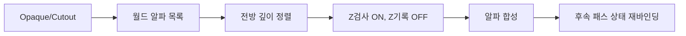

<callout icon="✅" color="green_bg">
	**09 보완 · 완전한 53검사 C++11 CPU 실습 소스**
	2026-10-13 GCC·Clang·Clang ASan/UBSan 및 GCC C++20의 동일한 53검사, CTest 1/1 통과. 09 기존의 끊어진 분할 코드와 다른 새 독립 실습입니다. Windows/MSVC·실제 D3D9/GPU 미검증입니다.
</callout>
<file src="notion-file-block://fc2744c3-4319-45eb-9cbf-de0841f8fe9c/3404e862-bf7f-4111-9813-32af1c1e5eb3?space_id=815d1335-3b56-43a7-903b-d7addf097c9f&name=dx9_09c_integrated_cpu_full_sources.md">dx9_09c_integrated_cpu_full_[sources.md](http://sources.md) — 전체 C++ 코드·CMake·검증</file>
<callout icon="🎆" color="blue_bg">
	**DX9 09 · 알파 블렌딩·알파 테스트·빌보드·이펙트**
	2026-10-13 · 기존 강의 메모를 심화 개정. 과거의 ‘50검사’ 표기는 현재 회수한 실행 파일의 48조건과 일치하지 않아 검증 완료 근거로 사용하지 않습니다. 아래 대형 소스 전사는 과거 미완성 기록입니다. 회수한 48조건 원형 전체는 09D, 별도 새 독립 53조건 실습은 위 09C 첨부를 사용합니다. 하위 09A/09B에서 8개·12개 조건을 새로 실제 검증했고 실행한 전체 미니 소스를 보존했습니다. Windows/D3D9/GPU 실행은 미검증입니다.
</callout>
## 기본 구분
**Opaque:** 깊이 검사/기록 ON, 블렌딩 OFF. **Cutout:** 픽셀 알파 임계값으로 폐기 여부를 결정하고 통과한 픽셀만 깊이를 기록할 수 있습니다. **Translucent:** 깊이 검사를 유지하되 기록은 대개 끄고, 기존 프레임 버퍼 색과 혼합합니다. **Additive:** 광채·불꽃과 같은 효과의 색 가산 정책입니다.
## 정리 범위
Straight/Premultiplied Alpha 수식, 알파 테스트의 AlphaRef 경계, 뒤→앞 정렬의 한계, Spherical/Cylindrical Billboard의 축과 특이점, 파티클 수명과 렌더 상태 관리, CPU 검증 및 재현 방법을 본문으로 다룹니다. 현행 학습 내용과 재현 소스는 09C·09D·09A·09B로 분리해 보존하며, 아래 과거 분할 전사는 변경 이력으로만 남깁니다.
## 검증과 출처
<mention-date start="2026-10-16"/> 실제 회수 파일 재검증: <mention-page url="https://app.notion.com/p/3fba99703f4081488757dd767cceacb2">09D · 과거 48조건 알파·빌보드 소스 보관본</mention-page>의 과거 원형은 48조건입니다. GCC C++20·GCC C++11·Clang ASan/UBSan에서 같은 48조건과 별도 미니 8·12조건을 각각 통과했습니다. 배치 CTest는 구성별 3/3이며, 09D에 게시한 원형 전용 CMake도 1/1 통과했습니다. 전체 원형 소스·빌드 안내·결과를 09D에 보관했습니다. 실제 GPU 실행 검증은 아닙니다.
[Microsoft Alpha Blending State](https://learn.microsoft.com/en-us/windows/win32/direct3d9/alpha-blending-state)
[Microsoft Alpha Testing State](https://learn.microsoft.com/en-us/windows/win32/direct3d9/alpha-testing-state)
## RGB 합성식과 입력 표현
Straight Alpha RGB 합성은 Source×Alpha + Destination×(1−Alpha)입니다. Premultiplied Alpha는 Source가 이미 알파와 곱해져 있으므로 Source + Destination×(1−Alpha)입니다. 장치에서 SRCBLEND와 DESTBLEND를 데이터 표현에 맞추지 않으면 색과 경계가 깨집니다. D3D9의 상태 기본값과 일반적인 투명 렌더링 관행은 구분해서 설명해야 합니다.
## Straight·Premultiplied·Additive 상태 계약
Straight Alpha: RGB = Source×alpha + Destination×(1−alpha). D3D9의 대표 인자는 SRCBLEND=SRCALPHA, DESTBLEND=INVSRCALPHA입니다. 배경 RGB=(0.2,0.4,0.6), 빨강=(1,0,0), a=0.25를 합성하면 (0.4,0.3,0.45)가 됩니다.
Premultiplied Alpha는 입력 RGB가 이미 알파와 곱해져 있으므로 SourcePremult + Destination×(1−alpha)이며 SRCBLEND=ONE, DESTBLEND=INVSRCALPHA를 사용합니다. Additive의 한 예는 Source×alpha + Destination이며 SRCBLEND=SRCALPHA, DESTBLEND=ONE입니다. 알파 채널 자체의 저장 값은 RGB와 별개의 blend 규칙 및 렌더타깃 포맷에 따라 달라집니다.
## 픽셀 폐기와 깊이 기록은 다른 결정
D3DRS_ALPHATESTENABLE=TRUE, ALPHAFUNC=D3DCMP_GREATEREQUAL, ALPHAREF=1이면 알파 0은 폐기, 1 이상은 통과합니다. ALPHAREF는 0\~255 범위의 하위 8비트를 사용합니다. 지원되는 비교 기능은 GetDeviceCaps 결과의 AlphaCmpCaps로 확인합니다.
컷아웃은 혼합 대신 픽셀을 통과/폐기하며 통과한 픽셀에서 Z 기록이 가능하므로 잎·울타리 등 경계가 선명한 마스크에 사용합니다. 반면 색상 혼합이 설정되고 알파가 0이어도 ZWRITE가 켜져 있다면 깊이 버퍼를 기록하여 뒤 물체를 가릴 수 있습니다. 깊이 검사, 깊이 기록, 알파 비교, 알파 혼합은 서로 다른 상태입니다.
## 뒤→앞 정렬의 수학과 한계
배경 (0.2,0.4,0.6) 위에 먼 빨강(alpha=.5)을 그린 다음 가까운 파랑(alpha=.5)을 그리면 RGB=(0.3,0.1,0.65)입니다. 순서를 바꾸면 결과가 달라집니다. 일반 알파 혼합은 교환법칙이 성립하지 않습니다.
카메라 전방 축에 대한 투영값 dot(center−camera, cameraForward)을 내림차순 정렬 키로 사용할 수 있습니다. 카메라에서의 단순 유클리드 거리는 화면의 깊이와 같지 않습니다. 이 정렬은 객체 중심의 단일 깊이만 보므로 교차하거나 길게 뻗은 메시의 삼각형 순서를 완전히 보장하지 못합니다. 안정적인 동률 처리와 객체 수명 검사도 필요합니다.
## Spherical Billboard와 Cylindrical Billboard
Spherical: facing=normalize(camera−center), right=normalize(cross(worldUp,facing)), up=cross(facing,right). 면의 법선을 카메라 위치로 향하게 하는 방식입니다. facing과 worldUp이 평행해지면 외적이 0에 가까우므로 대체 보조 축을 선택하거나 이전 유효 회전을 유지하는 정책이 필요합니다.
Cylindrical: 월드 Y축은 유지하고 facing의 XZ 성분만을 정규화합니다. 나무·기둥 스프라이트 등에 적합하지만 카메라가 정수직 위에 있으면 XZ 투영이 0이 되어 예외 처리가 필요합니다. 네 모서리는 Center ± Right×HalfWidth ± Up×HalfHeight로 만듭니다. 정점 winding과 컬링 설정은 실제 배열에 맞춰 검증합니다.
## 파티클 수명과 렌더 패스
Tick/LateTick에서 생성·시간 적분·수명 만료를 처리하고 Renderer에는 이번 프레임에 살아 있는 파티클의 드로우 요청만 제출합니다. 만료된 객체를 렌더 큐의 원시 포인터로 계속 참조하지 않도록 세대 핸들 또는 삭제 지연 계약을 명시합니다.
불꽃(Additive), 연기(Straight/Premultiplied), 나뭇잎(Cutout)은 각자 다른 Z·Blend·AlphaTest 계약으로 묶어야 합니다. 전역 RenderState는 Draw 뒤에도 유지되므로 패스 시작 시 깊이·알파·텍스처·셰이더 상태를 모두 선언하고 이후 패스에서 다시 바인딩합니다. 동적 VB/IB의 DISCARD/NOOVERWRITE는 이전 06 문서를 참고합니다.
## 검증 범위와 이식 조건
검증 수를 구분합니다. 이번에 실제 회수·재실행한 alpha_billboard.cpp는 RGB 합성·정렬·알파 경계·깊이·축 특이점의 48조건 원형이며 09D에 보존했습니다. 09A/09B는 각각 8/12조건, 09C는 별도로 작성한 53조건 실습입니다. 과거 ‘50조건’ 서술을 이 파일들의 실제 검사 수로 간주하지 않습니다. 원형의 유한 좌표·깊이·RGB 입력 전제와 새 실습의 검증 범위를 각 보관 문서에서 확인합니다.
실제 Windows/MSVC·D3D9 GPU·FXC/HLSL·sRGB·MSAA·하드웨어 깊이 정밀도는 미검증입니다. CPU 모델은 단일 픽셀·선형 RGB·double 계산이며 GPU 결과와 완전히 같다고 보장하지 않습니다.
## 월드 투명 렌더 흐름
Opaque/Cutout 깊이 기록 → 투명 Draw 요청 수집 → 카메라 깊이 정렬 → Z 검사 ON·Z 기록 OFF → 일반 Alpha 합성 → 가산형 이펙트 → UI 패스에서 상태 재지정. 만료 파티클의 핸들은 그리기 전에 검증합니다.
## Billboard 흐름
Particle Center → Camera-Center → Spherical 또는 Cylindrical 축 계산 → Center ± halfWidth×right ± halfHeight×up → 월드/뷰/투영 → Draw. 축 정규화가 실패하는 특이점은 별도로 처리합니다.
## 패스별 상태 비교
<table fit-page-width="true" header-row="true">
<tr>
<td>종류</td>
<td>Z test</td>
<td>Z write</td>
<td>Alpha test</td>
<td>Blend</td>
</tr>
<tr>
<td>Opaque</td>
<td>ON</td>
<td>ON</td>
<td>OFF</td>
<td>OFF</td>
</tr>
<tr>
<td>Cutout</td>
<td>ON</td>
<td>ON</td>
<td>ON</td>
<td>보통 OFF</td>
</tr>
<tr>
<td>Translucent</td>
<td>ON</td>
<td>보통 OFF</td>
<td>효과별</td>
<td>ON</td>
</tr>
<tr>
<td>Additive</td>
<td>ON</td>
<td>보통 OFF</td>
<td>효과별</td>
<td>ON</td>
</tr>
</table>
이는 하나의 예시이며 모든 게임에 강제되는 규칙이 아닙니다.
<details>
<summary>Q1. 알파가 0이면 뒤의 물체가 자동으로 보이는가?</summary>
	아닙니다. RGB는 변하지 않아도 ZWRITE가 켜져 있으면 깊이가 갱신될 수 있습니다. 컷아웃 폐기 또는 ZWRITE 끄기 정책을 적용합니다.
</details>
<details>
<summary>Q2. Cutout과 Translucent는 무엇이 다른가?</summary>
	Cutout은 통과/폐기 조건, Translucent는 기존 프레임 버퍼와 RGB를 혼합하는 규칙입니다.
</details>
## 공식 문서·변경 기록
[Alpha Blending State](https://learn.microsoft.com/en-us/windows/win32/direct3d9/alpha-blending-state) · [Alpha Testing State](https://learn.microsoft.com/en-us/windows/win32/direct3d9/alpha-testing-state) · [Render States](https://learn.microsoft.com/en-us/windows/win32/direct3d9/d3drenderstatetype) · [Render Target Alpha](https://learn.microsoft.com/en-us/windows/win32/direct3d9/render-target-alpha). 2026-10-13 개정: 알파 혼합·폐기·깊이 기록·카메라 facing의 조건을 분리했습니다. 다음: DX9 셰이더·Frustum.
```c++
// D3D9 상태 예시: 각 HRESULT와 AlphaCmpCaps는 실행 환경에서 검증한다.
device->SetRenderState(D3DRS_ALPHATESTENABLE, TRUE);
device->SetRenderState(D3DRS_ALPHAREF, 1);
device->SetRenderState(D3DRS_ALPHAFUNC, D3DCMP_GREATEREQUAL);
// 이후 후속 패스에서는 ALPHATESTENABLE을 명시적으로 FALSE로 설정한다.
```

## 과거 분할 전사 기록 · 현행 소스로 사용하지 않음
이하 13개 코드 블록은 2026-10-13 작성 중 남은 **과거 편집 기록**입니다. 당시 본문에는 ‘미완성 전사’와 ‘모든 원본 바이트 포함’이라는 서로 모순되는 설명이 함께 남았으므로, 이 블록들을 합쳐 재현 가능한 전체 소스로 취급하지 않습니다. 삭제하지 않고 변경 이력으로만 보존합니다.
현재 재현 기준은 목적에 따라 구분합니다. 과거 실행 파일을 그대로 확인하려면 <mention-page url="https://app.notion.com/p/3fba99703f4081488757dd767cceacb2">09D · 과거 48조건 알파·빌보드 소스 보관본</mention-page>, 새 통합 실습은 이 페이지 상단의 09C 53조건 첨부, 최소 재현은 09A·09B의 8·12조건 전체 소스를 사용합니다. 아래 분할 블록의 과거 FNV·바이트 수는 현행 검증 근거로 사용하지 않습니다.
### alpha_billboard.cpp / 1 of 13
```c++
#include <algorithm>
#include <cmath>
#include <cstdint>
#include <iostream>
#include <stdexcept>
#include <vector>

// Educational CPU reference model, NOT a Direct3D implementation.
// RGB arithmetic here is assumed linear, infinite precision, and single-sample.
struct Vec3 { double x, y, z; };
Vec3 operator+(Vec3 a, Vec3 b) { return {a.x+b.x,a.y+b.y,a.z+b.z}; }
Vec3 operator-(Vec3 a, Vec3 b) { return {a.x-b.x,a.y-b.y,a.z-b.z}; }
Vec3 operator*(Vec3 a, double s) { return {a.x*s,a.y*s,a.z*s}; }
double dot(Vec3 a, Vec3 b) { return a.x*b.x+a.y*b.y+a.z*b.z; }
Vec3 cross(Vec3 a, Vec3 b) {
```
### alpha_billboard.cpp / 2 of 13
```c++
    return {a.y*b.z-a.z*b.y,a.z*b.x-a.x*b.z,a.x*b.y-a.y*b.x};
}
Vec3 normalized(Vec3 v) {
    const double len2=dot(v,v);
    if (len2 < 1e-20) throw std::invalid_argument("zero-length basis");
    return v*(1.0/std::sqrt(len2));
}
bool nearly(double a, double b) { return std::fabs(a-b)<1e-9; }
bool close(Vec3 a, Vec3 b) { return nearly(a.x,b.x)&&nearly(a.y,b.y)&&nearly(a.z,b.z); }

struct RGB { double r,g,b; };
RGB operator*(RGB c, double s) { return {c.r*s,c.g*s,c.b*s}; }
RGB operator+(RGB a, RGB b) { return {a.r+b.r,a.g+b.g,a.b+b.b}; }
bool close(RGB a, RGB b) { return nearly(a.r,b.r)&&nearly(a.g,b.g)&&nearly(a.b,b.b); }
```
### alpha_billboard.cpp / 3 of 13
```c++
RGB straight(RGB src, double alpha, RGB dst) {
    if (alpha < 0 || alpha > 1) throw std::out_of_range("alpha");
    return src*alpha+dst*(1.0-alpha);
}
RGB premultiplied(RGB src_times_alpha, double alpha, RGB dst) {
    if (alpha < 0 || alpha > 1) throw std::out_of_range("alpha");
    return src_times_alpha+dst*(1.0-alpha);
}
RGB additive(RGB src, double alpha, RGB dst) {
    if (alpha < 0 || alpha > 1) throw std::out_of_range("alpha");
    return src*alpha+dst;
}

struct Pixel { RGB rgb; double depth; };
struct States { bool depthTest, depthWrite, alphaTest, blending; unsigned alphaRef; };
```
### alpha_billboard.cpp / 4 of 13
```c++
bool alpha_pass(std::uint8_t incomingAlpha, unsigned ref, bool greaterEqual) {
    if (ref>255) throw std::out_of_range("ALPHAREF is 8-bit");
    return greaterEqual?incomingAlpha>=ref:incomingAlpha>ref;
}
// A simplified ZFUNC=LESSEQUAL, one opaque or cutout fragment.
bool draw_cutout(Pixel& p, RGB color, double z, std::uint8_t a,
                 const States& s, bool greaterEqual) {
    if (s.alphaTest && !alpha_pass(a,s.alphaRef,greaterEqual)) return false;
    if (s.depthTest && z>p.depth) return false;
    p.rgb=color;
    if(s.depthWrite) p.depth=z;
    return true;
}
```
### alpha_billboard.cpp / 5a of 13
```c++
// A simplified translucent fragment that still does a depth comparison.
bool draw_translucent(Pixel& p, RGB src, double z, double alpha, const States& s) {
    if(!s.blending) throw std::logic_error("blending disabled");
    if(s.depthTest && z>p.depth) return false;
    p.rgb=straight(src,alpha,p.rgb);
    if(s.depthWrite) p.depth=z;  // Emulates the common erroneous state too.
    return true;
}
```
### alpha_billboard.cpp / 5b of 13
```c++
struct BillboardAxes { Vec3 right,up,facing; };
// Spherical: the quad's normal points exactly from its center to the camera.
// Reject exact/near parallel facing and world-up as an ambiguous input.
```
### alpha_billboard.cpp / 6.1
```c++
BillboardAxes spherical(Vec3 center, Vec3 camera, Vec3 worldUp={0,1,0}) {
    const Vec3 facing=normalized(camera-center);
    const Vec3 right=normalized(cross(normalized(worldUp),facing));
    const Vec3 up=normalized(cross(facing,right));
    return {right,up,facing};
}
```
### alpha_billboard.cpp / 6.2
```c++
// Cylindrical: preserve global Y axis; rotate about Y only.
BillboardAxes cylindrical(Vec3 center, Vec3 camera) {
    const Vec3 delta=camera-center;
    const Vec3 facing=normalized(Vec3{delta.x,0,delta.z});
    const Vec3 up={0,1,0};
    return {normalized(cross(up,facing)),up,facing};
}
struct Quad { Vec3 p0,p1,p2,p3; };
```
### alpha_billboard.cpp / 7.1
```c++
Quad make_quad(Vec3 c, BillboardAxes axes, double width,double height) {
    if(width<=0||height<=0) throw std::invalid_argument("nonpositive size");
    const Vec3 r=axes.right*(width/2), u=axes.up*(height/2);
    return {c-r-u,c+r-u,c+r+u,c-r+u};
}
struct Sprite { int id; Vec3 center; };
```
### alpha_billboard.cpp / 7.2a
```c++
// Camera-forward projected depth, not Euclidean distance. Stable tie handling.
void sort_back_to_front(std::vector<Sprite>& objects,Vec3 camera,Vec3 forward) {
```
### alpha_billboard.cpp / 7.2b
```c++
const Vec3 f=normalized(forward);
std::stable_sort(objects.begin(),objects.end(),[&](const Sprite& a,const Sprite& b) {
```
### alpha_billboard.cpp / 7.3
```c++
    return dot(a.center-camera,f)>dot(b.center-camera,f);
});
```
### alpha_billboard.cpp / 8.1
```c++
}
int main() {
    unsigned checks=0;
#define CHECK(cond) do { ++checks; if(!(cond)) throw std::runtime_error(#cond); } while(false)
    const RGB bg{0.2,0.4,0.6}, red{1,0,0}, blue{0,0,1};
    CHECK(close(straight(red,0,bg),bg));
    CHECK(close(straight(red,1,bg),red));
```
### alpha_billboard.cpp / 8.2.1
```c++
CHECK(close(straight(red,0.25,bg),RGB{0.4,0.3,0.45}));
CHECK(close(premultiplied(red*0.25,0.25,bg),straight(red,0.25,bg)));
```
### alpha_billboard.cpp / 8.2.2
```c++
CHECK(close(additive(red,0.5,bg),RGB{0.7,0.4,0.6}));
bool invalid=false; try { (void)straight(red,-0.1,bg); } catch(const std::out_of_range&) {invalid=true;}
```
### alpha_billboard.cpp / 8.2.3
```c++
CHECK(invalid);
```
### alpha_billboard.cpp / 9.1.1
```c++
RGB far_then_near=straight(blue,0.5,straight(red,0.5,bg));
RGB near_then_far=straight(red,0.5,straight(blue,0.5,bg));
```
### alpha_billboard.cpp / 9.1.2
```c++
CHECK(close(far_then_near,RGB{0.3,0.1,0.65}));
CHECK(!close(far_then_near,near_then_far));
CHECK(close(additive(red,0.5,additive(blue,0.5,bg)),
```
### alpha_billboard.cpp / 9.2.1aa
```c++
additive(blue,```
```
### alpha_billboard.cpp / 9.2.1ab
```c++
0.5,additive(red,0.5,bg))));

```
### alpha_billboard.cpp / 9.2.1b
```c++
CHECK(!alpha_pass(0,1,true));
CHECK(alpha_pass(1,1,true));
CHECK(!alpha_pass(1,1,false));
```
### alpha_billboard.cpp / 9.2.2
```c++
CHECK(alpha_pass(2,1,false));
CHECK(alpha_pass(255,255,true));
CHECK(!alpha_pass(254,255,true));
```
### alpha_billboard.cpp / 10.1.1
```c++
invalid=false;try{(void)alpha_pass(5,256,true);}catch(const std::out_of_range&){invalid=true;}
CHECK(invalid);
const States cutout{true,true,true,false,1};
```
### alpha_billboard.cpp / 10.1.2aa
```c++
Pixel p{bg,0.6};
CHECK(!```
```
### alpha_billboard.cpp / 10.1.2ab
```c++
draw_cutout(p,red,0.2,0,cutout,tr```
```
### alpha_billboard.cpp / 10.1.2b
```c++
ue));
    CHECK(close(p.rgb,bg));
    CHECK(nearly(p.depth,0.6));
```
### alpha_billboard.cpp / 10.2.1
```c++
CHECK(draw_cutout(p,red,0.2,255,cutout,true));
CHECK(nearly(p.depth,0.2));
CHECK(!draw_cutout(p,blue,0.5,255,cutout,true));
CHECK(close(p.rgb,red));
```
### alpha_billboard.cpp / 10.2.2a
```c++
const States alpha{true,false,false,true,0};
Pixel q{bg,0.6};
```
### alpha_billboard.cpp / 10.2.2b
```c++
CHECK(draw_translucent(q,red,0.3,0.5,alpha));
CHECK(nearly(q.depth,0.6));
```
### alpha_billboard.cpp / 11.1.1
```c++
CHECK(close(q.rgb,RGB{0.6,0.2,0.3}));
CHECK(!draw_translucent(q,blue,0.9,0.5,alpha));
CHECK(close(q.rgb,RGB{0.6,0.2,0.3}));
```
### alpha_billboard.cpp / 11.1.2
```c++
// Transparent with alpha=0 still writes Z if ZWRITE is accidentally on.
const States bad{true,true,false,true,0};
Pixel wrong{bg,0.9};
```
### alpha_billboard.cpp / 11.2.1
```c++
CHECK(draw_translucent(wrong,red,0.2,0,bad));
CHECK(close(wrong.rgb,bg));
CHECK(nearly(wrong.depth,0.2));
CHECK(!draw_cutout(wrong,blue,0.4,255,cutout,true));
```
### alpha_billboard.cpp / 11.2.2a
```c++

BillboardAxes sph=spherical({0,0,0},{0,0,10});
```
<page url="https://app.notion.com/p/3f8a99703f40814abaa3d01b697f2337">09A · 알파 테스트·깊이 기록 재현 — 검증된 C++11 미니 실습</page>
<page url="https://app.notion.com/p/3f8a99703f40813eae59d32100d7ebdc">09B · Billboard 축·카메라 깊이 정렬 — 검증된 C++11 미니 실습</page>
<page url="https://app.notion.com/p/3fba99703f4081488757dd767cceacb2">09D · 과거 48조건 알파·빌보드 소스 보관본</page>
