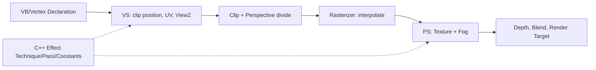
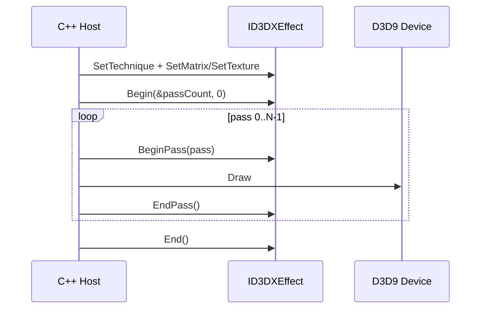

<callout icon="🧪" color="green_bg">
	DX9 구현 학습 10 · Shader/Effect v1.0 · 2026-10-13. 독립 CPU 모델은 실제 검증했지만 Direct3D9/HLSL GPU 실행은 미검증.
</callout>
## 1. 셰이더의 단계와 정의
**Vertex Shader(VS)**는 정점 입력을 변환하여 클립 공간 POSITION과 보간할 값(TEXCOORD/COLOR)을 출력한다. **래스터라이저**가 클리핑·투영 나눗셈·삼각형의 픽셀 후보 생성과 속성 보간을 담당한다. **Pixel Shader(PS)**는 이 보간 결과와 샘플러/상수를 받아 픽셀 후보의 색을 계산한다. “픽셀 셰이더가 정점마다 색을 계산하고 삼각형을 래스터화한다”는 설명은 잘못이다.
**Effect(.fx)**는 D3DX9의 레거시 Technique·Pass·Shader·RenderState 묶음이며 D3D9 셰이더 사용에 필수는 아니다. “셰이더로 그리면 디바이스 바인딩이 모두 무시된다”는 설명도 틀리다. 정점 선언, 스트림, 텍스처, 상수, 깊이, 블렌딩 상태의 계약은 유지된다.

## 2. 좌표·semantic·보간 계약
<table fit-page-width="true" header-row="true">
<tr>
<td>구분</td>
<td>핵심 규칙</td>
</tr>
<tr>
<td>VB → VS</td>
<td>정점 선언의 usage/index가 POSITION0/TEXCOORD0과 호환되어야 한다.</td>
</tr>
<tr>
<td>VS 출력</td>
<td>D3D9에서 POSITION0은 동차 clip space의 float4다. 행 벡터라면 mul(position, WorldViewProjection).</td>
</tr>
<tr>
<td>PS 입력</td>
<td>VS의 TEXCOORDn/COLORn 등과 semantic을 맞춘 보간값. POSITION0을 보통의 픽셀 입력이라고 가정하지 않는다.</td>
</tr>
<tr>
<td>PS 출력</td>
<td>D3D9 COLOR0. D3D10 이후의 SV_Position/SV_Target과 구분한다.</td>
</tr>
<tr>
<td>후처리</td>
<td>출력 색 이후 깊이 판정·블렌딩 등 상태가 적용된다.</td>
</tr>
</table>
클립 좌표 (x,y,z,w)의 기본 조건은 양의 w와 -w≤x≤w, -w≤y≤w, 0≤z≤w이다. 원근 보정 보간은 화면 공간 barycentric λ와 정점의 clip w를 사용해 `a = sum(λᵢ aᵢ / wᵢ) / sum(λᵢ / wᵢ)`로 계산한다. λ=(1/3,1/3,1/3), w=(1,2,4), U=(0,1,0)이면 U=2/7이며 단순 평균 1/3이 아니다. 실제 GPU의 삼각형 클리핑을 이 CPU 모델은 구현하지 않는다.
## 3. Effect 호출 및 자원 수명

Begin/End와 BeginPass/EndPass는 반드시 쌍을 맞춘다. Pass 내에서 Effect::SetX로 상수를 변경한 뒤에는 CommitChanges가 필요하다. 여러 Pass도 유효하며 “1 Pass만 사용해야 한다”는 규칙은 없다. `ID3DXEffect::OnLostDevice`는 Reset 전, `OnResetDevice`는 성공한 Reset 후 호출한다. DEFAULT 풀 버퍼 등은 별도의 수명 계약에 따라 재구성한다. API HRESULT 및 장치 caps를 점검한다.
## 4. 복사 가능한 DX9 Effect/HLSL 예제
이 HLSL은 `vs_2_0 / ps_2_0`을 목표로 작성했지만 FXC·D3DX로 실제 컴파일하지 않았다. 행렬 업로드 시 CPU/D3DX 저장·전치 규약과 HLSL mul(row,matrix)가 일치하는지 실제 Windows 환경에서 확인한다.
```plain text
// shader_contract.fx — legacy Direct3D9 Effect sample
float4x4 gWorldViewProj;
float4x4 gWorldView;
float4 gFogColor = float4(0.2,0.3,0.4,1);
float gFogStart = 2.0f, gFogEnd = 8.0f;
texture gDiffuseTexture;
sampler2D DiffuseSampler = sampler_state {
    Texture = <gDiffuseTexture>;
    MinFilter=LINEAR; MagFilter=LINEAR; MipFilter=LINEAR;
    AddressU=WRAP; AddressV=WRAP;
};
struct VS_IN { float4 pos:POSITION0; float2 uv:TEXCOORD0; };
struct VS_OUT { float4 clip:POSITION0; float2 uv:TEXCOORD0; float viewZ:TEXCOORD1; };
struct PS_IN { float2 uv:TEXCOORD0; float viewZ:TEXCOORD1; };
VS_OUT VSMain(VS_IN a) {
    VS_OUT b;
    b.clip=mul(a.pos,gWorldViewProj);
    b.uv=a.uv;
    b.viewZ=mul(a.pos,gWorldView).z;
    return b;
}
float4 PSMain(PS_IN a):COLOR0 {
    float4 tex=tex2D(DiffuseSampler,a.uv);
    float keep=saturate((gFogEnd-a.viewZ)/max(gFogEnd-gFogStart,0.0001f));
    return float4(lerp(gFogColor.rgb,tex.rgb,keep),tex.a);
}
technique FoggedTextured {
 pass P0 {
  VertexShader=compile vs_2_0 VSMain();
  PixelShader=compile ps_2_0 PSMain();
  ZEnable=TRUE; ZWriteEnable=TRUE; AlphaBlendEnable=FALSE;
 }
}
```
Fog는 카메라 공간 Z 기반의 **사용자 정의 선형 안개**다. D3D9 고정 기능 Fog와 동일하다고 가정하지 말 것. `gFogEnd > gFogStart`를 호스트가 검증하며, alpha는 텍스처 값 그대로 보존한다.
## 5. 전체 검증 소스·빌드·결과
다음 첨부는 실제 빌드·실행한 `main.cpp`의 **전체 7339바이트 텍스트**다. 파일을 `main.cpp`로 저장해 컴파일한다.
<file src="notion-file-block://85586c53-20b7-4cad-a44a-e43e83ccff65/d27e1c71-8e7a-4344-80df-77866ae8ab6d?space_id=815d1335-3b56-43a7-903b-d7addf097c9f&name=dx9_shader10_cpu_main.txt">main.cpp — 전체 CPU 실습 소스</file>
```plain text
cmake_minimum_required(VERSION 3.16)
project(dx9_shader_contract_cpu LANGUAGES CXX)
add_executable(shader_cpu main.cpp)
target_compile_features(shader_cpu PRIVATE cxx_std_20)
if(CMAKE_CXX_COMPILER_ID MATCHES "GNU|Clang")
  target_compile_options(shader_cpu PRIVATE -Wall -Wextra -Wpedantic)
endif()
enable_testing()
add_test(NAME shader_contract_cpu COMMAND shader_cpu)
```
```bash
g++ -std=c++20 -O2 -Wall -Wextra -Wpedantic main.cpp -o shader_cpu && ./shader_cpu
cmake -S . -B build && cmake --build build && ctest --test-dir build --output-on-failure
clang++ -std=c++20 -O1 -g -fsanitize=address,undefined -fno-omit-frame-pointer main.cpp -o shader_san && ./shader_san
```
<table fit-page-width="true" header-row="true">
<tr>
<td>환경</td>
<td>검증</td>
</tr>
<tr>
<td>GCC 14.2 · C++20 · Linux x86-64</td>
<td>CPU 모델 34개 명시 검사 PASS</td>
</tr>
<tr>
<td>Clang 17 · C++20</td>
<td>동일한 34개 PASS</td>
</tr>
<tr>
<td>Clang 17 · ASan/UBSan</td>
<td>동일한 34개 PASS, 진단 없음</td>
</tr>
<tr>
<td>CMake 3.31.6 / CTest</td>
<td>1/1 PASS</td>
</tr>
<tr>
<td>Windows/MSVC, FXC, D3D9/GPU</td>
<td>미실행·미검증</td>
</tr>
</table>
CPU 원본 파일: SHA256 `6a3ec20edb17657ced8a261515b9d09cb09d2bafbb4dfa916b726fef949abb3e`, FNV-1a32 `e63de3cd`. 동일한 34개를 여러 환경에서 실행했으며 독립 검사 102개로 합산하지 않는다. C++20 학습 기준, `std::clamp`는 C++17에 도입되었고 전체 C++11 빌드는 미검증이다.
## 6. 게임 적용·실수와 별도 Windows 검증
컴포넌트는 Effect 자원·Technique·파라미터의 소유권을, Renderer는 정점 입력·Pass·Draw·상태 복구의 실행 계약을 갖도록 설계할 수 있다. 이는 가능한 학습용 책임 분리이지 회사 엔진의 수정 지시가 아니다. 주의할 오류는 **D3D9 PS가 정점 단위로 호출된다는 오해, VS/PS semantic 불일치, 행렬 방향·전치 문제, Effect State 자동 복원 가정, Lost Device/Reset 순서 오류, 셰이더 모델 미지원**이다.
Windows 수동 테스트: VertexDeclaration ↔ VS 입력, GetDeviceCaps의 vs/ps 모델, .fx 컴파일과 오류 메시지, World/View/Projection 행렬, Pass 상태와 HRESULT, tex2D 샘플러 및 상태 누수, Lost Device 재생성, 결과 색을 확인한다.
## 7. 이해 확인 (접힌 해설)
<details>
<summary>Q1. w=(1,2,4)이고 U=(0,1,0)이면 U는 왜 2/7인가?</summary>
	보간 기여를 1/w로 보정하면 (4/7,2/7,1/7)이다. U=1인 두 번째 정점의 기여는 2/7이 된다.
</details>
<details>
<summary>Q2. BeginPass 후에 Effect::SetMatrix를 다시 호출하면?</summary>
	Effect가 실제 GPU 상태에 반영하도록 CommitChanges가 필요하다. 모든 변경을 Begin 이전에 했으면 일반적으로 불필요하다.
</details>
<details>
<summary>Q3. CPU 34조건을 통과하면 D3D9 GPU도 검증된 것인가?</summary>
	아니다. CPU 행렬·clip 범위·원근 보간·Fog 수치 계약만 검증했다. 장치·셰이더 컴파일·래스터화·MSAA·정밀도·실행 상태는 미검증이다.
</details>
## 출처·변경 기록
- [Microsoft: Writing HLSL Shaders in Direct3D 9](https://learn.microsoft.com/en-us/windows/win32/direct3dhlsl/dx-graphics-hlsl-writing-shaders-9)
- [Microsoft: HLSL Semantics](https://learn.microsoft.com/en-us/windows/win32/direct3dhlsl/dx-graphics-hlsl-semantics)
- [Microsoft: Using an Effect](https://learn.microsoft.com/en-us/windows/win32/direct3d9/using-an-effect)
- [Microsoft: ID3DXEffect](https://learn.microsoft.com/en-us/windows/win32/direct3d9/id3dxeffect)
- [Microsoft: BeginPass / CommitChanges](https://learn.microsoft.com/en-us/windows/win32/direct3d9/id3dxeffect--beginpass)
2026-10-13 v1.0: 기존 수동 메모의 VS/PS 설명과 “바인딩 무시” 오류를 교정하고 공식 계약·CPU 독립 코드·검증·접힌 해설 추가. 원본과 01\~09 링크는 변경하지 않음. **다음: 11 Frustum 컬링(6평면·구·AABB)**. DX9 전체는 미완료.
