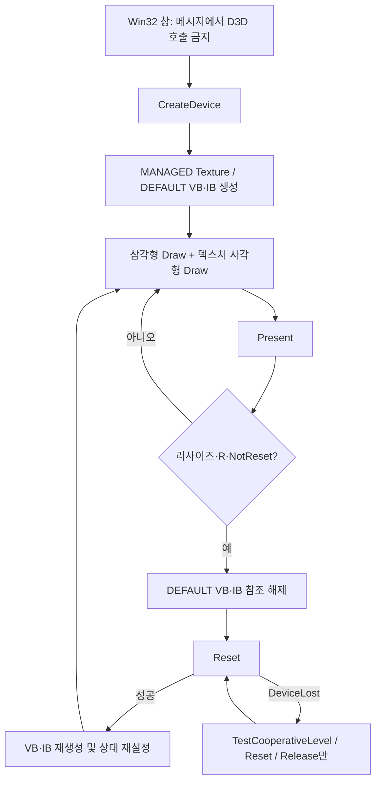

<callout icon="🎮" color="blue_bg">
	**통합 프로젝트 소스 작성 · Windows 실행은 미검증**
	<mention-date start="2026-10-16"/>. 이전 Clear/Present 창 예제를 넘어 VB·IB·색상 삼각형·절차 생성 텍스처 사각형·리사이즈·Reset을 연결하는 독립 프로젝트입니다. Windows 분기는 실제 컴파일·실행하지 않았습니다. 같은 파일의 CPU 데이터 검사 16개만 GCC C++20·C++11 및 Clang ASan/UBSan에서 통과했습니다. 두 결과를 혼동하지 않습니다.
</callout>
## 1. 이 예제로 연결하는 개념
장치를 만든 뒤 정점 7개와 인덱스 9개를 DEFAULT 풀의 VB/IB로 올립니다. 첫 Draw는 왼쪽 색상 삼각형, 두 번째 Draw는 오른쪽 체커 텍스처 사각형을 목표로 합니다. 64×64 텍스처는 파일을 읽지 않고 CPU에서 생성하여 MANAGED 풀에 저장합니다. 이 프로그램은 일반 IDirect3DDevice9이며 D3D9Ex가 아닙니다.
관찰할 핵심은 GPU 자원의 생성과 바인딩, 인덱스 범위, 텍스처 행 Pitch, 패스별 색상 연산, Reset 전후의 자원·상태 책임입니다. 이 최소 예제는 의도적으로 World/View/Projection을 모두 단위 행렬로 설정하고 z=0.5인 클립 범위 안 데이터를 사용합니다. 원근 카메라·조명·셰이더·알파·깊이 테스트·피킹 전체를 한 프로그램에 합친 엔진이 아닙니다. 창 비율을 바꾸면 도형 비율도 달라집니다.
## 2. 입력·출력과 빌드 조건
아래 main.cpp와 CMakeLists.txt를 같은 폴더에 저장합니다. 외부 에셋·D3DX·FXC·별도 DirectX SDK June 2010은 사용하지 않습니다. Windows SDK의 windows.h·d3d9.h·d3d9.lib와 C++ 컴파일러가 필요합니다. 기본 학습 표준은 C++20이며 사용한 소스의 C++11 CPU 호환 빌드도 확인했습니다. Windows 빌드의 실제 성공 여부는 별도 확인해야 합니다.
실행 목표는 어두운 배경에 왼쪽 RGB 삼각형과 오른쪽 노랑/파랑 체커 사각형을 보는 것입니다. R 키는 Reset 요청, Esc 또는 창 닫기는 종료 요청입니다. R이 실제 DeviceLost를 발생시키는 것은 아닙니다. 창 모드 Alt+Tab도 항상 장치 손실을 발생시키지 않습니다. 오류는 API 이름과 HRESULT를 메시지로 보여 줍니다. Windows에서 성공 종료 0, D3D 오류 1, 기타 초기화 오류 2를 사용합니다.
```powershell
cmake -S . -B build -A x64
cmake --build build --config Debug
ctest --test-dir build -C Debug --output-on-failure -V
.\build\Debug\dx9_demo.exe
```
CMake 생성기가 단일 구성인 경우 실행파일 위치가 build/dx9_demo.exe가 될 수 있습니다. C++11 호환 Windows 빌드는 구성 시 -DCMAKE_CXX_STANDARD=11을 추가하되 이번 실행에서는 수행하지 않았습니다.
## 3. 자원 수명과 상태 전이

단일 UI 스레드에서 생성·상태 확인·Reset·해제를 수행합니다. Reset 도중 윈도우 메시지가 재진입할 수 있으므로 WindowProc는 플래그만 바꿉니다. Reset 실패 뒤에는 불필요한 상태 바인딩 호출을 하지 않습니다. DeviceLost 이외 Reset 오류는 무한 재시도하지 않고 정리 후 종료합니다. DEFAULT 자원 재생성이 중간에 실패했을 때도 확보한 일부 VB/IB를 다음 Reset 전에 Release합니다. [Microsoft Reset](https://learn.microsoft.com/en-us/windows/win32/api/d3d9/nf-d3d9-idirect3ddevice9-reset)의 계약과 대조한 설계입니다.
MANAGED 텍스처는 일반 Reset에서 논리적 데이터를 유지하지만 장치 자체를 새로 만들면 재생성해야 합니다. [D3DPOOL](https://learn.microsoft.com/en-us/windows/win32/direct3d9/d3dpool)에서 DEFAULT와 MANAGED의 차이를 확인합니다. BeginScene 성공 이후 Draw가 실패해도 EndScene 정리를 시도하며 첫 오류를 보존합니다. COM 자원은 WindowOwner가 창을 파괴하기 전에 소멸하도록 범위를 정했습니다.
## 4. main.cpp — Windows 구현과 동일 데이터의 CPU 검사 전체
```c++
// DX9 12: one complete source; CPU data tests are NOT GPU tests.
#include <array>
#include <cstddef>
#include <cstdint>
#include <cstring>
#include <iostream>
#include <stdexcept>
#include <string>

struct Vertex { float x, y, z; std::uint32_t color; float u, v; };
static_assert(sizeof(float)==4 && sizeof(Vertex)==24, "FVF layout requires 24 bytes");
static_assert(offsetof(Vertex,color)==12 && offsetof(Vertex,u)==16, "FVF offsets");
const std::array<Vertex,7> kVertices = {{
    {-.90f,-.50f,.5f,0xffff4040u,0,1},
    {-.55f, .50f,.5f,0xff40ff40u,.5f,0},
    {-.20f,-.50f,.5f,0xff4040ffu,1,1},
    { .15f,-.50f,.5f,0xffffffffu,0,1},
    { .15f, .50f,.5f,0xffffffffu,0,0},
    { .85f,-.50f,.5f,0xffffffffu,1,1},
    { .85f, .50f,.5f,0xffffffffu,1,0}
}};
const std::array<std::uint16_t,9> kIndices = {{0,1,2,3,4,5,5,4,6}};
constexpr unsigned kTextureSize=64;
std::array<std::uint32_t,kTextureSize*kTextureSize> MakeChecker() {
    std::array<std::uint32_t,kTextureSize*kTextureSize> pixels{};
    for(unsigned y=0;y<kTextureSize;++y)
        for(unsigned x=0;x<kTextureSize;++x)
            pixels[y*kTextureSize+x]=((x/8+y/8)%2) ? 0xff3050c0u : 0xfff0d070u;
    return pixels;
}
bool DrawRangeFits(unsigned start,unsigned primitives,unsigned min,unsigned count) {
    if(count==0 || primitives==0 || min>=kVertices.size() || count>kVertices.size()-min)
        return false;
    if(start>kIndices.size() || primitives>(kIndices.size()-start)/3) return false;
    for(unsigned i=start;i<start+primitives*3;++i)
        if(kIndices[i]<min || kIndices[i]>=min+count) return false;
    return true;
}

#if defined(_WIN32) && !defined(DX9_CPU_TEST)
#define WIN32_LEAN_AND_MEAN
#define NOMINMAX
#include <windows.h>
#include <d3d9.h>
#include <sstream>

struct D3DError : std::runtime_error {
    HRESULT code;
    D3DError(HRESULT hr,const char* where):std::runtime_error(where),code(hr) {}
};
void Require(HRESULT hr,const char* where) { if(FAILED(hr)) throw D3DError(hr,where); }
#define HR(call) Require((call),#call)

template<class T> class Com {
    T* p_=nullptr;
public:
    Com()=default;
    Com(const Com&)=delete;
    Com& operator=(const Com&)=delete;
    ~Com(){reset();}
    void reset(){T* old=p_;p_=nullptr;if(old)old->Release();}
    T** put(){reset();return &p_;}
    T* get()const{return p_;}
    T* operator->()const{return p_;}
};
struct Input { bool quit=false; bool forceReset=false; };
LRESULT CALLBACK WindowProc(HWND hwnd,UINT message,WPARAM wp,LPARAM lp) {
    Input* input=reinterpret_cast<Input*>(GetWindowLongPtrW(hwnd,GWLP_USERDATA));
    if(message==WM_NCCREATE) {
        input=static_cast<Input*>(reinterpret_cast<CREATESTRUCTW*>(lp)->lpCreateParams);
        SetWindowLongPtrW(hwnd,GWLP_USERDATA,reinterpret_cast<LONG_PTR>(input));
    }
    if(input) {
        if(message==WM_CLOSE){input->quit=true;return 0;}
        if(message==WM_KEYDOWN && wp==VK_ESCAPE){input->quit=true;return 0;}
        if(message==WM_KEYDOWN && wp=='R'){input->forceReset=true;return 0;}
    }
    if(message==WM_DESTROY){PostQuitMessage(0);return 0;}
    return DefWindowProcW(hwnd,message,wp,lp);
}
struct WindowOwner {
    HINSTANCE instance; HWND hwnd=nullptr; bool registered=false;
    explicit WindowOwner(HINSTANCE i):instance(i) {}
    ~WindowOwner(){if(hwnd && IsWindow(hwnd))DestroyWindow(hwnd);
        if(registered)UnregisterClassW(L"DX9TriangleQuad12",instance);}
};
class Demo {
    HWND hwnd_;
    Com<IDirect3D9> d3d_;
    Com<IDirect3DDevice9> device_;
    Com<IDirect3DVertexBuffer9> vb_;
    Com<IDirect3DIndexBuffer9> ib_;
    Com<IDirect3DTexture9> texture_;
    UINT width_=0,height_=0;
    bool ready_=false;
    D3DPRESENT_PARAMETERS Parameters(UINT w,UINT h)const {
        D3DPRESENT_PARAMETERS pp{};
        pp.Windowed=TRUE;pp.hDeviceWindow=hwnd_;pp.SwapEffect=D3DSWAPEFFECT_DISCARD;
        pp.BackBufferFormat=D3DFMT_UNKNOWN;pp.BackBufferWidth=w;pp.BackBufferHeight=h;
        pp.PresentationInterval=D3DPRESENT_INTERVAL_ONE;
        pp.EnableAutoDepthStencil=FALSE;
        return pp;
    }
    void CreateBuffers() {
        HR(device_->CreateVertexBuffer(static_cast<UINT>(sizeof(kVertices)),
            D3DUSAGE_WRITEONLY,D3DFVF_XYZ|D3DFVF_DIFFUSE|D3DFVF_TEX1,
            D3DPOOL_DEFAULT,vb_.put(),nullptr));
        void* data=nullptr;
        HR(vb_->Lock(0,static_cast<UINT>(sizeof(kVertices)),&data,0));
        std::memcpy(data,kVertices.data(),sizeof(kVertices));
        HR(vb_->Unlock());
        HR(device_->CreateIndexBuffer(static_cast<UINT>(sizeof(kIndices)),
            D3DUSAGE_WRITEONLY,D3DFMT_INDEX16,D3DPOOL_DEFAULT,ib_.put(),nullptr));
        HR(ib_->Lock(0,static_cast<UINT>(sizeof(kIndices)),&data,0));
        std::memcpy(data,kIndices.data(),sizeof(kIndices));
        HR(ib_->Unlock());
        ready_=true;
    }
    void CreateTexture() {
        HR(device_->CreateTexture(kTextureSize,kTextureSize,1,0,D3DFMT_A8R8G8B8,
            D3DPOOL_MANAGED,texture_.put(),nullptr));
        const auto pixels=MakeChecker();
        D3DLOCKED_RECT locked{};
        HR(texture_->LockRect(0,&locked,nullptr,0));
        if(!locked.pBits || locked.Pitch<static_cast<int>(kTextureSize*4)) {
            const HRESULT cleanup=texture_->UnlockRect(0);
            if(FAILED(cleanup))OutputDebugStringA("Texture cleanup UnlockRect failed\n");
            throw std::runtime_error("unsupported texture pitch");
        }
        for(unsigned y=0;y<kTextureSize;++y)
            std::memcpy(static_cast<unsigned char*>(locked.pBits)+
                static_cast<std::size_t>(y)*static_cast<unsigned>(locked.Pitch),
                pixels.data()+y*kTextureSize,kTextureSize*4);
        HR(texture_->UnlockRect(0));
    }
    void StateAndDraw() {
        D3DMATRIX identity{};
        identity._11=identity._22=identity._33=identity._44=1.0f;
        HR(device_->SetVertexShader(nullptr));HR(device_->SetPixelShader(nullptr));
        HR(device_->SetTransform(D3DTS_WORLD,&identity));
        HR(device_->SetTransform(D3DTS_VIEW,&identity));
        HR(device_->SetTransform(D3DTS_PROJECTION,&identity));
        D3DVIEWPORT9 viewport{0,0,width_,height_,0.0f,1.0f};
        HR(device_->SetViewport(&viewport));
        HR(device_->SetRenderState(D3DRS_LIGHTING,FALSE));
        HR(device_->SetRenderState(D3DRS_ZENABLE,D3DZB_FALSE));
        HR(device_->SetRenderState(D3DRS_ZWRITEENABLE,FALSE));
        HR(device_->SetRenderState(D3DRS_CULLMODE,D3DCULL_NONE));
        HR(device_->SetRenderState(D3DRS_ALPHABLENDENABLE,FALSE));
        HR(device_->SetRenderState(D3DRS_ALPHATESTENABLE,FALSE));
        HR(device_->SetRenderState(D3DRS_FOGENABLE,FALSE));
        HR(device_->SetRenderState(D3DRS_STENCILENABLE,FALSE));
        HR(device_->SetRenderState(D3DRS_SCISSORTESTENABLE,FALSE));
        HR(device_->SetRenderState(D3DRS_FILLMODE,D3DFILL_SOLID));
        HR(device_->SetRenderState(D3DRS_COLORWRITEENABLE,0x0f));
        HR(device_->SetFVF(D3DFVF_XYZ|D3DFVF_DIFFUSE|D3DFVF_TEX1));
        HR(device_->SetStreamSource(0,vb_.get(),0,sizeof(Vertex)));
        HR(device_->SetIndices(ib_.get()));
        HR(device_->SetTextureStageState(0,D3DTSS_TEXCOORDINDEX,0));
        HR(device_->SetTextureStageState(0,D3DTSS_TEXTURETRANSFORMFLAGS,D3DTTFF_DISABLE));
        HR(device_->SetTextureStageState(0,D3DTSS_COLOROP,D3DTOP_SELECTARG1));
        HR(device_->SetTextureStageState(0,D3DTSS_COLORARG1,D3DTA_DIFFUSE));
        HR(device_->SetTextureStageState(0,D3DTSS_ALPHAOP,D3DTOP_SELECTARG1));
        HR(device_->SetTextureStageState(0,D3DTSS_ALPHAARG1,D3DTA_DIFFUSE));
        HR(device_->SetTexture(0,nullptr));
        HR(device_->DrawIndexedPrimitive(D3DPT_TRIANGLELIST,0,0,3,0,1));
        HR(device_->SetTexture(0,texture_.get()));
        HR(device_->SetTextureStageState(0,D3DTSS_COLOROP,D3DTOP_MODULATE));
        HR(device_->SetTextureStageState(0,D3DTSS_COLORARG1,D3DTA_TEXTURE));
        HR(device_->SetTextureStageState(0,D3DTSS_COLORARG2,D3DTA_DIFFUSE));
        HR(device_->SetSamplerState(0,D3DSAMP_MINFILTER,D3DTEXF_POINT));
        HR(device_->SetSamplerState(0,D3DSAMP_MAGFILTER,D3DTEXF_POINT));
        HR(device_->SetSamplerState(0,D3DSAMP_MIPFILTER,D3DTEXF_NONE));
        HR(device_->SetSamplerState(0,D3DSAMP_ADDRESSU,D3DTADDRESS_CLAMP));
        HR(device_->SetSamplerState(0,D3DSAMP_ADDRESSV,D3DTADDRESS_CLAMP));
        HR(device_->DrawIndexedPrimitive(D3DPT_TRIANGLELIST,0,3,4,3,2));
        HR(device_->SetTexture(0,nullptr));
    }
public:
    Demo(HWND hwnd,UINT w,UINT h):hwnd_(hwnd) {
        if(w==0||h==0)throw std::invalid_argument("zero client size");
        *d3d_.put()=Direct3DCreate9(D3D_SDK_VERSION);
        if(!d3d_.get())throw std::runtime_error("Direct3DCreate9 returned null");
        auto pp=Parameters(w,h);
        HR(d3d_->CreateDevice(D3DADAPTER_DEFAULT,D3DDEVTYPE_HAL,hwnd,
            D3DCREATE_SOFTWARE_VERTEXPROCESSING,&pp,device_.put()));
        width_=w;height_=h;
        CreateTexture();CreateBuffers();
    }
    bool Frame(UINT w,UINT h,bool forceReset) {
        HRESULT cooperative=device_->TestCooperativeLevel();
        if(cooperative==D3DERR_DEVICELOST)return false;
        if(cooperative!=D3DERR_DEVICENOTRESET)Require(cooperative,"TestCooperativeLevel");
        if(forceReset || w!=width_ || h!=height_ || cooperative==D3DERR_DEVICENOTRESET || !ready_) {
            if(ready_) {
                HR(device_->SetStreamSource(0,nullptr,0,0));HR(device_->SetIndices(nullptr));
            }
            vb_.reset();ib_.reset();ready_=false;
            auto pp=Parameters(w,h);
            const HRESULT hr=device_->Reset(&pp);
            if(hr==D3DERR_DEVICELOST)return false;
            Require(hr,"Reset");
            width_=w;height_=h;
            CreateBuffers();
            OutputDebugStringA("DX9 Reset success: default VB/IB recreated\n");
        }
        HR(device_->Clear(0,nullptr,D3DCLEAR_TARGET,D3DCOLOR_XRGB(25,30,40),1.0f,0));
        HR(device_->BeginScene());
        try { StateAndDraw(); }
        catch(...) { if(FAILED(device_->EndScene()))OutputDebugStringA("EndScene cleanup failed\n"); throw; }
        HR(device_->EndScene());
        const HRESULT present=device_->Present(nullptr,nullptr,nullptr,nullptr);
        if(present==D3DERR_DEVICELOST)return false;
        Require(present,"Present");
        return true;
    }
};
int WINAPI wWinMain(HINSTANCE instance,HINSTANCE,PWSTR,int show) {
    Input input;
    WindowOwner window(instance);
    try {
        WNDCLASSW wc{};wc.lpfnWndProc=WindowProc;wc.hInstance=instance;
        wc.hCursor=LoadCursorW(nullptr,IDC_ARROW);wc.lpszClassName=L"DX9TriangleQuad12";
        if(!RegisterClassW(&wc))throw std::runtime_error("RegisterClassW failed");
        window.registered=true;
        window.hwnd=CreateWindowExW(0,wc.lpszClassName,L"DX9: triangle + checker quad (R: Reset, Esc: quit)",
            WS_OVERLAPPEDWINDOW,CW_USEDEFAULT,CW_USEDEFAULT,960,640,nullptr,nullptr,instance,&input);
        if(!window.hwnd)throw std::runtime_error("CreateWindowExW failed");
        ShowWindow(window.hwnd,show);
        RECT rect{};
        if(!GetClientRect(window.hwnd,&rect))throw std::runtime_error("GetClientRect failed");
        Demo demo(window.hwnd,static_cast<UINT>(rect.right),static_cast<UINT>(rect.bottom));
        while(!input.quit) {
            MSG msg{};
            while(PeekMessageW(&msg,nullptr,0,0,PM_REMOVE)) {
                if(msg.message==WM_QUIT){input.quit=true;break;}
                TranslateMessage(&msg);DispatchMessageW(&msg);
            }
            if(input.quit)break;
            if(IsIconic(window.hwnd)){Sleep(30);continue;}
            if(!GetClientRect(window.hwnd,&rect))throw std::runtime_error("GetClientRect failed");
            if(rect.right<=0||rect.bottom<=0){Sleep(30);continue;}
            const bool reset=input.forceReset;input.forceReset=false;
            try {
                if(!demo.Frame(static_cast<UINT>(rect.right),static_cast<UINT>(rect.bottom),reset))Sleep(30);
            } catch(const D3DError& e) {
                if(e.code==D3DERR_DEVICELOST){Sleep(30);continue;}
                throw;
            }
        }
    } catch(const D3DError& e) {
        std::ostringstream out;out<<e.what()<<"\nHRESULT=0x"<<std::hex<<static_cast<unsigned long>(e.code);
        MessageBoxA(window.hwnd,out.str().c_str(),"D3D9 failure",MB_OK|MB_ICONERROR);return 1;
    } catch(const std::exception& e) {
        MessageBoxA(window.hwnd,e.what(),"Initialization failure",MB_OK|MB_ICONERROR);return 2;
    }
    return 0;
}
#else
int main() {
    int checks=0;
    auto check=[&](bool ok,const char* name){++checks;if(!ok)throw std::runtime_error(name);};
    try {
        check(sizeof(kVertices)==168,"vertex bytes");
        check(sizeof(kIndices)==18,"index bytes");
        check(DrawRangeFits(0,1,0,3),"triangle range");
        check(DrawRangeFits(3,2,3,4),"quad range");
        check(!DrawRangeFits(3,3,3,4),"too many primitives");
        check(!DrawRangeFits(3,2,3,3),"wrong declared vertex range");
        check(!DrawRangeFits(10,1,0,3),"bad start");
        check(!DrawRangeFits(0,0,0,3),"zero draw policy");
        const auto pixels=MakeChecker();
        check(pixels.size()==4096,"pixel count");
        check(pixels[0]==0xfff0d070u,"checker origin");
        check(pixels[8]==0xff3050c0u,"checker next column tile");
        check(pixels[8*64]==0xff3050c0u,"checker next row tile");
        check(pixels[8*64+8]==pixels[0],"checker diagonal tile");
        bool clips=true,uv=true,opaque=true;
        for(const auto& v:kVertices){clips=clips&&v.x>=-1&&v.x<=1&&v.y>=-1&&v.y<=1&&v.z>=0&&v.z<=1;
            uv=uv&&v.u>=0&&v.u<=1&&v.v>=0&&v.v<=1;opaque=opaque&&(v.color>>24)==255;}
        check(clips,"identity clip coordinates");check(uv,"uv range");check(opaque,"vertex alpha");
        std::cout<<"PASS "<<checks<<" data checks (CPU only; Windows renderer NOT RUN)\n";
    } catch(const std::exception& e){std::cerr<<e.what()<<'\n';return 1;}
}
#endif
```
## 5. CMakeLists.txt — 전체
```plain text
cmake_minimum_required(VERSION 3.16)
project(dx9_triangle_quad LANGUAGES CXX)
set(CMAKE_CXX_STANDARD 20 CACHE STRING "20 study default; 11 compatible source")
set(CMAKE_CXX_STANDARD_REQUIRED YES)
set(CMAKE_CXX_EXTENSIONS NO)
add_executable(dx9_cpu main.cpp)
target_compile_definitions(dx9_cpu PRIVATE DX9_CPU_TEST)
enable_testing()
add_test(NAME scene_data COMMAND dx9_cpu)
if(WIN32)
  add_executable(dx9_demo WIN32 main.cpp)
  target_compile_definitions(dx9_demo PRIVATE UNICODE _UNICODE)
  target_link_libraries(dx9_demo PRIVATE d3d9 user32)
endif()
```
## 6. 바이트·Draw·텍스처 계약을 읽는 방법
Vertex는 XYZ 12바이트, diffuse 색 4바이트, UV 8바이트로 총 24바이트입니다. VB는 168바이트, IB는 uint16×9=18바이트입니다. 첫 Draw는 Min=0·Num=3·Start=0·Primitive=1, 두 번째는 Min=3·Num=4·Start=3·Primitive=2입니다. Base는 둘 다 0입니다. [SetStreamSource](https://learn.microsoft.com/en-us/windows/win32/api/d3d9/nf-d3d9-idirect3ddevice9-setstreamsource)의 stride와 [DrawIndexedPrimitive](https://learn.microsoft.com/en-us/windows/win32/api/d3d9/nf-d3d9-idirect3ddevice9-drawindexedprimitive)의 상대 범위 계약을 확인합니다.
삼각형은 텍스처 없이 diffuse 색을 선택하고, 사각형은 texture×white diffuse를 선택합니다. [Creating Blending Stages](https://learn.microsoft.com/en-us/windows/win32/direct3d9/creating-blending-stages)의 색 연산과 프레임버퍼 알파 혼합은 다른 설정입니다. 이 예제의 AlphaBlend는 꺼져 있습니다. 텍스처 복사는 256바이트씩 실제 LockRect.Pitch 간격으로 수행하며 양수 Pitch만 지원합니다. [LockRect](https://learn.microsoft.com/en-us/windows/win32/api/d3d9/nf-d3d9-idirect3dtexture9-lockrect) 성공과 Unlock의 쌍을 맞춥니다.
소프트웨어 정점 처리와 HAL 래스터화를 선택한 학습 기준입니다. 하드웨어 VP 최적화나 모든 오래된 장치의 포맷·상태 fallback을 구현하지 않습니다. 각 실패 HRESULT를 드러내므로 미지원 장치에서는 정상 그림 대신 오류 보고로 종료할 수 있습니다. 이 프로그램은 자신의 Device를 독점하는 예제이며 외부 렌더러가 바꾼 모든 상태를 자동 복구하는 범용 플러그인이 아닙니다.
## 7. 실행한 검증과 실행하지 않은 검증
```bash
g++ -std=c++20 -Wall -Wextra -Wpedantic -Werror main.cpp -o cpu20
./cpu20
g++ -std=c++11 -Wall -Wextra -Wpedantic -Werror main.cpp -o cpu11
./cpu11
clang++ -std=c++20 -g -Wall -Wextra -Wpedantic -Werror -fsanitize=address,undefined -fno-sanitize-recover=undefined main.cpp -o cpu_san
./cpu_san
cmake -S . -B build -DCMAKE_BUILD_TYPE=Debug
cmake --build build -j 2
ctest --test-dir build --output-on-failure -V
```
```plain text
Linux x86-64 / GCC 14.2 C++20: PASS 16 data checks
Linux x86-64 / GCC 14.2 C++11: PASS 16 data checks
Linux x86-64 / Clang 17 ASan+UBSan: PASS 16 data checks
GCC CMake/CTest: scene_data 1/1 passed; exit=0
Windows branch: NOT COMPILED / NOT RUN
```
16개는 정점·인덱스 범위·잘못된 Draw 인자·체커 배열·UV·클립 범위를 확인한 CPU 데이터 검사입니다. Windows 전처리 분기는 Linux 컴파일에서 제외됩니다. 따라서 Windows 코드의 문법·링크·HRESULT·실제 Reset·GPU 출력은 위 통과 결과로 입증하지 않습니다. 정적 검토에서 일부 버퍼만 생성된 실패 경로의 Release를 보완했습니다.
## 8. 사용자 환경의 수동 검증 목록
<table fit-page-width="true" header-row="true">
<tr>
<td>확인 항목</td>
<td>기대 결과와 기록할 값</td>
</tr>
<tr>
<td>Windows Debug 빌드</td>
<td>MSVC·SDK 버전, 아키텍처, 경고와 링크 오류를 기록합니다.</td>
</tr>
<tr>
<td>첫 화면</td>
<td>왼쪽 삼각형·오른쪽 체커 사각형. 이것은 예상 출력이며 이 실행에서 관찰한 화면이 아닙니다.</td>
</tr>
<tr>
<td>창 크기 변경·최소화/복원</td>
<td>0크기는 렌더 생략. 복원 후 다시 Draw, 검은 화면·자원 누수 여부 확인.</td>
</tr>
<tr>
<td>R 반복</td>
<td>성공 Reset 로그와 VB/IB 재생성 후 그림 유지. 실제 장치 손실과 구별.</td>
</tr>
<tr>
<td>종료</td>
<td>COM 자원 해제 후 창 파괴. Debug runtime의 자원·호출 오류 확인.</td>
</tr>
<tr>
<td>실제 장치 손실</td>
<td>지원되는 재현 조건을 별도로 마련하고 TestCooperativeLevel·Reset 반환을 기록. 단순 Alt+Tab만으로 성공했다고 하지 않음.</td>
</tr>
</table>
## 9. 이해 확인·변경 기록
<details>
<summary>Reset 뒤 텍스처만 유지되면 VB/IB도 그대로 써도 되나요?</summary>
	아닙니다. 이 예제에서 텍스처는 MANAGED, VB/IB는 DEFAULT입니다. 풀별 수명과 모든 상태의 재설정 책임을 구별해야 합니다.
</details>
<details>
<summary>CPU 16검사가 Windows 코드의 컴파일도 확인하나요?</summary>
	아닙니다. Windows 분기는 조건부 컴파일로 제외되어 있습니다. 동일한 배열을 검사했을 뿐 Windows API와 GPU 경로는 별도 검증입니다.
</details>
<mention-date start="2026-10-16"/> v1.0: 승인 계획의 삼각형·텍스처 사각형 통합 프로젝트 누락을 소스·빌드 안내·수동 검증 절차로 보완했습니다. 기존 01A의 Clear-only 원형은 삭제하지 않습니다. 이 단원의 소스 작성 완료와 Windows 실행 검증 완료는 별개이며 DX9 전체의 이미지·원문 최종 대조를 대신하지 않습니다.
