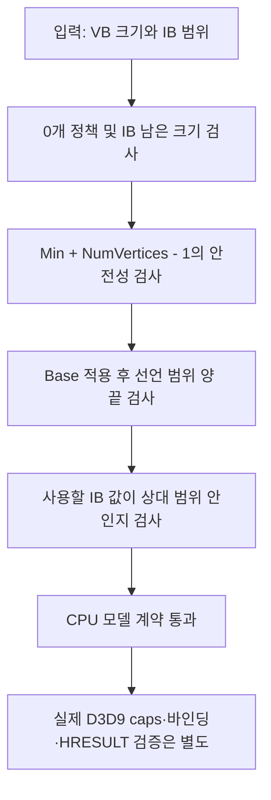

<callout icon="🧪" color="blue_bg">
	**수동 검수 12 · 기존 03 실습의 보관 복구와 오류 교정**
	<mention-date start="2026-10-16"/>. 회수한 v1 원형의 26조건은 통과했지만 새 반례에서 상대 인덱스 범위 오류와 signed overflow를 발견했습니다. 원형 ZIP은 변경하지 않고 v1.1 소스와 32조건 검증을 별도로 작성했습니다. 원래 03 본문은 <mention-page url="https://app.notion.com/p/bdcccf3ce6d34930827bf0a519b4fa78">쥬신 5–6개월차 — DirectX 9</mention-page> 안에 있으며, 이 페이지가 수정된 전체 실습의 보관 기준입니다.
</callout>
<table_of_contents/>
## 1. 무엇을 교정했는가
첫 번째 문제는 인덱스 버퍼의 상대 인덱스와 실제 정점 버퍼의 절대 인덱스를 섞은 것입니다. 기존 함수는 `minVertexIndex`를 `totalVertices`와 바로 비교하고 선언 범위를 `totalVertices - minVertexIndex`로 제한했습니다. 하지만 원래 API에서 인덱스 값과 MinVertexIndex는 모두 BaseVertexIndex에 상대적입니다. [Microsoft DrawIndexedPrimitive](https://learn.microsoft.com/en-us/windows/win32/api/d3d9/nf-d3d9-idirect3ddevice9-drawindexedprimitive), [버퍼 렌더링 설명](https://learn.microsoft.com/en-us/windows/win32/direct3d9/rendering-from-vertex-and-index-buffers)의 규약을 대조했습니다.
예를 들어 IB=\{3,4,5\}, Base=-3, Min=3, NumVertices=3이면 실제 VB 위치는 \{0,1,2\}입니다. 정점 3개가 있는 VB에서 유효한 범위인데 원형 CPU 함수는 false를 반환했습니다. v1.1은 선언 범위의 양 끝을 Base 적용 후에 검사하고 각 IB 값이 선언된 상대 범위 안에 있는지 확인합니다.
두 번째 문제는 CPU 함수의 넓은 int64 매개변수입니다. Base=INT64_MAX와 index=1의 합을 int64로 먼저 계산하면 범위 밖 연산이 발생합니다. 원형에서 UBSan의 signed integer overflow 진단과 종료 코드 1을 실제 재현했습니다. **D3D9 API의 BaseVertexIndex 타입은 INT이고 이 CPU 함수는 int64이므로, 이 극단값 재현을 실제 D3D9 호출 실패 사례라고 표현하지 않습니다.**
## 2. 오버플로 없이 범위를 비교하는 원리
목표는 수학적인 0 ≤ Base+relative &lt; total을 판단하는 것입니다. Base가 음수가 아니면 Base &lt; total을 먼저 확인한 뒤 relative &lt; total-Base로 바꿉니다. Base가 음수이면 그 절댓값 magnitude에 대해 relative ≥ magnitude와 relative-magnitude &lt; total을 검사합니다. INT64_MIN을 직접 부호 반전하지 않고 `-(Base+1)`을 unsigned로 옮긴 뒤 1을 더합니다.
Min부터 NumVertices개의 마지막 상대 인덱스를 만들기 전에는 `NumVertices-1 ≤ SIZE_MAX-Min`을 확인합니다. IB 시작 위치와 삼각형 수 또한 먼저 남은 원소 수를 3으로 나눈 한도와 비교합니다. 큰 수를 더하거나 곱한 뒤 검사하는 방식이 아니라 연산 전에 범위를 좁힙니다.

이 모델은 0개 primitive를 false로 처리하는 교육용 정책을 유지합니다. 모든 D3D9 유효 호출을 판별하는 공식 validation layer가 아닙니다. DeviceModel의 상태 전이와 DynamicRingModel 역시 논리 모형이며 GPU 명령·펜스·실제 장치 손실을 구현하지 않습니다.
## 3. 전체 파일과 빌드
아래 코드를 `resource_model.cpp`, 뒤의 설정을 `CMakeLists.txt`로 저장합니다. 외부 입력 파일이나 에셋은 없습니다. 학습 기준은 C++20이며 이번에 GCC C++11 호환 빌드도 실제 확인했습니다. 성공하면 32조건 출력과 종료 코드 0을 얻습니다. 실패한 expect는 예외로 실패하며 CTest는 비정상 종료를 실패로 판정합니다.
```bash
cmake -S . -B build -DCMAKE_BUILD_TYPE=Debug
cmake --build build -j 2
ctest --test-dir build --output-on-failure -V
```
## 4. resource_model.cpp — v1.1 전체 소스
```c++
// v1.1: checked index arithmetic and relative range repair. CPU only.
#include <array>
#include <cstddef>
#include <cstdint>
#include <iostream>
#include <limits>
#include <stdexcept>
#include <vector>

// A CPU-only teaching model. These states are NOT Direct3D 9 API return values.
enum class Pool { Default, Managed, SystemMemory };
enum class State { Operational, Lost, NotReset };

struct Resource {
    Pool pool;
    bool alive;
    std::uint64_t generation;
};

class DeviceModel {
public:
    State state = State::Operational;
    std::uint64_t generation = 1;
    std::vector<Resource> resources;

    std::size_t Create(Pool pool, bool dynamic = false) {
        if (state != State::Operational)
            throw std::logic_error("model: creation outside operational state");
        if (pool == Pool::Managed && dynamic)
            throw std::invalid_argument("model: dynamic managed VB/IB forbidden");
        resources.push_back({pool, true, generation});
        return resources.size() - 1;
    }
    void Lose() {
        if (state != State::Operational) throw std::logic_error("model: not operational");
        state = State::Lost;
    }
    void CanReset() {
        if (state != State::Lost) throw std::logic_error("model: not lost");
        state = State::NotReset;
    }
    void ReleaseDefaultResources() {
        for (Resource& r : resources)
            if (r.pool == Pool::Default) r.alive = false;
    }
    bool Reset() {
        if (state != State::NotReset) return false;
        for (const Resource& r : resources)
            if (r.pool == Pool::Default && r.alive) return false;
        ++generation;
        state = State::Operational;
        return true;
    }
    bool Usable(std::size_t id) const {
        if (id >= resources.size() || state != State::Operational) return false;
        const Resource& r = resources[id];
        return r.alive && (r.pool != Pool::Default || r.generation == generation);
    }
};

struct Vertex { float x, y, z, u, v; };
static_assert(sizeof(Vertex) == 5 * sizeof(float), "Example assumes 5 floats");

// Check a mathematical base+relative index without signed addition overflow.
// uintmax_t can represent size_t; -(base+1) avoids negating INT64_MIN.
bool AdjustedVertexFits(std::size_t relative, std::int64_t base,
                        std::size_t totalVertices) {
    const std::uintmax_t raw = relative, count = totalVertices;
    if (base >= 0) {
        const auto offset = static_cast<std::uintmax_t>(base);
        return offset < count && raw < count - offset;
    }
    const auto magnitude = static_cast<std::uintmax_t>(-(base + 1)) + 1;
    return raw >= magnitude && raw - magnitude < count;
}

bool ValidateTriangleList(const std::vector<std::uint16_t>& indices,
                          std::size_t totalVertices,
                          std::size_t startIndex,
                          std::size_t primitiveCount,
                          std::int64_t baseVertex,
                          std::size_t minVertexIndex,
                          std::size_t numVertices) {
    // Zero draws are rejected by this teaching model's policy, not an API claim.
    if (primitiveCount == 0 || numVertices == 0 || totalVertices == 0)
        return false;
    if (startIndex > indices.size() ||
        primitiveCount > (indices.size() - startIndex) / 3)
        return false;
    // Both declared range endpoints are relative to BaseVertexIndex.
    if (numVertices - 1 > std::numeric_limits<std::size_t>::max() - minVertexIndex)
        return false;
    const std::size_t lastVertexIndex = minVertexIndex + (numVertices - 1);
    if (!AdjustedVertexFits(minVertexIndex, baseVertex, totalVertices) ||
        !AdjustedVertexFits(lastVertexIndex, baseVertex, totalVertices))
        return false;
    const std::size_t endIndex = startIndex + primitiveCount * 3;
    for (std::size_t i = startIndex; i < endIndex; ++i) {
        const std::size_t index = indices[i];
        if (index < minVertexIndex || index > lastVertexIndex) return false;
    }
    return true;
}

struct RingReservation {
    std::size_t offset;
    bool discard;
};

class DynamicRingModel {
    std::size_t capacity_;
    std::size_t cursor_ = 0;
public:
    explicit DynamicRingModel(std::size_t capacity) : capacity_(capacity) {
        if (capacity_ == 0) throw std::invalid_argument("zero capacity");
    }
    RingReservation Reserve(std::size_t count) {
        if (count == 0 || count > capacity_) throw std::invalid_argument("invalid count");
        if (count > capacity_ - cursor_) {
            cursor_ = count;
            return {0, true}; // conceptual DISCARD, new storage region
        }
        const bool discard = cursor_ == 0;
        const auto at = cursor_;
        cursor_ += count;
        return {at, discard}; // conceptual NOOVERWRITE when false
    }
};

int main() {
    int checks = 0;
    auto expect = [&](bool cond, const char* message) {
        ++checks;
        if (!cond) throw std::runtime_error(message);
    };
    DeviceModel dev;
    const auto defaultVB = dev.Create(Pool::Default, true);
    const auto managedTexture = dev.Create(Pool::Managed);
    const auto systemCopy = dev.Create(Pool::SystemMemory);
    expect(dev.Usable(defaultVB), "default initial");
    expect(dev.Usable(managedTexture), "managed initial");
    expect(dev.Usable(systemCopy), "system initial");
    try { dev.Create(Pool::Managed, true); expect(false, "dynamic managed accepted"); }
    catch (const std::invalid_argument&) { expect(true, "dynamic managed rejected"); }
    dev.Lose();
    expect(!dev.Usable(defaultVB), "lost unusable");
    expect(!dev.Reset(), "reset before ready rejected");
    dev.CanReset();
    expect(!dev.Reset(), "default must be released");
    dev.ReleaseDefaultResources();
    expect(dev.Reset(), "reset after release");
    expect(!dev.Usable(defaultVB), "old default remains invalid");
    expect(dev.Usable(managedTexture), "managed survives reset");
    expect(dev.Usable(systemCopy), "system memory survives reset");
    const auto newDefaultVB = dev.Create(Pool::Default, true);
    expect(dev.Usable(newDefaultVB), "new default ready");
    expect(newDefaultVB != defaultVB, "not reusing old handle");

    const std::vector<std::uint16_t> indices = {0, 1, 2, 0, 2, 3};
    expect(ValidateTriangleList(indices, 4, 0, 2, 0, 0, 4), "two triangles");
    expect(ValidateTriangleList(indices, 4, 3, 1, 0, 0, 4), "second triangle");
    expect(!ValidateTriangleList(indices, 4, 0, 3, 0, 0, 4), "excess index range");
    expect(!ValidateTriangleList(indices, 4, 7, 1, 0, 0, 4), "bad start index");
    expect(!ValidateTriangleList(indices, 4, 0, 2, 0, 0, 3), "index outside declared range");
    expect(!ValidateTriangleList(indices, 4, 0, 2, -1, 0, 4), "negative adjusted index");
    expect(!ValidateTriangleList(indices, 4, 0, 2, 1, 0, 4), "adjusted index out of VB");
    expect(!ValidateTriangleList(indices, 4, 0, 0, 0, 0, 4), "zero primitives");

    // v1.1: six additional boundary/contract regression checks.
    const std::vector<std::uint16_t> shifted = {3, 4, 5};
    expect(ValidateTriangleList(shifted, 3, 0, 1, -3, 3, 3),
           "negative base with valid adjusted range");
    const std::vector<std::uint16_t> ones = {1, 1, 1};
    expect(!ValidateTriangleList(ones, 2, 0, 1,
        std::numeric_limits<std::int64_t>::max(), 0, 2), "INT64_MAX base rejected safely");
    expect(!ValidateTriangleList(ones, 2, 0, 1,
        std::numeric_limits<std::int64_t>::min(), 0, 2), "INT64_MIN base rejected safely");
    expect(!ValidateTriangleList(ones, 2, 0, 1, 0,
        std::numeric_limits<std::size_t>::max(), 2), "declared range overflow rejected");
    expect(!ValidateTriangleList(indices, 0, 0, 1, 0, 0, 1), "empty VB rejected");
    const std::vector<std::uint16_t> zeros = {0, 0, 0};
    expect(ValidateTriangleList(zeros, 1, 0, 1, 0, 0, 1),
           "repeated index is in range; geometry degeneracy is a separate question");

    DynamicRingModel ring(6);
    const auto a = ring.Reserve(4), b = ring.Reserve(2), c = ring.Reserve(3);
    expect(a.offset == 0 && a.discard, "first discard");
    expect(b.offset == 4 && !b.discard, "append nooverwrite");
    expect(c.offset == 0 && c.discard, "wrap discard");
    try { ring.Reserve(7); expect(false, "oversize accepted"); }
    catch (const std::invalid_argument&) { expect(true, "oversize rejected"); }
    try { ring.Reserve(0); expect(false, "zero accepted"); }
    catch (const std::invalid_argument&) { expect(true, "zero rejected"); }
    std::cout << "PASS: " << checks << " assertions (CPU model; not D3D9 GPU)\n";
}
```
## 5. CMakeLists.txt — 전체
```plain text
cmake_minimum_required(VERSION 3.16)
project(dx9_resource_model LANGUAGES CXX)
add_executable(dx9_resource_model resource_model.cpp)
target_compile_features(dx9_resource_model PRIVATE cxx_std_20)
if(MSVC)
  target_compile_options(dx9_resource_model PRIVATE /W4)
else()
  target_compile_options(dx9_resource_model PRIVATE -Wall -Wextra -Wpedantic)
endif()
enable_testing()
add_test(NAME resource_lifecycle_and_indices COMMAND dx9_resource_model)
```
## 6. 실패 재현과 수정 후 실행 로그
원형 26조건의 재통과는 새 경계 사례를 포함하지 않았습니다. 원형 함수만 추출한 추가 재현에서 아래 두 결과를 얻었습니다. 첫 줄은 계약상 유효한 예제를 잘못 거부한 결과이고, 두 번째는 의도적으로 오류를 재현한 실패 로그입니다.
```plain text
$ clang++ -std=c++20 -g -fsanitize=undefined -fno-sanitize-recover=undefined baseline_probe.cpp -o baseline_probe
exit=0
$ ./baseline_probe
negative-base valid draw accepted=0
exit=0
$ ./baseline_probe overflow
baseline_probe.cpp:24:48: runtime error: signed integer overflow: 9223372036854775807 + 1 cannot be represented in type 'std::int64_t' (aka 'long')
SUMMARY: UndefinedBehaviorSanitizer: undefined-behavior baseline_probe.cpp:24:48
exit=1
```
수정 후에는 같은 32조건을 세 가지 구성으로 실제 실행했습니다. CTest는 실행파일 하나를 등록하므로 1/1이며 32개의 별도 CTest 등록 항목이라는 뜻은 아닙니다.
```plain text
Started UTC: 2026-10-16T05:37:49.449018+00:00
Platform: Linux-6.18.44-x86_64-with-glibc2.41
Source SHA256: 13e2b28a4854f5438d0a9f2acc4616e115d9a6b2b62b21e77e04412bcb56ad37

$ g++ -std=c++20 -O2 -Wall -Wextra -Wpedantic -Werror resource_model.cpp -o resource_gcc20
exit=0
$ ./resource_gcc20
PASS: 32 assertions (CPU model; not D3D9 GPU)
exit=0

$ g++ -std=c++11 -O2 -Wall -Wextra -Wpedantic -Werror resource_model.cpp -o resource_gcc11
exit=0
$ ./resource_gcc11
PASS: 32 assertions (CPU model; not D3D9 GPU)
exit=0

$ clang++ -std=c++20 -O1 -g -Wall -Wextra -Wpedantic -Werror -fsanitize=address,undefined -fno-sanitize-recover=undefined -fno-omit-frame-pointer resource_model.cpp -o resource_san
exit=0
$ ./resource_san
PASS: 32 assertions (CPU model; not D3D9 GPU)
exit=0

$ cmake -S . -B build -DCMAKE_BUILD_TYPE=Debug
-- The CXX compiler identification is GNU 14.2.0
-- Detecting CXX compiler ABI info
-- Detecting CXX compiler ABI info - done
-- Check for working CXX compiler: /usr/bin/c++ - skipped
-- Detecting CXX compile features
-- Detecting CXX compile features - done
-- Configuring done (0.2s)
-- Generating done (0.0s)
-- Build files have been written to: /mnt/data/dx9_audit12/resource_v1_1/build
exit=0

$ cmake --build build -j 2
[ 50%] Building CXX object CMakeFiles/dx9_resource_model.dir/resource_model.cpp.o
[100%] Linking CXX executable dx9_resource_model
[100%] Built target dx9_resource_model
exit=0

$ ctest --test-dir build --output-on-failure -V
1: PASS: 32 assertions (CPU model; not D3D9 GPU)
1/1 Test #1: resource_lifecycle_and_indices ... Passed 0.00 sec
100% tests passed, 0 tests failed out of 1
Total Test time (real) = 0.00 sec
exit=0
Ended UTC: 2026-10-16T05:37:51.948295+00:00
Windows / MSVC / D3D9 / GPU: NOT RUN
```
검증 실행의 핵심 출력은 위에 직접 보존했습니다. 상세 CTest 경로 출력과 자동 실행용 Python 스크립트는 별도 검수 파일 묶음에 함께 보존합니다. C++ 실습 자체는 위 소스와 CMake만으로 재현되며 그 Python 파일에 의존하지 않습니다.
## 7. 이해 확인
<details>
<summary>IB 값이 5이고 Base가 -3이면 VB의 몇 번째 정점을 검사하나요?</summary>
	수학적인 최종 인덱스는 2입니다. Min/Num으로 선언한 상대 범위에 5가 포함되는지와, Base가 적용된 절대 범위가 VB 안에 있는지를 분리해서 봅니다.
</details>
<details>
<summary>원형 26조건이 모두 통과했는데 왜 v1.1이 필요했나요?</summary>
	기존 테스트에는 INT64 극단값과 유효한 음수 Base 예제가 없었습니다. 테스트 통과는 테스트한 범위의 증거이지 모든 입력의 안전성 증명이 아닙니다. 이번에는 실제 실패 재현 후 회귀 조건을 추가했습니다.
</details>
<details>
<summary>RingReservation의 discard가 true이면 GPU가 새 버퍼를 제공한 사실도 검증되나요?</summary>
	아닙니다. CPU 모형의 예약 위치와 플래그만 검사합니다. 실제 D3DLOCK_DISCARD/NOOVERWRITE와 GPU 사용 중 영역의 수명은 별도 D3D9 실행 검증이 필요합니다.
</details>
## 8. 보관·버전·남은 한계
회수한 원형 `resource_model.cpp`는 6,838바이트, SHA-256 `e3849fc099a76b1488f31c40376522c44097cf53331c4ddcc4a263d2d82a7666`입니다. 수정된 파일은 8,630바이트, SHA-256 `13e2b28a4854f5438d0a9f2acc4616e115d9a6b2b62b21e77e04412bcb56ad37`입니다. 이는 로컬 실제 컴파일 파일의 해시이며 Notion 줄끝 정규화까지 바이트 일치를 확인한 값이라고 표시하지 않습니다.
기존 상태 모형·26조건을 유지하고 상대 범위 판정과 안전한 산술, 6개 회귀 검사를 추가했습니다. 이 코드에는 실제 렌더링 API 호출, D3DCAPS9·FVF/Declaration·스트림 상태 검증, 장치별 Reset, GPU 실행이 없습니다. 장치 세대 번호의 장기간 wrap-around 등 모형 전체의 모든 극단값을 검증한 것도 아닙니다. **이번 완료는 소스 보관과 발견한 입력 검증 오류의 수정이며 전체 DX9 교재의 최종 완료가 아닙니다.**
