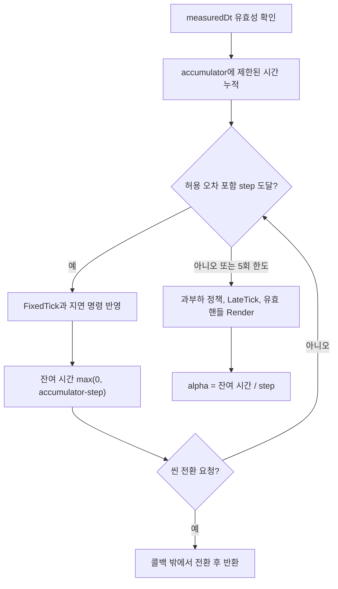

<callout icon="🧪" color="blue_bg">
	**수동 검수 13 · 씬 루프 전체 소스 복구와 경계 오류 교정**
	<mention-date start="2026-10-16"/>. 기존 39조건 소스를 실제로 회수·재실행했고, Tick 허용 오차가 음수 보간 계수를 만드는 반례를 발견했습니다. 원형을 보존하고 수정된 전체 헤더·테스트를 아래에 저장합니다. 기존 교재 <mention-page url="https://app.notion.com/p/3f8a99703f408171ab68e3ed5b265f01">05 · 씬·게임 오브젝트와 프레임 루프 — 개정 본문</mention-page>와 함께 읽습니다.
</callout>
## 1. 발견한 오류와 수정의 의미
고정 시간 step은 1/60초입니다. 원형은 accumulator+1e-12≥step이면 Tick을 실행하고 accumulator에서 step을 뺐습니다. accumulator=step−5e-13이면 허용 오차 때문에 Tick을 한 번 실행하지만 잔여 시간이 음수가 되고 alpha=accumulator/step도 음수가 됩니다. 아래 실제 재현 출력은 약 −3e-11입니다.
```plain text
Baseline: ticks=1 alpha=-2.9999960848847707e-11
```
v1.1은 기존 허용 오차 정책을 유지하면서 Tick 후 잔여 시간을 max(0, accumulator−step)으로 제한합니다. 이는 너무 작은 오차만 제거하는 교육용 정책이지 시간을 임의로 크게 올림하는 일반 법칙이 아닙니다. 큰 정지 시간은 0.25초로 제한하고 프레임당 최대 5회 갱신하며, 남은 과부하는 버리는 기존 정책을 유지합니다. 실제 입력·네트워크 동기화·결정적 리플레이에는 별도의 시간 정책이 필요합니다.
## 2. 수명과 호출 조건
Engine이 World를, World가 Actor를 unique_ptr로 소유합니다. Spawn/Destroy/OpenScene은 요청이며 Commit/ApplyPending은 안전 지점에서 적용합니다. Actor 콜백 도중 Commit, ApplyPending, RunFrame을 재진입 호출하면 안 됩니다. 학습용 공개 함수들이 이 규칙을 자동으로 강제하지는 않습니다. 단일 스레드·콜백 정상 반환을 전제로 하며, 할당 실패의 강한 예외 보장·세대 번호 wrap-around·동시성 검증은 없습니다.
콜백은 Spawn/Destroy/QueueDraw와 OpenScene 요청만 사용합니다. 렌더 이벤트 벡터는 호출자가 프레임별로 비우며 누적 수집도 가능합니다. 생성된 Actor는 다음 FixedTick부터 갱신되지만 현재 프레임의 LateTick/Render에는 참여할 수 있습니다. alpha는 보간용 계수일 뿐 이 예제 자체가 이전/현재 Transform을 보간하지는 않습니다.

## 3. scene_loop.hpp — 전체 수정본
```c++
#pragma once
#include <algorithm>
#include <cmath>
#include <cstdint>
#include <map>
#include <memory>
#include <set>
#include <stdexcept>
#include <string>
#include <utility>
#include <vector>

namespace study {
using Id = std::uint64_t;
struct Handle { std::uint64_t generation; Id id; };
class Engine;
class World;

struct FrameContext {
    World& world;
    Engine& engine;
};

class Actor {
public:
    virtual ~Actor() {}
    Id id() const { return id_; }
    virtual void FixedTick(FrameContext&, double) {}
    virtual void LateTick(FrameContext&) {}
    virtual void Render(std::vector<std::string>&) const {}
private:
    friend class World;
    Id id_ = 0;
};

class World {
public:
    explicit World(std::string name) : name_(std::move(name)) {}
    ~World() = default;
    World(const World&) = delete;
    World& operator=(const World&) = delete;

    Id Spawn(std::string layer, std::unique_ptr<Actor> object) {
        if (!object) throw std::invalid_argument("null actor");
        if (object->id_ != 0) throw std::logic_error("actor already owned");
        const Id id = nextId_++;
        object->id_ = id;
        pendingAdds_.push_back({std::move(layer), std::move(object)});
        return id;
    }
    void Destroy(Id id) { pendingRemoves_.insert(id); }
    void QueueDraw(Id id) {
        if (Find(id) && !pendingRemoves_.count(id)) drawQueue_.push_back({generation_, id});
    }
    Actor* Find(Id id) {
        auto it = objects_.find(id);
        return it == objects_.end() ? nullptr : it->second.get();
    }
    const Actor* Resolve(Handle h) const {
        if (h.generation != generation_) return nullptr;
        auto it = objects_.find(h.id);
        return it == objects_.end() ? nullptr : it->second.get();
    }
    Handle MakeHandle(Id id) const { return {generation_, id}; }
    std::size_t Size() const { return objects_.size(); }
    const std::string& Name() const { return name_; }
    std::uint64_t Generation() const { return generation_; }
    void Commit() {
        for (Id id : pendingRemoves_) {
            objects_.erase(id);
            for (auto& layer : layers_) {
                auto& ids = layer.second;
                ids.erase(std::remove(ids.begin(), ids.end(), id), ids.end());
            }
        }
        for (auto& pending : pendingAdds_) {
            const Id id = pending.object->id_;
            if (pendingRemoves_.count(id)) continue; // Spawn + Destroy in same step.
            if (!layers_.count(pending.layer)) layerOrder_.push_back(pending.layer);
            layers_[pending.layer].push_back(id);
            objects_.emplace(id, std::move(pending.object));
        }
        pendingAdds_.clear();
        pendingRemoves_.clear();
    }
    void FixedStep(Engine& engine, double dt);
    std::size_t LateAndDraw(Engine& engine, std::vector<std::string>& events);
private:
    friend class Engine;
    struct PendingAdd { std::string layer; std::unique_ptr<Actor> object; };
    void SetGeneration(std::uint64_t gen) { generation_ = gen; Commit(); }
    std::string name_;
    std::uint64_t generation_ = 0;
    Id nextId_ = 1;
    std::map<Id, std::unique_ptr<Actor>> objects_;
    std::map<std::string, std::vector<Id>> layers_;
    std::vector<std::string> layerOrder_;
    std::vector<PendingAdd> pendingAdds_;
    std::set<Id> pendingRemoves_;
    std::vector<Handle> drawQueue_;
};

struct FrameStats {
    unsigned fixedUpdates = 0;
    std::size_t rendered = 0;
    bool sceneChanged = false;
    bool backlogDropped = false;
    double alpha = 0.0;
};

class Engine {
public:
    static constexpr double FixedDt() { return 1.0 / 60.0; }
    void OpenScene(std::unique_ptr<World> next) {
        if (!next) throw std::invalid_argument("null scene");
        pending_ = std::move(next);
    }
    bool HasPendingScene() const { return static_cast<bool>(pending_); }
    const World* Current() const { return active_.get(); }
    World* Current() { return active_.get(); }
    void ApplyPending() {
        if (!pending_) return;
        pending_->SetGeneration(++generation_);
        active_ = std::move(pending_); // Releases previous world and its actors.
        accumulator_ = 0.0;              // Do not mix simulation time across scenes.
    }
    FrameStats RunFrame(double measuredDt, std::vector<std::string>& events) {
        if (!std::isfinite(measuredDt) || measuredDt < 0.0)
            throw std::invalid_argument("invalid frame delta");
        FrameStats result;
        if (pending_) { ApplyPending(); result.sceneChanged = true; }
        if (!active_) return result;
        accumulator_ += std::min(measuredDt, 0.25);  // Stalls must not generate unlimited ticks.
        const double step = FixedDt();
        while (accumulator_ + 1e-12 >= step && result.fixedUpdates < 5) {
            active_->FixedStep(*this, step);
            ++result.fixedUpdates;
            accumulator_ = std::max(0.0, accumulator_ - step); // v1.1: epsilon must not yield negative alpha
            if (pending_) {
                ApplyPending();
                result.sceneChanged = true;
                result.alpha = 0.0;
                return result; // Old scene must not LateTick/Render this frame.
            }
        }
        if (accumulator_ >= step) {
            accumulator_ = std::fmod(accumulator_, step);  // Drop excess backlog.
            result.backlogDropped = true;
        }
        result.rendered = active_->LateAndDraw(*this, events);
        if (pending_) {
            ApplyPending();
            result.sceneChanged = true;
            result.rendered = 0;
            result.alpha = 0.0;
            return result;
        }
        result.alpha = accumulator_ / step;
        return result;
    }
private:
    std::unique_ptr<World> active_;
    std::unique_ptr<World> pending_;
    std::uint64_t generation_ = 0;
    double accumulator_ = 0.0;
};

inline void World::FixedStep(Engine& engine, double dt) {
    FrameContext ctx{*this, engine};
    for (const auto& layer : layerOrder_) {
        const auto& ids = layers_.at(layer);
        for (Id id : ids) {
            if (pendingRemoves_.count(id)) continue;
            Actor* actor = Find(id);
            if (actor) actor->FixedTick(ctx, dt);
            if (engine.HasPendingScene()) return;
        }
    }
    Commit();  // The new actors participate in the NEXT fixed step.
}

inline std::size_t World::LateAndDraw(Engine& engine, std::vector<std::string>& events) {
    FrameContext ctx{*this, engine};
    drawQueue_.clear();
    for (const auto& layer : layerOrder_) {
        const auto& ids = layers_.at(layer);
        for (Id id : ids) {
            if (pendingRemoves_.count(id)) continue;
            Actor* actor = Find(id);
            if (actor) actor->LateTick(ctx);
            if (engine.HasPendingScene()) { drawQueue_.clear(); return 0; }
        }
    }
    Commit();  // Destroy between LateTick and Render invalidates queued handles.
    std::size_t drawn = 0;
    for (Handle h : drawQueue_) {
        const Actor* actor = Resolve(h);
        if (actor) { actor->Render(events); ++drawn; }
    }
    drawQueue_.clear();
    return drawn;
}
}  // namespace study
```
## 4. tests.cpp — 전체, 기존 39조건과 회귀 3조건
```c++
#include "scene_loop.hpp"
#include <cassert>
#include <iostream>
#include <limits>
#include <sstream>
#include <string>
#include <vector>
using namespace study;

class Probe : public Actor {
public:
    Probe(std::string label, int* destruct = nullptr)
        : name_(std::move(label)), destruct_(destruct) {}
    ~Probe() override { if (destruct_) ++*destruct_; }
    void FixedTick(FrameContext&, double) override { ++ticks_; }
    void LateTick(FrameContext& context) override { context.world.QueueDraw(id()); }
    void Render(std::vector<std::string>& events) const override { events.push_back(name_); }
    unsigned Ticks() const { return ticks_; }
private:
    std::string name_;
    int* destruct_;
    unsigned ticks_ = 0;
};

class SpawnAndRemove : public Actor {
public:
    explicit SpawnAndRemove(Id* child) : child_(child) {}
    void FixedTick(FrameContext& c, double) override {
        *child_ = c.world.Spawn("actors", std::unique_ptr<Actor>(new Probe("child")));
        c.world.Destroy(id());
    }
    void LateTick(FrameContext& c) override { c.world.QueueDraw(id()); }
    void Render(std::vector<std::string>& events) const override { events.push_back("should-not-draw"); }
private: Id* child_;
};

class SpawnAndCancel : public Actor {
public:
    void FixedTick(FrameContext& c, double) override {
        Id x = c.world.Spawn("actors", std::unique_ptr<Actor>(new Probe("cancelled")));
        c.world.Destroy(x);
        c.world.Destroy(id());
    }
};

class SwitchScene : public Actor {
public:
    explicit SwitchScene(int* oldDestruct) : oldDestruct_(oldDestruct) {}
    ~SwitchScene() override { ++*oldDestruct_; }
    void FixedTick(FrameContext& c, double) override {
        auto next = std::unique_ptr<World>(new World("Game"));
        next->Spawn("actors", std::unique_ptr<Actor>(new Probe("new-scene")));
        c.engine.OpenScene(std::move(next));
    }
    void LateTick(FrameContext& c) override { c.world.QueueDraw(id()); }
    void Render(std::vector<std::string>& e) const override { e.push_back("old-scene"); }
private: int* oldDestruct_;
};

int main() {
    unsigned tests = 0;
#define CHECK(expr) do { ++tests; if (!(expr)) { std::cerr << "FAILED: " << #expr << " line " << __LINE__ << "\n"; return 1; } } while (0)
    Engine engine;
    std::vector<std::string> events;
    auto world = std::unique_ptr<World>(new World("Logo"));
    Id child = 0;
    world->Spawn("actors", std::unique_ptr<Actor>(new SpawnAndRemove(&child)));
    world->Spawn("actors", std::unique_ptr<Actor>(new SpawnAndCancel));
    Id staticId = world->Spawn("actors", std::unique_ptr<Actor>(new Probe("static")));
    engine.OpenScene(std::move(world));
    FrameStats zero = engine.RunFrame(0.0, events);
    CHECK(zero.sceneChanged); CHECK(zero.fixedUpdates == 0); CHECK(zero.rendered == 2);
    CHECK(engine.Current()->Size() == 3);
    Handle oldStaticHandle = engine.Current()->MakeHandle(staticId);
    events.clear();
    FrameStats one = engine.RunFrame(Engine::FixedDt(), events);
    CHECK(one.fixedUpdates == 1); CHECK(one.rendered == 2);
    CHECK(engine.Current()->Size() == 2); CHECK(child != 0); CHECK(engine.Current()->Find(child) != nullptr);
    CHECK(events.size() == 2); CHECK(events[0] == "static"); CHECK(events[1] == "child");
    CHECK(engine.Current()->Resolve(oldStaticHandle) != nullptr);
    CHECK(static_cast<Probe*>(engine.Current()->Find(child))->Ticks() == 0); // New actor missed this FixedTick.
    events.clear();
    FrameStats half = engine.RunFrame(0.5 * Engine::FixedDt(), events);
    CHECK(half.fixedUpdates == 0); CHECK(half.rendered == 2); CHECK(half.alpha > 0 && half.alpha < 1);
    CHECK(static_cast<Probe*>(engine.Current()->Find(child))->Ticks() == 0);
    engine.RunFrame(0.5 * Engine::FixedDt(), events);
    CHECK(static_cast<Probe*>(engine.Current()->Find(child))->Ticks() == 1);
    FrameStats stall = engine.RunFrame(0.5, events);
    CHECK(stall.fixedUpdates == 5); CHECK(stall.backlogDropped);
    CHECK(stall.alpha >= 0 && stall.alpha < 1);
    CHECK(engine.Current()->Size() == 2);
    bool caught = false;
    try { engine.RunFrame(-0.01, events); } catch (const std::invalid_argument&) { caught = true; }
    CHECK(caught);
    caught = false;
    try { engine.RunFrame(std::numeric_limits<double>::quiet_NaN(), events); }
    catch (const std::invalid_argument&) { caught = true; }
    CHECK(caught);
    caught = false;
    try { engine.Current()->Spawn("bad", std::unique_ptr<Actor>()); }
    catch (const std::invalid_argument&) { caught = true; }
    CHECK(caught);
    int oldDestruct = 0;
    auto logo2 = std::unique_ptr<World>(new World("Logo2"));
    logo2->Spawn("actors", std::unique_ptr<Actor>(new SwitchScene(&oldDestruct)));
    engine.OpenScene(std::move(logo2));
    events.clear();
    FrameStats switched = engine.RunFrame(Engine::FixedDt(), events);
    CHECK(switched.sceneChanged); CHECK(switched.fixedUpdates == 1);
    CHECK(switched.rendered == 0); CHECK(events.empty()); CHECK(oldDestruct == 1);
    CHECK(engine.Current()->Name() == "Game"); CHECK(engine.Current()->Resolve(oldStaticHandle) == nullptr);
    CHECK(engine.Current()->Generation() != oldStaticHandle.generation);
    events.clear();
    FrameStats after = engine.RunFrame(Engine::FixedDt(), events);
    CHECK(!after.sceneChanged); CHECK(after.fixedUpdates == 1); CHECK(after.rendered == 1);
    CHECK(events.size() == 1 && events[0] == "new-scene");
    CHECK(engine.Current()->Size() == 1);
    Engine boundary;
    boundary.OpenScene(std::unique_ptr<World>(new World("Boundary")));
    std::vector<std::string> boundaryEvents;
    FrameStats tolerance = boundary.RunFrame(Engine::FixedDt() - 5e-13, boundaryEvents);
    CHECK(tolerance.fixedUpdates == 1);
    CHECK(tolerance.alpha == 0.0);
    FrameStats repeatedZero = boundary.RunFrame(0.0, boundaryEvents);
    CHECK(repeatedZero.fixedUpdates == 0 && repeatedZero.alpha == 0.0);
    std::cout << "PASS " << tests << " independent assertions\n";
}
```
## 5. 빌드와 검증 로그
```plain text
cmake_minimum_required(VERSION 3.16)
project(dx9_scene_recovered LANGUAGES CXX)
set(LAB_CXX_STANDARD 20 CACHE STRING "20 or 11")
add_executable(scene_loop_tests tests.cpp)
set_target_properties(scene_loop_tests PROPERTIES CXX_STANDARD ${LAB_CXX_STANDARD} CXX_STANDARD_REQUIRED YES CXX_EXTENSIONS NO)
if(MSVC)
  target_compile_options(scene_loop_tests PRIVATE /W4 /EHsc)
else()
  target_compile_options(scene_loop_tests PRIVATE -Wall -Wextra -Wpedantic -Werror)
endif()
enable_testing()
add_test(NAME scene_loop_tests COMMAND scene_loop_tests)
```
```bash
cmake -S . -B build -DCMAKE_BUILD_TYPE=Debug
cmake --build build -j 2
ctest --test-dir build --output-on-failure -V
# 독립 직접 빌드
 g++ -std=c++20 -Wall -Wextra -Wpedantic -Werror tests.cpp -o scene_tests
 ./scene_tests
 g++ -std=c++11 -Wall -Wextra -Wpedantic -Werror tests.cpp -o scene_compat
 ./scene_compat
 clang++ -std=c++20 -g -fsanitize=address,undefined -fno-sanitize-recover=undefined -fno-omit-frame-pointer tests.cpp -o scene_san
 ./scene_san
```
```plain text
Execution UTC: 2026-10-16T06:06:18.250448+00:00 to 06:06:23.591480+00:00
GCC 14.2 C++20: PASS 42 independent assertions
GCC 14.2 C++11: PASS 42 independent assertions
Clang 17 C++20 ASan+UBSan: PASS 42 independent assertions
Each full batch CTest (extended + existing mini): 2/2, exit=0
Existing mini: mini CPU model PASS
Windows/MSVC/Direct3D9/GPU: NOT RUN
```
등록 테스트 수와 내부 CHECK 수는 다릅니다. 위 독립 CMake에는 확장 테스트 하나만 등록됩니다. 배치에서는 기존 미니를 함께 검사했지만 그 코드와 본문을 다시 복사하지 않았습니다: <mention-page url="https://app.notion.com/p/3f8a99703f4081a8a6fcec673f79a98a"/>. 기존 미니가 v1.1 확장 검증을 대체하지는 않습니다.
실행한 헤더 SHA-256 `ee2c4c561037c76f4d9764a6120f725ad1ea123e6c860e5982521fe3fb551074`, tests.cpp `163c361ff6cf413eccacc98e20d3dcda5ecf12ec53e8c91d8da4dd5966223d05`. 이는 로컬 바이트 기준이며 Notion 줄끝까지의 바이트 일치 검증과 구분합니다.
## 6. 이해 확인과 변경 이력
<details>
<summary>epsilon을 Tick 조건에 더하면 남은 시간도 언제나 양수인가요?</summary>
	아닙니다. step보다 약간 작은 값이 조건을 통과할 수 있으므로 단순 차감 후 음수가 됩니다. 이 예제는 해당 작은 음수를 0으로 제한하며 그 경계를 새로 테스트했습니다.
</details>
<details>
<summary>이 코드의 alpha가 0.5이면 실제 화면도 자동으로 중간 위치를 그리나요?</summary>
	아닙니다. 계수만 반환합니다. 별도로 이전·현재 Transform을 저장하고 렌더링할 때 보간해야 합니다. 이 실습은 물리나 그래픽 보간 전체 구현이 아닙니다.
</details>
<mention-date start="2026-10-16"/> v1.1: 원형 39조건 재실행, 음수 alpha 반례 재현, 잔여 시간 보정과 3조건 추가, 호출자 전제 명시, 전체 소스 지속 보관. 프레임워크의 Tick/Commit 규칙은 학습 모델의 설계이고 C++ 언어가 강제하는 실행 순서가 아닙니다. 시간 측정 API 자체는 [Microsoft QueryPerformanceCounter](https://learn.microsoft.com/en-us/windows/win32/api/profileapi/nf-profileapi-queryperformancecounter)를 별도로 확인합니다.
