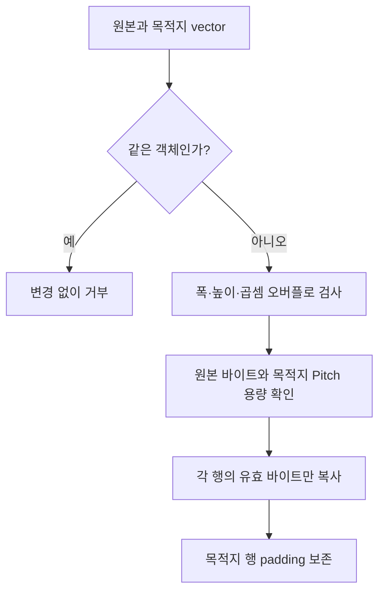

<callout icon="🧪" color="blue_bg">
	**수동 검수 13 · VIBuffer·Texture 확장 소스 복구**
	<mention-date start="2026-10-16"/>. 원형 22조건 재통과 뒤 제자리 Pitch 복사의 데이터 손상 반례를 실제 재현했습니다. 수정된 전체 CPU 소스와 재현 조건을 보존합니다. 상위 교재 <mention-page url="https://app.notion.com/p/3f8a99703f40817cbe12e85790420aab">06 · VIBuffer·Texture의 D3D9 API 계약 — 개정 본문</mention-page>의 실제 D3D9 계약과 CPU 모형을 구별합니다.
</callout>
## 1. 발견한 문제: 행 간격이 다르면 같은 버퍼에 복사해도 될까
원형 CopyImageRows는 같은 vector를 원본과 목적지로 받는 경우를 거부하지 않았습니다. 24바이트 배열에 0부터23을 넣고 rowBytes=4, height=3, destinationPitch=8로 제자리 확장하면 두 번째 행의 쓰기가 아직 읽지 않은 세 번째 원본 행을 덮어씁니다. 실제 재현에서는 마지막 행 첫 값이 기대값 8이 아니라 4였습니다.
```plain text
accepted_alias=1 last_row_first=4 expected=8
```
단순히 memcpy를 memmove로 바꾸는 것만으로 여러 행 사이의 선행 덮어쓰기를 해결하지 못합니다. 각 호출 내부의 겹침과 전체 루프의 읽기·쓰기 순서는 다른 문제입니다. 이 예제는 인플레이스 처리를 지원하지 않는 계약을 선택해 같은 vector 객체이면 복사 전에 false를 반환합니다. 실패 시 버퍼는 그대로 둡니다. 겹친 영역에 대한 memcpy의 제약은 [Microsoft memcpy 문서](https://learn.microsoft.com/en-us/cpp/c-runtime-library/reference/memcpy-wmemcpy)와 대조했습니다.
## 2. 인덱스와 Pitch의 전제
MinIndex와 IB 값은 BaseVertexIndex에 상대적입니다. Base=-3, IB=\{3,4,5\}, Min=3, Num=3이면 실제 VB 위치는 \{0,1,2\}입니다. 수정본은 선언 범위의 양 끝도 Base 적용 후 VB 안에 있는지 확인합니다. 실제 IB의 uint16 값을 int64로 명시 변환해 size_t와 signed 값을 섞는 산술도 제거했습니다. 공식 근거: [DrawIndexedPrimitive](https://learn.microsoft.com/en-us/windows/win32/api/d3d9/nf-d3d9-idirect3ddevice9-drawindexedprimitive).
이 CPU 복사는 별도의 두 vector, 양수 Pitch, 비압축 픽셀, 원본의 촘촘한 행 배열만 다룹니다. 목적지에는 Pitch×height 전체 저장공간이 있어야 한다는 보수적인 자체 계약을 사용합니다. 실제 D3DLOCKED_RECT의 포인터 수명·잠금 가능 여부·압축 블록·음수 Pitch 처리·Mip 규칙은 구현하지 않았습니다. [IDirect3DTexture9::LockRect](https://learn.microsoft.com/en-us/windows/win32/api/d3d9/nf-d3d9-idirect3dtexture9-lockrect)의 HRESULT와 실제 Pitch는 Windows에서 따로 검사합니다.

## 3. mesh_texture_contract.cpp — 전체
```c++
// DX9 VB/IB and texture upload contract - CPU-only executable test (C++11).
// This is NOT a Direct3D9 implementation or an emulated GPU.
#include <algorithm>
#include <cstdint>
#include <cstring>
#include <iostream>
#include <limits>
#include <stdexcept>
#include <vector>

struct VertexPT { float x, y, z, u, v; };
static_assert(sizeof(VertexPT) == 20, "VertexPT must be 20 bytes");

bool ValidateTriangleList(const std::vector<VertexPT>& vertices,
                          const std::vector<std::uint16_t>& indices,
                          std::size_t startIndex, std::size_t primitiveCount,
                          std::size_t minIndex, std::size_t numVertices,
                          std::int32_t baseVertexIndex) {
    if (vertices.empty() || numVertices == 0 || indices.empty()) return false;
    if (startIndex > indices.size()) return false;
    if (primitiveCount > (indices.size() - startIndex) / 3) return false;
    if (minIndex > std::numeric_limits<std::size_t>::max() - numVertices) return false;
    const std::size_t endIndex = minIndex + numVertices; // exclusive, raw index range
    const auto adjustedFits = [&](std::size_t raw) {
        const std::uintmax_t value = raw, count = vertices.size();
        const std::int64_t base = baseVertexIndex;
        if (base >= 0) {
            const auto offset = static_cast<std::uintmax_t>(base);
            return offset < count && value < count - offset;
        }
        const auto magnitude = static_cast<std::uintmax_t>(-base); // base is int32
        return value >= magnitude && value - magnitude < count;
    };
    if (!adjustedFits(minIndex) || !adjustedFits(endIndex - 1)) return false;

    for (std::size_t n = startIndex; n < startIndex + primitiveCount * 3; ++n) {
        const std::size_t raw = indices[n];
        if (raw < minIndex || raw >= endIndex) return false;
        const std::int64_t effective = static_cast<std::int64_t>(baseVertexIndex) +
            static_cast<std::int64_t>(raw); // raw is a uint16 index
        if (effective < 0 || static_cast<std::uint64_t>(effective) >= vertices.size()) return false;
    }
    return primitiveCount != 0;
}

enum class Pool { Default, Managed, SystemMem };
struct BufferSpec { bool dynamic; Pool pool; std::size_t bytes; };
bool ValidVertexBufferSpec(const BufferSpec& spec) {
    if (!spec.bytes) return false;
    // This models the documented D3D9 dynamic VB/IB + MANAGED prohibition.
    return !(spec.dynamic && spec.pool == Pool::Managed);
}

bool CopyImageRows(const std::vector<std::uint8_t>& src,
                   std::size_t width, std::size_t height,
                   std::size_t bytesPerPixel, std::size_t destinationPitch,
                   std::vector<std::uint8_t>& destination) {
    // In-place expansion can overwrite a later source row; reject aliasing first.
    if (&src == &destination) return false;
    if (!width || !height || !bytesPerPixel) return false;
    if (width > std::numeric_limits<std::size_t>::max() / bytesPerPixel) return false;
    const std::size_t rowBytes = width * bytesPerPixel;
    if (destinationPitch < rowBytes) return false;
    if (height > std::numeric_limits<std::size_t>::max() / rowBytes) return false;
    if (src.size() < rowBytes * height) return false;
    if (height > std::numeric_limits<std::size_t>::max() / destinationPitch) return false;
    if (destination.size() < destinationPitch * height) return false;
    for (std::size_t row = 0; row < height; ++row)
        std::memcpy(destination.data() + row * destinationPitch,
                    src.data() + row * rowBytes, rowBytes);
    return true;
}

int checks = 0;
void Check(bool condition, const char* label) {
    ++checks;
    if (!condition) throw std::runtime_error(label);
}

int main() {
    try {
        const std::vector<VertexPT> vertices(4);
        const std::vector<std::uint16_t> indices = {0, 1, 2, 2, 1, 3};
        Check(sizeof(VertexPT) * vertices.size() == 80, "vertex byte size");
        Check(sizeof(std::uint16_t) * indices.size() == 12, "index byte size");
        Check(ValidateTriangleList(vertices, indices, 0, 2, 0, 4, 0), "valid indexed rect");
        Check(!ValidateTriangleList(vertices, indices, 0, 3, 0, 4, 0), "out of index range");
        Check(!ValidateTriangleList(vertices, indices, 4, 1, 0, 4, 0), "start too late");
        Check(!ValidateTriangleList(vertices, indices, 0, 2, 0, 3, 0), "wrong NumVertices");
        Check(!ValidateTriangleList(vertices, indices, 0, 2, 1, 3, 0), "wrong MinIndex");
        Check(!ValidateTriangleList(vertices, indices, 0, 2, 0, 4, -1), "negative effective index");
        Check(!ValidateTriangleList(vertices, indices, 0, 2, 0, 4, 1), "effective index beyond VB");
        Check(!ValidateTriangleList(vertices, indices, 0, 0, 0, 4, 0), "zero primitives");
        Check(!ValidateTriangleList(vertices, indices, 0, 2,
              std::numeric_limits<std::size_t>::max(), 4, 0), "index range overflow");
        Check(ValidVertexBufferSpec({false, Pool::Managed, 80}), "managed static allowed");
        Check(ValidVertexBufferSpec({true, Pool::Default, 80}), "default dynamic allowed");
        Check(!ValidVertexBufferSpec({true, Pool::Managed, 80}), "managed dynamic rejected");
        Check(!ValidVertexBufferSpec({false, Pool::Default, 0}), "zero byte buffer rejected");
        std::vector<std::uint8_t> source = {1,2,3,4, 5,6,7,8};
        std::vector<std::uint8_t> dest(16, 0xcc);  // 2 rows; pitch 8, row content 4
        Check(CopyImageRows(source, 1, 2, 4, 8, dest), "pitched texture copy");
        Check(dest[0] == 1 && dest[3] == 4 && dest[8] == 5 && dest[11] == 8,
              "both rows placed at destination pitch");
        Check(dest[4] == 0xcc && dest[12] == 0xcc, "destination padding preserved");
        Check(!CopyImageRows(source, 1, 2, 4, 3, dest), "pitch smaller than row rejected");
        Check(!CopyImageRows(source, 1, 3, 4, 8, dest), "undersized source rejected");
        std::vector<std::uint8_t> smallDest(12, 0);
        Check(!CopyImageRows(source, 1, 2, 4, 8, smallDest), "undersized destination rejected");
        Check(!CopyImageRows(source, std::numeric_limits<std::size_t>::max(),
                            2, 4, 8, dest), "width overflow rejected");
        const std::vector<std::uint16_t> shifted = {3,4,5};
        Check(ValidateTriangleList(std::vector<VertexPT>(3), shifted, 0,1,3,3,-3),
              "negative base valid range");
        Check(!ValidateTriangleList(vertices, {0,0,0}, 0,1,0,5,0),
              "full declared range beyond VB rejected");
        std::vector<std::uint8_t> alias(24);
        for (unsigned i=0;i<alias.size();++i) alias[i]=static_cast<std::uint8_t>(i);
        const auto beforeAlias=alias;
        Check(!CopyImageRows(alias,1,3,4,8,alias), "in-place pitched copy rejected");
        Check(alias==beforeAlias, "alias rejection leaves storage unchanged");
        const auto beforeDest=dest;
        Check(!CopyImageRows(source,0,2,4,8,dest), "zero width rejected");
        Check(dest==beforeDest, "invalid width leaves destination unchanged");
        std::cout << "PASS " << checks << " CPU contract assertions\n";
    } catch (const std::exception& err) {
        std::cerr << "FAIL " << checks << ": " << err.what() << '\n';
        return 1;
    }
}
```
## 4. 빌드 설정과 실제 검증
```plain text
cmake_minimum_required(VERSION 3.16)
project(dx9_mesh_recovered LANGUAGES CXX)
set(LAB_CXX_STANDARD 20 CACHE STRING "20 or 11")
add_executable(mesh_texture mesh_texture_contract.cpp)
set_target_properties(mesh_texture PROPERTIES CXX_STANDARD ${LAB_CXX_STANDARD} CXX_STANDARD_REQUIRED YES CXX_EXTENSIONS NO)
if(MSVC)
  target_compile_options(mesh_texture PRIVATE /W4 /EHsc)
else()
  target_compile_options(mesh_texture PRIVATE -Wall -Wextra -Wpedantic -Werror)
endif()
enable_testing()
add_test(NAME mesh_texture COMMAND mesh_texture)
```
```bash
cmake -S . -B build -DCMAKE_BUILD_TYPE=Debug
cmake --build build -j 2
ctest --test-dir build --output-on-failure -V
# C++11 확인: 구성 시 -DLAB_CXX_STANDARD=11
# sanitizer: clang++ 및 컴파일/링크 옵션에 -fsanitize=address,undefined 사용
```
외부 에셋·입력 없이 실행합니다. 정상 종료 코드는 0, 실패한 Check는 메시지와 종료 코드 1입니다. 다음은 실제 배치 실행 로그에서 추린 결과이며 모든 구성의 configure/build/CTest 종료 코드가 0이었습니다.
```plain text
UTC 2026-10-16T06:06:23.592352+00:00 to 06:06:26.573793+00:00
GCC 14.2 C++20: PASS 28 CPU contract assertions
GCC 14.2 C++11: PASS 28 CPU contract assertions
Clang 17 C++20 ASan+UBSan: PASS 28 CPU contract assertions
Existing mini on each configuration: PASS 12 CPU checks
Full batch CTest (extended + mini): each 2/2; sanitizer diagnostic: none
Windows/MSVC/D3D9/GPU: NOT RUN
Source SHA256: ab99f00febf1fe93f989aad03ef8aa9ff96686cdfd8b4525ca778f5931a95a60
```
위 독립 CMake는 확장 실행파일 하나만 등록합니다. 기존 미니 전체 소스는 <mention-page url="https://app.notion.com/p/3f8a99703f4081058f96d3bd885a4ef7"/>를 유지합니다. 그 미니는 v1.1의 새 경계 검사를 포함하지 않습니다. 세 구성에서 같은 검사를 반복한 것이며 84개 독립 검사가 아닙니다.
## 5. 이해 확인과 변경 기록
<details>
<summary>각 memcpy만 memmove로 바꾸면 제자리 행 확장이 안전해지나요?</summary>
	아닙니다. 앞 행을 목적지에 쓴 결과가 다음 원본 행을 덮어쓸 수 있습니다. 이 예제는 서로 다른 원본·목적지 vector만 허용합니다. 인플레이스 구현이 필요하다면 방향·임시 저장·전체 접근 범위를 별도 설계해야 합니다.
</details>
<details>
<summary>이 함수가 true이면 실제 D3D9 Draw도 성공하나요?</summary>
	아닙니다. Device caps, VB/IB 바인딩, FVF/Declaration, Usage·Pool, 스트림 오프셋, HRESULT와 실제 장치 상태는 별도입니다. 이 모형은 선택한 일부 메모리·입력 계약만 검사합니다.
</details>
v1.1 변경: 제자리 복사 거부, 거부 시 원본 유지 확인, 선언 범위 양 끝 검사, uint16→int64의 명시적 산술, 기존 22+새 6=28조건. sizeof(VertexPT)==20은 컴파일 환경 전제이며 모든 C++ 구현의 float가 반드시 4바이트라는 보편 주장으로 읽지 않습니다.
