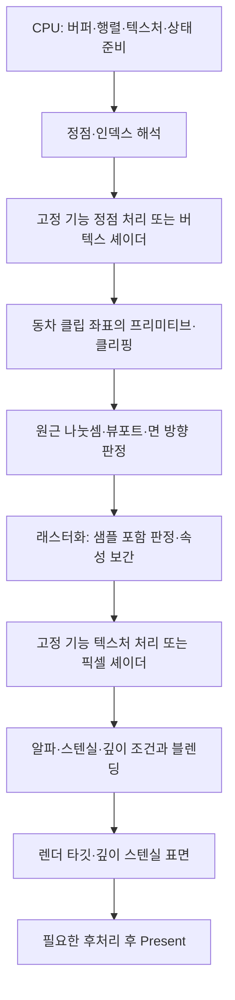

<callout icon="🧱" color="blue_bg">
	**삼각형을 그리기 전에, 어떤 바이트를 어떤 정점으로 읽는지부터 확인합니다.**
	학습 기준: Direct3D 9 · CPU 실습 C++20 · 개정일 <mention-date start="2026-10-13"/>. 실습 파일은 `src/vertex_input.cpp`입니다.
</callout>
<mention-page url="https://app.notion.com/p/3e66577f53a549fe99a94ac26f68a685">DX9 렌더링 파이프라인 — 개정판 v1.0</mention-page> · 선수 문서 <mention-page url="https://app.notion.com/p/3bde90ebffa44ef0a6455ca8e68a7886"/>
<table_of_contents color="gray"/>
## 1. 파이프라인은 데이터와 상태를 처리하는 단계입니다
게임의 `Update`가 위치를 바꾸었다고 화면이 자동으로 바뀌지는 않습니다. CPU 코드가 정점·인덱스·행렬·텍스처를 준비하고, 그릴 때 사용할 상태를 설정한 뒤 드로우 명령을 제출해야 합니다. 그래픽 파이프라인은 이 입력을 화면 샘플의 색과 깊이로 바꿉니다. 드로우 호출과 GPU 작업 완료, 모니터 표시 완료는 서로 다른 시점입니다.
아래는 **일반적인 삼각형을 이해하기 위한 논리적 흐름**입니다. 실제 GPU의 병렬 실행 순서나 내부 회로 배치를 나타낸 그림은 아닙니다. 깊이 검사의 조기 수행 등 결과를 보존하는 최적화도 있을 수 있습니다.

월드·뷰·투영은 서로 다른 좌표 공간을 연결하는 계산입니다. 매번 독립된 물리 하드웨어 단계 세 개로 실행된다는 뜻은 아닙니다. 셰이더에서 합성 행렬 하나를 사용해도 좌표 공간의 의미는 그대로 남습니다.
## 2. 정점은 위치만 가진 점이 아닙니다
정점은 위치, 법선, UV, 색, 뼈 인덱스와 가중치 등 그리기에 필요한 속성 묶음입니다. 같은 위치라도 UV 경계나 각진 면의 법선이 다르면 별개의 정점으로 저장할 수 있습니다. 큐브에 기하학적 꼭짓점이 8개라는 사실과 렌더링용 정점 수가 항상 8개라는 주장은 다릅니다.
삼각형은 세 정점으로 구성하는 프리미티브입니다. 폴리곤이라는 일반 용어가 언제나 삼각형과 같은 뜻은 아닙니다. 메시의 subset도 반드시 머리·몸통처럼 생김새로 나눈 부품은 아닙니다. 같은 재질로 그릴 인덱스 범위 등 구현이 정한 그룹일 수 있습니다. **로컬 공간**은 메시가 기준으로 삼는 좌표계이지, 정점→면→메시 다음에 생기는 자료구조 계층이 아닙니다.
이번 예제의 정점은 위치와 UV만 가집니다.
```c++
struct VertexPT {
    float x, y, z;
    float u, v;
};
```
이 구조에서 float가 4바이트이고 별도 패딩이 없다면 정점 하나는 20바이트, UV 시작은 12바이트입니다. 실습은 `sizeof`·`offsetof`·`static_assert`로 이 전제를 확인합니다. 모든 C++ 타입이 반드시 그런 크기를 갖는다고 일반화하지 않습니다.
## 3. 버퍼·선언·stride는 각각 다른 정보입니다
**버퍼**는 데이터를 담습니다. **정점 선언**은 버퍼의 어느 바이트가 어떤 형식과 의미인지 알려 줍니다. **stride**는 같은 스트림에서 다음 정점으로 갈 때 이동하는 바이트 수입니다. CPU 구조체의 멤버 이름을 드라이버가 읽고 추측하는 것이 아닙니다.
<table fit-page-width="true" header-row="true">
<tr>
<td>정보</td>
<td>이번 예제</td>
<td>잘못되었을 때</td>
</tr>
<tr>
<td>스트림</td>
<td>0번 버퍼</td>
<td>다른 데이터 또는 없는 버퍼를 읽음</td>
</tr>
<tr>
<td>stride</td>
<td>20바이트</td>
<td>두 번째 정점부터 읽는 시작점이 어긋남</td>
</tr>
<tr>
<td>POSITION0</td>
<td>offset 0, FLOAT3</td>
<td>위치 대신 UV·임의 비트를 해석</td>
</tr>
<tr>
<td>TEXCOORD0</td>
<td>offset 12, FLOAT2</td>
<td>기하 형태는 맞아도 텍스처 좌표가 깨질 수 있음</td>
</tr>
</table>
D3D9 선언의 핵심 필드는 Stream, Offset, Type, Method, Usage, UsageIndex입니다. `D3DDECLUSAGE`는 의미를 나타내는 열거형입니다. CPU 구조체를 그 열거형의 숫자 순서대로 배치하라는 규칙이 아닙니다. 아래는 **Windows API 대응 설명용 조각**이며 이번 Linux 실습에서 컴파일한 코드는 아닙니다.
```c++
const D3DVERTEXELEMENT9 elements[] = {
    {0,  0, D3DDECLTYPE_FLOAT3, D3DDECLMETHOD_DEFAULT,
            D3DDECLUSAGE_POSITION, 0},
    {0, 12, D3DDECLTYPE_FLOAT2, D3DDECLMETHOD_DEFAULT,
            D3DDECLUSAGE_TEXCOORD, 0},
    D3DDECL_END()
};
// CreateVertexDeclaration의 HRESULT를 검사한 뒤:
// device->SetVertexDeclaration(declaration);
// device->SetStreamSource(0, vertexBuffer, 0, sizeof(VertexPT));
```
근거: [정점 선언](https://learn.microsoft.com/en-us/windows/win32/direct3d9/vertex-declaration), [SetStreamSource의 offset·stride 계약](https://learn.microsoft.com/en-us/windows/win32/api/d3d9/nf-d3d9-idirect3ddevice9-setstreamsource).
### FVF와 정점 선언
FVF는 정해진 형식 조합으로 정점의 레이아웃을 기술하는 방법입니다. 위치 FLOAT3와 기본 2성분 UV 한 세트인 이번 구조는 고정 기능 경로에서 `D3DFVF_XYZ | D3DFVF_TEX1`로 표현할 수 있습니다. **TEX1은 텍스처 하나를 로드하거나 바인딩한다는 뜻이 아니라 텍스처 좌표 세트 수**입니다. 실제 텍스처 지정은 별도의 `SetTexture` 호출입니다.
FVF에는 필드 순서와 조합 제약이 있습니다. 자유로운 레이아웃을 설명하는 정점 선언과 섞어 생각하지 마세요. 이미 변환된 XYZRHW 정점은 일반적인 로컬 XYZ 정점과 입력 공간부터 다르므로 같은 행렬 처리를 다시 적용하지 않습니다. 근거: [D3DFVF 형식](https://learn.microsoft.com/en-us/windows/win32/direct3d9/d3dfvf).
## 4. 정점 수·인덱스 수·삼각형 수를 구별합니다
사각형은 삼각형 두 개로 그릴 수 있습니다. 위치와 UV가 네 모서리에서 공유된다면 정점 4개와 인덱스 `0,1,2,0,2,3` 여섯 개를 사용합니다. TRIANGLELIST의 primitive count는 **2**입니다. 인덱스가 여섯 개라고 primitive count를 6으로 넘기면 더 많은 인덱스를 읽으려 합니다.
<table fit-page-width="true" header-row="true">
<tr>
<td>인덱스 없는 일반 프리미티브</td>
<td>P개를 구성하는 정점 수</td>
</tr>
<tr>
<td>POINTLIST</td>
<td>P</td>
</tr>
<tr>
<td>LINELIST</td>
<td>2P</td>
</tr>
<tr>
<td>LINESTRIP</td>
<td>P+1</td>
</tr>
<tr>
<td>TRIANGLELIST</td>
<td>3P</td>
</tr>
<tr>
<td>TRIANGLESTRIP / TRIANGLEFAN</td>
<td>P+2</td>
</tr>
</table>
인덱스 드로우는 인덱스가 가리킨 정점을 재사용합니다. `startIndex`는 인덱스 버퍼에서 시작할 **원소 위치**, `BaseVertexIndex`는 읽은 인덱스에 더할 **정점 단위 오프셋**입니다. 스트림의 OffsetInBytes는 이름 그대로 **바이트 단위**입니다. `MinVertexIndex`·`NumVertices`도 프리미티브 수가 아니라 이 호출에서 참조할 정점 범위를 설명합니다. 서로 단위를 혼동하지 마세요.
단일 스트림에서 속성을 읽는 주소 관계는 다음처럼 이해할 수 있습니다.
```plain text
속성 바이트 위치 = 스트림 시작 바이트
                 + (BaseVertexIndex + 읽은 인덱스) × stride
                 + 정점 안의 속성 offset
```
실습 `FetchOffset`은 음수가 된 최종 인덱스, 버퍼 범위 초과, 너무 짧은 stride를 먼저 거부합니다. 이 함수는 드라이버를 흉내 낸 완전한 구현이 아닙니다. 예를 들어 stride 0인 특수 사용은 실습에서 제외했지만 D3D9 API가 모든 상황에서 0을 금지한다는 뜻은 아닙니다.
근거: [버텍스·인덱스 버퍼로 그리기](https://learn.microsoft.com/en-us/windows/win32/direct3d9/rendering-from-vertex-and-index-buffers), [DrawIndexedPrimitive](https://learn.microsoft.com/en-us/windows/win32/api/d3d9/nf-d3d9-idirect3ddevice9-drawindexedprimitive).
## 5. 고정 기능과 셰이더 경로의 책임
고정 기능은 정해진 계산을 상태로 제어합니다. 프로그래머블 경로는 셰이더 코드로 해당 계산을 작성합니다. 셰이더를 켰다는 이유로 래스터화·깊이·블렌딩까지 모두 셰이더에서 직접 구현해야 하는 것은 아닙니다.
<table fit-page-width="true" header-row="true">
<tr>
<td>담당 작업</td>
<td>고정 기능 중심</td>
<td>셰이더 중심</td>
</tr>
<tr>
<td>정점 변환</td>
<td>SetTransform으로 W/V/P 설정</td>
<td>VS에 상수를 전달하고 직접 곱함</td>
</tr>
<tr>
<td>조명 계산</td>
<td>고정 기능 조명·재질 상태</td>
<td>VS/PS 코드가 의도한 공간에서 계산</td>
</tr>
<tr>
<td>텍스처와 색 결합</td>
<td>TextureStageState 조합</td>
<td>PS에서 샘플하고 색 계산</td>
</tr>
<tr>
<td>깊이·스텐실·블렌딩</td>
<td>관련 렌더 상태</td>
<td>관련 렌더 상태가 여전히 중요</td>
</tr>
</table>
`SetTransform`만 바꾸고 사용자 VS의 행렬 상수를 갱신하지 않으면 그 VS의 변환은 바뀌지 않습니다. `D3DRS_LIGHTING=FALSE`가 사용자 PS의 조명 코드를 꺼 주는 것도 아닙니다. 반대로 픽셀 셰이더가 붉은색을 반환해도 깊이에서 탈락하거나 쓰기 마스크가 막으면 렌더 타깃은 바뀌지 않습니다.
근거: [고정 기능·셰이더 경로의 상태 적용 범위](https://learn.microsoft.com/en-us/windows/win32/direct3d9/setting-render-states-with-fixed-function-and-programmable-shader-pipeline), [D3D9 셰이더 작성](https://learn.microsoft.com/en-us/windows/win32/direct3dhlsl/dx-graphics-hlsl-writing-shaders-9).
## 6. 실무 코드와 연결하기
기존 엔진의 `Tick/LateTick/Render`, 렌더 그룹, 컴포넌트 부모 클래스는 엔진의 설계입니다. D3D9가 그 이름이나 상속 구조를 요구하는 것은 아닙니다. 이번에는 파이프라인 이해에 집중하고, COM 자원 소유권·VB/IB 생성·Lock·Lost Device/Reset은 다음 DX9 구현 문서에서 확장합니다.
흰 사각형이 나왔다는 관찰만으로 조명을 설정하지 않은 것이 원인이라고 확정할 수 없습니다. 정점 색·텍스처·재질·활성 셰이더·블렌딩을 함께 확인하고, 우선 단색 PS 또는 명시적인 고정 기능 상태로 변수를 줄여야 합니다.
## 7. 이해 확인과 검증 범위
<details>
<summary>정점 첫 개는 맞는데 뒤의 정점부터 위치가 깨진다면 무엇을 먼저 볼까?</summary>
	stride와 실제 sizeof, 스트림 바이트 오프셋, 선언의 필드 위치를 먼저 봅니다. 월드 행렬을 바꿔도 잘못 읽은 입력 바이트는 고쳐지지 않습니다. 큰 버퍼 안에서 잘못된 stride를 쓰면 범위 검사만 통과하고 틀린 데이터를 읽을 수도 있습니다.
</details>
<details>
<summary>정점 4개·인덱스 6개로 사각형을 그릴 때 TRIANGLELIST의 primitive count는?</summary>
	2입니다. 인덱스 버퍼에는 각 삼각형당 3개가 필요합니다. NumVertices=4, primitive count=2, 인덱스 수=6을 같은 값으로 취급하지 않습니다.
</details>
`vertex_input`의 22회 조건 검사는 GCC 14.2.0, Clang 17.0.0, Clang ASan·UBSan에서 통과했습니다. 이는 CPU의 레이아웃·주소 계산·범위 검사입니다. D3D9 버퍼 생성, GPU 정점 해석과 실제 드로우는 실행 검증하지 않았습니다.
