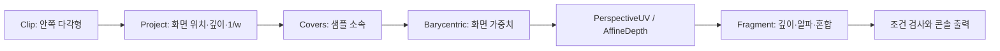

<callout icon="🧪" color="blue_bg">
	**한 번에 여러 상태를 바꾸지 말고, 정점 입력에서 최종 기록까지 실패한 경계를 찾습니다.**
	CPU 실습 C++20 · 개정일 <mention-date start="2026-10-13"/>. 이 문서는 앞의 네 문서와 실습 파일을 연결합니다.
</callout>
<mention-page url="https://app.notion.com/p/3e66577f53a549fe99a94ac26f68a685">DX9 렌더링 파이프라인 — 개정판 v1.0</mention-page>
<table_of_contents color="gray"/>
## 1. 이번 실습의 목적과 경계
이 실습은 Direct3D 9을 호출하는 게임이 아니라, 파이프라인의 핵심 수식과 상태를 관찰하는 **CPU 수치 모델**입니다. 창·그림을 출력하지 않고 콘솔 출력과 조건 검사로 결과를 확인합니다. 버퍼 해석·클리핑·보간·블렌딩의 의미를 이해한 뒤 실제 D3D9 코드와 비교하는 용도입니다.
실제 GPU에서는 정밀도, 픽셀·샘플 위치, 커버리지, 셰이더 최적화, 상태 지원 능력 등이 추가로 관여합니다. 따라서 CPU 검사 통과를 드라이버 적합성이나 GPU 화면 검증으로 표시하지 않습니다. 실제 장치·버퍼 생성과 Reset 구현은 다음 DX9 구현 단계의 대상입니다.
## 2. 실습 파일을 읽는 순서
<table fit-page-width="true" header-row="true">
<tr>
<td>파일</td>
<td>주제</td>
<td>실행 조건 검사</td>
</tr>
<tr>
<td>src/vertex_input.cpp</td>
<td>정점 stride·속성 offset·인덱스·버퍼 경계</td>
<td>22회</td>
</tr>
<tr>
<td>src/transform_clip.cpp</td>
<td>좌표 추적·투영 입력·여섯 동차 클립 평면</td>
<td>79회</td>
</tr>
<tr>
<td>src/raster_uv.cpp</td>
<td>샘플 소속·UV·깊이·텍셀 중심</td>
<td>71회</td>
</tr>
<tr>
<td>src/depth_blend.cpp</td>
<td>깊이 비교/쓰기·알파·혼합 순서</td>
<td>19회</td>
</tr>
<tr>
<td>src/pipeline_trace.cpp</td>
<td>삼각형 하나의 클립→화면→보간→출력 연결</td>
<td>105회</td>
</tr>
<tr>
<td>합계</td>
<td>5개 실행 프로그램</td>
<td>296회</td>
</tr>
</table>
공통 계산은 `include/pipeline.hpp`, 검사 보조는 `include/check.hpp`입니다. README에 함수별 전제와 범위가 있고, CMakeLists.txt는 위 다섯 프로그램을 각각 빌드·CTest에 등록합니다. 검사기가 실행 조건을 확인하는 것이며 컴파일 실패 예제나 성능 벤치마크를 포함한 것은 아닙니다.
`examples/texture_sm3.hlsl`은 D3D9의 VS/PS 입출력을 연결하는 참고 소스입니다. 기본 CMake 빌드 대상에 포함하지 않았고 FXC 컴파일·GPU 실행을 수행하지 않았습니다.
## 3. 삼각형 한 개를 따라갑니다
통합 실습은 다음 클립 좌표와 UV를 받습니다. 이미 정점 처리 이후의 데이터를 주어 나머지 단계를 분리해 보는 구성입니다. 로컬→클립 행렬 계산은 transform_clip에서 따로 검증합니다.
<table fit-page-width="true" header-row="true">
<tr>
<td>정점</td>
<td>클립 좌표</td>
<td>UV</td>
</tr>
<tr>
<td>A</td>
<td>(−0.8, 0.8, 0.4, 1)</td>
<td>(0, 0)</td>
</tr>
<tr>
<td>B</td>
<td>(0.8, 0.8, 0.4, 1)</td>
<td>(1, 0)</td>
</tr>
<tr>
<td>C</td>
<td>(0, −0.8, 0.4, 1)</td>
<td>(0.5, 1)</td>
</tr>
</table>
이 삼각형은 여섯 평면 안에 있으므로 클리핑 후 정점 수가 3개입니다. 8×8 뷰포트로 변환하면 화면 좌표는 A=(0.8,0.8), B=(7.2,0.8), C=(4,7.2)가 됩니다. 정수 픽셀 중심을 순회하면서 포함 판정→보간→출력을 수행합니다.

실제로 포함된 샘플은 **25개**입니다. 샘플 `(4,4)`의 UV는 `(0.5,0.5)`, 깊이는 0.4입니다. 색을 `(u,v,0,1)`로 만드는 간단한 셰이딩 수치 모델을 적용합니다. 화면 이미지를 만들어 눈으로 비교한 결과는 아닙니다.
공통 헤더를 사용하는 핵심 코드는 다음과 같습니다. 완전한 main과 오류 처리·검사는 `src/pipeline_trace.cpp`에 있습니다.
```c++
for (int y = 0; y < 8; ++y) {
    for (int x = 0; x < 8; ++x) {
        const Vec2 point{static_cast<double>(x), static_cast<double>(y)};
        if (!Covers(xy, point)) {
            continue;
        }
        const auto weights = Barycentric(xy, point);
        if (!weights) {
            throw std::runtime_error("invalid triangle");
        }
        const auto uv = PerspectiveUV(screen, *weights);
        const double depth = AffineDepth(screen, *weights);
        Pixel output{{0, 0, 0, 1}, 1};
        const bool written = Fragment(output, {uv.x, uv.y, 0, 1}, depth, {});
        // written과 output을 검사합니다.
    }
}
```
위 조각의 screen·xy는 앞서 변환해 둔 세 정점입니다. 해당 입력이 정점 세 개를 유지한다는 조건에 특화되어 있습니다. 클리핑으로 4개 이상의 정점이 생기는 일반 다각형을 통째로 처리하는 완성된 렌더러는 아니며, 그런 클리핑 결과 자체는 별도 테스트에서 확인합니다.
## 4. 화면에 안 보일 때의 진단 순서
처음부터 최종 재질을 모두 켜지 말고 단색 출력, 단순 기하, 명시적인 상태로 입력 변수를 줄입니다. 프레임 캡처 도구가 있다면 지원하는 API·환경을 확인한 뒤 해당 드로우의 입력과 상태를 관찰합니다. 도구가 보여 주는 값과 CPU 계산값의 좌표 공간을 맞춰야 합니다.
<table fit-page-width="true" header-row="true">
<tr>
<td>증상</td>
<td>먼저 확인할 것</td>
<td>원인 분리</td>
</tr>
<tr>
<td>아무것도 안 보임</td>
<td>드로우 실행 여부·HRESULT·대상 표면·버퍼·primitive count</td>
<td>Clear 색이 보이는지, 단색 삼각형까지 단순화</td>
</tr>
<tr>
<td>일부 정점부터 기하가 깨짐</td>
<td>stride·속성 offset·BaseVertexIndex·인덱스 범위</td>
<td>CPU에서 같은 바이트를 해석해 비교</td>
</tr>
<tr>
<td>카메라 근처에서 폭발하듯 늘어남</td>
<td>클립 좌표의 w·near 경계·나눗셈 순서</td>
<td>w를 지워 버리거나 음수 w를 무조건 나눴는지 확인</td>
</tr>
<tr>
<td>특정 방향 또는 음수 스케일에서 사라짐</td>
<td>인덱스 순서·컬링 모드·변환 방향</td>
<td>임시로 CULL_NONE으로 비교한 뒤 원인 수정</td>
</tr>
<tr>
<td>메시는 맞고 텍스처만 틀림</td>
<td>UV 선언·TEXCOORD·텍스처·샘플러·행렬 전송</td>
<td>UV를 RGB로 출력해 보간부터 구분</td>
</tr>
<tr>
<td>1:1 이미지가 흐리거나 반 칸 어긋남</td>
<td>텍셀 중심·픽셀 중심·반 픽셀 보정</td>
<td>이미 보정한 경로에 추가 보정했는지 확인</td>
</tr>
<tr>
<td>투명 영역 뒤 물체가 사라짐</td>
<td>알파 거부·깊이 비교·깊이 쓰기·그리기 순서</td>
<td>알파0도 깊이에 영향을 주는지 확인</td>
</tr>
<tr>
<td>어떤 패스를 그린 뒤부터 깨짐</td>
<td>렌더 상태·셰이더·텍스처·타깃의 잔존 상태</td>
<td>각 패스의 필요 상태를 명시하고 전후 비교</td>
</tr>
</table>
위 표는 원인을 확정하는 규칙이 아니라 확인 순서입니다. 예를 들어 흰 사각형은 텍스처가 없어서일 수도, PS가 흰색을 반환해서일 수도 있습니다. 관찰 하나를 원인 하나에 바로 대응시키지 않습니다.
## 5. 실행 방법
C++20 컴파일러와 CMake 3.20 이상이 필요합니다. 압축을 푼 프로젝트 폴더에서 실행합니다.
```bash
cmake -S . -B build -DCMAKE_BUILD_TYPE=Debug
cmake --build build --config Debug
ctest --test-dir build -C Debug --output-on-failure
```
상세 출력은 `ctest --test-dir build -C Debug -V`로 확인합니다. 특정 컴파일러를 지정한 재검증은 Python 3.9 이상에서 다음과 같습니다.
```bash
python3 verify.py --compiler g++ --build-dir ../pipeline-check-gcc
python3 verify.py --compiler clang++ --build-dir ../pipeline-check-clang
python3 verify.py --compiler clang++ --sanitizers --build-dir ../pipeline-check-san
```
Windows에서는 Python 실행 명령이 python일 수 있습니다. MSVC용 CMake 분기도 제공하지만 이번 실행 환경에서는 사용하지 않았습니다. 스크립트는 한 번 실행하고 종료하며, 기존 디렉터리를 삭제하지 않습니다. 서로 다른 컴파일러에는 서로 다른 빌드 폴더를 사용합니다.
## 6. 실제 검증 결과
<table fit-page-width="true" header-row="true">
<tr>
<td>환경·구성</td>
<td>수행 결과</td>
<td>의미</td>
</tr>
<tr>
<td>Linux x86-64 · GCC 14.2.0</td>
<td>5/5 프로그램, 296회 검사 통과</td>
<td>일반 C++20 CPU 빌드·실행</td>
</tr>
<tr>
<td>Linux x86-64 · Clang 17.0.0</td>
<td>5/5 프로그램, 296회 검사 통과</td>
<td>다른 컴파일러로 같은 조건 대조</td>
</tr>
<tr>
<td>Clang · ASan·UBSan</td>
<td>5/5 프로그램, 296회 검사 통과</td>
<td>이번 실행에서 해당 검사기 진단 없음</td>
</tr>
<tr>
<td>Windows/MSVC · D3D9 · GPU · FXC/HLSL</td>
<td>컴파일·실행 미검증</td>
<td>공식 API 대조와 참고 코드 작성만 수행</td>
</tr>
</table>
296회에는 반복문에서 샘플별로 검사한 횟수가 포함됩니다. 같은 검사를 세 구성에서 반복했으므로 독립된 888개 조건이라고 세지 않습니다. 별도의 컴파일 거부 예제는 없으며, 잘못된 입력에 대한 함수 거부를 실행 시 검사했습니다. 원시 로그는 ZIP의 logs 폴더에 있습니다.
기본 경고 옵션은 GCC/Clang의 `-Wall -Wextra -Wpedantic -Wconversion -Wshadow`입니다. Sanitizer 구성은 `-fsanitize=address,undefined -fno-omit-frame-pointer`를 사용했습니다. 재검증 스크립트도 실제로 실행해 같은 결과를 확인했습니다.
## 7. 이 테스트로 말할 수 없는 것
Double 모델이 실제 D3D9 드라이버의 정밀도나 모든 서브픽셀 규칙을 복제한다는 뜻은 아닙니다. Clip은 볼록 다각형·정해진 평면·제한된 값 범위, 샘플러는 1차원 level0, 출력은 LESS_EQUAL과 source-over에 한정됩니다. 스텐실, sRGB, MSAA, 이미지 로더, 실제 화면 출력은 설명만 포함하거나 범위 밖입니다.
C++20의 span·lerp 등을 사용하므로 기존 C++11 프로젝트에 그대로 붙일 수 없습니다. 코드에서 배울 개념과 사용 가능한 표준·라이브러리를 나누어 보세요. 메모리 검사기 통과도 전체 입력·동시성·GPU 자원 수명의 안전성 증명은 아닙니다.
## 8. 이해 확인
<details>
<summary>이 CPU 모델에서 좌표가 맞으면 실제 게임의 행렬도 맞다고 확정할 수 있을까?</summary>
	확정할 수 없습니다. GPU에 전달한 float 데이터, 전치 여부, 셰이더 mul 방향, 활성 셰이더와 상수 레지스터까지 같은 계약인지 확인해야 합니다. CPU 모델은 기대값을 만드는 기준이며 전송 경로 검증을 대신하지 않습니다.
</details>
<details>
<summary>통합 예제는 왜 텍스처 파일이나 복잡한 모델을 읽지 않을까?</summary>
	입력·변환·보간·출력의 원인을 분리하기 위해서입니다. 파일 디코딩이나 자원 생성 오류가 섞이면 수식이 맞는지 확인하기 어렵습니다. 먼저 이 작은 모델의 기대값을 확인하고 다음 DX9 구현 단계에서 실제 자원과 연결합니다.
</details>
관련 API 근거는 앞의 01\~04 본문에 배치했습니다. 진단 출발점: [정점·인덱스 버퍼](https://learn.microsoft.com/en-us/windows/win32/direct3d9/rendering-from-vertex-and-index-buffers), [뷰포트와 클리핑](https://learn.microsoft.com/en-us/windows/win32/direct3d9/viewports-and-clipping), [렌더 상태](https://learn.microsoft.com/en-us/windows/win32/direct3d9/d3drenderstatetype). 이 문서의 검사 횟수·수치 결과는 동봉한 소스와 실행 로그에서 나온 관찰입니다.
다음 문서: <mention-page url="https://app.notion.com/p/bdcccf3ce6d34930827bf0a519b4fa78"/>. 장치·자원·버퍼·드로우·상태 관리와 Lost Device/Reset을 파이프라인 개념에 연결합니다.
