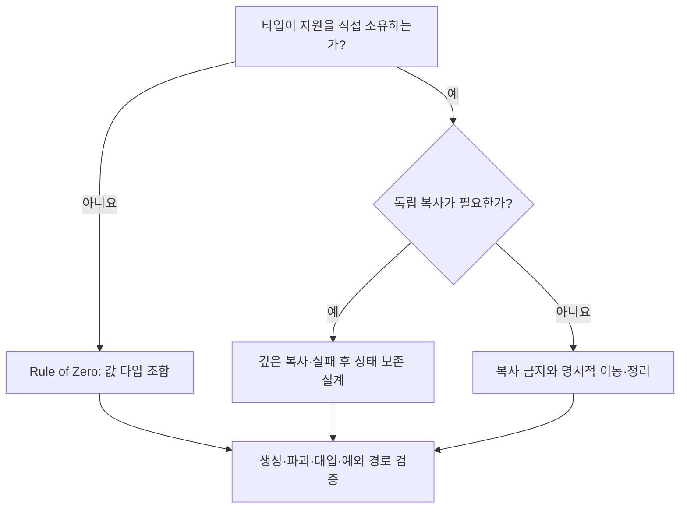

<callout icon="📖" color="blue_bg">
<b>기존 독서 노트의 항목 번호를 유지하되, 문장과 예제는 현재 학습 목적에 맞게 다시 씁니다.</b>

C++20 기준 · 개정일 <date start="2026-10-13" />. 책의 원문 번역이 아니라 기존 개인 메모를 검토한 독립적인 학습 해설입니다.
</callout>

<mention url="https://app.notion.com/p/8178c17f593b4f4e83a0b42544b8fe2b">Effective C++ — 55항목 개정판 v1.0</mention> · 개념 기초 <mention url="https://app.notion.com/p/aaa55bced8ff459ba67fb036fb34bb3b" />

<table-of-contents color="gray" />

## 항목 1. 패러다임보다 문제와 계약을 선택하기

C++에서는 절차적 함수, 객체 수명 관리, 런타임 다형성, 템플릿과 표준 알고리즘을 함께 사용할 수 있습니다. 하나의 스타일이 모든 영역을 대신하지 않습니다. 데이터 일괄 처리에는 연속 컨테이너와 함수가 단순할 수 있고, 다르게 구현된 리소스를 같은 인터페이스로 다루려면 가상 함수가 편리할 수 있습니다.

‘C++이니 전부 클래스로 만든다’나 ‘성능을 위해 상속은 전부 제거한다’가 아니라, 변경 축과 소유권, 데이터 접근 패턴을 먼저 적어 봅니다. 이번 학습에서는 언어 규칙과 특정 게임 프레임워크의 관례를 구별하는 것을 출발점으로 삼습니다. Update·Render·Free라는 함수 이름은 그 프레임워크의 약속이지 C++ 언어의 필수 멤버가 아닙니다.

## 항목 2. 이름과 타입이 있는 상수·함수를 우선하기

상수에는 const·constexpr, 타입 별칭에는 using, 재사용 계산에는 일반 함수나 함수 템플릿을 먼저 검토합니다. 함수형 매크로는 인수를 여러 번 평가하거나 우선순위를 바꾸는 문제를 일으킬 수 있습니다. 괄호를 많이 붙여도 중복 평가 문제까지 없어지지 않습니다.

```c++
constexpr int MaxSlots = 32;
constexpr int Square(int value) { return value * value; }
// 작은 값만 사용하는 예. 임의 int의 곱 오버플로를 해결하는 함수는 아닙니다.
```

매크로가 등장할 때마다 무조건 메모리 사본이 생기고 const는 항상 한 개만 생긴다고 설명하지 않습니다. 실제 객체 존재, 연결, 최적화에 따라 결과가 달라집니다. 조건부 컴파일·헤더 가드처럼 전처리기가 맡는 역할은 여전히 구분해 사용합니다. C++17의 inline constexpr 변수는 헤더에 공용 상수를 정의할 때 선택지가 되지만 기존 C++11 코드는 정의·연결 조건을 따로 확인합니다.

## 항목 3. const는 경로와 인터페이스의 약속

const는 이름에 붙이는 장식이 아니라 해당 경로를 통한 변경을 제한합니다. 포인터 자체의 const와 대상의 const, const 멤버 함수와 반환 타입의 const를 따로 읽습니다. 원문에 있던 <code>iter = 10</code>은 원소 대입 예제가 아닙니다. 원소를 바꾸려면 <code>*iter = 10</code>입니다.

```c++
std::vector<int> values{1, 2};
const auto iterator = values.begin();
*iterator = 7;                    // 원소는 변경 가능
// ++iterator;                   // 반복자 객체는 const

auto readonly = values.cbegin();
++readonly;                      // 위치는 변경 가능
// *readonly = 9;                // 원소는 읽기 전용
```

전체 실행은 <code>interfaces.cpp</code>에 있습니다. const 멤버 함수의 포인터 멤버를 통해 외부 대상이 바뀔 수 있다는 점과 논리적 const를 구별합니다. mutable 캐시도 자동으로 스레드 안전해지지 않습니다. int를 값으로 반환하는 함수의 결과에 대입할 수 없는 문제를 ‘반환값에 const를 붙였기 때문’이라고 설명하지 않습니다. 반대로 클래스 값 반환에 불필요한 const를 붙이면 이동 선택을 방해할 수 있습니다.

## 항목 4. 생성 성공 시 유효한 상태 만들기

초기화와 대입을 구분하고 기본 멤버 초기화·초기화 목록으로 상태를 분명히 합니다. 멤버의 초기화 순서는 초기화 목록에 적은 순서가 아니라 선언 순서입니다. 다른 멤버를 초기화에 사용할 때 그 멤버가 먼저 준비되어 있는지 확인합니다.

전역 또는 서로 다른 번역 단위의 정적 객체에 대한 초기화 순서 의존은 피해야 할 설계 위험입니다. 지역 static으로 필요 시 초기화하는 방식이 도움될 수 있고, C++11부터 지역 static 초기화의 동시 실행에 대한 규칙이 있습니다. 하지만 초기화가 안전하다는 사실이 그 객체의 이후 변경까지 스레드 안전하게 만들지는 않습니다. 종료 시 소멸 순서와 다른 전역 객체의 접근도 생각합니다.

근거: [N4861 — 멤버 초기화](https://timsong-cpp.github.io/cppwp/n4861/class.base.init), [선언문과 지역 static 초기화](https://timsong-cpp.github.io/cppwp/n4861/stmt.dcl).

## 항목 5. 암묵적 특수 멤버를 추측하지 않기

기본 생성자·소멸자·복사 생성·복사 대입·이동 생성·이동 대입은 서로의 사용자 선언과 멤버 특성에 영향을 받습니다. 생성자 하나를 선언하면 아무 인수 없는 생성이 자동으로 제공되지 않을 수 있고, unique\_ptr 멤버는 기본 복사를 막습니다. 사용자 선언 소멸자나 복사 연산은 암묵적 이동에 영향을 줍니다.

‘아무것도 쓰지 않으면 항상 사용 가능한 함수 여섯 개가 생긴다’가 아니라, 필요한 연산을 명시하고 컴파일 결과를 확인합니다. <code>=default</code>로 요청해도 멤버의 제약 때문에 삭제될 수 있습니다. trait는 호출 가능성을 조사하는 보조 도구이며 사용자 코드의 모든 의미적 정확성을 증명하지 않습니다. <code>is_move_constructible</code>이 참이어도 rvalue를 받는 const 참조 복사 때문일 수 있습니다.

## 항목 6. 금지하는 연산은 delete로 표현하기

복사하면 안 되는 장치 소유자나 유일한 세션은 복사 생성·복사 대입을 <code>=delete</code>로 표현합니다. 예전의 private 선언만 남기고 정의하지 않는 관행은 오래된 환경의 맥락으로 이해하고 새 학습 예제에는 명확한 진단을 사용합니다.

이동까지 금지할지, 이동 전용 소유 타입으로 만들지는 따로 결정합니다. ‘복사 금지’가 ‘모든 연산 금지’와 같은 말은 아닙니다. 테스트 <code>negative/copy_unique.cpp</code>는 unique\_ptr의 복사를 시도할 때 컴파일이 거부됨을 확인합니다. 실패 코드를 정상 예제에 섞어 빌드를 깨뜨리지 않습니다.

## 항목 7. 기반 삭제 경로를 설계하기

기반 포인터를 통해 파생 객체의 소멸을 허용하는 일반적인 다형 계층에서는 public virtual 소멸자를 제공합니다. 기반 포인터 삭제를 금지할 경우 protected nonvirtual 소멸자를 검토할 수 있습니다. 모든 클래스가 상속용 기반이 아니므로 작은 값 타입에까지 무조건 virtual을 추가하지 않습니다.

가상 소멸자가 없는 기본 포인터로 파생 객체를 ordinary delete하는 문제는 단순한 ‘파생 소멸자만 안 불러서 누수’로 제한해 설명할 수 없습니다. 언어의 삭제 조건을 어기면 미정의 동작입니다. unique\_ptr\<Base>의 기본 삭제도 이 계약을 대신 고쳐주지 않습니다. 구체적인 스마트 포인터와 deleter의 삭제 방식을 따로 봅니다.

근거: [N4861 — delete](https://timsong-cpp.github.io/cppwp/n4861/expr.delete), [Core Guidelines C.35](https://isocpp.github.io/CppCoreGuidelines/CppCoreGuidelines#Rc-dtor-virtual).

## 항목 8. 소멸 경로에서 실패를 어떻게 알릴까

스택 풀기 도중 또 예외가 소멸자를 벗어나면 종료로 이어질 수 있습니다. 소멸자는 자원을 정리하고 예외가 외부로 전파되지 않도록 설계하는 것이 기본입니다. 그렇다고 중요한 저장·연결 종료 오류를 무조건 삼켜서 성공처럼 보이게 만들라는 뜻은 아닙니다.

실패 보고가 중요한 작업은 명시적 Close·Commit 같은 연산에서 결과를 반환하고, 소멸자는 최후의 정리를 담당하도록 나눌 수 있습니다. noexcept가 붙은 함수가 예외를 내보내면 std::terminate가 호출됩니다. noexcept 표기만 추가해 문제를 숨기지 말고 내부 호출의 실패 가능성을 확인합니다.

## 항목 9. 생성·소멸 단계의 가상 호출

기반 생성자에서 부른 가상 함수가 아직 준비되지 않은 최종 파생 구현으로 가는 것으로 설계하지 않습니다. 현재 생성·소멸 단계의 규칙을 따르며, 파생 멤버에 의존하는 초기화는 그 부분이 완성된 뒤 수행해야 합니다.

실습 Effect와 Fire는 생성·소멸 단계별 Kind 값을 기록합니다. 결과는 기반 생성 1 → 파생 생성 2 → 파생 소멸 2 → 기반 소멸 1입니다. 이 동작은 virtual 키워드가 사라진다는 말이 아니라 객체의 해당 단계에 대한 가상 호출 규칙입니다. 완료 후 확장 작업이 필요하면 별도 시작 계약을 설계합니다.

근거: [N4861 — class.cdtor](https://timsong-cpp.github.io/cppwp/n4861/class.cdtor).

## 항목 10. 대입은 대상 객체를 참조로 반환하기

대입 연산자는 관례적으로 <code>T&</code>를 반환하고 <code>return *this;</code>를 사용합니다. 체인 대입이나 기존 코드의 예상과 맞추기 위한 인터페이스 설계입니다. 값으로 반환하면 불필요한 복사·이동과 다른 수명 의미가 생길 수 있습니다.

<code>*this</code>는 포인터 this 자체가 아니라 대입 대상 객체를 나타냅니다. 연산자 오버로드가 문법적으로 허용되는 여러 반환 형태를 가질 수 있다는 사실과, 읽기 좋은 타입이 통상적인 연산 의미를 따르는 것이 좋다는 판단을 구분합니다. 이번 IntBuffer의 복사·이동 대입 모두 자신의 참조를 반환합니다.

## 항목 11. 자기 대입과 실패를 함께 처리하기

<code>this == &other</code> 검사만으로 예외 안전성이 완성되지는 않습니다. 먼저 기존 자원을 버린 뒤 새 사본을 할당하면 사본 준비가 실패할 때 원래 데이터가 사라질 수 있습니다. 새 자원을 준비한 뒤 교체하면 자기 대입과 실패 경로를 단순하게 만들 수 있습니다.

이번 IntBuffer는 임시 사본을 만들고 noexcept swap합니다. 실패 주입 시 기존 크기와 값이 유지되는지, 자기 복사·자기 이동의 명시된 계약이 지켜지는지 검사합니다. 모든 타입이 자기 이동 후 같은 값을 보존해야 한다는 주장은 하지 않습니다. 타입마다 허용하는 후조건을 정해야 합니다.

## 항목 12. 기본 부분과 모든 멤버의 복사 의미

복사 구현을 직접 작성할 때 새 멤버를 빠뜨리거나 기반 부분의 복사를 빼면 객체가 부분적으로 다른 값을 가질 수 있습니다. 복사 생성자에서 기반 생성, 복사 대입에서 기반 대입을 어떻게 수행하는지 확인합니다.

하지만 ‘무조건 모든 raw pointer의 대상을 깊게 복사하라’는 뜻은 아닙니다. 포인터가 관찰자인지 소유자인지, ID를 복사해도 되는지, 락·장치·파일이 복제 가능한지에 따라 정책이 달라집니다. 가능하면 표준 값·소유 타입을 조합해 Rule of Zero를 사용하고, 사용자 정의 복사가 필요하면 의미와 실패 보장을 문서화합니다.

## 객체 수명·복사 정책 비교



<table fit-page-width="true" header-row="true">
<tr>
<td>
상황
</td>
<td>
대표적인 설계
</td>
<td>
반례·검증 지점
</td>
</tr>
<tr>
<td>
값 멤버만 있는 객체
</td>
<td>
Rule of Zero, 표준 타입에 수명 위임
</td>
<td>
불필요한 수동 소멸자·복사 중복
</td>
</tr>
<tr>
<td>
단독 자원 소유
</td>
<td>
RAII, 복사 금지 또는 깊은 복사
</td>
<td>
이중 해제·생성 실패·자기 대입
</td>
</tr>
<tr>
<td>
다형 기반 타입
</td>
<td>
기반 포인터 삭제를 허용하면 가상 소멸자
</td>
<td>
잘못된 삭제는 단순 누수 이상의 UB
</td>
</tr>
</table>

기존 수명·복사 실습을 해석하는 보조 자료이며 새 테스트 실행을 의미하지 않습니다.

## 실습과 확인 문제

<code>lifetime</code>, <code>ownership</code>, <code>interfaces</code>, <code>polymorphism</code>을 순서대로 실행합니다. 전체 소스는 상위 문서의 공통 실습 팩, 자세한 환경·검증 범위는 <mention url="https://app.notion.com/p/3f8a99703f408186b6f6e6196b1be1a6" />에 있습니다.

<toggle>
복사 생성자를 값 매개변수로 만들면 프로그램 실행 중 재귀에 빠지는가?

그 형태의 생성자 선언 자체가 잘못됩니다. 부정 예제는 -c 컴파일 단계에서 거부되며 실행되지 않습니다. 컴파일 오류와 실행 중 스택 오버플로를 분리해야 합니다.
</toggle>

<toggle>
복사 대입에 this == &other 검사만 추가하면 강한 예외 보장이 생기는가?

자기 대입 한 경우만 다룬 것입니다. 할당·복사가 실패하는 일반 경로에서 기존 상태를 보존하는지도 확인해야 합니다. 이번 구현은 임시 준비 후 noexcept 교체를 사용합니다.
</toggle>

## 기준 문서

[N4861 — 특수 멤버](https://timsong-cpp.github.io/cppwp/n4861/special), [복사·이동 생성](https://timsong-cpp.github.io/cppwp/n4861/class.copy.ctor), [복사·이동 대입](https://timsong-cpp.github.io/cppwp/n4861/class.copy.assign), [예외 명세](https://timsong-cpp.github.io/cppwp/n4861/except.spec). 기존 책의 설명 맥락과 언어 기준이 달라질 수 있으므로 C++20과 C++11 호환성을 구분해 읽습니다.
