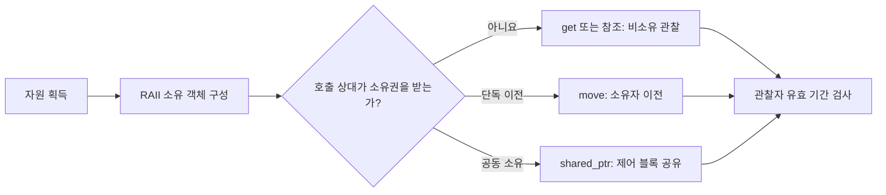

<callout icon="🔐" color="blue_bg">
<b>좋은 API는 사용법뿐 아니라 수명·소유권·실패 결과를 전달합니다.</b>

C++20 학습 기준 · 개정일 <date start="2026-10-13" />.
</callout>

<mention url="https://app.notion.com/p/8178c17f593b4f4e83a0b42544b8fe2b">Effective C++ — 55항목 개정판 v1.0</mention>

<table-of-contents color="gray" />

## 항목 13. 자원을 객체 수명에 묶기

RAII는 메모리뿐 아니라 파일, 락, 그래픽 자원 등 취득한 자원의 해제를 객체 수명에 연결하는 방식입니다. 정상 반환·조기 반환·예외 경로마다 수동 정리 코드를 반복하는 대신 소유 객체가 정리하도록 만듭니다.

기존 메모의 auto\_ptr은 당시의 역사적 맥락으로만 남깁니다. C++20 학습 코드에서는 이동 전용 소유에 unique\_ptr, 실제 공동 소유에 shared\_ptr 등 적절한 타입을 사용합니다. raw pointer를 없애는 것이 목표가 아니라 <b>누가 소유하며 누가 관찰하는지 명확히 하는 것</b>입니다. 메모리 이외 자원에는 custom deleter나 전용 RAII 클래스를 만들 수 있습니다.

## 항목 14. 자원 관리 객체를 복사한다는 의미

파일 핸들 소유자 두 개가 같은 닫기 책임을 갖게 하면 이중 해제가 생길 수 있습니다. 선택지는 복사 금지, 새 자원으로 복제, 공동 소유 등입니다. 자원의 종류와 API 계약에 따라 다릅니다. ‘스마트 포인터로 감싸면 복사 정책은 자동 결정’이라고 생각하지 않습니다.

unique\_ptr는 복사가 금지되고 이동으로 소유권을 넘길 수 있습니다. shared\_ptr를 복사하면 같은 제어 블록의 소유에 참여하며, 대상을 깊게 복사하지 않습니다. weak\_ptr는 강한 소유권을 늘리지 않고 lock으로 일시적인 소유를 얻는 관찰 수단입니다. 대상 객체의 데이터에 대한 동시 접근 안전성은 별도의 문제입니다.

## 항목 15. native handle을 꺼내는 연산 구별

래퍼 내부의 raw pointer·핸들을 외부 API에 전달해야 할 수 있습니다. <code>.get()</code>처럼 관찰용으로 꺼내는 것과 <code>.release()</code>처럼 소유권 관리에서 분리하는 것은 전혀 다릅니다. 반환 타입이 같은 포인터여도 해제 책임의 이동이 다릅니다.

```c++
auto owner = std::make_unique<int>(42);
int* observer = owner.get(); // 관찰: 직접 delete하지 않음
(void)observer;
auto next = std::move(owner); // 소유권 이전
```

실습 밖의 특정 API가 포인터를 잠깐 읽는지, 저장해 나중에 쓰는지, 소유권을 가져가는지는 문서를 확인해야 합니다. 함수 이름만 보고 추측하지 않습니다. COM 등의 출력 포인터를 받는 API는 래퍼가 제공하는 안전한 주소 취득 도구의 계약을 별도로 확인합니다.

## 항목 16. 할당과 해제의 짝을 맞추기

new T는 delete, new T\[n\]은 delete\[\], malloc 계열은 free처럼 대응합니다. typedef나 using으로 배열 타입을 숨겼다고 표현식의 배열 의미가 없어지는 것이 아닙니다. 가능하면 string·vector·array 같은 타입으로 직접 배열 자원 관리를 피합니다.

위치 지정 new로 자동 저장 공간 안에 만든 객체에 일반 delete를 쓰지 않습니다. 그 공간을 누가 확보했는지에 따라 객체 수명 종료와 공간 반환을 분리합니다. 특정 API가 생성한 자원을 다른 CRT나 다른 할당 API로 해제하지 않도록 모듈 경계의 규칙도 확인합니다.

## 항목 17. 소유권 성립 시점과 인수 평가 순서

예전 설명에서는 한 함수 호출의 인수들에 raw new와 다른 예외 가능 연산을 함께 쓰면 소유권이 성립하기 전에 예외가 발생할 수 있다는 문제가 강조되었습니다. <b>C++17 이후 함수 인수의 매개변수 초기화 사이 순서 규칙이 바뀐 부분</b>이 있으므로 옛 예제를 같은 이유로 그대로 설명하지 않습니다. 그래도 좌우 인수의 평가 순서 자체가 항상 왼쪽부터라고 보장되는 것은 아닙니다.

```c++
Consume(std::make_unique<Resource>(), FailPriority());
```

이번 transaction 실습에서는 FailPriority가 예외를 던져도 Resource가 살아 남지 않는지 검사합니다. make\_unique를 써서 취득과 소유를 묶고, 다른 부수 효과가 서로 의존한다면 문장을 나눠 순서를 명시합니다. 해당 테스트는 C++20 환경 결과이며 C++11의 옛 raw-new 식까지 실행 검증했다고 주장하지 않습니다.

근거: [N4861 — 함수 호출의 인수 평가](https://timsong-cpp.github.io/cppwp/n4861/expr.call).

## 항목 18. 잘못 사용하기 어려운 인터페이스

인수의 순서가 바뀌어도 모두 int라서 컴파일된다면 <code>Width</code>, <code>Height</code>, <code>Seconds</code> 같은 의미 있는 타입이나 설정 객체로 의도를 드러낼 수 있습니다. 필수 값, 선택 값, 소유·비소유, 실패 결과를 타입과 함수 이름에 표현합니다.

실습 Seconds는 double에서 암묵적으로 바뀌지 않도록 explicit 생성자를 사용하고 범위를 검사합니다. 외부에서 온 수치가 컴파일된다고 유효한 것은 아니므로 런타임 검증은 여전히 필요합니다. 타입을 지나치게 잘게 나누어 단순 연산까지 불편하게 만드는 비용도 고려합니다.

## 항목 19. 새 타입의 계약을 목록으로 설계하기

타입을 만들 때에는 생성 조건, 소멸 책임, 복사·이동 의미, 비교·정렬, 실패 결과, 스레드 접근, 직렬화 필요성을 생각합니다. 모든 연산을 처음부터 구현하라는 뜻이 아니라 제공하지 않는 연산도 분명히 정하라는 뜻입니다.

예를 들어 TextureHandle은 GPU 리소스를 소유하는가, ID를 관찰하는가에 따라 복사 정책이 달라집니다. ID라면 오래된 ID 재사용 문제, 소유자라면 해제 시점과 장치 수명을 봅니다. 이번 기본 실습에서는 실제 GPU 핸들을 구현한 것으로 가장하지 않고, IntBuffer와 Settings로 같은 설계 질문을 연습합니다.

## 항목 20. const 참조를 무조건적인 성능 규칙으로 쓰지 않기

작은 정수·포인터·가벼운 뷰는 값 전달이 단순할 수 있습니다. 큰 읽기 전용 객체는 const 참조가 복사를 피할 수 있습니다. 함수가 결국 소유 복사본을 저장한다면 값으로 받아 이동하는 설계도 후보입니다. 실제 호출 패턴과 예외 정책을 봐야 합니다.

다형 객체를 값으로 받으면 슬라이싱이 생길 수 있다는 의미 문제는 단순한 복사 비용보다 중요합니다. 반대로 참조를 장기 저장하면 원본 수명 의존이 생깁니다. ‘참조는 메모리를 전혀 쓰지 않으니 언제나 빠르다’는 설명을 버리고, 대상 ABI·최적화·실제 데이터로 판단합니다.

## 항목 21. 새 결과는 값, 빌린 참조는 수명 계약

함수 안에서 만든 지역 객체의 참조나 포인터를 반환해 사용하면 대상 수명 문제가 생깁니다. 결과를 소유하게 할 필요가 있으면 값 반환을 사용합니다. C++17 이후 특정 prvalue 결과는 복사 없이 직접 구성됩니다. 그러나 모든 값 반환이 같은 복사 생략 보장을 갖는 것은 아닙니다.

기존 장기 객체의 요소를 관찰하는 참조 반환은 올바른 API일 수 있습니다. 이 경우 소유자 수명과 컨테이너 무효화 조건을 문서화합니다. 임시 객체에서 view를 꺼내는 위험을 줄이려면 ref-qualified 함수나 rvalue 오버로드 삭제를 사용할 수 있습니다. 테스트 Label은 <code>View() && = delete</code>로 일부 잘못된 호출을 막지만, 모든 뷰 수명을 자동 검사하지는 않습니다.

## 항목 22. private의 목적은 변경 지점을 줄이는 것

서로 연관된 상태와 불변식을 갖는 타입은 private 멤버와 의미 있는 연산을 사용해 유효 상태를 관리합니다. 모든 멤버에 Getter/Setter를 하나씩 노출하면 외부가 여전히 내부 상태 변화 순서를 책임져야 할 수 있습니다.

독립적인 값을 묶은 단순 aggregate에는 public 멤버가 더 알맞을 수 있습니다. ‘모든 멤버는 무조건 private’라는 문장보다 어떤 규칙을 캡슐화해야 하는지 설명합니다. 공개 데이터 배치와 DLL·직렬화 포맷의 안정성도 별도 계약입니다. private로 바꿨다고 이미 외부에 저장한 바이너리 포맷이 저절로 안정되지는 않습니다.

## 항목 23. 공개 연산만으로 할 수 있는 일은 비멤버 후보

타입의 공개 인터페이스만으로 구현 가능한 편의 연산은 자유 함수로 두면 클래스가 직접 책임지는 영역을 줄일 수 있습니다. private 접근이 불필요하면 friend도 필요하지 않습니다. 네임스페이스로 관련 함수를 묶어 발견성을 유지할 수 있습니다.

그렇다고 모든 멤버를 밖으로 빼거나 ‘비멤버이면 캡슐화가 무조건 좋다’고 단정하지 않습니다. 불변식 유지·원자적인 상태 변경이 필요한 연산은 클래스 안에서 구현하는 편이 명확할 수 있습니다. 함수 위치보다 접근 권한과 데이터 책임의 경계를 판단합니다.

## 항목 24. 양쪽 피연산자의 변환을 의도적으로 허용

값 타입에서 <code>value + 2</code>와 <code>2 + value</code>를 같은 의미로 허용하려면 비멤버 연산자가 유용합니다. 멤버 호출의 대상이 되는 좌항은 일반적인 매개변수와 동일하게 암묵 변환을 적용해 후보를 찾는 것이 아니므로 차이가 생깁니다.

실습 Counter는 friend 비멤버 operator+를 통해 양쪽의 정수 변환을 검사합니다. 이것은 의도적으로 암묵 생성자를 선택한 교육 예입니다. 서로 섞이면 안 되는 초·거리·ID에 같은 정책을 무조건 적용하지 않습니다. 변환을 허용하는 범위와 손실 가능성부터 정합니다.

## 항목 25. 교체 연산과 ADL

타입에 맞는 swap은 그 타입의 네임스페이스에 비멤버로 제공하고, 일반적인 제네릭 호출은 <code>using std::swap; swap(a, b);</code>로 적절한 오버로드를 찾게 만들 수 있습니다. std 네임스페이스에 임의의 오버로드를 추가하는 방식은 피합니다. 표준 버전별 허용되는 customization 규칙을 확인해야 합니다.

```c++
friend void swap(Settings& left, Settings& right) noexcept {
    left.impl_.swap(right.impl_);
}
```

실제 정의는 pimpl.cpp에 있습니다. swap이 정말 예외를 던지지 않을 때에만 noexcept를 약속합니다. 컨테이너 swap은 allocator 전파·동등성 조건에 주의해야 하므로, 임의의 allocator를 가진 모든 타입에 무조건 같은 패턴을 적용하지 않습니다. copy-and-swap은 간단한 강한 보장을 제공할 수 있지만 매번 전체 복사를 만드는 비용과 버퍼 재사용 포기도 비교합니다.

## 소유권 전달 의사결정



<table fit-page-width="true" header-row="true">
<tr>
<td>
도구
</td>
<td>
의미
</td>
<td>
주의할 실패·수명
</td>
</tr>
<tr>
<td>
unique\_ptr.get()
</td>
<td>
소유권을 넘기지 않는 관찰 포인터
</td>
<td>
관찰자 수명이 소유자에 종속
</td>
</tr>
<tr>
<td>
std::move(unique\_ptr)
</td>
<td>
단독 소유권 이동 표현
</td>
<td>
이동 후 원 소유자의 계약 확인
</td>
</tr>
<tr>
<td>
shared\_ptr 복사
</td>
<td>
같은 대상을 공동 소유
</td>
<td>
깊은 복사가 아니며 순환 소유 주의
</td>
</tr>
<tr>
<td>
weak\_ptr
</td>
<td>
비소유 관찰, lock으로 임시 소유
</td>
<td>
만료 가능성과 lock 결과 확인
</td>
</tr>
</table>

소유 구조에 관한 비교이며 스마트 포인터 사용만으로 GPU·스레드 안전성이 보장되지는 않습니다.

## 실습 연결

상세 코드·검증 안내: <mention url="https://app.notion.com/p/3f8a99703f408186b6f6e6196b1be1a6" />. ownership, transaction, interfaces, pimpl을 실행하고 예외 직전·직후의 객체 상태를 비교합니다.

<toggle>
shared\_ptr를 복사했으니 원본 데이터를 바꿔도 사본은 독립적일까?

복사한 것은 같은 자원을 공동 소유하는 관리 객체입니다. 대상의 깊은 복사가 아닙니다. 독립된 값을 원하면 대상의 복제 정책을 따로 구현해야 합니다.
</toggle>

<toggle>
get()으로 받은 포인터를 delete하면 소유자가 비워질까?

소유자는 자동으로 그 사실을 알지 못합니다. 이후 중복 해제·잘못된 접근이 생길 수 있습니다. 관찰과 소유권 분리 연산을 구분해야 합니다.
</toggle>

## 기준 문서

[N4861 — unique\_ptr](https://timsong-cpp.github.io/cppwp/n4861/unique.ptr), [shared\_ptr](https://timsong-cpp.github.io/cppwp/n4861/util.smartptr.shared), [weak\_ptr](https://timsong-cpp.github.io/cppwp/n4861/util.smartptr.weak), [임시 객체 수명](https://timsong-cpp.github.io/cppwp/n4861/class.temporary), [Core Guidelines — 자원 관리](https://isocpp.github.io/CppCoreGuidelines/CppCoreGuidelines#S-resource).
