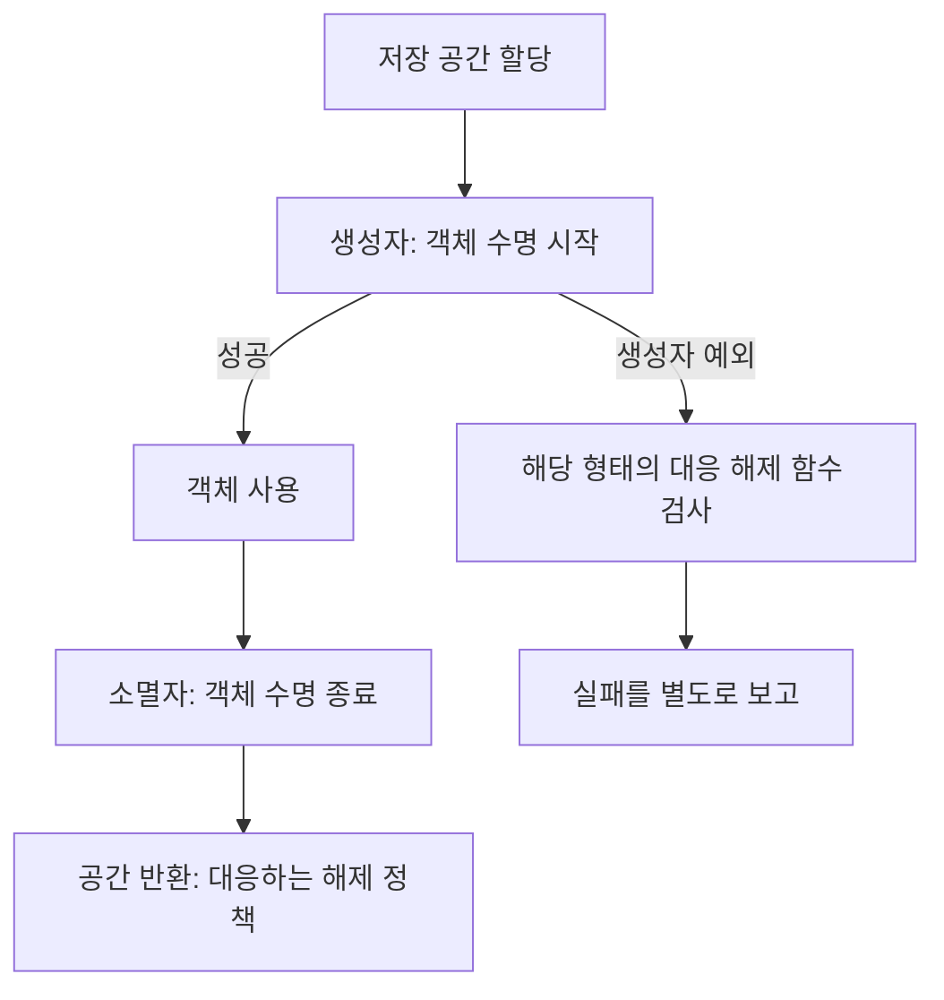

<callout icon="🔬" color="blue_bg">
<b>저수준 기능은 구현할 수 있다는 사실보다 실패·정렬·해제 계약이 중요합니다.</b>

C++20 기준 · 개정일 <date start="2026-10-13" /> · 실습 allocation·공통 검증 팩.
</callout>

<mention url="https://app.notion.com/p/8178c17f593b4f4e83a0b42544b8fe2b">Effective C++ — 55항목 개정판 v1.0</mention>

<table-of-contents color="gray" />

## 항목 49. new\_handler와 실패 종류

일반적인 throwing 할당이 공간 확보에 실패했을 때 new\_handler가 관련될 수 있습니다. 핸들러는 추가 공간 확보를 돕거나 다음 실패 정책을 바꾸는 등 정해진 계약을 따라야 하며, 무조건 반환만 반복하면 진전 없는 재시도가 될 수 있습니다. 전역 핸들러 상태는 프로세스의 다른 코드에도 영향을 줄 수 있습니다.

할당 함수 실패와 객체 생성자 실패는 분리합니다. <code>new(std::nothrow)</code>의 할당 실패가 nullptr로 표현될 수 있다는 것과, 생성자가 던진 예외가 전파되는 것은 다른 이야기입니다. 모든 new가 항상 같은 실패 형태를 가진다고 설명하지 않습니다.

이번 실습에서는 실제 시스템 메모리를 고갈시키거나 전역 new\_handler를 교체하지 않습니다. 고정 자원과 실패 주입으로 해당 경로를 안전하게 재현합니다. new\_handler의 모든 동작을 실행으로 검증한 것은 아닙니다.

근거: [N4861 — new\_handler](https://timsong-cpp.github.io/cppwp/n4861/new.handler), [new 표현식](https://timsong-cpp.github.io/cppwp/n4861/expr.new).

## 항목 50. 사용자 할당은 측정 가능한 이유로

특정 수명의 많은 작은 객체, 정렬이 중요한 데이터, 한 프레임의 임시 메모리, 할당 추적 등이 사용자 할당 정책을 검토하는 이유가 될 수 있습니다. ‘new는 느리니까 전부 풀로 바꾼다’보다 실제 할당 횟수·시간·수명 분포를 측정합니다.

표준 컨테이너와 allocator, C++17의 pmr 자원을 먼저 활용할 수도 있습니다. 디버깅을 위해 모든 전역 할당을 교체하기 전에 sanitizer나 플랫폼 진단 도구가 목적을 충족하는지도 봅니다. 커스텀 할당자는 재진입·멀티스레드·정렬·해제 주체·실패 처리가 추가 책임입니다. 단순한 테스트 통과로 범용 할당자의 완성을 주장하지 않습니다.

## 항목 51. new와 delete를 작성할 때의 계약

사용자 operator new/delete는 제공하는 범위에 맞게 실패 규칙, 0크기 요청, 정렬, deallocation, 배열, 추가 인수 등을 검토해야 합니다. C++17 이후 과도 정렬 타입에 대한 할당 선택 등도 고려해야 하므로 예전의 기본 함수 두 개만 복사해 모든 경우를 지원한다고 생각하지 않습니다.

클래스 전용 overload가 기존 할당 형태를 가릴 수 있고, 어떤 deallocation 함수가 선택되는지도 확인해야 합니다. sized deallocation이나 aligned allocation의 지원은 전체 설계와 짝을 맞춥니다. 배열 new가 부가 정보를 필요로 하는 경우까지 사용자가 임의의 주소 산술로 추측하지 않습니다.

이번 Pool/Widget 예는 <b>단일 타입·기본 정렬·동기 실행</b>에 한정됩니다. 전역 할당 함수 교체나 범용 엔진 allocator의 참조 구현으로 제공한 것이 아닙니다. 코드 앞의 제한과 실제 필요한 대상의 계약을 비교합니다.

## 항목 52. 위치 지정 생성의 실패 정리와 정상 정리

위치 지정 인수를 받는 operator new로 저장 공간을 얻은 뒤 생성자가 실패하면 대응하는 deallocation 함수가 선택될 수 있습니다. 짝이 맞지 않으면 확보한 공간이 정리되지 않는 문제가 생길 수 있습니다. 성공 후 사용을 마치는 경로는 별도로 구현해야 합니다.

```c++
struct Widget {
    static void* operator new(std::size_t bytes, Pool& source) {
        return source.Allocate(bytes);
    }
    static void operator delete(void* p, Pool& source) noexcept {
        source.Free(p);
    }
    explicit Widget(Pool&, bool fail) {
        if (fail) throw std::runtime_error("construction");
    }
};
```

설명용 축약이며 전체 구현은 allocation.cpp입니다. 생성 실패 테스트는 할당과 반환 카운터가 각각 1인지 검사합니다. 정상 생성된 객체는 unique\_ptr custom deleter가 std::destroy\_at과 Pool::Free를 호출하도록 합니다. Pool이 객체보다 먼저 사라지면 안 됩니다.

별도의 자동 byte 배열에 placement new한 int는 객체 수명만 끝내고 공간은 배열 소유자에게 맡깁니다. 그 주소를 delete하지 않습니다. 정렬된 저장 공간 확보와 객체 수명 시작·끝을 구분해야 합니다.

## 항목 53. 경고를 확인하고 테스트의 한계를 알기

컴파일러 경고는 의미를 확인한 뒤 원인을 해결합니다. 임의의 cast나 경고 억제 매크로로 출력을 없애는 것이 곧 수정은 아닙니다. 여러 컴파일러·경고 설정·디버그/최적화 구성을 비교하면 한 환경의 우연에 의존한 코드를 발견하는 데 도움이 됩니다.

이번 정상 실습은 GCC 14.2와 Clang 17에서 경고를 오류로 처리하여 빌드했고, Clang ASan·UBSan 구성을 별도로 실행했습니다. 9개 실행 파일, 89조건이 각 구성에서 통과했습니다. 컴파일 거부 예제 6개는 두 컴파일러에서 실제로 거부되었습니다.

정적 분석, 단위 테스트, fuzzing, sanitizer, 스레드 검사, GPU validation은 서로 다른 문제를 관찰합니다. ASan 무진단은 모든 메모리 버그 부재의 증명이 아니며, UBSan도 모든 미정의 동작을 탐지하지 않습니다. Windows/MSVC·실제 DirectX·회사 프로젝트 통합은 이번 실습의 실행 검증 범위가 아닙니다.

## 항목 54. TR1 시대의 소개를 현재 표준과 대조

기존 메모의 TR1은 역사적인 표준 라이브러리 확장 맥락으로 읽습니다. 현재 학습 코드에서 std::tr1을 기본으로 쓰거나 당시 후보 기능을 모두 미표준 기능처럼 설명하지 않습니다. 기능별로 어떤 표준·컴파일러·라이브러리 버전을 쓰는지 확인합니다.

<table fit-page-width="true" header-row="true">
<tr>
<td>
예전 메모의 기능
</td>
<td>
현재 학습에서의 처리
</td>
</tr>
<tr>
<td>
auto\_ptr
</td>
<td>
C++17에서 제거된 기능. 단독 소유는 unique\_ptr와 명시적 이동으로 설명
</td>
</tr>
<tr>
<td>
result\_of
</td>
<td>
C++20에서 제거된 trait. 해당 목적은 invoke\_result 등 현재 인터페이스로 확인
</td>
</tr>
<tr>
<td>
TR1 shared\_ptr·weak\_ptr·function·tuple
</td>
<td>
표준 라이브러리의 해당 기능과 도입 버전·계약을 확인
</td>
</tr>
<tr>
<td>
bind 중심 콜백
</td>
<td>
람다·직접 호출 가능 객체·function 등의 선택과 캡처 수명 비교
</td>
</tr>
<tr>
<td>
unordered 컨테이너
</td>
<td>
평균 성능뿐 아니라 최악 복잡도·충돌·rehash·수명 조건 포함
</td>
</tr>
</table>

기능이 표준화되었다고 모든 컴파일러의 모든 버전에서 동일하게 지원되는 것은 아닙니다. 프로젝트에서 선택한 언어 모드와 표준 라이브러리 구현을 함께 기록합니다. 이번 학습 팩은 C++20으로 고정하며 C++11 회사 코드와 동일하지 않습니다.

근거: [Microsoft — C++17 제거·비권장 기능](https://devblogs.microsoft.com/cppblog/c17-feature-removals-and-deprecations/), [N4861 — C++17 대비 변경](https://timsong-cpp.github.io/cppwp/n4861/diff.cpp17), [invoke\_result 등 타입 도구](https://timsong-cpp.github.io/cppwp/n4861/meta.trans.other).

## 항목 55. Boost는 필요한 라이브러리를 골라 검토

Boost를 하나의 기능처럼 통째로 평가하지 않습니다. 필요한 라이브러리의 인터페이스, 지원 표준, 의존성, 빌드 형태, 라이선스, 유지보수 상태를 확인합니다. 표준 라이브러리로 충분하면 의존성을 추가하지 않는 선택도 가능합니다. 반대로 아직 필요한 기능이나 기존 코드와의 호환성 때문에 특정 Boost 라이브러리가 적절할 수도 있습니다.

도입할 때는 버전을 고정하고 작은 빌드·테스트에서 사용법을 확인한 뒤 프로젝트에 통합합니다. 헤더 전용이라고 빌드 비용·ABI·라이선스 검토가 모두 사라지는 것은 아닙니다. 이번 작업에서는 Boost 패키지를 설치하거나 기존 게임 프로젝트의 의존성을 바꾸지 않았습니다.

출발점은 [Boost 공식 사이트](https://www.boost.org/)와 [라이선스 안내](https://www.boost.org/users/license.html)입니다. 실제 도입 시에는 사용하는 개별 라이브러리와 배포물의 조건을 확인합니다.

## 저장 공간과 객체 수명은 별도 단계



<table fit-page-width="true" header-row="true">
<tr>
<td>
문맥
</td>
<td>
작업
</td>
<td>
오류 처리 기준
</td>
</tr>
<tr>
<td>
throwing new
</td>
<td>
공간 확보 + 객체 생성
</td>
<td>
할당 예외·생성자 예외 구별
</td>
</tr>
<tr>
<td>
nothrow new
</td>
<td>
할당 실패 시 null 반환 가능
</td>
<td>
생성자 예외까지 null로 바꾸지 않음
</td>
</tr>
<tr>
<td>
placement new
</td>
<td>
기존 저장 공간에 객체 구성
</td>
<td>
정상 파괴와 생성 실패 처리 구분
</td>
</tr>
<tr>
<td>
pmr monotonic 자원
</td>
<td>
자원 수명 동안 묶어서 할당
</td>
<td>
개별 해제 후 공간 즉시 재사용 보장 안 됨
</td>
</tr>
</table>

자원 획득 주체와 수명 경계를 분리해서 읽습니다. ASan/UBSan 통과는 실행된 경로의 검사 결과이지 플랫폼 전체 보증이 아닙니다.

## 한정 할당 실습 읽기

고정된 1024바이트 버퍼를 monotonic\_buffer\_resource에 연결하고 upstream을 null\_memory\_resource로 지정합니다. 그 자원을 사용하는 pmr::vector를 먼저 소멸시킨 뒤 자원 수명이 끝나도록 순서를 맞춥니다. 4096바이트 요청은 실제 시스템 메모리 고갈 대신 명시된 자원 한도로 실패합니다.

이 자원은 개별 deallocate마다 모든 공간을 즉시 재사용하는 일반 힙과 같지 않습니다. 목적에 맞는 수명 묶음으로 활용해야 하며, 성능 이득은 별도 측정 결과로만 주장합니다. 관련 source와 전체 빌드 결과: <mention url="https://app.notion.com/p/3f8a99703f408186b6f6e6196b1be1a6" />.

## 이해 확인

<toggle>
nothrow new를 사용하면 생성자의 모든 예외도 nullptr로 바뀔까?

할당 실패 표현과 생성자 실패는 다른 단계입니다. 생성자에서 던지는 예외까지 무조건 바뀌는 것은 아닙니다. 실패 보고 정책을 단계별로 확인해야 합니다.
</toggle>

<toggle>
ASan·UBSan을 통과했으니 배포 코드가 완전히 검증된 것일까?

실행한 입력과 경로에서 해당 검사기가 진단하지 않았다는 결과입니다. 미실행 경로, 경쟁 조건, GPU 리소스, 플랫폼 차이, 논리 오류와 성능은 따로 검증해야 합니다.
</toggle>

## 범위

55개 항목의 개념 해설을 개정했으며 55개 각각에 대응하는 독립 실행 프로그램 55개를 만들었다는 뜻은 아닙니다. 9개의 공통 실습으로 여러 개념을 연결했고, 실행한 부분과 문서 근거로 검토한 부분을 구분했습니다. [Clang ASan](https://clang.llvm.org/docs/AddressSanitizer.html), [Clang UBSan](https://clang.llvm.org/docs/UndefinedBehaviorSanitizer.html), [N4861 — 메모리 자원](https://timsong-cpp.github.io/cppwp/n4861/mem.res).
