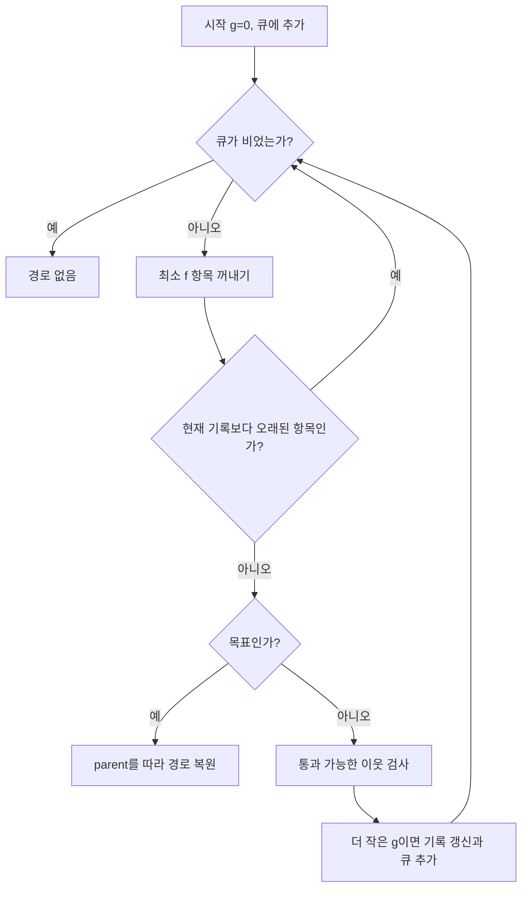

<callout icon="🧪" color="blue_bg">
	**길찾기의 정답과 로딩 결과를 언제 적용할지는 서로 다른 문제입니다.**
	C++20 · <mention-date start="2026-10-13"/> · 실습 `src/pathfinding.cpp`, `src/tile_document.cpp`
</callout>
<mention-page url="https://app.notion.com/p/3bde90ebffa44ef0a6455ca8e68a7886">게임 수학·MFC — 개정판 v1.0</mention-page>
<table_of_contents color="gray"/>
## 1. 먼저 이동 규칙을 고정합니다
이번 Grid는 폭·높이 각각 1\~256이며, 길찾기에서는 타일 ID 0만 통과 가능하고 나머지는 막힌 칸입니다. 상하좌우 네 방향, 한 칸 비용 1, 정적인 맵을 전제로 합니다. 화면에서 마름모로 보인다고 경로 그래프의 연결 규칙이 저절로 바뀌지 않습니다.
DFS는 도달 여부를 찾을 수 있지만 일반적으로 최단 경로를 보장하지 않습니다. 모든 간선 비용이 같은 이 모델에서는 BFS가 최단 이동 횟수의 비교 기준이 됩니다. A\*는 목표까지의 추정치를 이용해 후보 확장의 우선순위를 정합니다. 항상 BFS보다 빨리 끝나거나 최적 결과를 무조건 보장하는 마법 함수는 아닙니다.
## 2. g와 h를 혼동하지 않습니다
$$
f(n)=g(n)+h(n)
$$
g는 시작에서 현재 노드까지 **실제로 발견한 경로의 누적 비용**이고, h는 현재에서 목표까지 남은 비용의 추정치입니다. 시작과 현재의 직선 거리를 g 대신 쓰면 벽을 돌아온 비용을 잃습니다.
이 실습에서는 h를 맨해튼 거리 `abs(goal.x-x)+abs(goal.y-y)`로 정합니다. 네 방향 단위 비용 이동에 맞는 하한이며 일관된 휴리스틱입니다. 대각선이나 지형 가중치를 추가하면 이동 비용과 휴리스틱을 함께 다시 정해야 합니다. 실제 남은 비용보다 큰 추정치를 쓸 때는 최적성을 그대로 주장하지 않습니다.
개념 근거: [UC Berkeley CS188 — Informed Search](https://inst.eecs.berkeley.edu/~cs188/textbook/search/informed.html). 아래의 구현·테스트 조건은 이 실습의 선택입니다.
## 3. A\*의 핵심은 더 좋은 경로를 발견할 때 갱신하는 것입니다
우선순위 큐에는 `(f,g,노드ID)`를 넣습니다. 노드마다 최선 g와 parent를 저장하고, 이웃으로 가는 새 비용이 더 작으면 둘을 갱신합니다. 큐에 같은 노드가 여러 번 들어갈 수 있으므로 꺼낸 g가 현재 기록과 다르면 오래된 항목으로 건너뜁니다.

목표를 처음 이웃으로 발견했다는 이유만으로 일반적인 A\*를 종료하지 않습니다. 이 구현은 유효한 최소 항목으로 목표를 꺼냈을 때 종료합니다. 경로는 parent를 역추적한 뒤 뒤집습니다. close 목록에 들어간 순서를 그대로 이동 경로로 사용하지 않습니다.
이번 구현은 명시적인 closed 집합 대신 최선 거리와 오래된 큐 항목 검사를 사용합니다. 재귀 함수 호출로 탐색 순서를 흉내 내기보다 큐·거리·parent를 분리해 디버깅하기 쉽게 만들었습니다. 한 칸 맵, 시작=목표, 막힌 시작/목표, 도달 불가도 정상적인 입력 결과로 처리합니다.
## 4. 작은 입력에서 다른 알고리즘과 대조했습니다
3×3 격자의 장애물 배치는 2⁹=512개입니다. 각 배치마다 시작 9개와 목표 9개를 조합하여 **41,472개 시나리오**를 확인했습니다. 별도 BFS 구현으로 도달 여부와 최단 길이를 구하고 A\* 결과와 비교했습니다.
반환 경로가 시작·목표를 포함하는지, 각 점이 통과 가능한지, 연속된 두 점이 상하좌우 이웃인지도 검사했습니다. 경로의 원소 수는 이동 횟수보다 1 많습니다. 이 검사는 작은 격자 전체에 대한 강한 회귀 검사지만, 가중 그래프·대각선·이동 장애물·대규모 지도까지 검증한 것은 아닙니다.
`pathfinding`의 조건 검사 횟수 93,561에는 각 경로 원소 검사도 포함됩니다. 93,561개의 독립된 게임 기능을 검증한 것으로 해석하지 않습니다.
## 5. 작업 스레드에는 값의 스냅샷을 전달합니다
UI 스레드가 편집하는 맵을 작업 스레드가 동시에 읽으면 동기화 문제가 생길 수 있습니다. 작은 맵 실습은 값을 복사해 작업에 넘기고, 결과를 받은 쪽이 현재 문서에 적용할지 판단합니다.
```c++
// tile_document.cpp의 흐름을 요약한 코드입니다.
auto job = std::async(std::launch::async,
    [snapshot = study::Grid(3, 3)] {
        return study::AStar(snapshot, {0, 0}, {2, 2});
    });
auto path = job.get();
```
완전한 예제에는 `<future>`와 공통 헤더가 필요합니다. 위처럼 바로 get하면 기다릴 수 있으므로 GUI에서는 완료 확인·메시지 전달·작업 큐 등의 방식으로 긴 대기를 UI 루프 밖에서 관리해야 합니다.
작업을 제출한 맵의 개정 번호와 현재 번호가 다르면 결과가 오래되었을 수 있습니다. 실습은 서로 다른 번호를 구분하는 조건을 확인할 뿐, 실제 MFC 비동기 메시지 시스템이나 취소 가능한 작업 풀을 완성한 것은 아닙니다. 실무 적용에서는 취소 요청, 종료 시 join, 예외 전달, 결과 수명, 동일 버전 결과의 적용 정책이 필요합니다.

UI 컨트롤과 그래픽 자원을 작업 스레드가 마음대로 수정하게 두지 않는 것을 기본 설계로 삼습니다. 파일 읽기·파싱과 GPU 자원 생성·표시를 구분하세요. COM 초기화나 D3D 장치의 스레딩 규칙은 각 API의 별도 계약입니다.
## 6. 스레드·교착·단편화 설명을 교정합니다
스레드는 실행 경로이며 각자 스택·레지스터 상태 등을 갖고 프로세스의 자원을 공유합니다. 컨텍스트 스위칭이 사라지는 것이 아니고, 몇 배 빠르다는 고정 비율도 없습니다. 같은 값을 여러 스레드가 수정하는 상황은 단순한 ‘병목’이 아니라 데이터 경쟁이 될 수 있습니다. 락 두 개를 사용한다고 언제나 교착이 되는 것도 아닙니다. 획득 순서와 서로 기다리는 의존성을 분석해야 합니다.
[Microsoft — C와 Win32의 멀티스레딩](https://learn.microsoft.com/cpp/parallel/multithreading-with-c-and-win32). 이 문서에서 제공한 실행 검증은 경로 작업의 값 전달 예이며 ThreadSanitizer나 Windows 경쟁 조건 검사 결과가 아닙니다.
구조체 패딩은 타입 정렬을 위한 객체 내부 공간이며, 힙의 빈 조각이 흩어지는 외부 단편화와 동일하지 않습니다. 메모리 풀은 할당 방식, 스레드 풀은 작업 실행 자원을 재사용하는 방식입니다. 이름에 풀이 붙는다고 같은 해결책이 아니고, 둘 다 수명·용량·실패 처리 비용이 있습니다.
## 7. 공통 실습 팩 구성과 실제 결과
<table fit-page-width="true" header-row="true">
<tr>
<td>실행 파일</td>
<td>내용</td>
<td>조건 검사</td>
</tr>
<tr>
<td>vector_motion</td>
<td>내외적·정규화·이동·각도·점프</td>
<td>19</td>
</tr>
<tr>
<td>transforms</td>
<td>SRT·역변환·법선·카메라</td>
<td>29</td>
</tr>
<tr>
<td>geometry</td>
<td>충돌·선분·마름모 타일 피킹</td>
<td>78</td>
</tr>
<tr>
<td>loop_input</td>
<td>고정 시간 단계·입력 에지·애니메이션</td>
<td>484</td>
</tr>
<tr>
<td>tile_document</td>
<td>편집·실행 취소·파싱 실패·작업 스냅샷</td>
<td>26</td>
</tr>
<tr>
<td>pathfinding</td>
<td>A\*와 독립 BFS 대조</td>
<td>93,561</td>
</tr>
</table>
총 94,197회 조건 검사를 GCC 14.2.0 / Clang 17.0.0 / Clang ASan·UBSan 구성에서 각각 통과했습니다. 세 번 실행한 값을 서로 다른 조건 282,591개로 합산하지 않습니다. 산술·메모리 진단은 실행된 경로에 관한 결과이며 수학적 안전성 증명이나 완전한 테스트 커버리지가 아닙니다.
Windows GUI 예제는 별도 `windows/winapi_demo.cpp`에 있습니다. 이 환경에는 Windows SDK·MFC·GUI 실행 환경이 없어 해당 파일은 **정적 검토만 수행했고 컴파일·실행하지 않았습니다**. D3D9·D3DX·FMOD 바이너리도 팩에 포함하거나 실행하지 않았습니다.
## 8. 이해 확인과 다음 연결
<details>
<summary>A\*가 반환한 길이가 BFS와 같은데 경로 모양이 다르면 오류일까?</summary>
	최단 경로가 여러 개일 수 있습니다. 비용과 이동 규칙이 맞고 각 단계가 유효한지 확인합니다. 정확히 같은 모양이 필요하다면 후보 순서와 동률 처리도 계약으로 정해야 합니다.
</details>
<details>
<summary>길찾기 중 사용자가 벽을 추가했다면 결과를 그대로 써도 될까?</summary>
	계산 당시 스냅샷에는 새 벽이 없을 수 있습니다. 결과의 버전·현재 맵을 확인하고 폐기·재계산·경로 재검증 정책 중 하나를 적용해야 합니다.
</details>
다음 그래픽스 작업은 **DX9 렌더링 파이프라인**입니다. 이 묶음의 행렬·좌표계를 정점 입력과 클립 공간, 뷰포트까지 이어서 다룹니다. 게임 엔진 아키텍처 책의 기존 장은 이 작업 범위가 아닙니다.
