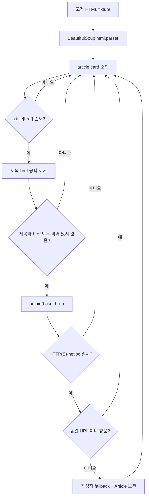

# Notion 학습 원본 보존

원본: https://app.notion.com/p/3fda99703f408164a6f6f6006e6be923

> 이 파일은 프로토타입 시점의 Notion 원문입니다. 변환 시 누락 여부 확인과 링크 추적용입니다.

**2026-10-19 05시 최신 보관 상태:** Python 전체 `main.py` 4,202B(<mention-page url="https://app.notion.com/p/3fda99703f408119b69ff07c046d09f5">PY03B · main.py 전체 소스 v1.1 (빈 href 회귀 포함)</mention-page>), C++ 전체 `main.cpp` 4,164B(PY03C1·C2·C3 네이티브 분할 페이지), CMake 451B(PY03A) 저장·재조회. Python·C++ 코드 FNV64 원본 일치. **원시 로그 진도: 9단계의 stdout·stderr 기록 모두 Notion 네이티브 코드로 보존 확인**. GCC14 C++20은 이 페이지 하단, GCC14 C++11은 PY03D, Clang17 ASan/UBSan은 PY03E에 있습니다. 원본 ZIP 대비 stdout 9종 코드 텍스트와 마지막 개행을 대조하여 FNV64 9/9개 일치를 확인했습니다. 첨부 파일로 내려받은 바이트의 독립 검증은 아직 하지 않았습니다. 아래의 과거 ‘소스 미보관’ 문구는 해당 작성 당시 상태이며 이 안내가 우선합니다.
<callout icon="🔎" color="blue_bg">
	**PY03 · BeautifulSoup 선택자·오프라인 HTML fixture 계약** — 기존 PY02(표준 라이브러리 기반 요청·페이지 탐색)와 별개로, *수집된 HTML을 실제 사이트 접속 없이* 파싱하고 검증하는 진행 중인 실습입니다. 예제의 news.example는 가상의 출처이며 서버 요청을 하지 않습니다.
</callout>
## 1. 정의와 전제
**크롤링(crawling)**은 문서를 발견하고 가져오는 과정이며, **파싱(parsing)**은 이미 받은 HTML로부터 구조화된 항목을 추출하는 단계입니다. `BeautifulSoup(html, "html.parser")`는 브라우저가 아닙니다. JavaScript를 실행하거나 서버에 HTTP 요청을 보내지 않습니다. CSS 선택자는 현재 HTML 구조에 종속되며 실제 사이트의 클래스명이 바뀌면 결과도 달라집니다.
- 환경: Python **3.9 이상**(예제 타입 힌트 `list[Article]`, dataclass), bs4 **4.14.3**로 Linux Python **3.13.5**에서 재검증. 외부 HTML이나 사이트 접근은 하지 않음.
- 입력: 고정 `<article class="card"><a class="title" href="/post/1">...</a></article>` 목록, `base_url`은 완전한 HTTP(S) URL. 출력은 제목·절대 URL·작성자라는 세 필드를 가진 불변 `Article` 목록.
- 정책(목표): 제목·`href`가 비었거나 JavaScript/외부 주소인 카드는 제외하고 URL 중복은 **첫 항목 보존**. 최초 버전에서는 `href=""` 또는 공백만 있는 `href`가 base URL로 바뀌어 수용되는 오류가 있었습니다. 2026-10-19 수정본 `main.py` v1.1(4,202바이트)에 URL 결합 전 빈 문자열 검사를 추가하고 2개 회귀 검사를 포함한 unittest 10/10 통과를 확인했으며, 전체 소스가 PY03B 하위 페이지에 영구 저장·재조회됐습니다. 현재 GCC14 C++20/C++11·Clang17 ASan/UBSan Configure·Build·CTest 9단계 로그의 네이티브 코드 저장과 FNV64 교차 검증이 완료됐습니다. 다만 첨부 파일 자체의 다운로드·바이너리 검증과 Windows/DX11/Unity 실행은 미검증입니다. 허용 URL 검사도 `netloc` 문자열 일치까지만 보장합니다. 이는 교육용 보수적 검사이며 RFC 전체 URL 정규화나 SSRF 방어의 충분조건은 아닙니다.
## 2. 작동 과정

## 3. 선택자·검증 비교
<table fit-page-width="true" header-row="true">
<tr>
<td>단계</td>
<td>Python 실제 HTML 파서</td>
<td>C++11/20 비교 CPU 모델</td>
</tr>
<tr>
<td>입력</td>
<td>HTML 문자열을 `BeautifulSoup`로 파싱</td>
<td>이미 추출된 카드 레코드 목록</td>
</tr>
<tr>
<td>선택자</td>
<td>`article.card`, `a.title[href]`, `.author`</td>
<td>HTML 파싱 없음(선택자 미지원)</td>
</tr>
<tr>
<td>URL</td>
<td>`urljoin`  • `urlsplit`의 scheme/netloc 검증</td>
<td>허용 목록에 지정한 origin + 루트 상대 경로의 **제한된** 합성</td>
</tr>
<tr>
<td>중복</td>
<td>URL Set: 첫 출현 보존</td>
<td>`std::unordered_set`: 첫 출현 보존</td>
</tr>
<tr>
<td>용도</td>
<td>오프라인 뉴스·게임 패치 노트 카드 추출 테스트</td>
<td>게임 에셋 메타데이터를 가져온 뒤 정규화 계약 확인</td>
</tr>
</table>
## 4. 반례와 실패 경계
1. 클래스가 `card`에서 다른 이름으로 바뀌면 결과 0건일 수 있습니다. 이는 "사이트에 게시물이 없음"의 증거가 아닙니다.
2. `javascript:`, 프로토콜 상대 외부 주소, 외부 host, 빈 제목·href, 중복 URL은 무시합니다. 첫 번째 유효한 카드가 마지막 같은 URL보다 우선합니다.
3. HTML 엔티티·공백·유니코드의 처리와 작성자 누락 시 `(unknown)` 대체를 테스트합니다. **수정 완료된 과거 반례:** 초기 `main.py`는 `href=""`와 `href="   "`를 `https://news.example/` 기사로 잘못 수용했습니다(과거 Python 3.13.5 재현). v1.1은 URL 결합 전에 공백 제거 및 빈 링크 검사를 수행하며 2개 회귀 테스트를 추가한 unittest 10/10 통과를 확인했습니다. 수정본 전체 소스는 PY03B에 4,202바이트로 보관하고 FNV64를 대조했습니다. C++ 빌드·CTest 9단계 원시 텍스트는 2026-10-19 후속 개정에서 Notion에 보존했습니다. 네이티브 코드 텍스트 대조는 완료했으나 첨부 바이너리의 재다운로드 검증은 별개로 남아 있습니다.
4. `urlsplit(...).netloc` 단순 비교는 문자적 동일성을 확인할 뿐 IDNA·기본 포트·URL canonicalization·리다이렉트·DNS 주소·HTTPS 정책의 전부를 보장하지 않습니다. **프로덕션 HTTP fetcher에 그대로 사용하면 안 됩니다.**
5. robots.txt, 이용 약관, 인증, 접근 제한, 429 응답 등은 별도 HTTP 수집 단계의 책임입니다. 이 실습에서는 HTTP/JavaScript/브라우저를 실행하지 않았습니다.
## 5. 전체 소스, 빌드와 실제 테스트
- **보관 상태(진행 중):** CMake 전체 원본은 하위 페이지에 보존했지만 Python 전체 `main.py`는 PY03B 하위 페이지에 4,202바이트 네이티브 코드로 저장·FNV64 검증했습니다. C++ `main.cpp` 전체 4,164바이트도 PY03C1·C2·C3 하위에 3분할 저장·재조회하여 FNV64가 일치했습니다. 원시 Configure·Build·CTest 9단계 모두 Notion 네이티브 코드 블록으로 저장했습니다. GCC C++20은 현재 본문, GCC C++11은 <mention-page url="https://app.notion.com/p/3fda99703f40819ba84fe5bd84756ab9">PY03D · GCC C++11 원시 로그 기록</mention-page>, Clang ASan/UBSan은 <mention-page url="https://app.notion.com/p/3fda99703f408171ac50e276fb309b15">PY03E · Clang 17 ASan/UBSan 원시 로그 기록</mention-page>에 보관했습니다. 세 환경 stdout 9종의 코드 텍스트와 로컬 원시 기록을 비교해 FNV64 9/9개 일치를 확인했습니다. 원시 파일의 Notion 첨부 다운로드 검증은 별도 미완료입니다. 완료 단원으로 집계하지 않습니다. C++ 예제는 HTML 파싱 구현이 아니라 후처리 레코드 계약 모델입니다.
- Linux 환경 최초 Python 테스트 **8/8 통과**, 2026-10-19 수정 후 회귀 테스트 **10/10 통과** (<mention-page url="https://app.notion.com/p/3fda99703f4081d4a4c2f6c4210d22c9">PY03 · 2026-10-19 빈 href 오류 교정·10/10 CPU 로그</mention-page> 참조). 수정본 `python3 main.py --selftest`의 **10/10 통과**, `python3 -m py_compile main.py` 통과, fixture JSON 생성. GCC **14.2.0** C++20·C++11, Clang **17.0.0** C++20 ASan/UBSan의 `ctest -V`가 각각 **1/1 통과**했고, 같은 **11개 논리 검사**를 세 번 반복했습니다(독립 테스트는 11개).
- Windows/MSVC, GPU/DX9/DX11, Unity Editor, 실사이트 데이터 및 HTTP 연결, sanitizer가 보장하지 않는 논리 안전성은 **미검증**입니다. 테스트는 고정 fixture의 CPU 관찰값입니다.
## 6. 접힌 이해 확인
<details>
<summary>Q1. Python 요청 결과에 없지만 브라우저 화면에는 보이는 글을 `BeautifulSoup`로 직접 찾을 수 있나요?</summary>
	대개 아닙니다. 브라우저의 JavaScript 렌더링 뒤 DOM에 추가됐을 수 있습니다. 우선 실제 HTTP 원시 응답과 공식 API 여부를 확인합니다.
</details>
<details>
<summary>Q2. 카드 `href`만 URL을 읽을 수 있으므로 항상 안전한가요?</summary>
	아닙니다. `javascript:`, protocol-relative, 외부 host 및 리다이렉트를 별도로 검증해야 합니다. 이 예제는 데이터 추출 실습이며 프로덕션 SSRF 방어가 아닙니다.
</details>
<details>
<summary>Q3. Python의 수정 후 10개 unittest와 C++의 11개 논리 검사를 각각 수행했다면 검사를 어떻게 집계하나요?</summary>
	Python은 기존 8개에 빈 href 회귀 검사 2개를 더한 10개입니다. C++ 계약 모델은 고유 논리 조건 11개를 GCC C++20·C++11·Clang ASan/UBSan 세 환경에서 반복했습니다. 따라서 환경 반복 33회를 독립적인 33개 C++ 조건으로 세지 않습니다. Python unittest 10개와 C++ 논리 조건 11개는 서로 다른 대상의 검사이며, 동일 의미 검사의 중복 가능성을 따로 고려합니다.
</details>
## 7. 참고·변경 이력
- [Beautiful Soup 공식 문서](https://www.crummy.com/software/BeautifulSoup/bs4/doc/) · [Python urljoin](https://docs.python.org/3/library/urllib.parse.html#urllib.parse.urljoin) · [Python unittest](https://docs.python.org/3/library/unittest.html) · [CMake CTEST](https://cmake.org/cmake/help/latest/manual/ctest.1.html).
- 기존 PY02 요청·페이지 탐색 문서는 <mention-page url="https://app.notion.com/p/3fba99703f408148a00be7d6e1473c2e"/>이며, 과거 Naver/Melon 메모 <mention-page url="https://app.notion.com/p/d0b2d7867308442bbc28d65a686d1936"/>는 삭제·교체하지 않았습니다.
- <mention-date start="2026-10-19"/> v1.1: 초기 고정 HTML 파서 8 unittest에서 빈 href와 공백 href 반례 2개를 추가하고 수정해 10 unittest를 검증했습니다. C++ 후처리 모델의 고유 조건은 11개이며 CMake 전체 원문은 별도 페이지에 보관했습니다. 수정된 Python `main.py` 전체 4,202바이트는 PY03B에 저장하고 FNV64로 대조했습니다. C++ 전체 `main.cpp` 4,164바이트도 PY03C1/C2/C3에 3분할 보존·재조합 후 FNV64 일치를 확인했습니다. **환경별 Configure·Build·CTest 9단계의 stdout/stderr 텍스트 보존과 FNV64 9/9개 일치를 확인**했습니다. GCC14 C++20은 현재 본문, GCC14 C++11은 PY03D, Clang17 ASan/UBSan은 PY03E 참조. 실제 첨부 다운로드·플랫폼별 실행 검증은 남아 있으며 단원 전체 완료 여부는 종합 검수 후 확정합니다.
<page url="https://app.notion.com/p/3fda99703f4081eb97dcdda5d9910a21">PY03A · CMake 빌드 계약 원본</page>
<page url="https://app.notion.com/p/3fda99703f4081d4a4c2f6c4210d22c9">PY03 · 2026-10-19 빈 href 오류 교정·10/10 CPU 로그</page>
<page url="https://app.notion.com/p/3fda99703f408119b69ff07c046d09f5">PY03B · [main.py](http://main.py) 전체 소스 v1.1 (빈 href 회귀 포함)</page>
<page url="https://app.notion.com/p/3fda99703f408136bef0cc404494149e">PY03C1 · main.cpp 원본 1/3 · 헤더 및 URL 계약</page>
<page url="https://app.notion.com/p/3fda99703f4081e895d2f62114cc870d">PY03C2 · main.cpp 원본 2/3 · 카드 정규화·중복 방지</page>
<page url="https://app.notion.com/p/3fda99703f40811bb6cacedea20ec87e">PY03C3 · main.cpp 원본 3/3 · CPU 테스트 main</page>
## PY03 2026-10-19 05시 CPU 실행 원시 로그 보관 1/3 · GCC14 C++20
기존 실행 결과의 Configure·Build·CTest 단계별 stdout/stderr와 원본 바이트·SHA-256 정보를 인용했습니다. 이는 07시 신규 CPU 실행이 아닙니다. 로그 바이트의 실제 바이너리 재다운로드 검증은 별도 미수행입니다.
### gcc20
#### configure
`logs/gcc20/configure.stdout.log` · 394바이트 · FNV64 `96dfa4a8684fa3a1` · SHA-256 `f80da1cc5efcaf76436c8624c782f923b896710e7fda10cdc731cdb9018516ef`
```plain text
-- The CXX compiler identification is GNU 14.2.0
-- Detecting CXX compiler ABI info
-- Detecting CXX compiler ABI info - done
-- Check for working CXX compiler: /usr/bin/g++ - skipped
-- Detecting CXX compile features
-- Detecting CXX compile features - done
-- Configuring done (0.4s)
-- Generating done (0.0s)
-- Build files have been written to: /mnt/data/notion_run_20261019_05/build_gcc20

```
`logs/gcc20/configure.stderr.log` · 100바이트 · FNV64 `be2900569afdd140` · SHA-256 `62cc6d56ba65533ce3f4437c4c7ba2604bca036e56473e28f25961b3fda155ae`
```plain text
CMake Warning:
  Manually-specified variables were not used by the project:

    CMAKE_C_COMPILER


```
#### build
`logs/gcc20/build.stdout.log` · 145바이트 · FNV64 `6fd1afb061fdae02` · SHA-256 `f5d1c8052cebd3080c9a060bd7a063dee0bf30d7a23f44e7f8fd661f25c728fb`
```plain text
[ 50%] Building CXX object CMakeFiles/card_contract.dir/main.cpp.o
[100%] Linking CXX executable card_contract
[100%] Built target card_contract

```
`logs/gcc20/build.stderr.log` · 0바이트 · FNV64 `cbf29ce484222325` · SHA-256 `e3b0c44298fc1c149afbf4c8996fb92427ae41e4649b934ca495991b7852b855`
*(0바이트 빈 파일)*
#### ctest
`logs/gcc20/ctest.stdout.log` · 980바이트 · FNV64 `dd82ec8f1dca5de5` · SHA-256 `caa6af3d243f760c678896174885351995d7f1a4f2f4e0bc7710312657d0a2f6`
```plain text
Internal ctest changing into directory: /mnt/data/notion_run_20261019_05/build_gcc20
UpdateCTestConfiguration  from :/mnt/data/notion_run_20261019_05/build_gcc20/DartConfiguration.tcl
UpdateCTestConfiguration  from :/mnt/data/notion_run_20261019_05/build_gcc20/DartConfiguration.tcl
Test project /mnt/data/notion_run_20261019_05/build_gcc20
Constructing a list of tests
Done constructing a list of tests
Updating test list for fixtures
Added 0 tests to meet fixture requirements
Checking test dependency graph...
Checking test dependency graph end
test 1
    Start 1: offline_card_contract

1: Test command: /mnt/data/notion_run_20261019_05/build_gcc20/card_contract "--test"
1: Working Directory: /mnt/data/notion_run_20261019_05/build_gcc20
1: Test timeout computed to be: 10000000
1: PASS 11 deterministic normalization checks
1/1 Test #1: offline_card_contract ............   Passed    0.00 sec

100% tests passed, 0 tests failed out of 1

Total Test time (real) =   0.01 sec

```
`logs/gcc20/ctest.stderr.log` · 0바이트 · FNV64 `cbf29ce484222325` · SHA-256 `e3b0c44298fc1c149afbf4c8996fb92427ae41e4649b934ca495991b7852b855`
*(0바이트 빈 파일)*
<page url="https://app.notion.com/p/3fda99703f40819ba84fe5bd84756ab9">PY03D · GCC C++11 원시 로그 기록</page>
<page url="https://app.notion.com/p/3fda99703f408171ac50e276fb309b15">PY03E · Clang 17 ASan/UBSan 원시 로그 기록</page>

---

## 부록 · 전체 소스 원본
## Python 3.9+ 실행 가능한 전체 원본 `main.py` (4202 ASCII bytes)
기존 PY03 수정본입니다. 소스 SHA-256 `a16fa28cb35a418047d656a1dc74010063e9264fbb2811f45fadb5a23f365df7`.
```python
#!/usr/bin/env python3
"""Offline, deterministic HTML card extraction; Python 3.9+; no network calls.

For comparison with C++11/C++20: the parsing contract is language-independent,
but this implementation is Python-specific and uses BeautifulSoup 4.
"""
from dataclasses import asdict, dataclass
from urllib.parse import urljoin, urlsplit
import json
import sys
import unittest
from bs4 import BeautifulSoup


@dataclass(frozen=True)
class Article:
    title: str
    url: str
    author: str


def extract(html: str, base_url: str) -> list[Article]:
    """Parse cards without I/O; exclude malformed/foreign links, deduplicate URLs."""
    base = urlsplit(base_url)
    if base.scheme not in ("http", "https") or not base.netloc:
        raise ValueError("base_url must be an absolute HTTP(S) URL")
    soup = BeautifulSoup(html, "html.parser")
    seen = set()
    output = []
    for card in soup.select("article.card"):
        link = card.select_one("a.title[href]")
        if link is None:
            continue
        title = link.get_text(" ", strip=True)
        href = (link.get("href") or "").strip()
        if not href:
            continue
        url = urljoin(base_url, href)
        dest = urlsplit(url)
        if not title or dest.scheme not in ("http", "https") or dest.netloc != base.netloc:
            continue
        if url in seen:
            continue
        author_node = card.select_one(".author")
        author = author_node.get_text(" ", strip=True) if author_node else ""
        output.append(Article(title, url, author or "(unknown)"))
        seen.add(url)
    return output


FIXTURE = """<main>
<article class="card"><a class="title" href="/post/1"> First </a><b class="author"> Ada </b></article>
<article class="card"><a class="title" href="/post/1">Duplicate</a></article>
<article class="card"><a class="title" href="/post/2">Second</a></article>
<article class="card"><span class="author">Missing link</span></article>
<article class="card"><a class="title" href="/blank"> </a></article>
<article class="card"><a class="title" href="javascript:alert(1)">Unsafe</a></article>
<article class="card"><a class="title" href="https://other.example/x">External</a></article>
</main>"""


class ParserTests(unittest.TestCase):
    def test_two_valid_cards(self):
        self.assertEqual([a.title for a in extract(FIXTURE, "https://news.example/")], ["First", "Second"])

    def test_relative_link_and_author(self):
        self.assertEqual(extract(FIXTURE, "https://news.example/")[0], Article("First", "https://news.example/post/1", "Ada"))

    def test_deduplicates(self):
        self.assertEqual(len(extract(FIXTURE, "https://news.example/")), 2)

    def test_missing_author_uses_fallback(self):
        self.assertEqual(extract(FIXTURE, "https://news.example/")[1].author, "(unknown)")

    def test_ignores_incomplete_cards(self):
        self.assertEqual(extract('<article class="card"><a class="title">No href</a></article>', "https://news.example/"), [])

    def test_rejects_foreign_and_javascript_links(self):
        bad = '<article class="card"><a class="title" href="//evil.example/x">Off site</a></article>'
        self.assertEqual(extract(bad, "https://news.example/"), [])
        self.assertEqual(len(extract(FIXTURE, "https://news.example/")), 2)

    def test_empty_href_is_rejected(self):
        html = '<article class="card"><a class="title" href="">Valid title</a></article>'
        self.assertEqual(extract(html, "https://news.example/"), [])

    def test_whitespace_href_is_rejected(self):
        html = '<article class="card"><a class="title" href="   ">Valid title</a></article>'
        self.assertEqual(extract(html, "https://news.example/"), [])

    def test_empty_document(self):
        self.assertEqual(extract("", "https://news.example/"), [])

    def test_invalid_base_url(self):
        with self.assertRaises(ValueError):
            extract(FIXTURE, "relative/path")


if __name__ == "__main__":
    if "--selftest" in sys.argv:
        unittest.main(argv=[sys.argv[0]], verbosity=2)
    else:
        print(json.dumps([asdict(a) for a in extract(FIXTURE, "https://news.example/")], ensure_ascii=False, indent=2))
```
## 실행
`python3 -m py_compile main.py` / `python3 main.py --selftest` / `python3 main.py`.
실제 오프라인 회귀 10개(빈 href 2개 포함). Windows·HTTP 미검증.
